轴的运动由控制器发脉冲控制，脉冲的方向决定电机的转向，根据发送脉冲的频率控制轴运动的快慢。

## 3. 轴类型(ZAux\_Direct\_SetAtype)=3 或 6:编码器轴

编码器单独占用一个轴号时，根据编码器类型，轴类型可选 3或6。

## 4. 轴类型(ZAux\_Direct\_SetAtype)=4 脉冲轴和编码器轴共用轴号

当前的脉冲轴带编码器反馈时，轴类型设为 4，脉冲输出和编码器输入信号在同一个轴上。

## 5. 轴类型(ZAux\_Direct\_SetAtype)=8:CAN 扩展轴

使用 CAN 总线扩展轴时，扩展的脉冲轴的轴类型设成 8，扩展轴上接入编码器轴的轴类型设为9。

## 6. 轴类型(ZAux\_Direct\_SetAtype)=21:振镜轴号

接入激光振镜设备时，需要将振镜轴类型设为 21，激光振镜轴部分型号支持。

## 7. 轴类型(ZAux\_Direct\_SetAtype)=50,51,52 : RTEX 总线轴

使 用 RTEX 总 线 驱 动 器 时 ， 轴 类 型 只 能 在 以 上 三 个 中 选 择 ， 其 中轴类型(ZAux\_Direct\_SetAtype)=50 是 位 置 模 式 ， 使 用 运 动 指 令 控 制 电 机 运 行 ； 轴类型(ZAux\_Direct\_SetAtype)=51 速度模式，速度模式下使用 DAC 指令设置电机的运行速度，并持续运行；轴类型(ZAux\_Direct\_SetAtype)=52 力矩模式，力矩模式下使用 DAC 指令设置电机的力矩，并持续运行.

速 度和 力矩 模式下 若要 切换 模式 ，为防 止事 故， 先将 DAC 置 0 后再 使用ZAux\_Direct\_SetAtype 指令切换。

注意：修改轴类型(ZAux\_Direct\_SetAtype)切换到力矩模式之前，请先将驱动器参数Pr6.47 的第一位置为 0，关闭 2 自由度控制模式。再通过参数 Pr3.17 设置速度限制。当Pr3.17(速度限制选择)的设定值是 0 时，通过 Pr3.21 设置速度限制，设定值是 1 时，可以通过 SL\_SW 切换转矩控制时的速度限制值采用 Pr3.21 还是 Pr3.22。

## 8. 轴类型(ZAux\_Direct\_SetAtype)=65,66,67 EtherCAT 总线轴号

使用 EtherCAT 总线驱动器时，轴类型只能在以上三个中选择，其中轴类型(ZAux\_Direct\_SetAtype)=65 是 位 置 模 式 ， 使 用 运 动 指 令 控 制 电 机 运 行 ； 轴类型(ZAux\_Direct\_SetAtype)=66 速度模式，速度模式下使用 DAC 指令设置电机的运行速度，并 持 续 运 行 ， 速 度 单 位 有 两 个 ， 脉 冲 数/S 和 R/MIN， 由 驱 动 器 确 定 ；轴 类 型(ZAux\_Direct\_SetAtype)=67 力矩模式，力矩模式下使用 DAC 指令设置电机的力矩，并持续运行，力矩控制模式下DAC值范围0-1000，对应0-100%。

速度和力矩模式下若要切换模式，为防止事故，先将 DAC 置 0 后再使用轴类型(ZAux\_Direct\_SetAtype)指令切换。

## 5.1.2-3 轴速度

速度曲线一般分为三个阶段：加速阶段、匀速阶段、减速阶段，如下图所示。

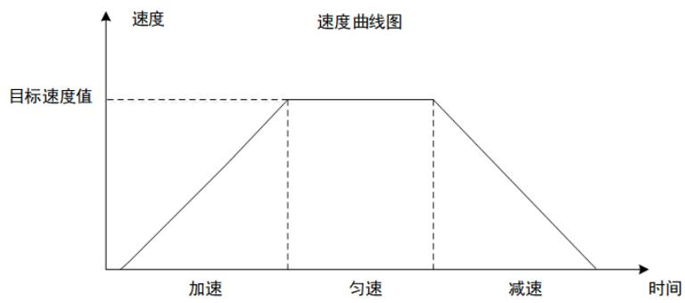  
当位移较短时，可能不存在匀速阶段，仅有加减速阶段，如下图所示。

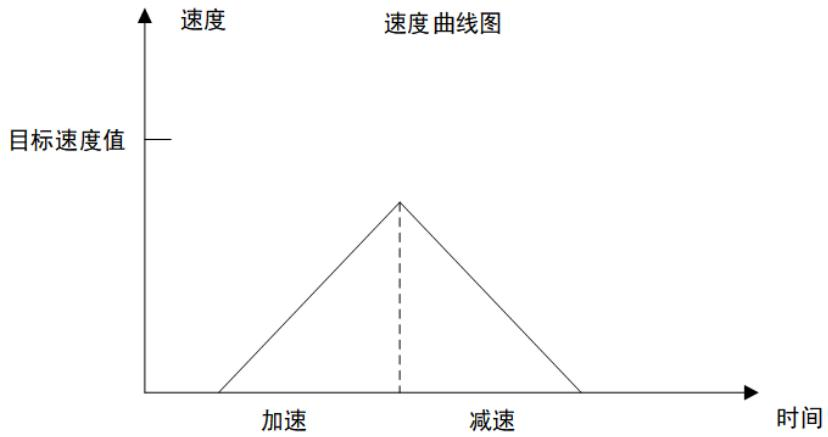

常用的速度指令有 ZAux\_Direct\_SetSpeed 设置运动速度，ZAux\_Direct\_SetAccel 加速度，ZAux\_Direct\_SetDecel 减速度，ZAux\_Direct\_SetFastDec 快减减速度（急停。报警、限位等情况下使用快减速速度快速停止运动）等，在轴参数初始化时设置完成，作为运动指令的速度参考。

## 梯形图曲线

不设置 SRAMP（令 SRAMP 等于 0。调用 ZAux\_Direct\_SetSramp 设置），速度曲线为梯形曲线，在此速度规划方式下，速度曲线按梯形曲线变化。保持速度、加减速度等参数值不变。

速度到达设定数值后匀速运动，若只设置加速度，减速度为 0时，减速度会自动等于加速度的值。一般在运动前就设置好相应的加减速，运动过程中不要修改，运动中调整会导致运动轨迹变化。如图：S曲线时间(ZAux\_Direct\_SetSramp)=0（加减速过程较快，速度变化对机床冲击较大。）

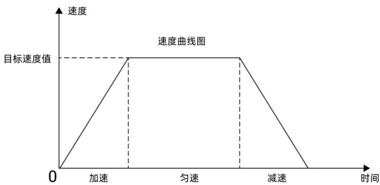  
例：假设目标速度值为：100，加速度为 1000，减速度为：1000 则：  
总加速时间=100/1000=0.1s  
总减速时间=100/1000=0.1s

## S 型曲线

通过调用ZAux\_Direct\_SetSramp来设定合适的加减速变化率，使得速度曲线平滑，在机械启停或加减速时减少抖动。S 曲线时间(ZAux\_Direct\_SetSramp)值的范围在 0 到梯形加速时间之间（单位ms），设置后加减速过程会变长相应的时间，时间越长速度曲线越平滑。设置时间若超过梯形加速时间，按照梯形加速时间进行。

当 S 曲线时间(ZAux\_Direct\_SetSramp)=50 时，得到 S 型曲线如下：加减速时更柔和。

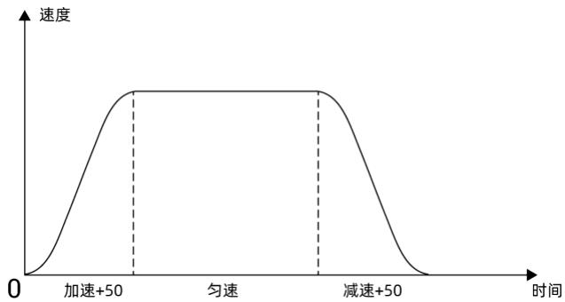

例：假设目标速度值为：100，加速度为 1000，减速度为：1000，S 曲线时间为 50ms，则：

总加速时间=100/1000 + 0.05=0.1s+0.05s=0.15s

总减速时间=100/1000 + 0.05=0.1s+0.05s=0.15s

## 5.1.2-4 脉冲当量

在运动控制装置中，当机械结构确定以后，电机和机械装置的传动关系也就固定了，电机每转一圈产生的机械位移量也就固定了。脉冲当量（ZAux\_Direct\_SetUnits）是每单位对应的脉冲数，可以是单位距离、单位角度等，支持 5 位小数精度。

控制器以脉冲当量（ZAux\_Direct\_SetUnits）作为基本单位，运动的目标位置、速度、加减速度等都是以脉冲当量（ZAux\_Direct\_SetUnits）作为基础单位来进行运算执行，脉冲当量（ZAux\_Direct\_SetUnits）修改后，目标位置、速度、加减速度等会随脉冲当量

（ZAux\_Direct\_SetUnits）改变成比例变化。

假设脉冲型运动控制器，控制器发 1000 个脉冲，设备机构走 1mm,则把脉冲当量 units设置为 1000 时，运动中 move 相关的指令，走 1mm，实际发了 1000 个脉冲。速度设置为100 个用户单位，则为 100mm/s，控制轴走 50 用户单位时则走 50mm。

语法：ZAux\_Direct\_SetUnits(控制器连接句柄，轴号，变量)

伺服脉冲当量设置：

减速比：即减速装置的传动比，是传动比的一种，是指减速机构中瞬时输入速度与输出速度的比值。

螺纹导程：是螺纹上任意一点沿同一条螺旋线转一周所移动的轴向距离，螺距指的是螺纹上相邻两牙对应点的轴向距离，代号是 P。单线螺纹的导程等于螺距，多线螺纹的导程等于头数（n）乘以螺距，即导程 S=nP。

若机构存在导程（单位 mm）以及减速机，则要把脉冲当量转换成 mm 为：

脉冲当量=电子齿轮比\*导程/ 编码器分辨率\*机械减速比

注：

1.电机转了 a 圈，减速机输出转了 b 圈，则减速比为：a:b

2.若电机直连丝杆，则机械减速比为 1：1

3.若轴为旋转轴，则导程为 360°

4.一圈脉冲数=编码器分辨率/电子齿轮比

## 步进脉冲当量设置：

步距角：一个脉冲，步进电机所转动的角度；

细分：把步距角细分成 N 等份，则一个脉冲，步进电机转动的角度为：步距角/细分

步进电机旋转一圈脉冲数为：360/（步距角/细分）=360\*细分/步距角

减速比：即减速装置的传动比，是传动比的一种，是指减速机构中瞬时输入速度与输出速度的比值。

螺纹导程：是螺纹上任意一点沿同一条螺旋线转一周所移动的轴向距离，螺距指的是螺纹上相邻两牙对应点的轴向距离，代号是 P。单线螺纹的导程等于螺距，多线螺纹的导程等于头数（n）乘以螺距，即导程 S=nP。

若机构存在导程（单位 mm）以及减速机，则要把脉冲当量转换成 mm 为：

脉冲当量=导程/（（360/（步距角/细分））\*减速比）=（导程\*步距角）/（360\*减速比\*细分）

注：

1.电机转了a圈，减速机输出转了 b圈，则减速比为：a:b

2.若电机直连丝杆，则机械减速比为 1：1

3.若轴为旋转轴，则导程为 360°

4.导程：电机旋转一周时，其推进面上任一点在轴向的前进距离。

5.步进电机默认是走一步转 1.8°的角度。则1.8°就是步距角的值。所以步进电机默认是360/1.8=200个脉冲一转，但是在一些机构里面精度要求高，1.8°不适合，所以就有了驱动器上面的细分数设置，比如说驱动器上面有一个 5 的细分，即角度缩小了 5 倍即 1.8/5=0.36，就是指电机每走一步转动的角度为 0.36°，360/0.36=1000个脉冲一转。

常见的几种机械传动的 UNITS（脉冲当量：ZAux\_Direct\_SetUnits）计算方式见下表。
<table><tr><td>机械 结构</td><td>图例</td><td>机械规格</td><td>编码器分辨率</td><td>UNITS</td></tr><tr><td>滚珠 丝杆</td><td>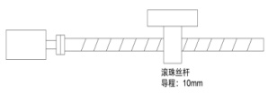</td><td>滚珠丝杆导程： 10mm 减速比：1：1</td><td>驱动器电子齿轮 比:1:1 编码器分辨率： 10000 1圈脉冲数： 10000</td><td>1 圈脉冲数÷丝杆 导程： UNITS=10000/10 =1000 即一个units 机构运 动1mm 如果圆台与电机直</td></tr><tr><td>圆台</td><td>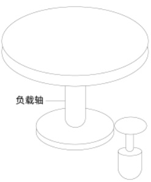</td><td>1圈旋转角度:360 减速比：1/5</td><td>驱动器电子齿轮 比:1:1 编码器分辨率： 10000 1圈脉冲数： 10000/1</td><td>连 电机一度脉冲=1圈 脉冲数/角度，则： UNITS=10000/360。 如果圆台通过减速 机联结到伺服电 机， 减速比1：5则电机 旋 转5°，机构旋转1° 则有1:5 减速结构 的 UNITS=10000/360/</td></tr><tr><td>皮带+ 皮带轮</td><td>皮带轮直径：Φ100mm</td><td>皮带轮直径： 100mm 皮带轮周长： 314mm 减速比:1/1</td><td>驱动器电子齿轮 比:1:1 编码器分辨率： 10000 1圈脉冲数： 10000/1</td><td>5。 1圈脉冲数/周长: UNITS=10000/314</td></tr></table>

## 例程

## 5.1.3-1 轴基本运动参数设置获取

// test1.cpp : 定义控制台应用程序的入口点。   
//   
#include "stdafx.h"   
#include <windows.h>   
#include "zmotion.h"   
#include "zauxdll2.h"   
void commandCheckHandler(const char \*command, int ret)   
if (ret)//非 0 则失败   
{   
printf("%s return code is %d\n", command, ret);   
}   
int \_tmain(int argc, \_TCHAR\* argv[])   
char \*ip\_addr = (char \*)"127.0.0.1"; //控制器出厂默认 IP 地址   
192.168.0.11,仿真器 IP 地址 127.0.0.1，仿真器连接需把仿真器打开   
ZMC\_HANDLE handle = NULL; //连接句柄   
int ret = ZAux\_OpenEth(ip\_addr, &handle); //连接控制器   
if (ERR\_SUCCESS != ret)   
{   
printf("connect controller failed!\n");   
handle = NULL;   
getchar();   
return -1;   
}   
printf("控制器连接成功！\n");

```c
ZAux_Direct_SetAtype(handle, 0, 1); //设置轴 0 轴 类型为 1
ZAux_Direct_SetUnits(handle, 0, 100); //设置轴 0 脉冲当量为 100
ZAux_Direct_SetSpeed(handle, 0, 200); //设置轴 0 速度为 200units/s
ZAux_Direct_SetAccel(handle, 0, 2000); //设置轴 0 加速度为 2000units/s/s
ZAux_Direct_SetDecel(handle, 0, 2000); //设置轴 0 减速度为 2000units/s/s
float dpos;
int ifIdle;
int status;
float DposValue;
int Atype;
float Units;
float Speed;
float Accel;
float Decel;
ret =ZAux_Direct_GetAtype(handle, 0, &Atype); //获取轴 0 轴类型
commandCheckHandler("ZAux_Direct_GetAtype", ret);//判断指令是否执行成功
printf("轴 0 轴类型 Atype = %d\n", Atype);
ret =ZAux_Direct_GetUnits(handle, 0, &Units); //获取轴 0 脉冲当量
commandCheckHandler("ZAux_Direct_GetUnits", ret);//判断指令是否执行成功
printf("轴 0 脉冲当量 Units = %f\n", Units);
ret =ZAux_Direct_GetSpeed(handle, 0, &Speed); //获取轴 0 速度
commandCheckHandler("ZAux_Direct_GetSpeed", ret);//判断指令是否执行成功
printf("轴 0 速度 Speed = %f\n", Speed);
ret =ZAux_Direct_GetAccel(handle, 0, &Accel); //获取轴 0 加速度
commandCheckHandler("ZAux_Direct_GetAccel", ret);//判断指令是否执行成功
printf("轴 0 加速度 Accel = %f\n", Accel);
ret =ZAux_Direct_GetDecel(handle, 0, &Decel); //获取轴 0 减速度
commandCheckHandler("ZAux_Direct_GetDecel", ret);//判断指令是否执行成功
printf("轴 0 减速度 Decel = %f\n", Decel);
ret = ZAux_Direct_SetDpos( handle, 0, 0);//轴指令位置清 0
```

```c
commandCheckHandler("ZAux_Direct_SetDpos", ret);//判断指令是否执行成功
ret = ZAux_Direct_SetMpos( handle, 0, 0);//编码器反馈位置清 0
commandCheckHandler("ZAux_Direct_SetMpos", ret);//判断指令是否执行成功
ZAux_Trigger(handle);//示波器触发函数
ret =ZAux_Direct_Single_Move( handle, 0, 500);
printf("驱动轴 0 走 500units\n");
commandCheckHandler("ZAux_Direct_SetDpos", ret);//判断指令是否执行成功
Sleep(1000);
ret = ZAux_Direct_GetDpos(handle, 0, &dpos); //获取 dpos
commandCheckHandler("ZAux_Direct_GetDpos", ret) ;//判断指令是否执行成功
printf("1 秒后轴 0 轴指令位置 dpos = %f\n", dpos);
ret = ZAux_Direct_GetMpos(handle, 0, &DposValue);
commandCheckHandler("ZAux_Direct_GetMpos", ret) ;//判断指令是否执行成功
printf("1 秒后轴 0 编码器反馈位置 Mpos = %f\n", DposValue);
ret = ZAux_Direct_GetIfIdle(handle, 0, &ifIdle); //获取当前轴是否空闲
commandCheckHandler("ZAux_Direct_GetIfIdle", ret) ;//判断指令是否执行成功
printf("1 秒后轴 0 运动状态 Idle: %s\n", ifIdle ? "停止" : "运动中");
ret = ZAux_Direct_GetAxisStatus(handle, 0, &status); //获取轴状态
commandCheckHandler("ZAux_Direct_GetAxisStatus", ret) ;//判断指令是否执行成功
printf("轴状态 AXISSTATUS：%x h\n", status);
Sleep(2000);
ret = ZAux_Close(handle); //关闭连接
commandCheckHandler("ZAux_Close", ret) ;//判断指令是否执行成功
printf("connection closed!\n");
handle = NULL;
return 0;
```

输出波形图：

设置 启动 停止 1 VP\_SPEEDq Min:0.00 Max:200.00   
水平刻度： 500 □xy模式   
手动触发 跟随 导入 导出   
显示编号 数据源 偏移 垂直刻度   
□ VP\_SPEED 200   
MPOS   
1 MSPEED 100   
1 MSPEED 2000   
√ 2 PPos 100   
MSPEED 200   
1 VP\_SPEED 200   
7 VP\_SPEED 500 1000 1500 2000 2500

## 5.1.3-2 轴基本参数的设置获取（带起始速度与 S 曲线）

```c
// test1.cpp : 定义控制台应用程序的入口点。
//
#include "stdafx.h"
#include <windows.h>
#include "zmotion.h"
#include "zauxdll2.h"
void commandCheckHandler(const char *command, int ret)
{
if (ret)//非 0 则失败
{
printf("%s return code is %d\n", command, ret);
}
int _tmain(int argc, _TCHAR* argv[])
{
char *ip_addr = (char *)"127.0.0.1"; //控制器 IP 地址
ZMC_HANDLE handle = NULL; //连接句柄
int ret = ZAux_OpenEth(ip_addr, &handle); //连接控制器
```

```c
if (ERR_SUCCESS != ret)
{
printf("connect controller failed!\n");
handle = NULL;
getchar();
return -1;
}
printf("控制器连接成功！\n");
ZAux_Direct_SetAtype(handle, 0, 1); //设置轴 0 轴类型为 1
ZAux_Direct_SetUnits(handle, 0, 100); //设置轴 0 脉冲当量为 100
ZAux_Direct_SetSpeed(handle, 0, 200); //设置轴 0 速度为 200units/s
ZAux_Direct_SetAccel(handle, 0, 2000); //设置轴 0 加速度为 2000units/s/s
ZAux_Direct_SetDecel(handle, 0, 2000); //设置轴 0 减速度为 2000units/s/s
ZAux_Direct_SetLspeed(handle, 0, 100); //设置轴 0 起始速度为 20units/s
ZAux_Direct_SetSramp(handle, 0, 200);//设置轴 0 S 曲线时间为 200ms
float dpos;
int ifIdle;
int status;
float DposValue;
int Atype;
float Units;
float Speed;
float Accel;
float Decel;
float Lspeed;
float Sramp;
ret =ZAux_Direct_GetAtype(handle, 0, &Atype); //获取轴 0 轴类型
commandCheckHandler("ZAux_Direct_GetAtype", ret);//判断指令是否执行成功
printf("轴 0 轴类型 Atype = %d\n", Atype);
ret =ZAux_Direct_GetUnits(handle, 0, &Units); //获取轴 0 脉冲当量
commandCheckHandler("ZAux_Direct_GetUnits", ret);//判断指令是否执行成功
printf("轴 0 脉冲当量 Units = %f\n", Units);
```

```c
ret =ZAux_Direct_GetSpeed(handle, 0, &Speed); //获取轴 0 速度
commandCheckHandler("ZAux_Direct_GetSpeed", ret);//判断指令是否执行成功
printf("轴 0 速度 Speed = %f\n", Speed);
ret =ZAux_Direct_GetAccel(handle, 0, &Accel); //获取轴 0 加速度
commandCheckHandler("ZAux_Direct_GetAccel", ret);//判断指令是否执行成功
printf("轴 0 加速度 Accel = %f\n", Accel);
ret =ZAux_Direct_GetDecel(handle, 0, &Decel); //获取轴 0 减速度
commandCheckHandler("ZAux_Direct_GetDecel", ret);//判断指令是否执行成功
printf("轴 0 减速度 Decel = %f\n", Decel);
ret =ZAux_Direct_GetLspeed(handle, 0, &Lspeed); //获取轴 0 起始速度
commandCheckHandler("ZAux_Direct_GetLspeed", ret);//判断指令是否执行成功
printf("轴 0 起始速度 Lspeed = %f\n", Lspeed);
ret =ZAux_Direct_GetSramp(handle, 0, &Sramp); //获取轴 0 S 曲线时间
commandCheckHandler("ZAux_Direct_GetDecel", ret);//判断指令是否执行成功
printf("轴 0 S 曲线时间 Sramp = %f\n", Sramp);
ret = ZAux_Direct_SetDpos( handle, 0, 0);//轴指令位置清 0
commandCheckHandler("ZAux_Direct_SetDpos", ret);//判断指令是否执行成功
ret = ZAux_Direct_SetMpos( handle, 0, 0);//编码器反馈位置清 0
commandCheckHandler("ZAux_Direct_SetMpos", ret);//判断指令是否执行成功
ZAux_Trigger(handle);//示波器触发函数
ret =ZAux_Direct_Single_Move( handle, 0, 500);
printf("驱动轴 0 走 500units\n");
commandCheckHandler("ZAux_Direct_SetDpos", ret);//判断指令是否执行成功
Sleep(1000);
ret = ZAux_Direct_GetDpos(handle, 0, &dpos); //获取 dpos
commandCheckHandler("ZAux_Direct_GetDpos", ret) ;//判断指令是否执行成功
printf("1 秒后轴 0 轴指令位置 dpos = %f\n", dpos);
ret = ZAux_Direct_GetMpos(handle, 0, &DposValue);
```

```c
commandCheckHandler("ZAux_Direct_GetMpos", ret) ;//判断指令是否执行成功
printf("1 秒后轴 0 编码器反馈位置 Mpos = %f\n", DposValue);
ret = ZAux_Direct_GetIfIdle(handle, 0, &ifIdle); //获取当前轴是否空闲
commandCheckHandler("ZAux_Direct_GetIfIdle", ret) ;//判断指令是否执行成功
printf("1 秒后轴 0 运动状态 Idle: %s\n", ifIdle ? "停止" : "运动中");
ret = ZAux_Direct_GetAxisStatus(handle, 0, &status); //获取轴状态
commandCheckHandler("ZAux_Direct_GetAxisStatus", ret) ;//判断指令是否执行成功
printf("轴状态 AXISSTATUS：%x h\n", status);
Sleep(2000);
ret = ZAux_Close(handle); //关闭连接
commandCheckHandler("ZAux_Close", ret) ;//判断指令是否执行成功
printf("connection closed!\n");
handle = NULL;
return 0;
```

输出波形图：

<table><tr><td colspan="2" rowspan="2">设置</td><td rowspan="2"></td><td></td><td rowspan="2"></td><td colspan="6">↑</td><td rowspan="2"></td></tr><tr><td>启动 停止</td><td>1 VP_SPEED[0]</td><td></td><td>Min:0.00</td><td>Max:200.00</td><td></td><td></td></tr><tr><td colspan="2">水平刻度：</td><td>500</td><td colspan="2">□xY模式</td><td>《</td><td></td><td></td><td></td><td></td><td></td><td></td></tr><tr><td colspan="2">手动触发</td><td>跟随</td><td colspan="2">导入</td><td rowspan="6"></td><td rowspan="2"></td><td rowspan="2"></td><td rowspan="2"></td><td rowspan="2"></td><td rowspan="2"></td></tr><tr><td colspan="2">显示编号</td><td>数据源</td><td>偏移 垂直刻度</td><td>导出</td></tr><tr><td>√ □</td><td>▼</td><td>VP_SPEED</td><td>□ 0</td><td>200</td><td rowspan="5"></td><td rowspan="5"></td><td rowspan="5"></td><td rowspan="5"></td><td rowspan="5"></td><td rowspan="5"></td></tr><tr><td>√ 0</td><td></td><td>MPOS</td><td>□ 回</td><td>100</td></tr><tr><td>回</td><td>1 √</td><td>MSPEED</td><td>√ -100</td><td>[1000</td></tr><tr><td>√</td><td>1 A</td><td>MSPEED √</td><td>|-2000</td><td>[1000</td></tr><tr><td>√</td><td>② √</td><td>DPOS □</td><td>-100</td><td>100</td></tr><tr><td>√</td><td>2 √</td><td>MSPEED</td><td>√</td><td>[-200</td><td>100</td><td rowspan="2"></td><td rowspan="2"></td><td rowspan="2"></td></tr><tr><td></td><td>1</td><td>√</td><td>VP_SPEED</td><td>√ [-200</td><td>100</td></tr><tr><td>√</td><td>7</td><td>VP_SPEED</td><td>日</td><td>D</td><td>1000</td><td></td><td>1000</td><td>1500</td><td>2000</td><td>2500</td></tr><tr><td colspan="7"></td><td></td><td></td><td></td><td></td></tr></table>

## 5.2 轴其他参数

## 指令列表

轴参数：

<table><tr><td rowspan=1 colspan=2>指令                                                   说明</td></tr><tr><td rowspan=1 colspan=1> ZAux_GetModbusDpos</td><td rowspan=1 colspan=1>快速读取多个当前轴的DPOS（modbus）</td></tr><tr><td rowspan=1 colspan=1> ZAux_GetModbusMpos</td><td rowspan=1 colspan=1>快速读取多个当前轴的MPOS（modbus）</td></tr><tr><td rowspan=1 colspan=1>ZAux GetModbusCurSpeed</td><td rowspan=1 colspan=1>快速读取多个轴运动时的当前速度（modbus）</td></tr><tr><td rowspan=1 colspan=1>ZAux Direct SetAxisAddress</td><td rowspan=1 colspan=1>设置轴地址</td></tr><tr><td rowspan=1 colspan=1>ZAux Direct_ GetAxisAddress</td><td rowspan=1 colspan=1>读取轴地址</td></tr><tr><td rowspan=1 colspan=1> ZAux_Direct_ SetInvertStep</td><td rowspan=1 colspan=1>设置脉冲输出模式</td></tr><tr><td rowspan=1 colspan=1>ZAux_Direct_ GetInvertStep</td><td rowspan=1 colspan=1>读取脉冲输出模式</td></tr><tr><td rowspan=1 colspan=1>ZAux _Direct SetMaxSpeed</td><td rowspan=1 colspan=1>设置脉冲输出最高频率</td></tr><tr><td rowspan=1 colspan=1>ZAux Direct GetMaxSpeed</td><td rowspan=1 colspan=1>读取脉冲输出最高频率</td></tr><tr><td rowspan=1 colspan=1>ZAux_Direct_GetMtype</td><td rowspan=1 colspan=1>读取当前正在运动指令类型</td></tr><tr><td rowspan=1 colspan=1>ZAux_Direct_ GetNtype</td><td rowspan=1 colspan=1>读取当前正在运动的下一条运动指令类型</td></tr><tr><td rowspan=1 colspan=1>ZAux_Direct SetOffpos</td><td rowspan=1 colspan=1>设置修改偏移相对位置</td></tr><tr><td rowspan=1 colspan=1>ZAux_Direct_ GetOffpos</td><td rowspan=1 colspan=1>读取修改偏移相对位置</td></tr><tr><td rowspan=1 colspan=1>ZAux Direct Defpos</td><td rowspan=1 colspan=1>绝对位置偏移。定义DPOS,不建议使用</td></tr><tr><td rowspan=1 colspan=1>ZAux_Direct_GetFe</td><td rowspan=1 colspan=1>读取随动误差</td></tr><tr><td rowspan=1 colspan=1>ZAux Direct SetFeLimit</td><td rowspan=1 colspan=1>设置最大允许的随动误差值(预留)</td></tr><tr><td rowspan=1 colspan=1>ZAux Direct GetFeLimit</td><td rowspan=1 colspan=1>读取最大允许的随动误差值(预留)</td></tr><tr><td rowspan=1 colspan=1>ZAux_Direct_SetFeRange</td><td rowspan=1 colspan=1>设置报警时随动误差值(预留)</td></tr><tr><td rowspan=1 colspan=1> ZAux Direct GetFeRange</td><td rowspan=1 colspan=1>读取报警时的随动误差值(预留)</td></tr><tr><td rowspan=1 colspan=1>ZAux Direct_ SetAxisMode</td><td rowspan=1 colspan=1>设置connect运动保持参数</td></tr></table>

## 重点说明

指令列表主要把其余的所有轴参数状态设置分类，规划分为参数类以及状态类，比较基本的参数状态获取，补足了各种不同情况下，获取相关信息。如 ZAux\_GetModbusDpos，ZAux\_GetModbusMpos，ZAux\_GetModbusCurSpeed 三个函数获取的方式，是通过获取寄存器 Modbus\_IEEE 的值来批量获取的。

## 5.2.2-1 轴地址说明

1. ZCAN 扩展轴时，扩展板上带 8位拨码开关（V1.3以上硬件版本）。

受总线带宽限制，ZCAN扩展轴不要设置超过 2个。

必须先用 ZAux\_Direct\_SetAxisAddress 设置轴地址，再用 ZAux\_Direct\_SetAtype 设置 ZCAN 扩展轴类型，修改后必须重新用 ZAux\_Direct\_SetAtype 设置轴类型。见例一。

<table><tr><td rowspan=1 colspan=1>位1-4</td><td rowspan=1 colspan=1>CAN地址拨码，组合值0-15</td></tr><tr><td rowspan=1 colspan=1>位5-6</td><td rowspan=1 colspan=1>CAN 速度拨码，不同组合值速度不同</td></tr><tr><td rowspan=1 colspan=1>位7</td><td rowspan=1 colspan=1>特殊功能预留</td></tr><tr><td rowspan=1 colspan=1>位8</td><td rowspan=1 colspan=1>120 欧姆电阻拨码，拨ON时电阻接通</td></tr></table>

规则：

ZAux\_Direct\_SetAxisAddress(控制器连接句柄, 轴号,(32\*0)+ID)//扩展板的本地轴接口 0ZAux\_Direct\_SetAxisAddress(控制器连接句柄, 轴号,(32\*1)+ID)//扩展板的本地轴接口 12. 总线驱动器映射轴号，将连接的驱动器按编号一一映射。

驱动器编号根据接线顺序排列，编号从 0开始到EtherCAT 驱动器个数减 1。

驱动器编号与设备号不同，设备号包括 ECAT接口所有连接的设备，驱动器编号只算连接的驱动器。

必须先设置轴地址，再设置 ECAT 轴的轴类型（ZAux\_Direct\_SetAxisAddress），修改后必须重新设置轴类型（ZAux\_Direct\_SetAxisAddress）。见例二。

<table><tr><td>位0-15</td><td>驱动器编号加1，0-自动指定</td></tr><tr><td>位16-31</td><td>SLOT编号（多槽位时）</td></tr></table>

规则：

ZAux\_Direct\_SetAxisAddress (控制器连接句柄, 轴号,(槽位号<<16)+驱动器编号+1)

3. 本地脉冲轴号重映射，4 系列控制器支持本地脉冲或编码器轴号重新映射，固件160608以上版本支持。

重新映射时注意先把原本地脉冲轴设置为虚拟轴。修改后必须重新设置轴类型（ZAux\_Direct\_SetAtype）。见例四。

<table><tr><td>位0-15</td><td>映射的本地脉冲轴号</td></tr><tr><td>位16-31</td><td>高16 位全设为1（等同于十进制下高16位=-1)</td></tr></table>

规则：

注：要把控制器物理接口轴 0 轴号重映射为轴 3，则轴3 为目标轴号，轴 0为重映射的轴号。

ZAux\_Direct\_SetParam(控制器连接句柄，“ATYPE”，重映射的轴号 0，0)

ZAux\_Direct\_SetParam(控制器连接句柄，“ATYPE”，目标轴号 3，0)

ZAux\_Direct\_SetAxisAddress (控制器连接句柄，目标轴号 3,(-1<<16) +重映射的轴号0)

ZAux\_Direct\_SetParam(控制器连接句柄，“ATYPE”，目标轴号 3，1 或 7)

## 5.2.2-2 运动类型

在正运动控制卡中，每种运动都有不同运动类型，如走插补直线是一种运动类型，走圆心画弧又是另一种运动类型，这时候则可以通过调用 ZAux\_Direct\_GetMtype 函数来获取当前运动的运动类型，也可以通过调用 ZAux\_Direct\_GetNtype 函数来获取下条运动的运动类型。

运动类型表如下：

<table><tr><td colspan="2" rowspan="1">MTYPE                                       运动指令类型</td></tr><tr><td colspan="1" rowspan="1">0</td><td colspan="1" rowspan="1">IDLE(没有运动)</td></tr><tr><td colspan="1" rowspan="1">1</td><td colspan="1" rowspan="1">MOVE（单轴直线或者插补直线运动）</td></tr><tr><td colspan="1" rowspan="1">2</td><td colspan="1" rowspan="1">MOVEABS（绝对值单轴直线或者绝对插补直线运动）</td></tr><tr><td colspan="1" rowspan="1">3</td><td colspan="1" rowspan="1">MHELICAL（圆心螺旋运动）</td></tr><tr><td colspan="1" rowspan="1">4</td><td colspan="1" rowspan="1">MOVECIRC（圆弧插补）</td></tr><tr><td colspan="1" rowspan="1">5</td><td colspan="1" rowspan="1">MOVEMODIFY（修改运动位置）</td></tr><tr><td colspan="1" rowspan="1">6</td><td colspan="1" rowspan="1">MOVESP（SP速度的单轴直线或者 SP速度的插补直线运动）</td></tr><tr><td colspan="1" rowspan="1">7</td><td colspan="1" rowspan="1">MOVEABSSP（SP速度的绝对值单轴直线/SP速度的绝对插补直线运动）</td></tr><tr><td colspan="1" rowspan="1">8</td><td colspan="1" rowspan="1">MOVECIRCSP（SP 速度的圆弧插补）</td></tr><tr><td colspan="1" rowspan="1">9</td><td colspan="1" rowspan="1">MHELICALSP（SP速度的圆心螺旋运动）</td></tr><tr><td colspan="1" rowspan="1">10</td><td colspan="1" rowspan="1">FORWARD，VMOVE(1）（正向持续运动）</td></tr><tr><td colspan="1" rowspan="1">11</td><td colspan="1" rowspan="1">REVERSE，VMOVE(-1）（负向持续运动）</td></tr><tr><td colspan="1" rowspan="1">12</td><td colspan="1" rowspan="1">DATUMING (回零运动中)</td></tr><tr><td colspan="1" rowspan="1">13</td><td colspan="1" rowspan="1">CAM(凸轮表运动)</td></tr><tr><td colspan="1" rowspan="1">14</td><td colspan="1" rowspan="1">FWD_JOG (映射正向 JOG运动)</td></tr><tr><td colspan="1" rowspan="1">15</td><td colspan="1" rowspan="1">REV_JOG(映射负向 JOG 运动)</td></tr><tr><td colspan="1" rowspan="1">20</td><td colspan="1" rowspan="1">CAMBOX(跟随凸轮表运动)</td></tr><tr><td colspan="1" rowspan="1">21</td><td colspan="1" rowspan="1">CONNECT(同步运动)</td></tr><tr><td colspan="1" rowspan="1">22</td><td colspan="1" rowspan="1">MOVELINK(自动凸轮运动)</td></tr><tr><td colspan="1" rowspan="1">23</td><td colspan="1" rowspan="1">CONNPATH(同步运动 2，矢量类型的)</td></tr><tr><td colspan="1" rowspan="1">25</td><td colspan="1" rowspan="1">MOVESLINK（自动凸轮运动2）</td></tr><tr><td colspan="1" rowspan="1">26</td><td colspan="1" rowspan="1">MOVESPIRAL(渐开线圆弧)</td></tr><tr><td colspan="1" rowspan="1">27</td><td colspan="1" rowspan="1">MECLIPSE，MECLIPSEABS，MECLIPSESP，MECLIPSEABSSP（椭圆运动）</td></tr><tr><td colspan="1" rowspan="1">28</td><td colspan="1" rowspan="1">MOVE_OP/MOVE_OP2       MOVE_TABLE，   MOVE_PWMMOVE_TASKMOVE_PARA，MOVE_ASYNMOVE，MOVE_AOUT（缓</td></tr><tr><td colspan="1" rowspan="1"></td><td colspan="1" rowspan="1">冲IO/缓冲寄存器操作等）</td></tr><tr><td colspan="1" rowspan="1">29</td><td colspan="1" rowspan="1">MOVE_DELAY，MOVE_WAIT，MOVE_SYNMOVE（缓冲延时）</td></tr><tr><td colspan="1" rowspan="1">31</td><td colspan="1" rowspan="1">MSPHERICAL，MSPHERICALSP（空间圆弧）</td></tr><tr><td colspan="1" rowspan="1">32</td><td colspan="1" rowspan="1">MOVE_PT（单位时间内运动距离）</td></tr><tr><td colspan="1" rowspan="1">33</td><td colspan="1" rowspan="1">CONNFRAME（机械手逆解运动）</td></tr><tr><td colspan="1" rowspan="1">34</td><td colspan="1" rowspan="1">CONNREFRAME（机械手正解运动）</td></tr></table>

## 5.2.2-3 脉冲模式

## 脉冲方向模式(PUL/DIR):

PUL+、PUL-脉冲线输出指令脉冲数，脉冲数对应电机运行距离，而脉冲频率对应电机运行速度。

DIR+、DIR-方向线输出方向信号，该信号的不同电平对应电机不同的转动方向。此种模式在驱动器中最多。

对应 ZAux\_Direct\_SetInvertStep(句柄,轴号,（0-3）)

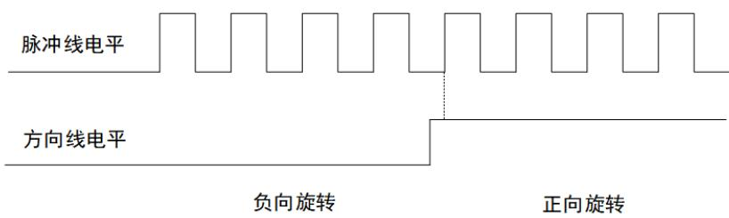

双脉冲模式(CW/CCW):

两根线都输出脉冲信号，CW 为正方向脉冲信号，CCW 为反方向脉冲信号，通常都是 差分方式输出，两信号相位相差角度，根据相位超前或滞后来决定。

对应 ZAux\_Direct\_SetInvertStep (句柄, 轴号, （4-7）)

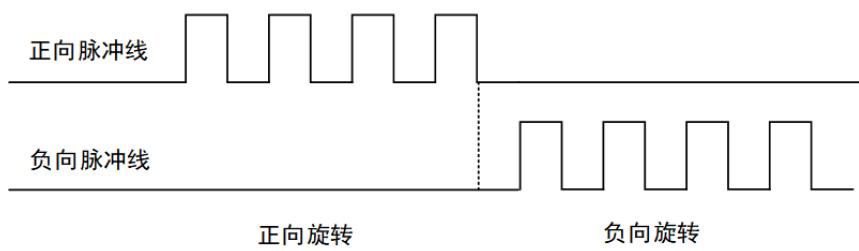

正交脉冲模式(A/B 相)：

正交脉冲指两个相互独立的相同脉冲信号，正方向脉冲信号在负方向脉冲信号之前产生，二者相位相差 90 度，此时为正向旋转；负方向脉冲信号在正方向脉冲信号之前产生，二者相位相差90度，此时为负向旋转。

通过两个脉冲之间的相位差来达到计数或编码的作用。

对应 ZAux\_Direct\_SetInvertStep(句柄, 轴号,（8-9）)

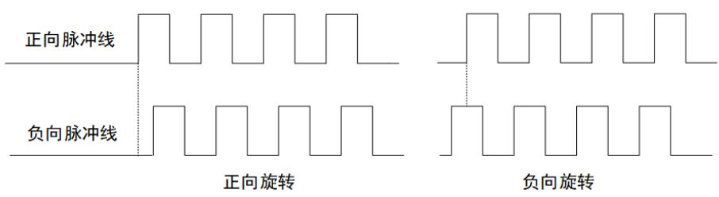

## 例程

以下例程会把本章节所讲的指令全部有简单应用的示例。

## 5.2.3-1 本地脉冲轴号重映射

本例程，把轴0的轴号重映射成轴 3。

```c
// test1.cpp : 定义控制台应用程序的入口点。
//
#include "stdafx.h"
#include <windows.h>
#include "zmotion.h"
#include "zauxdll2.h"
void commandCheckHandler(const char *command, int ret)
{
if (ret)//非 0 则失败
{
printf("%s return code is %d\n", command, ret);
}
int _tmain(int argc, _TCHAR* argv[])
{
char *ip_addr = (char *)"192.168.0.181"; //控制器IP 地址，需要硬件接线
才可跑出手册上的波形图，不可用仿真器
ZMC_HANDLE handle = NULL; //连接句柄
int ret = ZAux_OpenEth(ip_addr, &handle); //连接控制器
```

```c
if (ERR_SUCCESS != ret)
{
printf("控制器连接失败!\n");
handle = NULL;
(2000);
return -1;
}
printf("控制器连接成功！\n");
int i=0;
//轴地址清 0 复位
for (i=0;i<10;i++)
{
ret =ZAux_Direct_SetAtype(handle,i,0);//设置轴地址之前需把 ATYPE 清 0
commandCheckHandler("ZAux_Direct_SetParam", ret) ;//判断指令是否执行成功
ret =ZAux_Direct_SetAxisAddress(handle,i,0);//设置轴地址 Axis_Address 清 0
commandCheckHandler("ZAux_Direct_SetParam", ret) ;//判断指令是否执行成功
int axis[2]={0,3};
for (i=0;i<2;i++)
{
ret = ZAux_Direct_SetParam(handle,"ATYPE",axis[i],1);//使用 SetParam 的方式设置轴列
表，ATYPE=1
commandCheckHandler("ZAux_Direct_SetParam", ret) ;//判断指令是否执行成功
ret = ZAux_Direct_SetParam(handle,"DPOS",axis[i],0);//使用 SetParam 的方式设置轴列表，
dpos 清 0
commandCheckHandler("ZAux_Direct_SetParam", ret) ;//判断指令是否执行成功
ret = ZAux_Direct_SetParam(handle,"ACCEL",axis[i],1000);//使用 SetParam 的方式设置轴
列表，加速度为 1000
commandCheckHandler("ZAux_Direct_SetParam", ret) ;//判断指令是否执行成功
ret = ZAux_Direct_SetParam(handle,"DECEL",axis[i],1000);//使用 SetParam 的方式设置轴
列表，减速度为 1000
commandCheckHandler("ZAux_Direct_SetParam", ret) ;//判断指令是否执行成功
ret = ZAux_Direct_SetParam(handle,"SPEED",axis[i],1000);//使用 SetParam 的方式设置轴
```

```c
列表，速度为 1000
commandCheckHandler("ZAux_Direct_SetParam", ret) ;//判断指令是否执行成功
ret = ZAux_Direct_SetParam(handle,"DPOS",5,0);//使用 SetParam 的方式设置轴 5，dpos 清
0
commandCheckHandler("ZAux_Direct_SetParam", ret) ;//判断指令是否执行成功
ret = ZAux_Direct_SetParam(handle,"ATYPE",5,6);//使用 SetParam 的方式设置轴 5，轴类型
设置为 6，编码器轴，也可以用 setAtype 函数
commandCheckHandler("ZAux_Direct_SetParam", ret) ;//判断指令是否执行成功
float len[2]={100,100};
int AxisAddress0;
int AxisAddress3;
ret =ZAux_Direct_GetAxisAddress(handle,0,&AxisAddress0);//获取轴 0 地址
commandCheckHandler("ZAux_Direct_GetAxisAddress", ret) ;//判断指令是否执行成功
printf("修改前轴 0 轴地址为 Axis_Address：%d\n",AxisAddress0);
ret =ZAux_Direct_GetAxisAddress(handle,3,&AxisAddress3);//获取轴 3 地址
commandCheckHandler("ZAux_Direct_GetAxisAddress", ret) ;//判断指令是否执行成功
printf("修改前轴 3 轴地址为 Axis_Address：%d\n",AxisAddress3);
*****************\n");
ZAux_Trigger(handle);//触发 ZDevelop 软件自带的示波器
float IDLE;
ZAux_Direct_Single_Move(handle,0,100);//轴 0 运动 100
while (1)//等待轴 0 运动完成
{
Sleep(100);
ZAux_Direct_GetParam(handle,"IDLE",0,&IDLE);
if (IDLE<0)break;
}
Sleep(400);
ZAux_Direct_Single_Move(handle,3,100);//轴 3 运动 100
while (1)//等待轴 3 运动完成
```

Sleep(100);   
ZAux\_Direct\_GetParam(handle,"IDLE",3,&IDLE);   
if (IDLE<0)break;   
}   
//{要把物理接口轴 0 的轴号重映射为轴 3，则轴 3 为要修改的轴号，轴 0 为重映射的轴号。   
ret = ZAux\_Direct\_SetParam(handle,"ATYPE",0,0);//使用 SetParam 的方式重映射轴 0，轴类   
型设置为虚拟轴，也可以用 setAtype 函数   
commandCheckHandler("ZAux\_Direct\_SetParam", ret) ;//判断指令是否执行成功   
ret =ZAux\_Direct\_SetParam(handle,"ATYPE",3,0);//使用 SetParam 的方式把目标轴号 3，轴   
类型设置为虚拟轴，也可以用 setAtype 函数   
commandCheckHandler("ZAux\_Direct\_SetParam", ret) ;//判断指令是否执行成功   
ret =ZAux\_Direct\_SetAxisAddress(handle,3,(-1<<16)+0);//把轴 0 的轴号重新映射为轴 3   
commandCheckHandler("ZAux\_Direct\_SetAxisAddress", ret) ;//判断指令是否执行成功   
ret =ZAux\_Direct\_SetParam(handle,"ATYPE",3,1);//目标轴号轴类型设置为 1   
commandCheckHandler("ZAux\_Direct\_SetParam", ret) ;//判断指令是否执行成功   
ret =ZAux\_Direct\_GetAxisAddress(handle,0,&AxisAddress0);//获取轴 0 地址   
commandCheckHandler("ZAux\_Direct\_GetAxisAddress", ret) ;//判断指令是否执行成功   
printf("修改后轴 0 轴地址为 Axis\_Address：%d\n",AxisAddress0);   
ret =ZAux\_Direct\_GetAxisAddress(handle,3,&AxisAddress3);//获取轴 3 地址   
commandCheckHandler("ZAux\_Direct\_GetAxisAddress", ret) ;//判断指令是否执行成功   
printf("修改后轴 3 轴地址为 Axis\_Address：%d\n",AxisAddress3);   
//例：要把物理接口轴 0 的轴号重映射为轴 3，则轴 3 为要修改的轴号，轴 0 为重映射的轴号。}   
ZAux\_Direct\_Single\_Move(handle,0,100);//轴 0 运动 100   
while (1)   
{   
Sleep(100);   
ZAux\_Direct\_GetParam(handle,"IDLE",0,&IDLE);

```c
if (IDLE<0)break;
}
Sleep(400);
ZAux_Direct_Single_Move(handle,3,100);//轴 3 运动 100
(2000);
ret = ZAux_Close(handle); //关闭连接
commandCheckHandler("ZAux_Close", ret) ;//判断指令是否执行成功
printf("connection closed!\n");
handle = NULL;
return 0;
}
```

由如下运动波形图可观察出轴 0 的轴号变更为了 3。

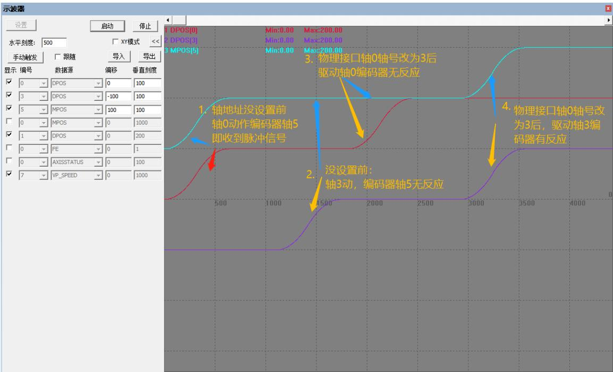

程序结果输出：

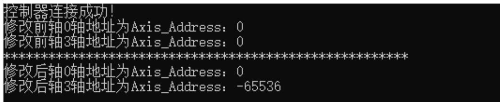

## 5.2.3-2 参数获取及配置

```c
// test1.cpp : 定义控制台应用程序的入口点。
//
#include "stdafx.h"
#include <windows.h>
#include "zmotion.h"
#include "zauxdll2.h"
void commandCheckHandler(const char *command, int ret)
{
if (ret)//非 0 则失败
{
printf("%s return code is %d\n", command, ret);
}
int _tmain(int argc, _TCHAR* argv[])
char *ip_addr = (char *)"127.0.0.1"; //控制器 IP 地址
ZMC_HANDLE handle = NULL; //连接句柄
int ret = ZAux_OpenEth(ip_addr, &handle); //连接控制器
if (ERR_SUCCESS != ret)
{
printf("connect controller failed!\n");
handle = NULL;
(2000);
return -1;
}
printf("控制器连接成功！\n");
ZAux_Direct_SetDpos(handle, 1, 100); //设置轴 1 dpos=100
ZAux_Direct_SetDpos(handle, 2, 200); //设置轴 2 dpos=200
ZAux_Direct_SetSpeed(handle, 0, 300); //设置轴 0 速度为 300units/s
```

```c
ZAux_Direct_SetSpeed(handle, 1, 400); //设置轴 1 速度为 400units/s
ZAux_Direct_SetSpeed(handle, 2, 500); //设置轴 2 速度为 500units/s
float Mpos[3]={0};
float Dpos[3]={0};
float Speed[3]={0};
int MaxSpeed;
int Invert_Step;
//{Invert_Step 用法，
//0-3 脉冲方向模式，脉冲线+方向线
//4-7 双脉冲方式（或称 CW/CCW），正向脉冲线+负向脉冲线
//8-9 AB 输出(部分控制器定制)
***********************\n");
ZAux_Direct_GetInvertStep(handle, 0, &Invert_Step);//获取轴 0 脉冲模式
commandCheckHandler("ZAux_GetModbusMpos", ret) ;//判断指令是否执行成功
printf("轴 0 脉冲模式 Invert_Step(0)：%d\n",Invert_Step);
ZAux_Direct_SetInvertStep(handle, 0, 1);//设置轴 0 脉冲模式为 1
commandCheckHandler("ZAux_GetModbusMpos", ret) ;//判断指令是否执行成功
ZAux_Direct_GetInvertStep(handle, 0, &Invert_Step);//获取轴 0 脉冲模式
commandCheckHandler("ZAux_GetModbusMpos", ret) ;//判断指令是否执行成功
printf("轴 0 脉冲模式 Invert_Step(0)（修改后）：%d\n",Invert_Step);
ZAux_Direct_SetInvertStep(handle, 0, 0);//设置轴 0 脉冲模式为 0（默认模式）
commandCheckHandler("ZAux_GetModbusMpos", ret) ;//判断指令是否执行成功
printf("***********************************************\n");
//Invert_Step 用法}
//{max_speed 简单应用（speed 速度最大不能超过该值）
ret=ZAux_Direct_GetMaxSpeed(handle, 0, &MaxSpeed);//获取轴 0 最大脉冲输出频率
commandCheckHandler("ZAux_Direct_GetMaxSpeed", ret) ;//判断指令是否执行成功
printf("轴 0 最大脉冲输出频率 Maxspeed：轴 0=%d\n",MaxSpeed);
ret=ZAux_Direct_SetMaxSpeed(handle, 0, MaxSpeed+100);//修改最大脉冲频率
commandCheckHandler("ZAux_Direct_SetMaxSpeed", ret) ;//判断指令是否执行成功
ret=ZAux_Direct_GetMaxSpeed(handle, 0, &MaxSpeed);
```

commandCheckHandler("ZAux\_Direct\_GetMaxSpeed", ret) ;//判断指令是否执行成功  
printf("轴 0 最大脉冲输出频率 Maxspeed（修改后）：轴 0=%d\n",MaxSpeed);  
ret=ZAux\_Direct\_SetMaxSpeed(handle, 0, MaxSpeed-100);//改回最大脉冲频率  
commandCheckHandler("ZAux\_Direct\_SetMaxSpeed", ret) ;//判断指令是否执行成功  
//max\_speed 简单应用（speed 速度最大不能超过该值）}  
//modbus 方式获取 DPOS,MPOS,VP\_SPEED  
\*\*\*\*\*\*\*\*\*\*\*\*\*\*\*\n");  
ret=ZAux\_GetModbusMpos( handle, 3, Mpos);//读取轴 0-轴 2 的 MPOS  
commandCheckHandler("ZAux\_GetModbusMpos", ret) ;//判断指令是否执行成功  
printf("反馈位置 MPOS：轴 0=%f 轴 1=%f 轴 2=%f\n",Mpos[0],Mpos[1],Mpos[2]);  
ret=ZAux\_GetModbusDpos(handle, 3, Dpos);  
commandCheckHandler("ZAux\_GetModbusDpos", ret) ;//判断指令是否执行成功  
printf("规划位置 DPOS：轴 0=%f 轴 1=%f 轴 2=%f\n",Dpos[0],Dpos[1],Dpos[2]);  
ret=ZAux\_GetModbusCurSpeed(handle, 3, Speed);//读取轴 0-轴 2 的 VP\_SPEED（即轴运动时，  
控制器发送的脉冲速度，不一定为理想  
commandCheckHandler("ZAux\_GetModbusCurSpeed", ret) ;//判断指令是否执行成功  
printf("当前运动的规划速度 VP\_SPEED（运动前）：轴 0=%f 轴 1=%f 轴  
2=%f\n\n",Speed[0],Speed[1],Speed[2]);  
//modbus 方式获取 DPOS,MPOS,VP\_SPEED}  
//{运动  
ret=ZAux\_Direct\_Single\_Move(handle,0,200);//驱动轴 0 走 200  
commandCheckHandler("ZAux\_Direct\_Single\_Move", ret) ;//判断指令是否执行成功  
ret=ZAux\_Direct\_Single\_Move(handle,1,200);//驱动轴 1 走 200  
commandCheckHandler("ZAux\_Direct\_Single\_Move", ret) ;//判断指令是否执行成功  
ret=ZAux\_Direct\_Single\_Move(handle,2,200);//驱动轴 2 走 200  
commandCheckHandler("ZAux\_Direct\_Single\_Move", ret) ;//判断指令是否执行成功  
Sleep(200);  
//运动}  
//{重新获取信息  
ret=ZAux\_GetModbusMpos( handle, 3, Mpos);//读取轴 0-轴 2 的 MPOS  
commandCheckHandler("ZAux\_GetModbusMpos", ret) ;//判断指令是否执行成功  
printf("反馈位置 MPOS（运动后）：轴 0=%f 轴 1=%f 轴 2=%f\n",Mpos[0],Mpos[1],Mpos[2]);

```c
ret=ZAux_GetModbusDpos(handle, 3, Dpos);
commandCheckHandler("ZAux_GetModbusDpos", ret) ;//判断指令是否执行成功
printf("规划位置 DPOS（运动后）：轴 0=%f 轴 1=%f 轴 2=%f\n",Dpos[0],Dpos[1],Dpos[2]);
ret=ZAux_GetModbusCurSpeed(handle, 3, Speed);//读取轴 0-轴 2 的 VP_SPEED（即轴运动时，
控制器发送的脉冲速度
commandCheckHandler("ZAux_GetModbusCurSpeed", ret) ;//判断指令是否执行成功
printf("当前运动的规划速度 VP_SPEED（运动后）：轴 0=%f 轴 1=%f 轴
2=%f\n",Speed[0],Speed[1],Speed[2]);
printf("********** ****************\n");
//重新获取信息}
//{运动类型获取
//值为 0：无运动，大于 0 有运动，具体说明查阅 PC 编程手册 5.2.2-2
int Mtype=0;
int Ntype=0;
ret=ZAux_Direct_GetMtype(handle, 0,&Mtype);
commandCheckHandler("ZAux_Direct_GetMtype", ret) ;//判断指令是否执行成功
printf("轴 0 当前运动类型 Mtype：轴 0=%d \n",Mtype);
ret=ZAux_Direct_GetNtype(handle, 0,&Ntype);
commandCheckHandler("ZAux_Direct_GetNtype", ret) ;//判断指令是否执行成功
printf("轴 0 当前正在运动的下一条运动指令类型 Ntype：=%d \n",Ntype);
printf("***********************************************\n");
//运动类型获取}
Sleep(2000);
ret = ZAux_Close(handle); //关闭连接
commandCheckHandler("ZAux_Close", ret) ;//判断指令是否执行成功
printf("connection closed!\n");
handle = NULL;
return 0;
```

程序结果输出：

控制器连接成功！  
\*\*\*\*\*\*\*\*\*\*\*\*\*\*\* \*\*\*\*\*\*\*\*\*  
轴0脉冲模式Invert\_Step(0)：0  
轴0脉冲模式Invert\_Step(O）（修改后）：1  
\*\*\*\*\*\*\*\*\*\*\*\*\*\*\*\*\*\*\*\*\*\*\*\*\*\*\*\*\*\*\*\*\*\*\*\*\*\*\*\*\*\*\*\*\*\*\*  
轴0最大脉冲输出频率Maxspeed：轴0=1000000  
轴0最大脉冲输出率Maxspeed（修改后）：轴0=1000100  
\*\*\*\*\*\*\*\*\*\*\*\*\*\*\*\*\*\*\*\*\*\*\*\*\*\*\*\*\*\*\*\*\*\*\*\*\*\*\*\*\*\*\*\*\*\*\*  
反馈位置MP0S：轴0=-900.000000轴1=100.000000轴2=200.000000  
规划位置S40=9000轴1=100.00000轴2=200000  
当前运动的规划速度VP\_SPEED（运动前）：轴0=0.000000轴1=0.000000轴2=0.000000  
反馈位罩MP0S（运动后）：轴0=-879.900024轴1=120.099998轴2=220.100006  
规划位置DP0S（运动后）：轴0=-879.900024轴1=120.099998\_轴2-220.100006  
当前运动的规划速度VP\_SPEED（运动后）：轴0=202.000000轴1=202.000000轴2=202.000000  
\*\*\*\*\*\*\*\*\*\*\*\*\*\*\*\*\*\*\*\*\*\*\*\*\*\*\*\*\*\*\*\*\*\*\*\*\*\*\*\*\*\*\*\*\*\*\*  
轴0当剪运动类型Mtype：轴0=1  
轴0当箭正在运动的下一条运动指令类型Ntype：=0  
\*\*\*\*\*\*\*\*\*\*\*\*\*\*\*\*\*\*\*\*\*\*\*\*\*\*\*\*\*\*\*\*\*\*\*\*\*\*\*\*\*\*\*\*\*\*\*

## 5.2.3-3 轴坐标设置

```c
// test1.cpp : 定义控制台应用程序的入口点。
#include "stdafx.h"
#include <windows.h>
#include "zmotion.h"
#include "zauxdll2.h"
void commandCheckHandler(const char *command, int ret)
{
if (ret)//非 0 则失败
{
printf("%s return code is %d\n", command, ret);
}
int _tmain(int argc, _TCHAR* argv[])
{
char *ip_addr = (char *)"127.0.0.1"; //控制器 IP 地址
ZMC_HANDLE handle = NULL; //连接句柄
int ret = ZAux_OpenEth(ip_addr, &handle); //连接控制器
if (ERR_SUCCESS != ret)
{
printf("控制器连接失败!\n");
```

handle = NULL;   
(2000);   
return -1;   
}   
printf("控制器连接成功！\n");   
ret =ZAux\_Direct\_SetAtype(handle,0,1);//设置轴类型   
commandCheckHandler("ZAux\_Direct\_SetAtype", ret) ;//判断指令是否执行成功   
ret =ZAux\_Direct\_SetAccel(handle,0,500);//设置轴加速度   
commandCheckHandler("ZAux\_Direct\_SetAccel", ret) ;//判断指令是否执行成功   
ret =ZAux\_Direct\_SetDecel(handle,0,500);//设置轴减速度   
commandCheckHandler("ZAux\_Direct\_SetDecel", ret) ;//判断指令是否执行成功   
ret =ZAux\_Direct\_SetSpeed(handle,0,200);//设置轴速度   
commandCheckHandler("ZAux\_Direct\_SetSpeed", ret) ;//判断指令是否执行成功   
ret =ZAux\_Direct\_SetDpos(handle,0,0);//设置轴 DPOS 清 0   
commandCheckHandler("ZAux\_Direct\_SetDpos", ret) ;//判断指令是否执行成功   
float DPOS;   
float OFFPOS;   
ret =ZAux\_Direct\_GetDpos(handle,0,&DPOS);//获取轴 DPOS 值   
commandCheckHandler("ZAux\_Direct\_SetDpos", ret) ;//判断指令是否执行成功   
printf("运动前轴 0 DPOS=%f\n",DPOS);   
float IDLE;   
ZAux\_Direct\_Single\_Move(handle,0,200);//轴 0 运动 200   
while (1)//等待轴 0 运动完成   
{   
Sleep(100);   
ZAux\_Direct\_GetParam(handle,"IDLE",0,&IDLE);   
if (IDLE<0)break;   
}   
ret =ZAux\_Direct\_GetDpos(handle,0,&DPOS);//获取轴 0 的 DPOS 值   
commandCheckHandler("ZAux\_Direct\_SetDpos", ret) ;//判断指令是否执行成功   
printf("运动完成轴 0 DPOS=%f\n",DPOS);   
ret =ZAux\_Direct\_SetOffpos(handle,0,800);//把轴 0 坐标相对偏移 800   
commandCheckHandler("ZAux\_Direct\_SetDpos", ret) ;//判断指令是否执行成功

```c
//ret =ZAux_Direct_GetOffpos(handle,0,&OFFPOS);
//commandCheckHandler("ZAux_Direct_SetDpos", ret) ;//判断指令是否执行成功
//printf("轴 0 偏移量 OFFPOS=%f\n",OFFPOS);
ret =ZAux_Direct_GetDpos(handle,0,&DPOS);//获取轴 DPOS 值
commandCheckHandler("ZAux_Direct_SetDpos", ret) ;//判断指令是否执行成功
printf("偏移 800 后轴 0 DPOS=%f\n",DPOS);
ret =ZAux_Direct_Defpos(handle,0,2022);//把轴 0 坐标偏移为绝对位置 2022
commandCheckHandler("ZAux_Direct_SetDpos", ret) ;//判断指令是否执行成功
ret =ZAux_Direct_GetDpos(handle,0,&DPOS);//获取轴 DPOS 值
commandCheckHandler("ZAux_Direct_SetDpos", ret) ;//判断指令是否执行成功
printf("绝对位置偏移 2022 后轴 0 DPOS=%f\n",DPOS);
Sleep(2000);
ret = ZAux_Close(handle); //关闭连接
commandCheckHandler("ZAux_Close", ret) ;//判断指令是否执行成功
printf("connection closed!\n");
handle = NULL;
return 0;
```

程序结果输出：（只改变坐标，轴不动）

控制器连接成功！  
运动前轴0DPOS=0.000000  
运动莞成轴0DP0S=200.000000  
偏移800后轴0DP0S=1000.00000  
绝对位置偏移2022后轴0DP0S=2022.000000

## 5.2.3-4 随动误差获取

对于伺服控制系统而言，在某些异常情况下，电机的实际位置可能与规划位置差距很大。这时通常存在一些危险情况，例如电机故障、编码器 A、B相信号接反或断线、机械摩擦太大或者机械故障造成电机堵转等。为了及时检测这些情况，增强系统的安全性并延长设备使用寿命，运动控制器提供可以获取跟随误差超限的安全保护机制。

以下例程为获取轴 0的随动误差。

```c
// test1.cpp : 定义控制台应用程序的入口点。
#include "stdafx.h"
#include <windows.h>
#include "zmotion.h"
#include "zauxdll2.h"
void commandCheckHandler(const char *command, int ret)
if (ret)//非 0 则失败
{
printf("%s fail!return code is %d\n", command, ret);
}
int _tmain(int argc, _TCHAR* argv[])
{
char *ip_addr = (char *)"127.0.0.1"; //控制器 IP 地址
ZMC_HANDLE handle = NULL; //连接句柄
int ret = ZAux_OpenEth(ip_addr, &handle); //连接控制器
if (ERR_SUCCESS != ret)
{
printf("控制器连接失败!\n");
handle = NULL;
(2000);
return -1;
}
printf("控制器连接成功！\n");
ret =ZAux_Direct_SetAtype(handle,0,5);//设置轴类型为 5，带编码器反馈的轴类型，因仿真
器无编码器反馈接线，则会造成明显的随动误差
commandCheckHandler("ZAux_Direct_SetAtype", ret) ;//判断指令是否执行成功
ret =ZAux_Direct_SetAccel(handle,0,500);//设置轴加速度
commandCheckHandler("ZAux_Direct_SetAccel", ret) ;//判断指令是否执行成功
ret =ZAux_Direct_SetDecel(handle,0,500);//设置轴减速度
commandCheckHandler("ZAux_Direct_SetDecel", ret) ;//判断指令是否执行成功
ret =ZAux_Direct_SetSpeed(handle,0,200);//设置轴速度
```

commandCheckHandler("ZAux\_Direct\_SetSpeed", ret) ;//判断指令是否执行成功   
ret =ZAux\_Direct\_SetDpos(handle,0,0);//设置轴 DPOS 清 0   
commandCheckHandler("ZAux\_Direct\_SetDpos", ret) ;//判断指令是否执行成功   
float IDLE;   
ZAux\_Direct\_Single\_Move(handle,0,200);//轴 0 运动 200   
while (1)//等待轴 0 运动完成   
{   
Sleep(100);   
ZAux\_Direct\_GetParam(handle,"IDLE",0,&IDLE);   
if (IDLE<0)break;   
}   
float FE;   
float DPOS;   
float MPOS;   
ret =ZAux\_Direct\_GetDpos(handle,0,&DPOS);//设置轴 DPOS 清 0   
commandCheckHandler("ZAux\_Direct\_GetDpos", ret) ;//判断指令是否执行成功   
printf("当前 DPOS=%f\n",DPOS);   
ret =ZAux\_Direct\_GetMpos(handle,0,&MPOS);//设置轴 DPOS 清 0   
commandCheckHandler("ZAux\_Direct\_GetMpos", ret) ;//判断指令是否执行成功   
printf("当前 MPOS=%f\n",MPOS);   
ret =ZAux\_Direct\_GetFe(handle,0,&FE);//设置轴 DPOS 清 0   
commandCheckHandler("ZAux\_Direct\_GetFe", ret) ;//判断指令是否执行成功   
printf("当前 FE=%f\n",FE);   
Sleep(2000);   
ret = ZAux\_Close(handle); //关闭连接   
commandCheckHandler("ZAux\_Close", ret) ;//判断指令是否执行成功   
printf("connection closed!\n");   
handle = NULL;   
return 0;

## 5.3 轴参数指令表

## 指令列表

<table><tr><td rowspan=1 colspan=2>指令                                                   说明</td></tr><tr><td rowspan=1 colspan=1> ZAux_ Direct GetAllAxisPara</td><td rowspan=1 colspan=1>浮点型读全部轴参数状态</td></tr><tr><td rowspan=1 colspan=1>ZAux Direct GetAllAxisInfo</td><td rowspan=1 colspan=1>整型读全部轴参数状态</td></tr><tr><td rowspan=1 colspan=1>ZAux_Direct_SetParam</td><td rowspan=1 colspan=1>通用的轴参数修改函数</td></tr><tr><td rowspan=1 colspan=1>ZAux_Direct_GetParam</td><td rowspan=1 colspan=1>通用的轴参数读取函数</td></tr></table>

## 重点说明

运动控制参数表：

<table><tr><td colspan="2" rowspan="1">指令                                描述</td><td colspan="1" rowspan="1">读写性</td><td colspan="1" rowspan="1">序号</td></tr><tr><td colspan="1" rowspan="1">Atype</td><td colspan="1" rowspan="1">轴类型</td><td colspan="1" rowspan="1">可读可写</td><td colspan="1" rowspan="1">0</td></tr><tr><td colspan="1" rowspan="1">Units</td><td colspan="1" rowspan="1">脉冲当量</td><td colspan="1" rowspan="1">可读可写</td><td colspan="1" rowspan="1">1</td></tr><tr><td colspan="1" rowspan="1">Accel</td><td colspan="1" rowspan="1">加速度</td><td colspan="1" rowspan="1">可读可写</td><td colspan="1" rowspan="1">2</td></tr><tr><td colspan="1" rowspan="1">Decel</td><td colspan="1" rowspan="1">减速度</td><td colspan="1" rowspan="1">可读可写</td><td colspan="1" rowspan="1">3</td></tr><tr><td colspan="1" rowspan="1">Speed</td><td colspan="1" rowspan="1">运行速度</td><td colspan="1" rowspan="1">可读可写</td><td colspan="1" rowspan="1">4</td></tr><tr><td colspan="1" rowspan="1">Creep</td><td colspan="1" rowspan="1">爬行速度</td><td colspan="1" rowspan="1">可读可写</td><td colspan="1" rowspan="1">5</td></tr><tr><td colspan="1" rowspan="1">Lspeed</td><td colspan="1" rowspan="1">起始速度</td><td colspan="1" rowspan="1">可读可写</td><td colspan="1" rowspan="1">6</td></tr><tr><td colspan="1" rowspan="1">Merge</td><td colspan="1" rowspan="1">连续插补开关</td><td colspan="1" rowspan="1">可读可写</td><td colspan="1" rowspan="1">7</td></tr><tr><td colspan="1" rowspan="1">Sramp</td><td colspan="1" rowspan="1">加减速曲线时间设置</td><td colspan="1" rowspan="1">可读可写</td><td colspan="1" rowspan="1">8</td></tr><tr><td colspan="1" rowspan="1">Dpos</td><td colspan="1" rowspan="1">轴指令规划位置</td><td colspan="1" rowspan="1">可读可写</td><td colspan="1" rowspan="1">9</td></tr><tr><td colspan="1" rowspan="1">Mpos</td><td colspan="1" rowspan="1">编码器反馈位置</td><td colspan="1" rowspan="1">可读可写</td><td colspan="1" rowspan="1">10</td></tr><tr><td colspan="1" rowspan="1">Endmove</td><td colspan="1" rowspan="1">当前运动目标位置</td><td colspan="1" rowspan="1">只读</td><td colspan="1" rowspan="1">11</td></tr><tr><td colspan="1" rowspan="1">Fs_Limit</td><td colspan="1" rowspan="1">正向软限位设置</td><td colspan="1" rowspan="1">可读可写</td><td colspan="1" rowspan="1">12</td></tr><tr><td colspan="1" rowspan="1">Rs_Limit</td><td colspan="1" rowspan="1">负向软限位设置</td><td colspan="1" rowspan="1">可读可写</td><td colspan="1" rowspan="1">13</td></tr><tr><td colspan="1" rowspan="1">Datum_In</td><td colspan="1" rowspan="1">映射原点输入</td><td colspan="1" rowspan="1">可读可写</td><td colspan="1" rowspan="1">14</td></tr><tr><td colspan="1" rowspan="1">Fwd_In</td><td colspan="1" rowspan="1">映射正限位输入</td><td colspan="1" rowspan="1">可读可写</td><td colspan="1" rowspan="1">15</td></tr><tr><td colspan="1" rowspan="1">Rev_In</td><td colspan="1" rowspan="1">映射负限位输入</td><td colspan="1" rowspan="1">可读可写</td><td colspan="1" rowspan="1">16</td></tr><tr><td colspan="1" rowspan="1">Idle</td><td colspan="1" rowspan="1">运动状态</td><td colspan="1" rowspan="1">只读</td><td colspan="1" rowspan="1">17</td></tr><tr><td colspan="1" rowspan="1">Loaded</td><td colspan="1" rowspan="1">缓冲是否为空状态位</td><td colspan="1" rowspan="1">只读</td><td colspan="1" rowspan="1">18</td></tr><tr><td colspan="1" rowspan="1">Mspeed</td><td colspan="1" rowspan="1">实际编码反馈速度</td><td colspan="1" rowspan="1">只读</td><td colspan="1" rowspan="1">19</td></tr><tr><td colspan="1" rowspan="1">Mtype</td><td colspan="1" rowspan="1">当前运动类型</td><td colspan="1" rowspan="1">只读</td><td colspan="1" rowspan="1">20</td></tr><tr><td colspan="1" rowspan="1">Ntype</td><td colspan="1" rowspan="1">下条运动类型</td><td colspan="1" rowspan="1">只读</td><td colspan="1" rowspan="1">21</td></tr><tr><td colspan="1" rowspan="1">Remain</td><td colspan="1" rowspan="1">当前运动剩余距离</td><td colspan="1" rowspan="1">只读</td><td colspan="1" rowspan="1">22</td></tr><tr><td colspan="1" rowspan="1">Vp_Speed</td><td colspan="1" rowspan="1">当前运动速度</td><td colspan="1" rowspan="1">只读</td><td colspan="1" rowspan="1">23</td></tr><tr><td colspan="1" rowspan="1">Axisstatus</td><td colspan="1" rowspan="1">轴状态</td><td colspan="1" rowspan="1">只读</td><td colspan="1" rowspan="1">24</td></tr><tr><td colspan="1" rowspan="1">Move_Mark</td><td colspan="1" rowspan="1">运动标号</td><td colspan="1" rowspan="1">可读可写</td><td colspan="1" rowspan="1">25</td></tr><tr><td colspan="1" rowspan="1">Move_Curmark</td><td colspan="1" rowspan="1">当前运动标号</td><td colspan="1" rowspan="1">只读</td><td colspan="1" rowspan="1">26</td></tr><tr><td colspan="1" rowspan="1">Vector_Buffered</td><td colspan="1" rowspan="1">当前运动剩余距离</td><td colspan="1" rowspan="1">只读</td><td colspan="1" rowspan="1">27</td></tr><tr><td colspan="1" rowspan="1">Axis_StopReason</td><td colspan="1" rowspan="1">轴停止原因</td><td colspan="1" rowspan="1">只读</td><td colspan="1" rowspan="1">28</td></tr><tr><td colspan="1" rowspan="1">Moves_Buffered</td><td colspan="1" rowspan="1">当前运动缓冲数</td><td colspan="1" rowspan="1">只读</td><td colspan="1" rowspan="1">29</td></tr><tr><td colspan="1" rowspan="1">Axis_Address</td><td colspan="1" rowspan="1">轴地址</td><td colspan="1" rowspan="1">可读可写</td><td colspan="1" rowspan="1">30</td></tr><tr><td colspan="1" rowspan="1">Axis_Enable</td><td colspan="1" rowspan="1">单轴使能</td><td colspan="1" rowspan="1">可读可写</td><td colspan="1" rowspan="1">31</td></tr><tr><td colspan="1" rowspan="1">Force_Speed</td><td colspan="1" rowspan="1">sp运动速度</td><td colspan="1" rowspan="1">可读可写</td><td colspan="1" rowspan="1">32</td></tr><tr><td colspan="1" rowspan="1">Startmove_Speed</td><td colspan="1" rowspan="1">sp运动开始速度</td><td colspan="1" rowspan="1">可读可写</td><td colspan="1" rowspan="1">33</td></tr><tr><td colspan="1" rowspan="1">Endmove_Speed</td><td colspan="1" rowspan="1">sp运动结束速度</td><td colspan="1" rowspan="1">可读可写</td><td colspan="1" rowspan="1">34</td></tr><tr><td colspan="1" rowspan="1">Fastdec</td><td colspan="1" rowspan="1">快减减速度</td><td colspan="1" rowspan="1">可读可写</td><td colspan="1" rowspan="1">35</td></tr><tr><td colspan="1" rowspan="1">Addax_Axis</td><td colspan="1" rowspan="1">叠加轴号</td><td colspan="1" rowspan="1">只读</td><td colspan="1" rowspan="1">36</td></tr><tr><td colspan="1" rowspan="1">Link_Axis</td><td colspan="1" rowspan="1">连接轴号</td><td colspan="1" rowspan="1">只读</td><td colspan="1" rowspan="1">37</td></tr><tr><td colspan="1" rowspan="1">Cormer_Mode</td><td colspan="1" rowspan="1">拐角模式</td><td colspan="1" rowspan="1">可读可写</td><td colspan="1" rowspan="1">38</td></tr><tr><td colspan="1" rowspan="1">Decel_Angle</td><td colspan="1" rowspan="1">拐角减速开始</td><td colspan="1" rowspan="1">可读可写</td><td colspan="1" rowspan="1">39</td></tr><tr><td colspan="1" rowspan="1">Stop_Angle</td><td colspan="1" rowspan="1">拐角减速结束</td><td colspan="1" rowspan="1">可读可写</td><td colspan="1" rowspan="1">40</td></tr><tr><td colspan="1" rowspan="1">Ful_Sp_Radius</td><td colspan="1" rowspan="1">限速半径</td><td colspan="1" rowspan="1">可读可写</td><td colspan="1" rowspan="1">41</td></tr><tr><td colspan="1" rowspan="1">Splimit_Radius</td><td colspan="1" rowspan="1">限速值</td><td colspan="1" rowspan="1">可读可写</td><td colspan="1" rowspan="1">42</td></tr><tr><td colspan="1" rowspan="1">Zsmooth</td><td colspan="1" rowspan="1">倒角半径</td><td colspan="1" rowspan="1">可读可写</td><td colspan="1" rowspan="1">43</td></tr><tr><td colspan="1" rowspan="1">Vector_Moved</td><td colspan="1" rowspan="1">当前运动的距离</td><td colspan="1" rowspan="1">可读可写</td><td colspan="1" rowspan="1">44</td></tr><tr><td colspan="1" rowspan="1">Endmove_Buffer</td><td colspan="1" rowspan="1">缓冲最终位置</td><td colspan="1" rowspan="1">只读</td><td colspan="1" rowspan="1">45</td></tr><tr><td colspan="1" rowspan="1">Homewait</td><td colspan="1" rowspan="1">回零反找延时</td><td colspan="1" rowspan="1">可读可写</td><td colspan="1" rowspan="1">46</td></tr><tr><td colspan="1" rowspan="1">Fast_Jog</td><td colspan="1" rowspan="1">映射点动输入</td><td colspan="1" rowspan="1">可读可写</td><td colspan="1" rowspan="1">47</td></tr><tr><td colspan="1" rowspan="1">Fwd_Jog</td><td colspan="1" rowspan="1">映射正向Jog输入</td><td colspan="1" rowspan="1">可读可写</td><td colspan="1" rowspan="1">48</td></tr><tr><td colspan="1" rowspan="1">Rev_Jog</td><td colspan="1" rowspan="1">映射负向Jog输入</td><td colspan="1" rowspan="1">可读可写</td><td colspan="1" rowspan="1">49</td></tr><tr><td colspan="1" rowspan="1">Jogspeed</td><td colspan="1" rowspan="1">映射Jog速度</td><td colspan="1" rowspan="1">可读可写</td><td colspan="1" rowspan="1">50</td></tr><tr><td colspan="1" rowspan="1">Fhold_in</td><td colspan="1" rowspan="1">映射保持输入</td><td colspan="1" rowspan="1">可读可写</td><td colspan="1" rowspan="1">51</td></tr><tr><td colspan="1" rowspan="1">Fhspeed</td><td colspan="1" rowspan="1">保持速度</td><td colspan="1" rowspan="1">可读可写</td><td colspan="1" rowspan="1">52</td></tr><tr><td colspan="1" rowspan="1">Encoder</td><td colspan="1" rowspan="1">编码器原始值</td><td colspan="1" rowspan="1">只读</td><td colspan="1" rowspan="1">53</td></tr><tr><td colspan="1" rowspan="1">Encoder_Status</td><td colspan="1" rowspan="1">编码器状态</td><td colspan="1" rowspan="1">只读</td><td colspan="1" rowspan="1">54</td></tr><tr><td colspan="1" rowspan="1">PP_Step</td><td colspan="1" rowspan="1">编码器内部比例</td><td colspan="1" rowspan="1">可读可写</td><td colspan="1" rowspan="1">55</td></tr><tr><td colspan="1" rowspan="1">Reg_Inputs</td><td colspan="1" rowspan="1">锁存输入映射</td><td colspan="1" rowspan="1">可读可写</td><td colspan="1" rowspan="1">56</td></tr><tr><td colspan="1" rowspan="1">Mark</td><td colspan="1" rowspan="1">锁存触发</td><td colspan="1" rowspan="1">只读</td><td colspan="1" rowspan="1">57</td></tr><tr><td colspan="1" rowspan="1">MarkB</td><td colspan="1" rowspan="1">锁存2触发</td><td colspan="1" rowspan="1">只读</td><td colspan="1" rowspan="1">58</td></tr><tr><td colspan="1" rowspan="1">MarkC</td><td colspan="1" rowspan="1">锁存3触发</td><td colspan="1" rowspan="1">只读</td><td colspan="1" rowspan="1">59</td></tr><tr><td colspan="1" rowspan="1">MarkD</td><td colspan="1" rowspan="1">锁存4触发</td><td colspan="1" rowspan="1">只读</td><td colspan="1" rowspan="1">60</td></tr><tr><td colspan="1" rowspan="1">Reg_Pos</td><td colspan="1" rowspan="1">锁存位置</td><td colspan="1" rowspan="1">只读</td><td colspan="1" rowspan="1">61</td></tr><tr><td colspan="1" rowspan="1">Reg_PosB</td><td colspan="1" rowspan="1">锁存2位置</td><td colspan="1" rowspan="1">只读</td><td colspan="1" rowspan="1">62</td></tr><tr><td colspan="1" rowspan="1">Reg_PosC</td><td colspan="1" rowspan="1">锁存3位置</td><td colspan="1" rowspan="1">只读</td><td colspan="1" rowspan="1">63</td></tr><tr><td colspan="1" rowspan="1">Reg_PosD</td><td colspan="1" rowspan="1">锁存4位置</td><td colspan="1" rowspan="1">只读</td><td colspan="1" rowspan="1">64</td></tr><tr><td colspan="1" rowspan="1">Alm_In</td><td colspan="1" rowspan="1">映射报警输入</td><td colspan="1" rowspan="1">可读可写</td><td colspan="1" rowspan="1">65</td></tr><tr><td colspan="1" rowspan="1">Rep_Option</td><td colspan="1" rowspan="1">坐标循环模式</td><td colspan="1" rowspan="1">可读可写</td><td colspan="1" rowspan="1">66</td></tr><tr><td colspan="1" rowspan="1">Rep_Dist</td><td colspan="1" rowspan="1">坐标循环位置</td><td colspan="1" rowspan="1">可读可写</td><td colspan="1" rowspan="1">67</td></tr><tr><td colspan="1" rowspan="1">Invert_Step</td><td colspan="1" rowspan="1">脉冲模式设置</td><td colspan="1" rowspan="1">可读可写</td><td colspan="1" rowspan="1">68</td></tr><tr><td colspan="1" rowspan="1">Max_speed</td><td colspan="1" rowspan="1">脉冲频率限制</td><td colspan="1" rowspan="1">可读可写</td><td colspan="1" rowspan="1">69</td></tr><tr><td colspan="1" rowspan="1">Axis_Zset</td><td colspan="1" rowspan="1">精准输出设置</td><td colspan="1" rowspan="1">可读可写</td><td colspan="1" rowspan="1">70</td></tr><tr><td colspan="1" rowspan="1">Dac</td><td colspan="1" rowspan="1">总线轴模拟量控制</td><td colspan="1" rowspan="1">可读可写</td><td colspan="1" rowspan="1">71</td></tr><tr><td colspan="1" rowspan="1">ErrorMask</td><td colspan="1" rowspan="1">错误时操作</td><td colspan="1" rowspan="1">可读可写</td><td colspan="1" rowspan="1">72</td></tr></table>

以上运动参数列表状态的获取和设置，均可用指令 ZAux\_Direct\_SetParam、ZAux\_Direct\_GetParam函数来设置或者获取，且设置获取时，字符串指令不区分大小写。

## 例程

## 5.3.3-1 字符串方式设置获取基本参数

```cpp
// test1.cpp : 定义控制台应用程序的入口点。
#include "stdafx.h"
#include <windows.h>
#include "zmotion.h"
#include "zauxdll2.h"
void commandCheckHandler(const char *command, int ret)
{
if (ret)//非 0 则失败
{
```

printf("%s return code is %d\n", command, ret);   
}   
int \_tmain(int argc, \_TCHAR\* argv[])   
char \*ip\_addr = (char \*)"127.0.0.1"; //控制器 IP 地址   
ZMC\_HANDLE handle = NULL; //连接句柄   
int ret = ZAux\_OpenEth(ip\_addr, &handle); //连接控制器   
if (ERR\_SUCCESS != ret)   
{   
printf("connect controller failed!\n");   
handle = NULL;   
getchar();   
return -1;   
}   
printf("控制器连接成功！\n");   
ZAux\_Direct\_SetParam(handle,"ATYPE", 0, 1); //设置轴 0 轴类型为 1,字符串指令不区   
分大小写   
ZAux\_Direct\_SetParam(handle,"Units", 0, 100); //设置轴 0 脉冲当量为 100,字符串指令不   
区分大小写   
ZAux\_Direct\_SetParam(handle,"SPEED", 0, 200); //设置轴 0 速度为 200units/s,字符串指   
令不区分大小写   
ZAux\_Direct\_SetParam(handle,"ACCEL",0, 2000); //设置轴 0 加速度为 2000units/s/s,字符   
串指令不区分大小写   
ZAux\_Direct\_SetParam(handle,"DECEL", 0, 2000); //设置轴 0 减速度为 2000units/s/s,字   
符串指令不区分大小写   
float dpos;   
float ifIdle;   
float status;   
float DposValue;   
float Atype;   
float Units;   
float Speed;   
float Accel;

```c
float Decel;
ret =ZAux_Direct_GetParam(handle,"ATYPE", 0, &Atype); //获取轴 0 轴类型为 1
commandCheckHandler("ZAux_Direct_GetAtype", ret);//判断指令是否执行成功
printf("轴 0 轴类型 Atype = %d\n", Atype);
ret =ZAux_Direct_GetParam(handle, "Units",0, &Units); //获取轴 0 脉冲当量为 100
commandCheckHandler("ZAux_Direct_GetUnits", ret);//判断指令是否执行成功
printf("轴 0 脉冲当量 Units = %f\n", Units);
ret =ZAux_Direct_GetParam(handle,"Speed", 0, &Speed); //获取轴 0 速度为 200units/s
commandCheckHandler("ZAux_Direct_GetSpeed", ret);//判断指令是否执行成功
printf("轴 0 速度 Speed = %f\n", Speed);
ret =ZAux_Direct_GetParam(handle,"Accel", 0, &Accel); //获取轴 0 加速度为
2000units/s/s
commandCheckHandler("ZAux_Direct_GetAccel", ret);//判断指令是否执行成功
printf("轴 0 加速度 Accel = %f\n", Accel);
ret =ZAux_Direct_GetParam(handle,"Decel", 0, &Decel); //获取轴 0 减速度为
2000units/s/s
commandCheckHandler("ZAux_Direct_GetDecel", ret);//判断指令是否执行成功
printf("轴 0 减速度 Decel = %f\n", Decel);
ret = ZAux_Direct_SetParam( handle,"DPOS", 0, 0);//轴指令位置清 0
commandCheckHandler("ZAux_Direct_SetDpos", ret);//判断指令是否执行成功
ret = ZAux_Direct_SetParam( handle, "MPOS", 0, 0);//编码器反馈位置位置清 0
commandCheckHandler("ZAux_Direct_SetMpos", ret);//判断指令是否执行成功
ZAux_Trigger(handle);//示波器触发函数
ret =ZAux_Direct_Single_Move( handle, 0, 500);
printf("驱动轴 0 走 500units\n");
commandCheckHandler("ZAux_Direct_Single_Move", ret);//判断指令是否执行成功
Sleep(1000);
ret = ZAux_Direct_GetParam(handle,"DPOS", 0, &dpos); //获取 dpos
```

```c
commandCheckHandler("ZAux_Direct_GetDpos", ret) ;//判断指令是否执行成功
printf("1 秒后轴 0 轴指令位置 dpos = %f\n", dpos);
ret = ZAux_Direct_GetParam(handle,"MPOS", 0, &DposValue);
commandCheckHandler("ZAux_Direct_GetMpos", ret) ;//判断指令是否执行成功
printf("1 秒后轴 0 编码器反馈位置 Mpos = %f\n", DposValue);
ret = ZAux_Direct_GetParam(handle,"Idle", 0, &ifIdle); //获取当前轴是否空闲
commandCheckHandler("ZAux_Direct_GetIfIdle", ret) ;//判断指令是否执行成功
printf("1 秒后轴 0 运动状态 Idle: %s\n", ifIdle ? "停止" : "运动中");
ret = ZAux_Direct_GetParam(handle,"AxisStatus", 0, &status); //获取轴状态
commandCheckHandler("ZAux_Direct_GetAxisStatus", ret) ;//判断指令是否执行成功
printf("轴状态 AXISSTATUS：%x h\n", status);
Sleep(2000);
ret = ZAux_Close(handle); //关闭连接
commandCheckHandler("ZAux_Close", ret) ;//判断指令是否执行成功
printf("connection closed!\n");
handle = NULL;
return 0;
```

## 第六章 基本运动控制

## 6.1 运动缓冲机制

## 指令列表

<table><tr><td colspan="2" rowspan="1">指令                                                   说明</td></tr><tr><td colspan="1" rowspan="1">ZAux Direct GetEndMove</td><td colspan="1" rowspan="1">读取轴当前运动的最终位置</td></tr><tr><td colspan="1" rowspan="1"> ZAux_Direct_ GetEndMoveBuffer</td><td colspan="1" rowspan="1">读取当前和缓冲中运动的最终位置</td></tr><tr><td colspan="1" rowspan="1">ZAux_Direct_GetLoaded</td><td colspan="1" rowspan="1">读取当前除了当前运动是否还有缓冲</td></tr><tr><td colspan="1" rowspan="1">ZAux_Direct_ GetMovesBuffered</td><td colspan="1" rowspan="1">读取当前被缓冲起来的运动个数</td></tr><tr><td colspan="1" rowspan="1">ZAux_Direct_GetMoveCurmark</td><td colspan="1" rowspan="1">读取当前正在运动指令的MOVE_MARK标号</td></tr><tr><td colspan="1" rowspan="1">ZAux Direct SetMovemark</td><td colspan="1" rowspan="1">设置运动指令的MOVE_MARK标号</td></tr><tr><td colspan="1" rowspan="1"> ZAux_Direct_GetRemain</td><td colspan="1" rowspan="1">读取返回轴当前运动还未完成的距离</td></tr><tr><td colspan="1" rowspan="1"> ZAux_Direct_ GetRemain_LineBuffer</td><td colspan="1" rowspan="1">读取轴剩余的直线缓冲，按直线段来计算</td></tr><tr><td colspan="1" rowspan="1"> ZAux Direct_ GetRemain Buffer</td><td colspan="1" rowspan="1">参数轴剩余的缓冲，按最复杂空间圆弧来计算</td></tr><tr><td colspan="1" rowspan="1">ZAux_Direct_ GetVectorBuffered</td><td colspan="1" rowspan="1">读取返回轴当前运动和缓冲运动还未完成的距离</td></tr><tr><td colspan="1" rowspan="1"> ZAux Direct MoveOp</td><td colspan="1" rowspan="1">在运动缓冲中加入输出指令</td></tr><tr><td colspan="1" rowspan="1"> ZAux _Direct_MoveOpAdist</td><td colspan="1" rowspan="1">在运动缓冲中设置提前输出距离</td></tr><tr><td colspan="1" rowspan="1">ZAux Direct MoveOpMulti</td><td colspan="1" rowspan="1">在运动缓冲中加入连续输出口输出指令</td></tr><tr><td colspan="1" rowspan="1"> ZAux Direct MoveOpDelay</td><td colspan="1" rowspan="1">设置op口提前打开或关闭</td></tr><tr><td colspan="1" rowspan="1"> ZAux Direct MoveOp2</td><td colspan="1" rowspan="1">在运动缓冲中加入输出指令，指定时间后输出状态翻转</td></tr><tr><td colspan="1" rowspan="1"> ZAux_Direct_ MoveAout</td><td colspan="1" rowspan="1">在运动缓冲中加入AOUT输出指令</td></tr><tr><td colspan="1" rowspan="1"> ZAux_Direct_MoveDelay</td><td colspan="1" rowspan="1">在运动缓冲中加入延时指令</td></tr><tr><td colspan="1" rowspan="1">ZAux Direct MoveWait</td><td colspan="1" rowspan="1">BASE 轴运动缓冲加入一个可变的延时</td></tr><tr><td colspan="1" rowspan="1">ZAux Direct MoveTask</td><td colspan="1" rowspan="1">BASE 轴运动缓冲开启一个 TASK 任务</td></tr><tr><td colspan="1" rowspan="1"> ZAux Direct MovePara</td><td colspan="1" rowspan="1">运动中修改参数</td></tr><tr><td colspan="1" rowspan="1"> ZAux_Direct_MovePwm</td><td colspan="1" rowspan="1">运动中修改PWM</td></tr><tr><td colspan="1" rowspan="1"> ZAux_Direct MoveSynmove</td><td colspan="1" rowspan="1">运动中同步其他轴的运动</td></tr><tr><td colspan="1" rowspan="1"> ZAux_Direct MoveASynmove</td><td colspan="1" rowspan="1">运动中触发其他轴的运动</td></tr><tr><td colspan="1" rowspan="1"> ZAux Direct MoveTable</td><td colspan="1" rowspan="1">运动中修改 TABLE</td></tr><tr><td colspan="1" rowspan="1">ZAux_ Direct_ MoveCancel</td><td colspan="1" rowspan="1">运动中取消其他轴运动</td></tr><tr><td colspan="1" rowspan="1"> ZAux Direct MoveModify</td><td colspan="1" rowspan="1">运动中修改结束位置</td></tr><tr><td colspan="1" rowspan="1">ZAux Direct MoveLimit</td><td colspan="1" rowspan="1">在当前的运动末尾位置增加速度限制，用于强制拐角减速</td></tr><tr><td colspan="1" rowspan="1"> ZAux Direct MoveModify2</td><td colspan="1" rowspan="1">运动中修改结束位置2</td></tr><tr><td colspan="1" rowspan="1"> ZAux Execute GetMoveTime</td><td colspan="1" rowspan="1">读取对应运动剩余时间</td></tr><tr><td colspan="1" rowspan="1"> ZAux Execute_ GetPreCalTime</td><td colspan="1" rowspan="1">预估点位运动时间，单位为ms</td></tr></table>

## 重点说明

运动指令用来实现点位运动、直线插补、圆弧插补、凸轮运动等，在运动前要设置好轴参数。

运动指令分为单轴运动指令和多轴运动指令，单轴运动指令一次只能操作一个轴的运动，轴号缺省状态下对主轴进行操作；多轴运动指令一次可以操作多个轴运动。

指令周期：取指令，分析指令，执行指令，执行完成取下一条，重复此过程。

ZMotion运动控制器具有多级的缓冲，当前有运动指令正在执行时，后面调用的运动指令会填入缓冲，避免程序的阻塞。当多级运动缓冲区全部被塞满时,如果程序继续运行更多的运动指令，程序也会被阻塞。直到指令依次完成并退出，缓冲区有了空位，指令才会继续进入缓冲。

运动指令主要指直线、圆弧等各种插补运动指令以及带 MOVE 前缀的一些指令。

使用带 SP 函数时，ZAux\_Direct\_SetForceSpeed、ZAux\_Direct\_SetEndMoveSpeed、 ZAux\_Direct\_SetStartMoveSpeed 会随 sp 运动指令写入运动缓存区。

可以用 ZAux\_Direct\_MoveOp 把 IO 操作指令填入缓冲，这样在运动指令之间自动加入 IO输出。用ZAux\_Direct\_MoveDelay 把延时指令填入缓冲，这样在运动指令之间自动延时。

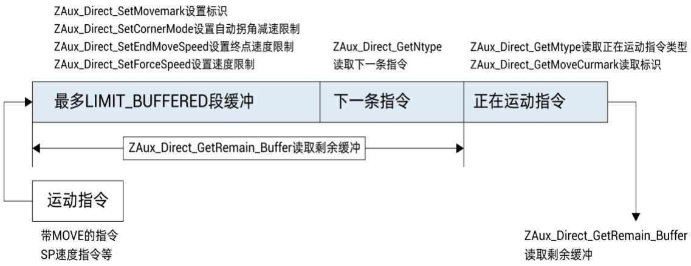

每个轴的运动缓冲互不干扰，如下图。ZMC4 系列运动控制器每个轴可支持多达 4096段运动缓冲（不同型号的控制器缓冲个数有差别，具体情况参见控制器手册说明）。

以正运动ZMC406控制器为例，运动缓冲执行机制如下图：

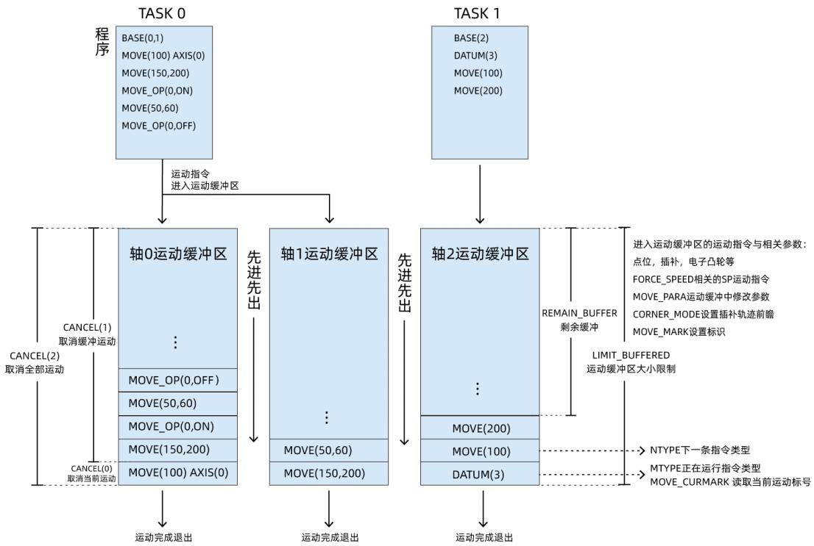  
支 持 运 动 缓 冲 的 指 令 有 ： 如 ： ZAux\_Direct\_MoveSp ， ZAux\_Direct\_MoveAbsSp ，ZAux\_Direct\_MoveCircSp 等，即后缀带 SP 函数的指令。  
不支持运动缓冲的指令：如 ZAux\_Direct\_MoveModify 等

## 例程

## 6.1.3-1 获取剩余运动缓冲数量

在 ZDevelop 开发环境中可以通过在命令行输入?\*max 在信息输出窗口来查看最大的运动缓冲区大小，例如 MotionRT7 运动缓冲区大小为 max\_movebuff:4096。

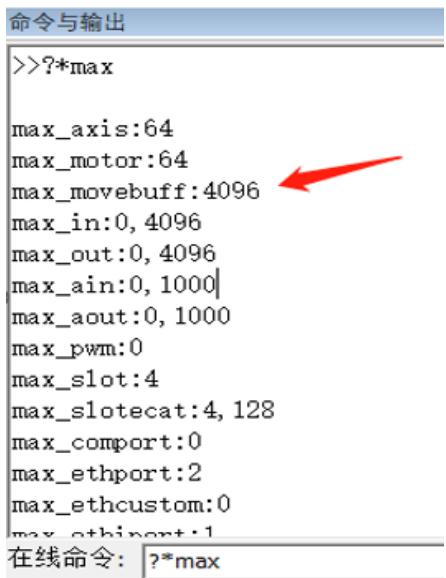

本例程获取轴0缓冲区剩余缓冲数，根据剩余缓冲数是否大于 0，往缓冲区里面加入运动。

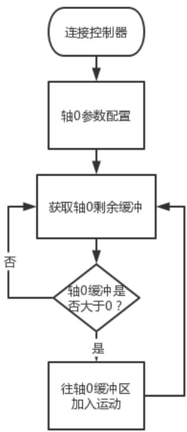

```c
// test1.cpp : 定义控制台应用程序的入口点。
//
#include "stdafx.h"
#include <windows.h>
#include "zmotion.h"
#include "zauxdll2.h"
void commandCheckHandler(const char *command, int ret)
if (ret)//非 0 则失败
{
printf("%s return code is %d\n", command, ret);
}
int _tmain(int argc, _TCHAR* argv[])
{
char *ip_addr = (char *)"127.0.0.1"; //控制器 IP 地址
```

```c
ZMC_HANDLE handle = NULL; //连接句柄
int ret = ZAux_OpenEth(ip_addr, &handle); //连接控制器
if (ERR_SUCCESS != ret)
{
printf("connect controller failed!\n");
handle = NULL;
getchar();
return -1;
printf("控制器连接成功！\n");
ZAux_Direct_SetAtype(handle, 0, 1); //设置轴 0 轴类型为 1
ZAux_Direct_SetUnits(handle, 0, 100); //设置轴 0 脉冲当量为 100
ZAux_Direct_SetSpeed(handle, 0, 200); //设置轴 0 速度为 200units/s
ZAux_Direct_SetAccel(handle, 0, 2000); //设置轴 0 加速度为 2000units/s/s
ZAux_Direct_SetDecel(handle, 0, 2000); //设置轴 0 减速度为 2000units/s/s
int MoveTime = 0;
int GetValue;
ret = ZAux_Direct_SetDpos( handle, 0 , 0);//DPOS 位置清 0
commandCheckHandler("ZAux_Direct_SetDpos",ret);
while (MoveTime < 100)
ret = ZAux_Direct_GetRemain_Buffer( handle, 0, &GetValue);//获取轴 0 剩余缓冲数
commandCheckHandler("ZAux_Direct_GetRemain_Buffer", ret);
printf("Remain_Buffer = %d \n", GetValue);
if (GetValue > 0)//若轴 0 缓冲数>0
ret = ZAux_Direct_Single_Move( handle, 0, 10);//给轴 0 缓冲加入运动
commandCheckHandler("ZAux_Direct_Single_Move", ret);
MoveTime += 1;
```

```c
Sleep(2000);
ret = ZAux_Close(handle); //关闭连接
commandCheckHandler("ZAux_Close", ret) ;//判断指令是否执行成功
printf("connection closed!\n");
handle = NULL;
return 0;
```

## 6.1.3-2 运动中触发输出（move\_op2）

举例：假设在某个执行机构中，需要实现轴0 运动1mm需要100个脉冲，轴0总共运动2 米，每隔100mm触发一次输出口0用于点胶。

```c
// test1.cpp : 定义控制台应用程序的入口点。
//
#include "stdafx.h"
#include <windows.h>
#include "zmotion.h"
#include "zauxdll2.h"
void commandCheckHandler(const char *command, int ret)
{
if (ret)//非0则失败
{
printf("%s return code is %d\n", command, ret);
int _tmain(int argc, _TCHAR* argv[])
char *ip_addr = (char *)"127.0.0.1"; //控制器IP地址
ZMC_HANDLE handle = NULL; //连接句柄
int ret = ZAux_OpenEth(ip_addr, &handle); //连接控制器
if (ERR_SUCCESS != ret)
{
printf("connect controller failed!\n");
handle = NULL;
getchar();
return -1;
```

```c
}
printf("控制器连接成功！\n");
ZAux_Direct_SetAtype(handle, 0, 1); //设置轴 0 轴类型为4
ZAux_Direct_SetUnits(handle, 0, 100); //设置轴 0 脉冲当量为100,对应1mm
ZAux_Direct_SetSpeed(handle, 0, 200); //设置轴 0 速度为 200units/s
ZAux_Direct_SetAccel(handle, 0, 2000); //设置轴 0 加速度为 2000units/s/s
ZAux_Direct_SetDecel(handle, 0, 2000); //设置轴 0 减速度为 2000units/s/s
int MoveTime = 0;
int GetValue;
ret = ZAux_Direct_SetDpos( handle, 0 , 0);//DPOS位置清0,
commandCheckHandler("ZAux_Direct_SetDpos",ret);
ret = ZAux_Direct_SetMpos( handle, 0 , 0);//MPOS位置清0,
commandCheckHandler("ZAux_Direct_SetMpos",ret);
ret = ZAux_Direct_SetMerge( handle, 0 , 1);//打开连续插补
commandCheckHandler("ZAux_Direct_SetMerge",ret);
ret =ZAux_Trigger(handle);
commandCheckHandler("ZAux_Trigger",ret);
for (int i=0;i<20;i++)
{
ret = ZAux_Direct_Single_Move(handle, 0 , 100);
commandCheckHandler("ZAux_Direct_Single_Move", ret);
ret = ZAux_Direct_MoveOp2(handle, 0 , 0,1,10);
commandCheckHandler("ZAux_Direct_MoveOp2", ret);
}
Sleep(2000);
ret = ZAux_Close(handle); //关闭连接
commandCheckHandler("ZAux_Close", ret) ;//判断指令是否执行成功
printf("connection closed!\n");
handle = NULL;
return 0;
```

由下图示波器可观察出，在速度不掉的情况下，每隔 100 个脉冲当量的位置，OUT 0输出一次：

<table><tr><td>示波器</td><td></td></tr><tr><td></td></tr><tr><td>设置</td><td></td><td>启动</td><td>停止 ↑ &lt;</td><td>MPOS[0]</td><td></td><td></td><td>Min:0.00</td><td></td><td>Max:2000.00</td><td></td><td></td><td></td><td></td><td></td><td></td><td></td><td></td><td></td></tr><tr><td>水平刻度： 连续采集</td><td colspan="2">1000</td><td colspan="2">T模式 □ □显示游标</td><td>2OP[] 3 VP_SPEED[0)]</td><td></td><td></td><td>Min:0.00 Min:0.00</td><td></td><td colspan="2">Max:1.00 Max:200.00</td><td></td><td colspan="2"></td><td colspan="2"></td><td colspan="2"></td><td></td></tr><tr><td>手动触发</td><td></td><td>跟随</td><td>导入</td><td>导出</td><td></td><td></td><td></td><td></td><td></td><td></td><td></td><td></td><td></td><td></td><td></td><td></td><td></td><td></td><td></td></tr><tr><td>显示编号</td><td></td><td>数据源</td><td>偏移</td><td>垂直刻度</td><td></td><td></td><td></td><td></td><td></td><td></td><td></td><td></td><td></td><td></td><td></td><td></td><td></td><td></td><td></td></tr><tr><td>√ □</td><td>□</td><td>MPOS</td><td>日 D</td><td>1000</td><td></td><td></td><td></td><td></td><td></td><td></td><td></td><td></td><td></td><td></td><td></td><td></td><td></td><td></td><td></td></tr><tr><td>□ □ √ □</td><td>? OP □</td><td>VP_SPEED</td><td>日 0 日</td><td>1</td><td></td><td></td><td></td><td></td><td></td><td></td><td></td><td></td><td></td><td></td><td></td><td></td><td></td><td></td><td></td></tr><tr><td></td><td></td><td></td><td>D</td><td>100</td><td></td><td></td><td></td><td></td><td></td><td></td><td></td><td></td><td></td><td></td><td></td><td></td><td></td><td></td><td></td></tr><tr><td></td><td></td><td></td><td></td><td></td><td></td><td>：1000</td><td></td><td>2000</td><td></td><td></td><td></td><td>4000</td><td></td><td>5000</td><td></td><td></td><td></td><td></td><td></td></tr><tr><td></td><td></td><td></td><td></td><td></td><td></td><td></td><td></td><td></td><td></td><td>3000</td><td></td><td></td><td></td><td></td><td>6000</td><td>7000</td><td></td><td>8000</td></tr><tr><td></td><td></td><td></td><td></td><td></td><td></td><td></td><td></td><td></td><td></td><td></td><td></td><td></td><td></td><td></td><td></td><td></td><td></td><td></td></tr><tr><td></td><td></td><td></td><td></td><td></td><td></td><td></td><td></td><td></td><td></td><td></td><td></td><td></td><td></td><td></td><td></td><td></td><td></td><td></td></tr><tr><td></td><td></td><td></td><td></td><td></td><td></td><td></td><td></td><td></td><td></td><td></td><td></td><td></td><td></td><td></td><td></td><td></td><td></td><td></td></tr></table>

## 6.2 单轴运动

## 指令列表

<table><tr><td rowspan=1 colspan=2>指令                                                  说明</td></tr><tr><td rowspan=1 colspan=1> ZAux Direct_ Single_ Move</td><td rowspan=1 colspan=1>单轴相对运动</td></tr><tr><td rowspan=1 colspan=1>ZAux Direct Single MoveAbs</td><td rowspan=1 colspan=1>单轴绝对运动</td></tr><tr><td rowspan=1 colspan=1> ZAux_ Direct Single_ Vmove</td><td rowspan=1 colspan=1>单轴连续运动</td></tr><tr><td rowspan=1 colspan=1>ZAux Direct SetJogSpeed</td><td rowspan=1 colspan=1>设置JOG时速度</td></tr><tr><td rowspan=1 colspan=1> ZAux Direct GetJogSpeed</td><td rowspan=1 colspan=1>读取JOG时速度</td></tr><tr><td rowspan=1 colspan=1>ZAux_Direct_GetFastJog</td><td rowspan=1 colspan=1>读取 JOG 速度输入IN，有输入时，速度由 SPEED参数给出。如果没有输入，速度由JOGSPEED 参数给出</td></tr><tr><td rowspan=1 colspan=1> ZAux Direct SetFastJog</td><td rowspan=1 colspan=1>设置 JOG 速度输入IN，有输入时，速度由 SPEED参数给出。如果没有输入，速度由 JOGSPEED参数给出</td></tr><tr><td rowspan=1 colspan=1>ZAux Direct SetFwdJog</td><td rowspan=1 colspan=1>设置正向JOG 输入对应的输入编号-1无效</td></tr><tr><td rowspan=1 colspan=1>ZAux_Direct_GetFwdJog</td><td rowspan=1 colspan=1>读取正向 JOG 输入对应的输入编号-1无效</td></tr><tr><td rowspan=1 colspan=1>ZAux Direct_ SetRevJog</td><td rowspan=1 colspan=1>设置负向 JOG 输入对应的输入编号-1无效</td></tr><tr><td rowspan=1 colspan=1>ZAux_Direct_ GetRevJog</td><td rowspan=1 colspan=1>读取负向 JOG 输入对应的输入编号-1无效</td></tr><tr><td rowspan=1 colspan=1></td><td rowspan=1 colspan=1></td></tr></table>

## 重点说明

控制器每个轴都有自己独立的轴参数，并且运动的参数值全局性的，即速度、加速度一变则立刻生效，可以实现在线变速的功能。

当 调 用 ZAux\_Direct\_Single\_Cancel 停 止 运 动 指 令 时 ， 需 通 过 使 用 减 速 度 指 令ZAux\_Direct\_SetFastDec(缺省默认等于减速度的值)来设置的值减速，要实现急停时可以将快减减速度设置为驱动器的最大允许值。

单轴持续运动（ZAux\_Direct\_Single\_Vmove）连续往一个方向运动。若前面的单轴持续运动没有停止时，新的单轴持续运动指令会自动替换前面的单轴持续运动并修改方向，因此不需要调用 ZAux\_Direct\_Single\_Cancel 停止前面的单轴持续运动。

## 例程

## 6.2.3-1 单轴点位运动

初始时命令位置为 0，脉冲当量设为 100，速度设为 200units/s，加速度 2000unit/s^2，减速度 2000units/s^2，S 形曲线加减速时间设为 200ms，先做相对运动，运动 800units，然后再做绝对运动，运动到绝对位置 100units的位置。

Ps: S 形曲线加减速时间为运动加减速过程的变化时间，且为轨迹为 S形，非梯形。

```cpp
运动参数配置 相对运动800 units 绝对运动到100 units
// test1.cpp : 定义控制台应用程序的入口点。
//
#include "stdafx.h"
#include <windows.h>
#include "zmotion.h"
#include "zauxdll2.h"
void commandCheckHandler(const char *command, int ret)
{
if (ret)//非 0 则失败
{
printf("%s return code is %d\n", command, ret);
```

```c
int _tmain(int argc, _TCHAR* argv[])
char *ip_addr = (char *)"127.0.0.1"; //控制器 IP 地址
ZMC_HANDLE handle = NULL; //连接句柄
int ret = ZAux_OpenEth(ip_addr, &handle); //连接控制器
if (ERR_SUCCESS != ret)
{
printf("connect controller failed!\n");
handle = NULL;
getchar();
return -1;
}
printf("控制器连接成功！\n");
ZAux_Direct_SetAtype(handle, 0, 1); //设置轴 0 轴类型为 1
ZAux_Direct_SetUnits(handle, 0, 100); //设置轴 0 脉冲当量为 100
ZAux_Direct_SetSpeed(handle, 0, 200); //设置轴 0 速度为 200units/s
ZAux_Direct_SetAccel(handle, 0, 2000); //设置轴 0 加速度为 2000units/s/s
ZAux_Direct_SetDecel(handle, 0, 2000); //设置轴 0 减速度为 2000units/s/s
ZAux_Direct_SetSramp(handle, 0, 200); //设置轴 0 S 曲线为 200ms
ret = ZAux_Direct_SetDpos( handle, 0, 0);//轴指令位置清 0
commandCheckHandler("ZAux_Direct_SetDpos", ret);//判断指令是否执行成功
ret = ZAux_Direct_SetMpos( handle, 0, 0);//编码器反馈位置清 0
commandCheckHandler("ZAux_Direct_SetMpos", ret);//判断指令是否执行成功
ZAux_Trigger(handle);//示波器触发函数
ret =ZAux_Direct_Single_Move( handle, 0, 800);
commandCheckHandler("ZAux_Direct_SetDpos", ret);//判断指令是否执行成功
float IDLE;
while (1)//等待轴 0 运动完成
{
```

```c
Sleep(100);
ZAux_Direct_GetParam(handle,"IDLE",0,&IDLE);
if (IDLE<0)break;
ret =ZAux_Direct_Single_MoveAbs( handle, 0, 100);
commandCheckHandler("ZAux_Direct_SetDpos", ret);//判断指令是否执行成功
while (1)//等待轴 0 运动完成
{
Sleep(100);
ZAux_Direct_GetParam(handle,"IDLE",0,&IDLE);
if (IDLE<0)break;
Sleep(2000);
ret = ZAux_Close(handle); //关闭连接
commandCheckHandler("ZAux_Close", ret) ;//判断指令是否执行成功
printf("connection closed!\n");
handle = NULL;
return 0;
```

波形图：

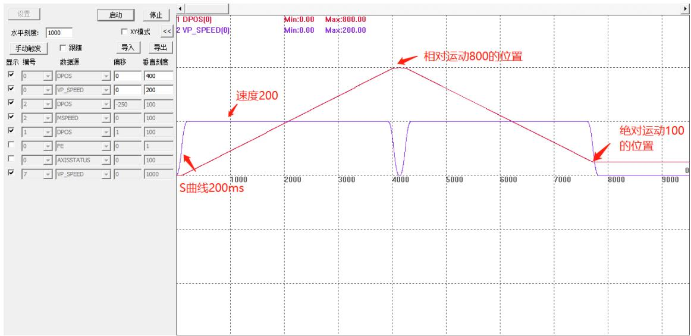

## 6.2.3-2 单轴持续运动

初始时命令位置为 0，脉冲当量设为 100，速度设为 200units/s，加速度 2000unit/s^2，减速度2000units/s^2，S形曲线加减速时间设为200ms，先做正向持续运动3 秒中，然后再

运动参数配置 正向持续运动3秒 负向持续运动5秒

做负向持续运动5秒中，后停止运动。

Ps：S形曲线加减速时间为运动加减速过程的变化时间，且为轨迹为S 形，非梯形。

```c
// test1.cpp : 定义控制台应用程序的入口点。
//
#include "stdafx.h"
#include <windows.h>
#include "zmotion.h"
#include "zauxdll2.h"
void commandCheckHandler(const char *command, int ret)
if (ret)//非 0 则失败
{
printf("%s return code is %d\n", command, ret);
}
int _tmain(int argc, _TCHAR* argv[])
char *ip_addr = (char *)"127.0.0.1"; //控制器 IP 地址
ZMC_HANDLE handle = NULL; //连接句柄
int ret = ZAux_OpenEth(ip_addr, &handle); //连接控制器
if (ERR_SUCCESS != ret)
{
printf("connect controller failed!\n");
handle = NULL;
getchar();
return -1;
}
printf("控制器连接成功！\n");
ZAux_Direct_SetAtype(handle, 0, 1); //设置轴 0 轴类型为 1
```

ZAux\_Direct\_SetUnits(handle, 0, 100); //设置轴 0 脉冲当量为 100   
ZAux\_Direct\_SetSpeed(handle, 0, 200); //设置轴 0 速度为 200units/s   
ZAux\_Direct\_SetAccel(handle, 0, 2000); //设置轴 0 加速度为 2000units/s/s   
ZAux\_Direct\_SetDecel(handle, 0, 2000); //设置轴 0 减速度为 2000units/s/s   
ZAux\_Direct\_SetSramp(handle, 0, 200); //设置轴 0 S 曲线为 200ms   
ret = ZAux\_Direct\_SetDpos( handle, 0, 0);//轴指令位置清 0   
commandCheckHandler("ZAux\_Direct\_SetDpos", ret);//判断指令是否执行成功   
ret = ZAux\_Direct\_SetMpos( handle, 0, 0);//编码器反馈位置清 0   
commandCheckHandler("ZAux\_Direct\_SetMpos", ret);//判断指令是否执行成功   
ZAux\_Trigger(handle);//示波器触发函数   
ret =ZAux\_Direct\_Single\_Vmove( handle, 0, 1);   
commandCheckHandler("ZAux\_Direct\_Single\_Vmove", ret);//判断指令是否执行成功   
Sleep(3000);//延时三秒   
ret =ZAux\_Direct\_Single\_Vmove( handle, 0, -1);   
commandCheckHandler("ZAux\_Direct\_SetDpos", ret);//判断指令是否执行成功   
Sleep(5000);//延时 5 秒   
ret = ZAux\_Direct\_Single\_Cancel(handle,0,2);//停止运动   
commandCheckHandler("ZAux\_Direct\_Single\_Cancel", ret) ;//判断指令是否执行成功   
ret = ZAux\_Close(handle); //关闭连接   
commandCheckHandler("ZAux\_Close", ret) ;//判断指令是否执行成功   
printf("connection closed!\n");   
handle = NULL;   
return 0;

波形图：

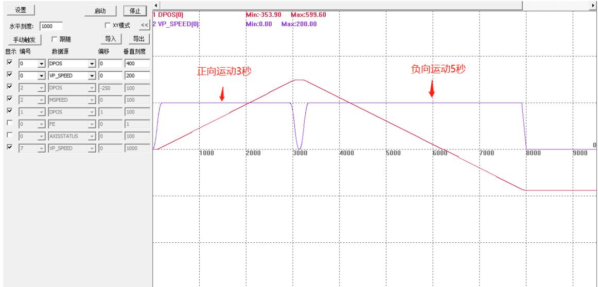

## 6.2.3-3 快速点动（IN 控制）

初始时命令为 0，脉冲当量设为 100，速度设为 200units/s，加速度 2000unit/s^2，减速度 2000units/s^2，S 形曲线加减速时间设为 200ms。JOG 速度设置为 100。把输入口 IN0 映射为控制使用JOG 速度和SPEED 速度的输入口，把输入口IN1设置为正方向运动控制的输入口，把输入口IN2映射为负方向运动的控制的输入口。

Ps：S形曲线加减速时间为运动加减速过程的变化时间，且为轨迹为S 形，非梯形。

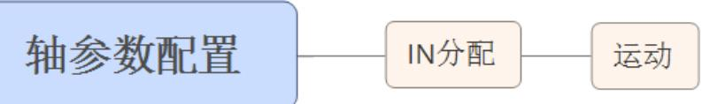

```cpp
轴参数配置 IN分配 运动
// test1.cpp : 定义控制台应用程序的入口点。
//
#include "stdafx.h"
#include <windows.h>
#include "zmotion.h"
#include "zauxdll2.h"
void commandCheckHandler(const char *command, int ret)
if (ret)//非 0 则失败
{
printf("%s return code is %d\n", command, ret);
```

```c
int32 _stdcall ZAux_Direct_ZSIMU_IN(ZMC_HANDLE handle,int link_axis,int move_axis)
char cmdbuff[2048];
char cmdbuffAck[2048];
//生成命令
sprintf(cmdbuff, "ZSIMU_IN(%d,%d) ", link_axis,move_axis);
//调用命令执行函数
return ZAux_DirectCommand(handle, cmdbuff, cmdbuffAck, 2048);
}
int _tmain(int argc, _TCHAR* argv[])
{
char *ip_addr = (char *)"127.0.0.1"; //控制器 IP 地址
ZMC_HANDLE handle = NULL; //连接句柄
int ret = ZAux_OpenEth(ip_addr, &handle); //连接控制器
if (ERR_SUCCESS != ret)
{
printf("connect controller failed!\n");
handle = NULL;
getchar();
return -1;
}
printf("控制器连接成功！\n");
ZAux_Direct_SetAtype(handle, 0, 1); //设置轴 0 轴类型为 1
ZAux_Direct_SetUnits(handle, 0, 100); //设置轴 0 脉冲当量为 100
ZAux_Direct_SetSpeed(handle, 0, 200); //设置轴 0 速度为 200units/s
ZAux_Direct_SetAccel(handle, 0, 2000); //设置轴 0 加速度为 2000units/s/s
ZAux_Direct_SetDecel(handle, 0, 2000); //设置轴 0 减速度为 2000units/s/s
ZAux_Direct_SetSramp(handle, 0, 200); //设置轴 0 S 曲线为 200ms
```

ret = ZAux\_Direct\_SetDpos( handle, 0, 0);//轴指令位置清 0   
commandCheckHandler("ZAux\_Direct\_SetDpos", ret);//判断指令是否执行成功   
ret = ZAux\_Direct\_SetMpos( handle, 0, 0);//编码器反馈位置清 0   
commandCheckHandler("ZAux\_Direct\_SetMpos", ret);//判断指令是否执行成功   
ZAux\_Direct\_SetJogSpeed(handle, 0, 100);//设置 JOG 速度为 100   
ZAux\_Direct\_SetFastJog(handle, 0, 0);//设置 JOG 速度是否启动控制 IN   
ZAux\_Direct\_SetFwdJog(handle, 0, 1);//设置 JOG 正方向控制 IN0   
ZAux\_Direct\_SetRevJog(handle, 0, 2);//设置 JOG 负方向控制 IN1   
ZAux\_Direct\_SetInvertIn(handle, 0, 1);//反转 IN 有效输入。ECI 系列的控制卡不用反转   
ZAux\_Direct\_SetInvertIn(handle, 1, 1);//反转 IN 有效输入。ECI 系列的控制卡不用反转   
ZAux\_Direct\_SetInvertIn(handle, 2, 1);//反转 IN 有效输入。ECI 系列的控制卡不用反转   
ZAux\_Trigger(handle);//示波器触发函数   
Sleep(500);   
ret = ZAux\_Close(handle); //关闭连接   
commandCheckHandler("ZAux\_Close", ret) ;//判断指令是否执行成功   
printf("connection closed!\n");   
handle = NULL;   
return 0;

IN(0)未有效输入时：  
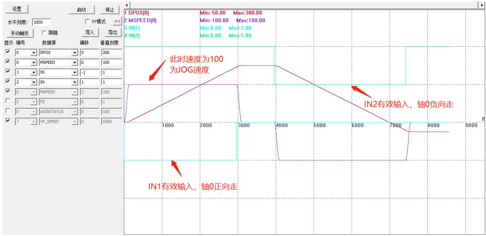  
IN(0)有效输入时：

<table><tr><td colspan="3">设置</td><td>启动</td><td>停止 □ 1 DPOS[0]</td><td colspan="9"></td></tr><tr><td>水平刻度：</td><td>1000</td><td colspan="3">□xY模式</td><td rowspan="2">[2 MSPEED[0]</td><td rowspan="2">Min:-100.00 Min:-200.00 Min:0.00 Min:0.00</td><td rowspan="2">Max:1.00</td><td rowspan="2">Max:600.00 Max:200.00</td><td rowspan="2"></td><td rowspan="2"></td><td rowspan="2"></td><td rowspan="2"></td><td rowspan="2"></td></tr><tr><td>手动触发</td><td>厂跟随</td><td></td><td>导出 导入</td><td>3 IN[1]</td></tr><tr><td>显示编号</td><td>数据源</td><td></td><td>偏移</td><td>4 IN[2] 垂直刻度</td><td rowspan="5"></td><td rowspan="5"></td><td rowspan="5">Max:1.00</td><td rowspan="5"></td><td rowspan="5"></td><td rowspan="5"></td><td rowspan="5"></td><td rowspan="5"></td><td rowspan="5"></td></tr><tr><td>√ □</td><td>□ DPOS</td><td>日 □</td><td>400</td></tr><tr><td></td><td>□ MSPEED</td><td></td><td></td></tr><tr><td>√ 回</td><td>□ 园N</td><td>□ D □ 1</td><td>100</td></tr><tr><td>√ 1 √ 2</td><td>□ 园</td><td>□ 1</td><td>1 1</td></tr><tr><td>?</td><td>MSPEED</td><td></td><td></td><td>100</td><td rowspan="5">:1000</td><td rowspan="5"></td><td rowspan="5"></td><td rowspan="5"></td><td rowspan="5">IN(2)有效输入时负向运动</td><td rowspan="5"></td><td rowspan="5"></td><td rowspan="5"></td><td rowspan="5">0 9000</td></tr><tr><td>0</td><td>[FE</td><td>AXISSTATUS</td><td>□ □ 100</td><td></td></tr><tr><td></td><td>|VP_SPEED</td><td></td><td>□ □</td><td>1000</td></tr><tr><td>√</td><td></td><td></td><td>日 </td><td></td></tr><tr><td></td><td></td><td></td><td></td><td></td></tr><tr><td></td><td></td><td></td><td></td><td rowspan="3"></td><td rowspan="3"></td><td rowspan="3"></td><td rowspan="3"></td><td rowspan="3"></td><td rowspan="3">速度=200，为SPEED速度</td><td rowspan="3"></td><td rowspan="3"></td><td rowspan="3"></td></tr><tr><td></td><td></td><td></td><td></td></tr><tr><td></td><td></td><td></td><td></td></tr><tr><td></td><td></td><td></td><td></td><td rowspan="2"></td><td rowspan="2">IN1有效输入正向运动</td><td rowspan="2"></td><td rowspan="2"></td><td rowspan="2"></td><td rowspan="2"></td><td rowspan="2"></td><td rowspan="2"></td><td rowspan="2"></td></tr><tr><td></td><td></td><td></td><td></td></tr><tr><td></td><td></td><td></td><td></td><td></td><td></td><td></td><td></td><td></td><td></td><td></td><td></td><td></td><td></td></tr><tr><td></td><td></td><td></td><td></td><td></td><td></td><td></td><td></td><td></td><td></td><td></td><td></td><td></td><td></td></tr><tr><td></td><td></td><td></td><td></td><td></td><td></td><td></td><td></td><td></td><td></td><td></td><td></td><td></td><td></td></tr><tr><td></td><td></td><td></td><td></td><td></td><td></td><td></td><td></td><td></td><td></td><td></td><td></td><td></td><td></td></tr></table>

## 6.3 回零运动

## 指令列表

<table><tr><td rowspan=1 colspan=2>指令                                                   说明</td></tr><tr><td rowspan=1 colspan=1> ZAux _Direct Single_ Datum</td><td rowspan=1 colspan=1>控制器方式回零</td></tr><tr><td rowspan=1 colspan=1>ZAux_BusCmd Datum</td><td rowspan=1 colspan=1>总线驱动器回零</td></tr><tr><td rowspan=1 colspan=1>ZAux_Direct_UserDatum</td><td rowspan=1 colspan=1>自定义二次回零</td></tr><tr><td rowspan=1 colspan=1>ZAux Direct SetHomeWait</td><td rowspan=1 colspan=1>设置回零反找等待时间</td></tr><tr><td rowspan=1 colspan=1>ZAux Direct GetHomeWait</td><td rowspan=1 colspan=1>读取回零反找等待时间</td></tr><tr><td rowspan=1 colspan=1>ZAux_BusCmd_SetDatumOffpos</td><td rowspan=1 colspan=1>设置回零偏移距离</td></tr><tr><td rowspan=1 colspan=1>ZAux_BusCmd_GetDatumOffpos</td><td rowspan=1 colspan=1>读取回零偏移距离</td></tr><tr><td rowspan=1 colspan=1>ZAux_Direct_ SetCreep</td><td rowspan=1 colspan=1>设置回零爬行速度</td></tr><tr><td rowspan=1 colspan=1>ZAux_ Direct_GetCreep</td><td rowspan=1 colspan=1>读取回零爬行速度</td></tr><tr><td rowspan=1 colspan=1> ZAux Direct GetHomeStatus</td><td rowspan=1 colspan=1>回零完成状态</td></tr><tr><td rowspan=1 colspan=1>ZAux_Direct GetHomeStatus2</td><td rowspan=1 colspan=1>回零完成状态2</td></tr><tr><td rowspan=1 colspan=1>ZAux_BusCmd_ GetHomeStatus</td><td rowspan=1 colspan=1>驱动器回零完成状态</td></tr><tr><td rowspan=1 colspan=1>ZAux_BusCmd GetHomeStatus2</td><td rowspan=1 colspan=1>驱动器回零完成状态2</td></tr><tr><td rowspan=1 colspan=1>ZAux_Direct_SetDatumIn</td><td rowspan=1 colspan=1>设置回零原点信号对应输入口</td></tr><tr><td rowspan=1 colspan=1>ZAux Direct_ GetDatumIn</td><td rowspan=1 colspan=1>读取回零原点信号对应输入口</td></tr><tr><td rowspan=1 colspan=1>ZAux Direct SetInvertIn</td><td rowspan=1 colspan=1>设置输入口有效状态反转</td></tr><tr><td rowspan=1 colspan=1>ZAux_Direct_ GetInvertIn</td><td rowspan=1 colspan=1>读取输入口反转状态</td></tr></table>

## 重点说明

原点开关的输入点由参数 ZAux\_Direct\_SetDatumIn 决定，正负限位开关通过 ZAux\_Direct\_SetFwdIn，ZAux\_Direct\_SetRevIn 设置。

ZMC控制器为0 触发有效，输入为OFF 状态时，表示到达原点/限位，常开类型信号需要采用 ZAux\_Direct\_SetInvertIn 反转电平。

ECI 控制器为 1 触发有效，输入为 ON 状态时，表示到达原点/限位，常闭类型信号需要采用 ZAux\_Direct\_SetInvertIn 反转电平。

Z 信号回零必须配置为带Z 信号轴类型。

多轴回零时，需要都每个轴都使用回零函数。

总线控制器使用控制器找原点模式完成后，需要手动清零反馈位置。

回零方式如下：

## 回零模式 1

如下图，ZAux\_Direct\_Single\_Datum 模式 1：轴以 ZAux\_Direct\_SetCreep 速度正向运行，直到Z 信号出现后开始减速，减速到0 之后，此时将命令位置值重置为0，停止后所处位置为原点，回零途中若碰到限位开关会直接停止。

回零模式 2 与模式 1 类型一致，找原点运动方向相反。

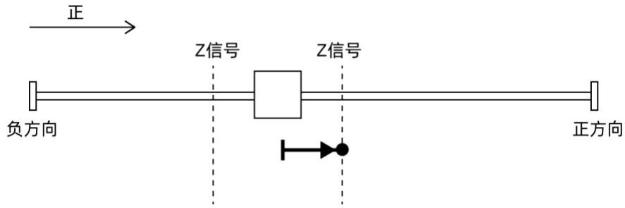  
速度时间曲线图：

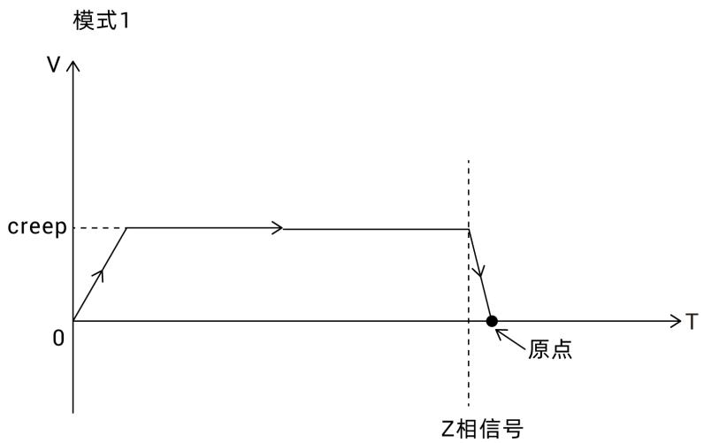  
Z 相模式回零

注：回零碰到Z 相信号后，是用 Decel 的减速度，减速到 0 停止的。存在 1 小段误差，可以通过把 Creep 的速度减小，Decel 减速度加大来减小误差。若存在高精度的回零，则需

要自己通过Z相锁存，手动做回零来达到高精度的Z 相回零效果。

## 回零模式 3

如下图，ZAux\_Direct\_Single\_Datum 模式 3：轴以 ZAux\_Direct\_SetSpeed 速度快速正向运行,直到碰到原点开关后开始减速，减速到 0 之后再反向以 ZAux\_Direct\_SetCreep 速度找原点，再次碰到原点之后减速停止，轴停止之后将位置值重置为0，当前所处位置为原点，回零途中若碰到限位开关会直接停止。

回零模式 4 与模式 3 类型一致，找原点运动方向相反。

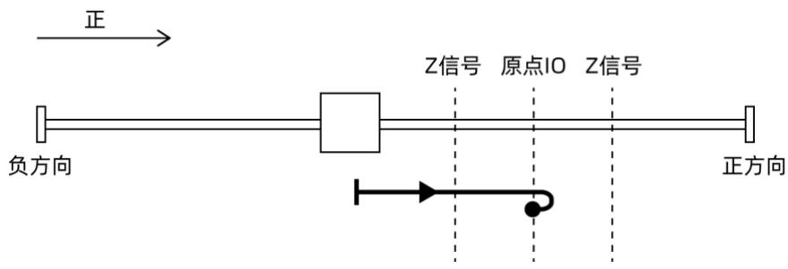

速度时间曲线图：

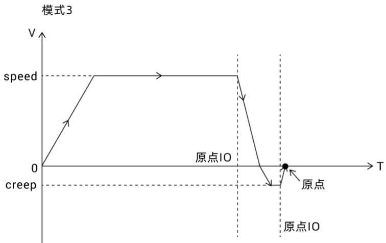

注：回零碰到原点信号后，是减速到 Creep 速度，反向运动遇到原点 IO 感应就停止，用减速到 0 停止的。存在从离开 IO 感应到减速为 0 之间的一小段误差，可以通过把 Creep的速度减小，Decel 减速度加大来减小误差。若存在高精度的回零，则需要自己通过 IO 锁存，手动做回零来达到高精度的效果。

## 回零模式 5

如下图，ZAux\_Direct\_Single\_Datum 模式 5：轴以 ZAux\_Direct\_SetSpeed 速度快速正向运行,直到碰到原点开关后开始减速，减速到 0 之后再反向以 ZAux\_Direct\_SetCreep 速度运动，直到Z信号出现之后减速停止，遇到Z 信号便将位置值重置为0，Z 信号出现的位置为原点，回零途中若碰到限位开关会直接停止。

回零模式 6 与模式 5 类型一致，找原点运动方向相反。

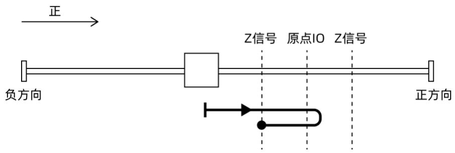  
速度时间曲线图：

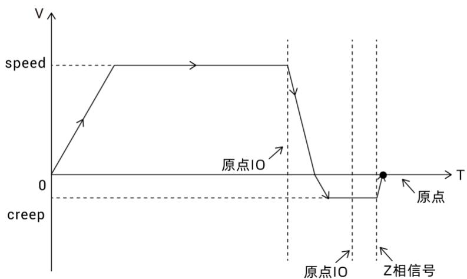

注：回零碰到原点信号后，是用 Decel的减速度减速到Creep速度，反向运动，直到离开原点IO感应，碰到 Z相信号后，用Decel的减速度减速到 0停止的。存在从离开 Z信号感应到减速为 0 之间的一小段误差，可以通过把 Creep 的速度减小，Decel 减速度加大来减小误差。若存在高精度的回零，则需要自己通过 Z 相锁存，手动做回零来达到高精度的效果。

## 回零模式 8

如下图，ZAux\_Direct\_Single\_Datum 模式 8：轴以 ZAux\_Direct\_SetSpeed 速度快速正向运行,直到碰到原点开关后开始减速，减速到0之后便将位置值重置为0，停止后所处位置为原点，回零途中若碰到限位开关会直接停止。

回零模式 9 与模式 8 类型一致，找原点运动方向相反。

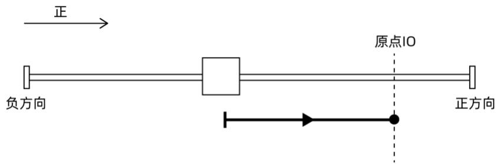

速度时间曲线图：

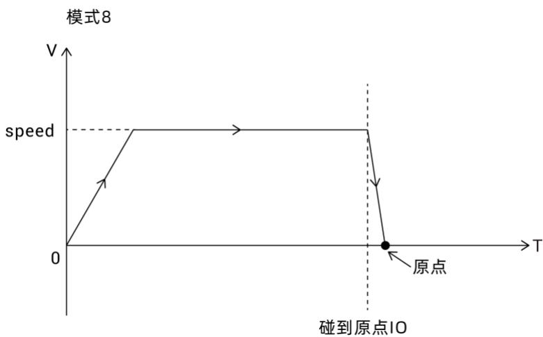

注：回零碰到原点信号后，是用 Decel 的减速度，减速到 0 停止的。存在一小段误差，可以通过把 speed 的速度减小，Decel 减速度加大来减小误差。若存在高精度的回零，则需要自己通过IO锁存，手动做回零来达到高精度的回零效果。

## 例程

## 6.3.3-1 单轴回零运动

本例程采用回零模式 3，轴以 ZAux\_Direct\_SetSpeed 速度正向运行，直到碰到原点开关。然后轴以 ZAux\_Direct\_SetCreep 速度反向运动直到离开原点开关。同时位置会自动清0。例子里面以IN0作为原点开关，开启了电平反转。

```cpp
轴参数配置 正向SPEED速度运动 找到原点IN 反向CREEP速度运动 离开原点IN感应 停止清零
// test1.cpp : 定义控制台应用程序的入口点。
#include "stdafx.h"
#include <windows.h>
#include "zmotion.h"
#include "zauxdll2.h"
void commandCheckHandler(const char *command, int ret)
if (ret)//非 0 则失败
{
printf("%s return code is %d\n", command, ret);
```

```c
int _tmain(int argc, _TCHAR* argv[])
{
char *ip_addr = (char *)"127.0.0.1"; //控制器 IP 地址
ZMC_HANDLE handle = NULL; //连接句柄
int ret = ZAux_OpenEth(ip_addr, &handle); //连接控制器
if (ERR_SUCCESS != ret)
{
printf("connect controller failed!\n");
handle = NULL;
getchar();
return -1;
}
printf("控制器连接成功！\n");
ZAux_Direct_SetAtype(handle, 0, 1); //设置轴 0 轴类型为 1
ZAux_Direct_SetUnits(handle, 0, 100); //设置轴 0 脉冲当量为 100
ZAux_Direct_SetSpeed(handle, 0, 200); //设置轴 0 速度为 200units/s
ZAux_Direct_SetAccel(handle, 0, 2000); //设置轴 0 加速度为 2000units/s/s
ZAux_Direct_SetDecel(handle, 0, 2000); //设置轴 0 减速度为 2000units/s/s
ZAux_Direct_SetSramp(handle, 0, 200); //设置轴 0 S 曲线时间为 200ms
ret = ZAux_Direct_SetCreep(handle, 0, 50); //设置回零时反向爬行速度
commandCheckHandler("ZAux_Direct_SetCreep", 0);
ret = ZAux_Direct_SetDatumIn(handle, 0, 0); //设置原点点开关
commandCheckHandler("ZAux_Direct_SetDatumIn", 0);
ret = ZAux_Direct_SetHomeWait(handle, 0, 1000); //设置回零等待时间
commandCheckHandler("ZAux_Direct_SetHomeWait", 0);
ret = ZAux_Direct_SetInvertIn(handle, 0, 1); //设置输入口 0 电平反转
commandCheckHandler("ZAux_Direct_SetInvertIn", 0);
ret = ZAux_Direct_SetDpos( handle, 0, 0);//轴指令位置清 0
commandCheckHandler("ZAux_Direct_SetDpos", ret);//判断指令是否执行成功
ret = ZAux_Direct_SetMpos( handle, 0, 0);//编码器反馈位置清 0
```

```c
commandCheckHandler("ZAux_Direct_SetMpos", ret);//判断指令是否执行成功
ZAux_Trigger(handle);//示波器触发函数
ret = ZAux_Direct_Single_Datum(handle, 0, 3); //回零，模式 3
commandCheckHandler("ZAux_Direct_Single_Datum", 0);
uint32 homestatus;
while (1)//等待轴 0 回零运动完成
{
Sleep(100);
ZAux_Direct_GetHomeStatus(handle,0,&homestatus);//获取回零运动完成状态
if (homestatus==1)break;
}
Sleep(2000);
ret = ZAux_Close(handle); //关闭连接
commandCheckHandler("ZAux_Close", ret) ;//判断指令是否执行成功
printf("connection closed!\n");
handle = NULL;
return 0;
```

## 波形图：

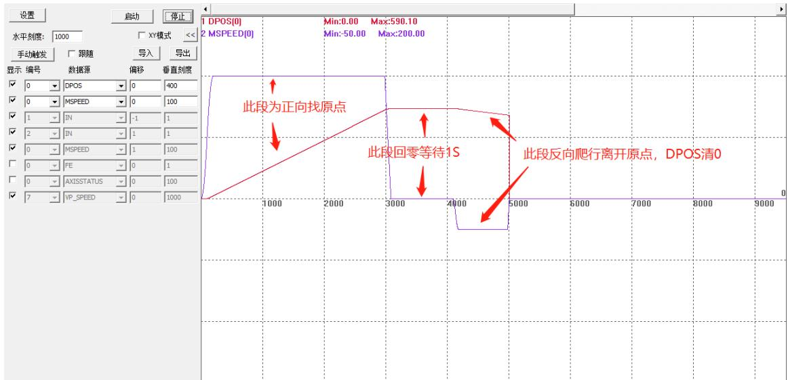

## 6.4 电子齿轮

## 指令列表

<table><tr><td rowspan=1 colspan=2>指令                                                   说明</td></tr><tr><td rowspan=1 colspan=1> ZAux_ Direct SetClutchRate</td><td rowspan=1 colspan=1>设置连接速率</td></tr><tr><td rowspan=1 colspan=1>ZAux Direct GetClutchRate</td><td rowspan=1 colspan=1>获取连接速率</td></tr><tr><td rowspan=1 colspan=1>ZAux Direct EncoderRatio</td><td rowspan=1 colspan=1>编码器输入齿轮比，缺省(1,1)</td></tr><tr><td rowspan=1 colspan=1> ZAux _Direct StepRatio</td><td rowspan=1 colspan=1>设置脉冲输出齿轮比，缺省(1,1)</td></tr><tr><td rowspan=1 colspan=1>ZAux_Direct_Connect</td><td rowspan=1 colspan=1>连接 同步运动指令 电子齿轮</td></tr><tr><td rowspan=1 colspan=1>ZAux_Direct_ Connpath</td><td rowspan=1 colspan=1>连接 同步运动2指令 电子齿轮（矢量方式）</td></tr><tr><td rowspan=1 colspan=1> ZAux Direct GetLinkax</td><td rowspan=1 colspan=1>读取当前连接运动的参考轴号</td></tr></table>

## 重点说明

电子齿轮功能用于两个轴的连接，将主轴与从轴按照一个常数齿轮比建立连接，不需要物理齿轮，使用指令直接设置电子齿轮的比值，由于是使用软件实现的，故电子齿轮比可以随时更改。

电子齿轮功能通过指令 ZAux\_Direct\_Connect、ZAux\_Direct\_Connpath 实现。将一个轴按照一定比例连接到另一个轴上做跟随运动，一条运动指令就能驱动两个电机的运行，通过对这两个电机轴移动量的检测，将位移偏差反馈到控制器并获得同步补偿，这样能使两个轴之间的位移偏差量控制在精度允许范围内。

电子齿轮连接的是脉冲个数，例如主从轴连接比例为 1:5，给主轴发送1 个脉冲，此时对应给从轴发送5个脉冲。

同步指令连接 2 个轴后，取消时需要用 cancel 指令取消当前轴的同步运动，然后再调用别的运动，当切换同步倍率时可以直接调用 ZAux\_Direct\_Connect 来取代前面的ZAux\_Direct\_Connect 指令。连接的是脉冲个数，要考虑不同轴 UNITS 的比例。

与凸轮不同，电子齿轮的连接是线性的。

电子齿轮功能通过指令 ZAux\_Direct\_Connect、ZAux\_Direct\_Connpath 实现，将一个轴按照一定比例连接到另一个轴上做跟随运动，一条运动指令就能驱动两个电机的运行，通过对这两个电机轴移动量的检测，将位移偏差反馈到控制器并获得同步补偿，这样能使两个轴之间的位移偏差量控制在精度允许范围内。

电子齿轮的作用：

1. 脉冲补偿，减少上位机负担（因为目前用的发送脉冲的元件，都有发送脉冲频率的限制）。

2. 匹配电机发出的脉冲数与机械最小移动量，可将指令输入 1个脉冲对应的工件（或电机）移动量设定为任意值；可实现电机的无极变速，在电机启动和停止时，可以防止失步和过冲现象，这样就能充分发挥电机的潜能。

3. 传递同步运动信息，实现坐标的联动、运动形式之间的变换（旋转-旋转，旋转-直线，直线-直线）、简化控制等。

ZAux\_Direct\_Connpath 与 ZAux\_Direct\_Connect 的相同点：二者的使用语法相同，连接 的 都 是 脉 冲 个 数 ， ZAux\_Direct\_Connpath 连 接 到 单 个 轴 的 运 动 的 效 果 与ZAux\_Direct\_Connect 相同。

ZAux\_Direct\_Connpath 与 ZAux\_Direct\_Connect 的区别：ZAux\_Direct\_Connect 连接的是单个轴的目标位置。ZAux\_Direct\_Connpath 是连接的是插补轴的矢量长度，此时需要连接在插补运动的主轴上，连接到插补从轴上无法跟随插补运动。ZAux\_Direct\_Connpath会跟踪XY轴插补的矢量长度变化，而不是跟踪单独的X轴或者Y 轴。

## 例程

## 6.4.3-1 同步运动

本例程驱动轴0运动了 100个脉冲当量的运动距离，把轴 1轴0的轴参数设置一样，比较同步前与同步后的效果区别。

```cpp
// test1.cpp : 定义控制台应用程序的入口点。
//
#include "stdafx.h"
#include <windows.h>
#include "zmotion.h"
#include "zauxdll2.h"
void commandCheckHandler(const char *command, int ret)
if (ret)//非 0 则失败
{
printf("%s fail!return code is %d\n", command, ret);
}
```

```c
int _tmain(int argc, _TCHAR* argv[])
char *ip_addr = (char *)"127.0.0.1"; //控制器 IP 地址，使用仿真器查看时曲线可能会有
误差，最好连实物控制器查看
ZMC_HANDLE handle = NULL; //连接句柄
int ret = ZAux_OpenEth(ip_addr, &handle); //连接控制器
if (ERR_SUCCESS != ret)
{
printf("控制器连接失败!\n");
handle = NULL;
getchar();
return -1;
}
printf("控制器连接成功！\n");
ret =ZAux_Direct_SetAtype(handle,0,1);//设置轴 0 轴类型为 1
commandCheckHandler("ZAux_Direct_SetAtype", ret) ;//判断指令是否执行成功
ret =ZAux_Direct_SetAtype(handle,1,1);//设置轴 1 轴类型为 1
commandCheckHandler("ZAux_Direct_SetAtype", ret) ;//判断指令是否执行成功
ret =ZAux_Direct_SetUnits(handle,0,100);//设置轴 0 脉冲当量为 100
commandCheckHandler("ZAux_Direct_SetUnits", ret) ;//判断指令是否执行成功
ret =ZAux_Direct_SetUnits(handle,1,100);//设置轴 1 脉冲当量为 100
commandCheckHandler("ZAux_Direct_SetUnits", ret) ;//判断指令是否执行成功
ret =ZAux_Direct_SetAccel(handle,0,500);//设置轴 0 加速度
commandCheckHandler("ZAux_Direct_SetAccel", ret) ;//判断指令是否执行成功
ret =ZAux_Direct_SetAccel(handle,1,500);//设置轴 1 加速度
commandCheckHandler("ZAux_Direct_SetAccel", ret) ;//判断指令是否执行成功
ret =ZAux_Direct_SetDecel(handle,0,500);//设置轴 0 减速度
commandCheckHandler("ZAux_Direct_SetDecel", ret) ;//判断指令是否执行成功
ret =ZAux_Direct_SetDecel(handle,1,500);//设置轴 1 减速度
commandCheckHandler("ZAux_Direct_SetDecel", ret) ;//判断指令是否执行成功
ret =ZAux_Direct_SetDpos(handle,0,0);//设置轴 0 DPOS 清 0
```

commandCheckHandler("ZAux\_Direct\_SetDpos", ret) ;//判断指令是否执行成功   
ret =ZAux\_Direct\_SetDpos(handle,1,0);//设置轴 1 DPOS 清 0   
commandCheckHandler("ZAux\_Direct\_SetDpos", ret) ;//判断指令是否执行成功   
ret =ZAux\_Direct\_SetSpeed(handle,0,100);//设置轴 0 速度   
commandCheckHandler("ZAux\_Direct\_SetDecel", ret) ;//判断指令是否执行成功   
ret =ZAux\_Direct\_SetSpeed(handle,1,100);//设置轴 1 速度   
commandCheckHandler("ZAux\_Direct\_SetDecel", ret) ;//判断指令是否执行成功   
ret =ZAux\_Direct\_Connect(handle,1,0,1);//设置开启同步连接，轴 1 跟着轴 0 走   
commandCheckHandler("ZAux\_Direct\_Connect", ret) ;//判断指令是否执行成功   
float IDLE;   
ZAux\_Trigger( handle);//触发示波器   
ret = ZAux\_Direct\_Single\_Move(handle, 0,100.0); //轴 1 运动 100   
commandCheckHandler("ZAux\_Direct\_Single\_Move", ret) ;//判断指令是否执行成功   
while (1)//等待轴 0 运动完成   
{   
Sleep(100);   
ZAux\_Direct\_GetParam(handle,"IDLE",0,&IDLE);   
if (IDLE<0)break;   
ret =ZAux\_Direct\_Single\_Cancel(handle,0,2);//取消同步运动   
commandCheckHandler("ZAux\_Direct\_Connect", ret) ;//判断指令是否执行成功   
getchar();   
ret = ZAux\_Close(handle); //关闭连接   
commandCheckHandler("ZAux\_Close", ret) ;//判断指令是否执行成功   
printf("connection closed!\n");   
handle = NULL;   
return 0;   
}

## 未启动同步运动前：

<table><tr><td>示波器</td><td colspan="18"></td></tr><tr><td>设置</td><td></td><td>启动</td><td></td><td>停止 1</td><td>1 DPOS[0]</td><td>Min:0.00</td><td>Max:100.00</td><td></td><td></td><td></td><td></td><td></td><td></td><td></td></tr><tr><td>水平刻度：</td><td>1000</td><td></td><td>xy模式</td><td>≤</td><td>[2DPOS[1]</td><td>Min:0.00</td><td>Max:0.00</td><td></td><td></td><td></td><td></td><td></td><td></td><td></td></tr><tr><td>手动触发</td><td>√跟随</td><td></td><td>导入</td><td>导融</td><td rowspan="8"></td><td></td><td></td><td></td><td></td><td></td><td></td><td></td><td></td><td></td></tr><tr><td>显示编号</td><td>数据源</td><td>偏移</td><td></td><td>垂直刻度</td><td rowspan="5"></td><td></td><td></td><td></td><td></td><td></td><td></td><td></td><td></td></tr><tr><td>√ □ √</td><td>日 OPOS □ pPOs</td><td>日 日 </td><td>100</td><td>100 100</td><td rowspan="5"></td><td></td><td></td><td></td><td></td><td></td><td></td><td></td><td></td></tr><tr><td>1 √</td><td></td><td></td><td></td><td></td><td></td><td></td><td></td><td></td><td></td><td></td><td></td><td></td></tr><tr><td>2</td><td>□ PPOS</td><td>□ 可</td><td></td><td>50</td><td></td><td></td><td></td><td></td><td></td><td></td><td></td><td></td></tr><tr><td>√ 3 √ 1</td><td>□ PPOS 日 POS</td><td>□ f □ F</td><td></td><td>50 100</td><td></td><td></td><td></td><td></td><td></td><td></td><td></td><td></td></tr><tr><td>0</td><td>日 FE</td><td>日</td><td>f</td><td>[</td><td></td><td></td><td></td><td></td><td></td><td></td><td></td><td></td></tr><tr><td>□ √</td><td>√ AXISSTATUS</td><td>□</td><td>可</td><td>100</td><td></td><td></td><td></td><td></td><td></td><td></td><td></td><td></td><td></td><td></td></tr><tr><td>7</td><td>日 |VP_SPEED</td><td></td><td>那</td><td></td><td>1000</td><td>1000</td><td>2000 3000</td><td></td><td></td><td></td><td></td><td>7000</td><td>8000</td><td>0</td></tr><tr><td rowspan="10"></td><td rowspan="10"></td><td rowspan="10"></td><td rowspan="10"></td><td></td><td></td><td></td><td></td><td>4000</td><td>5000</td><td>6000</td><td></td><td></td><td>9000</td></tr><tr><td></td><td></td><td></td><td></td><td></td><td></td><td></td><td></td><td></td><td></td></tr><tr><td></td><td></td><td></td><td></td><td></td><td></td><td></td><td></td><td></td><td></td></tr><tr><td></td><td></td><td></td><td></td><td></td><td></td><td></td><td></td><td></td><td></td></tr><tr><td></td><td></td><td></td><td></td><td></td><td></td><td></td><td></td><td></td><td></td></tr><tr><td></td><td></td><td></td><td></td><td></td><td></td><td></td><td></td><td></td><td></td></tr><tr><td></td><td></td><td></td><td></td><td></td><td></td><td></td><td></td><td></td></tr><tr><td></td><td></td><td></td><td></td><td></td><td></td><td></td><td></td><td></td></tr><tr><td></td><td></td><td></td><td></td><td></td><td></td><td></td><td></td><td></td></tr><tr><td></td><td></td><td></td><td></td><td></td><td></td><td></td><td></td><td></td><td></td></tr></table>

启动同步运动后：ZAux\_Direct\_Connect （控制器连接句柄，1，0，1）
<table><tr><td>设置</td><td></td><td>启动</td><td></td><td>停止 1</td><td></td><td></td><td></td><td></td><td></td><td></td><td></td><td></td><td></td><td></td></tr><tr><td>水平刻度：</td><td>1000</td><td colspan="3">□xY模式 &lt;</td><td>1 DPOS[0] 2 DPOS[1]</td><td></td><td>Min:0.00 Min:0.00</td><td>Max:100.00 Max:100.00</td><td></td><td></td><td></td><td></td><td></td><td></td></tr><tr><td>手动触发</td><td></td><td>□跟随</td><td>导入</td><td>导出</td><td></td><td></td><td></td><td></td><td></td><td></td><td></td><td></td><td></td><td></td></tr><tr><td>显示编号</td><td>数据源</td><td></td><td>偏移</td><td>垂直刻度</td><td></td><td></td><td></td><td></td><td></td><td></td><td></td><td></td><td></td><td></td></tr><tr><td>√ </td><td>T PPOS</td><td></td><td>□ 100</td><td>100</td><td></td><td></td><td></td><td></td><td></td><td></td><td></td><td></td><td></td><td></td></tr><tr><td>√ □ √ 2</td><td>√ DPOS □ DPOS</td><td></td><td>□ D □ 回</td><td>100</td><td></td><td></td><td></td><td></td><td></td><td></td><td></td><td></td><td></td><td></td></tr><tr><td>√ 3</td><td>DPOS</td><td></td><td>□ 同</td><td>[50 50</td><td></td><td></td><td></td><td></td><td></td><td></td><td></td><td></td><td></td><td></td></tr><tr><td>√</td><td>√ DPOS</td><td></td><td>日</td><td>100</td><td></td><td></td><td></td><td></td><td></td><td></td><td></td><td></td><td></td><td></td></tr><tr><td>□ 0</td><td>□ FE</td><td></td><td>□ D</td><td>□</td><td></td><td></td><td></td><td></td><td></td><td></td><td></td><td></td><td></td><td></td></tr><tr><td>回</td><td></td><td>AXISSTATUS</td><td>□ 回</td><td>100</td><td></td><td></td><td></td><td></td><td></td><td></td><td></td><td></td><td></td><td></td></tr><tr><td>□ 7</td><td>1</td><td>VP_SPEED</td><td>日 同</td><td>1000</td><td></td><td>1000</td><td>2000</td><td>3000</td><td>4000</td><td>5000</td><td>6000</td><td>7000</td><td>8000</td><td>0 9000</td></tr><tr><td></td><td></td><td></td><td></td><td></td><td></td><td></td><td></td><td></td><td></td><td></td><td></td><td></td><td></td><td></td></tr><tr><td></td><td></td><td></td><td></td><td></td><td></td><td></td><td></td><td></td><td></td><td></td><td></td><td></td><td></td><td></td></tr><tr><td></td><td></td><td></td><td></td><td></td><td></td><td></td><td></td><td></td><td></td><td></td><td></td><td></td><td></td><td></td></tr><tr><td></td><td></td><td></td><td></td><td></td><td></td><td></td><td></td><td></td><td></td><td></td><td></td><td></td><td></td><td></td></tr><tr><td></td><td></td><td></td><td></td><td></td><td></td><td></td><td></td><td></td><td></td><td></td><td></td><td></td><td></td><td></td></tr><tr><td></td><td></td><td></td><td></td><td></td><td></td><td></td><td></td><td></td><td></td><td></td><td></td><td></td><td></td><td></td></tr><tr><td></td><td></td><td></td><td></td><td></td><td></td><td></td><td></td><td></td><td></td><td></td><td></td><td></td><td></td><td></td></tr><tr><td></td><td></td><td></td><td></td><td></td><td></td><td></td><td></td><td></td><td></td><td></td><td></td><td></td><td></td><td></td></tr><tr><td></td><td></td><td></td><td></td><td></td><td></td><td></td><td></td><td></td><td></td><td></td><td></td><td></td><td></td><td></td></tr><tr><td></td><td></td><td></td><td></td><td></td><td></td><td></td><td></td><td></td><td></td><td></td><td></td><td></td><td></td><td></td></tr><tr><td></td><td></td><td></td><td></td><td></td><td></td><td></td><td></td><td></td><td></td><td></td><td></td><td></td><td></td><td></td></tr><tr><td></td><td></td><td></td><td></td><td></td><td></td><td></td><td></td><td></td><td></td><td></td><td></td><td></td><td></td><td></td></tr><tr><td></td><td></td><td></td><td></td><td></td><td></td><td></td><td></td><td></td><td></td><td></td><td></td><td></td><td></td><td></td></tr><tr><td></td><td></td><td></td><td></td><td></td><td></td><td></td><td></td><td></td><td></td><td></td><td></td><td></td><td></td><td></td></tr><tr><td></td><td></td><td></td><td></td><td></td><td></td><td></td><td></td><td></td><td></td><td></td><td></td><td></td><td></td><td></td></tr><tr><td></td><td></td><td></td><td></td><td></td><td></td><td></td><td></td><td></td><td></td><td></td><td></td><td></td><td></td><td></td></tr><tr><td></td><td></td><td></td><td></td><td></td><td></td><td></td><td></td><td></td><td></td><td></td><td></td><td></td><td></td><td></td></tr><tr><td></td><td></td><td></td><td></td><td></td><td></td><td></td><td></td><td></td><td></td><td></td><td></td><td></td><td></td><td></td></tr><tr><td></td><td></td><td></td><td></td><td></td></table>

## 6.4.3-2 同步运动 2

本例程主要是驱动轴 2，跟随轴0，轴 1 的插补合成矢量运动，同插补合成矢量进行同步运动。

```cpp
// test1.cpp : 定义控制台应用程序的入口点。
#include "stdafx.h"
#include <windows.h>
#include "zmotion.h"
#include "zauxdll2.h"
void commandCheckHandler(const char *command, int ret)
{
```

```c
if (ret)//非 0 则失败
{
printf("%s fail!return code is %d\n", command, ret);
}
int _tmain(int argc, _TCHAR* argv[])
char *ip_addr = (char *)"127.0.0.1"; //控制器 IP 地址，使用仿真器查看时曲线可能会有
误差，最好连实物控制器查看
ZMC_HANDLE handle = NULL; //连接句柄
int ret = ZAux_OpenEth(ip_addr, &handle); //连接控制器
if (ERR_SUCCESS != ret)
{
printf("控制器连接失败!\n");
handle = NULL;
getchar();
return -1;
printf("控制器连接成功！\n");
ret =ZAux_Direct_SetAtype(handle,0,1);//设置轴 0 轴类型为 1
commandCheckHandler("ZAux_Direct_SetAtype", ret) ;//判断指令是否执行成功
ret =ZAux_Direct_SetAtype(handle,1,1);//设置轴 1 轴类型为 1
commandCheckHandler("ZAux_Direct_SetAtype", ret) ;//判断指令是否执行成功
ret =ZAux_Direct_SetAtype(handle,2,1);//设置轴 2 轴类型为 1
commandCheckHandler("ZAux_Direct_SetAtype", ret) ;//判断指令是否执行成功
ret =ZAux_Direct_SetUnits(handle,0,100);//设置轴 0 脉冲当量为 100
commandCheckHandler("ZAux_Direct_SetUnits", ret) ;//判断指令是否执行成功
ret =ZAux_Direct_SetUnits(handle,1,100);//设置轴 1 脉冲当量为 100
commandCheckHandler("ZAux_Direct_SetUnits", ret) ;//判断指令是否执行成功
ret =ZAux_Direct_SetUnits(handle,2,100);//设置轴 2 脉冲当量为 100
commandCheckHandler("ZAux_Direct_SetUnits", ret) ;//判断指令是否执行成功
ret =ZAux_Direct_SetAccel(handle,0,500);//设置轴 0 加速度
commandCheckHandler("ZAux_Direct_SetAccel", ret) ;//判断指令是否执行成功
```

ret =ZAux\_Direct\_SetAccel(handle,1,500);//设置轴 1 加速度   
commandCheckHandler("ZAux\_Direct\_SetAccel", ret) ;//判断指令是否执行成功   
ret =ZAux\_Direct\_SetAccel(handle,2,500);//设置轴 2 加速度   
commandCheckHandler("ZAux\_Direct\_SetAccel", ret) ;//判断指令是否执行成功   
ret =ZAux\_Direct\_SetDecel(handle,0,500);//设置轴 0 减速度   
commandCheckHandler("ZAux\_Direct\_SetDecel", ret) ;//判断指令是否执行成功   
ret =ZAux\_Direct\_SetDecel(handle,1,500);//设置轴 1 减速度   
commandCheckHandler("ZAux\_Direct\_SetDecel", ret) ;//判断指令是否执行成功   
ret =ZAux\_Direct\_SetDecel(handle,2,500);//设置轴 2 减速度   
commandCheckHandler("ZAux\_Direct\_SetDecel", ret) ;//判断指令是否执行成功   
ret =ZAux\_Direct\_SetDpos(handle,0,0);//设置轴 0 DPOS 清 0   
commandCheckHandler("ZAux\_Direct\_SetDpos", ret) ;//判断指令是否执行成功   
ret =ZAux\_Direct\_SetDpos(handle,1,0);//设置轴 1 DPOS 清 0   
commandCheckHandler("ZAux\_Direct\_SetDpos", ret) ;//判断指令是否执行成功   
ret =ZAux\_Direct\_SetDpos(handle,2,0);//设置轴 2 DPOS 清 0   
commandCheckHandler("ZAux\_Direct\_SetDpos", ret) ;//判断指令是否执行成功   
ret =ZAux\_Direct\_SetSpeed(handle,0,150);//设置轴 0 速度   
commandCheckHandler("ZAux\_Direct\_SetDecel", ret) ;//判断指令是否执行成功   
ret =ZAux\_Direct\_SetSpeed(handle,1,100);//设置轴 1 速度   
commandCheckHandler("ZAux\_Direct\_SetDecel", ret) ;//判断指令是否执行成功   
ret =ZAux\_Direct\_SetSpeed(handle,2,100);//设置轴 2 速度   
commandCheckHandler("ZAux\_Direct\_SetDecel", ret) ;//判断指令是否执行成功   
ret =ZAux\_Direct\_Connpath(handle,1,0,2);//设置开启同步连接 2，轴 2 连接插补运动主轴，   
commandCheckHandler("ZAux\_Direct\_Connect", ret) ;//判断指令是否执行成功   
float IDLE;   
ZAux\_Trigger( handle);//触发示波器   
int axislist[2]={0,1};   
float dposlist[2]={300,400};   
ret = ZAux\_Direct\_Move(handle, 2,axislist,dposlist); //插补运动 300,400，   
commandCheckHandler("ZAux\_Direct\_Single\_Move", ret) ;//判断指令是否执行成功

```c
while (1)//等待轴 0 运动完成
{
Sleep(100);
ZAux_Direct_GetParam(handle,"IDLE",0,&IDLE);
if (IDLE<0)break;
}
ret =ZAux_Direct_Single_Cancel(handle,0,2);//取消同步运动
commandCheckHandler("ZAux_Direct_Connect", ret) ;//判断指令是否执行成功
getchar();
ret = ZAux_Close(handle); //关闭连接
commandCheckHandler("ZAux_Close", ret) ;//判断指令是否执行成功
printf("connection closed!\n");
handle = NULL;
return 0;
```

插补速度曲线与跟随轴速度曲线波形图：

（由波形图可观察出，跟随轴是跟插补运动合成的矢量的速度变化而变化的）

启动 停止 1 VP\_SPEEDq0] Min:0.00 Max:150.00   
水平刻度：1000 xy模式 2MSPEED[0] Min:0.00 Max:90.00  
手动触发 跟随 入   
显示编号 数据源 偏移 垂直刻度  
□ |VP\_SPEED 100 100  
□ □ MSPEED -100 100  
MSPEED 200 100  
√ MSPEED 100  
□ pPOs   
□  
MSPEED（2）:跟随轴2的跟随速度  
□ AXISSTATUS   
√ 7 VP\_SPEED 1000' 2000 3000 4000 5000 6000 7000 8000 90000

插补运动与跟随轴运动轨迹曲线波形图：

（由波形图可观察出，跟随轴是跟插补运动合成的矢量的轨迹运动的。）

合成矢量距离=DPOS(2)=√3002 + 4002 = 500

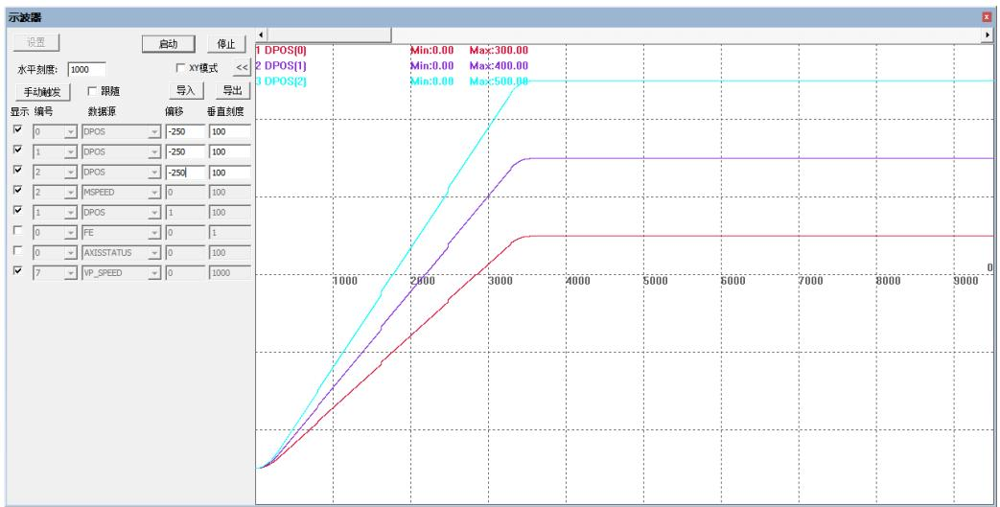

## 6.4.3-3 脉冲输出电子齿轮比设置

本例程，在编码器齿轮比默认为 1 的情况下，修改脉冲输出齿轮比，把轴 0的脉冲输出接入轴5的编码器输入，从而观察出轴 0的脉冲输出的实际情况。

例程硬件接线：需把轴 0脉冲输出与轴5编码器接上。

```c
// test1.cpp : 定义控制台应用程序的入口点。
//
#include "stdafx.h"
#include <windows.h>
#include "zmotion.h"
#include "zauxdll2.h"
void commandCheckHandler(const char *command, int ret)
if (ret)//非 0 则失败
{
printf("%s fail!return code is %d\n", command, ret);
}
int _tmain(int argc, _TCHAR* argv[])
{
char *ip_addr = (char *)"192.168.0.181"; //控制器 IP 地址，该例程需要使用编码器查看
对比，需要连接实物控制器
ZMC_HANDLE handle = NULL; //连接句柄
```

int ret = ZAux\_OpenEth(ip\_addr, &handle); //连接控制器   
if (ERR\_SUCCESS != ret)   
{   
printf("控制器连接失败!\n");   
handle = NULL;   
getchar();   
return -1;   
}   
printf("控制器连接成功！\n");   
ret =ZAux\_Direct\_SetAtype(handle,0,1);//设置轴 0 轴类型为 1   
commandCheckHandler("ZAux\_Direct\_SetAtype", ret) ;//判断指令是否执行成功   
ret =ZAux\_Direct\_SetAtype(handle,5,6);//设置轴 5 轴类型脉冲编码器   
commandCheckHandler("ZAux\_Direct\_SetAtype", ret) ;//判断指令是否执行成功   
ret =ZAux\_Direct\_SetUnits(handle,0,100);//设置轴 0 脉冲当量为 100   
commandCheckHandler("ZAux\_Direct\_SetUnits", ret) ;//判断指令是否执行成功   
ret =ZAux\_Direct\_SetUnits(handle,5,100);//设置轴 5 脉冲当量为 100   
commandCheckHandler("ZAux\_Direct\_SetUnits", ret) ;//判断指令是否执行成功   
ret =ZAux\_Direct\_SetAccel(handle,0,500);//设置轴 0 加速度   
commandCheckHandler("ZAux\_Direct\_SetAccel", ret) ;//判断指令是否执行成功   
ret =ZAux\_Direct\_SetDecel(handle,0,500);//设置轴 0 减速度   
commandCheckHandler("ZAux\_Direct\_SetDecel", ret) ;//判断指令是否执行成功   
ret =ZAux\_Direct\_SetDpos(handle,0,0);//设置轴 0 DPOS 清 0   
commandCheckHandler("ZAux\_Direct\_SetDpos", ret) ;//判断指令是否执行成功   
ret =ZAux\_Direct\_SetMpos(handle,5,0);//设置轴 5 MPOS 清 0   
commandCheckHandler("ZAux\_Direct\_SetDpos", ret) ;//判断指令是否执行成功   
ret =ZAux\_Direct\_SetSpeed(handle,0,100);//设置轴 0 速度   
commandCheckHandler("ZAux\_Direct\_SetDecel", ret) ;//判断指令是否执行成功   
ret =ZAux\_Direct\_StepRatio(handle,0,2,1);//设置轴 0 脉冲齿轮比为 2,即两倍脉冲输出   
commandCheckHandler("ZAux\_Direct\_StepRatio", ret) ;//判断指令是否执行成功   
float IDLE;

```c
ZAux_Trigger( handle);//触发示波器
ret = ZAux_Direct_Single_Move(handle, 0,100); //轴 0 运动 100
commandCheckHandler("ZAux_Direct_Single_Move", ret) ;//判断指令是否执行成功
while (1)//等待轴 0 运动完成
{
Sleep(100);
ZAux_Direct_GetParam(handle,"IDLE",0,&IDLE);
if (IDLE<0)break;
}
ret =ZAux_Direct_StepRatio(handle,0,1,1);//恢复轴 0 脉冲齿轮比为 1
commandCheckHandler("ZAux_Direct_StepRatio", ret) ;//判断指令是否执行成功
getchar();
ret = ZAux_Close(handle); //关闭连接
commandCheckHandler("ZAux_Close", ret) ;//判断指令是否执行成功
printf("connection closed!\n");
handle = NULL;
return 0;
```

输出波形图：

由波形图可以观察出，编码器轴 5接收到的脉冲为轴 0 的两倍，刚好符合设置脉冲输出齿轮比。

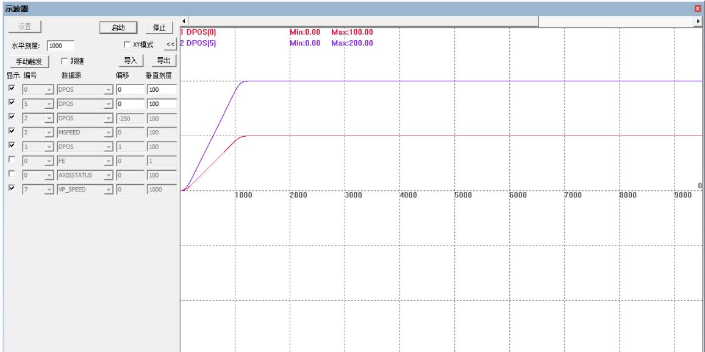

## 6.4.3-4 编码器齿轮比设置

本例程，在脉冲输出齿轮比默认为 1的情况下，修改编码器输入齿轮比，把轴 0 的脉冲输出接入轴5的编码器输入，从而观察出轴 5的脉冲接收的实际情况。

例程硬件接线：需把轴 0脉冲输出与轴5编码器接上。

```c
// test1.cpp : 定义控制台应用程序的入口点。
//
#include "stdafx.h"
#include <windows.h>
#include "zmotion.h"
#include "zauxdll2.h"
void commandCheckHandler(const char *command, int ret)
if (ret)//非 0 则失败
{
printf("%s fail!return code is %d\n", command, ret);
}
int _tmain(int argc, _TCHAR* argv[])
char *ip_addr = (char *)"192.168.0.181"; //控制器 IP 地址，该例程需要使用编码器查看
对比，需要连接实物控制器
ZMC_HANDLE handle = NULL; //连接句柄
int ret = ZAux_OpenEth(ip_addr, &handle); //连接控制器
if (ERR_SUCCESS != ret)
{
printf("控制器连接失败!\n");
handle = NULL;
getchar();
return -1;
}
```

printf("控制器连接成功！\n");

ret =ZAux\_Direct\_SetAtype(handle,0,1);//设置轴 0 轴类型为 1

commandCheckHandler("ZAux\_Direct\_SetAtype", ret) ;//判断指令是否执行成功

ret =ZAux\_Direct\_SetAtype(handle,5,6);//设置轴 5 轴类型脉冲编码器

commandCheckHandler("ZAux\_Direct\_SetAtype", ret) ;//判断指令是否执行成功

ret =ZAux\_Direct\_SetUnits(handle,0,100);//设置轴 0 脉冲当量为 100

commandCheckHandler("ZAux\_Direct\_SetUnits", ret) ;//判断指令是否执行成功

ret =ZAux\_Direct\_SetUnits(handle,5,100);//设置轴 5 脉冲当量为 100

commandCheckHandler("ZAux\_Direct\_SetUnits", ret) ;//判断指令是否执行成功

ret =ZAux\_Direct\_SetAccel(handle,0,500);//设置轴 0 加速度

commandCheckHandler("ZAux\_Direct\_SetAccel", ret) ;//判断指令是否执行成功

ret =ZAux\_Direct\_SetDecel(handle,0,500);//设置轴 0 减速度

commandCheckHandler("ZAux\_Direct\_SetDecel", ret) ;//判断指令是否执行成功

ret =ZAux\_Direct\_SetDpos(handle,0,0);//设置轴 0 DPOS 清 0

commandCheckHandler("ZAux\_Direct\_SetDpos", ret) ;//判断指令是否执行成功

ret =ZAux\_Direct\_SetMpos(handle,5,0);//设置轴 5 MPOS 清 0

commandCheckHandler("ZAux\_Direct\_SetDpos", ret) ;//判断指令是否执行成功

ret =ZAux\_Direct\_SetSpeed(handle,0,100);//设置轴 0 速度

commandCheckHandler("ZAux\_Direct\_SetDecel", ret) ;//判断指令是否执行成功

ret =ZAux\_Direct\_EncoderRatio(handle,5,2,1);//设置轴 5 脉冲齿轮比为 2,即两倍脉冲输出

commandCheckHandler("ZAux\_Direct\_EncoderRatio", ret) ;//判断指令是否执行成功

float IDLE;

ZAux\_Trigger( handle);//触发示波器

ret = ZAux\_Direct\_Single\_Move(handle, 0,100); //轴 0 运动 100

commandCheckHandler("ZAux\_Direct\_Single\_Move", ret) ;//判断指令是否执行成功

while (1)//等待轴 0 运动完成

```c
Sleep(100);
ZAux_Direct_GetParam(handle,"IDLE",0,&IDLE);
if (IDLE<0)break;
}
ret =ZAux_Direct_EncoderRatio(handle,5,1,1);//恢复轴 5 脉冲齿轮比为 1
commandCheckHandler("ZAux_Direct_EncoderRatio", ret) ;//判断指令是否执行成功
getchar();
ret = ZAux_Close(handle); //关闭连接
commandCheckHandler("ZAux_Close", ret) ;//判断指令是否执行成功
printf("connection closed!\n");
handle = NULL;
return 0;
```

输出波形图：

由波形图可以观察出，编码器轴 5接收到的脉冲为轴 0 的两倍，刚好符合设置编码器输入齿轮比。

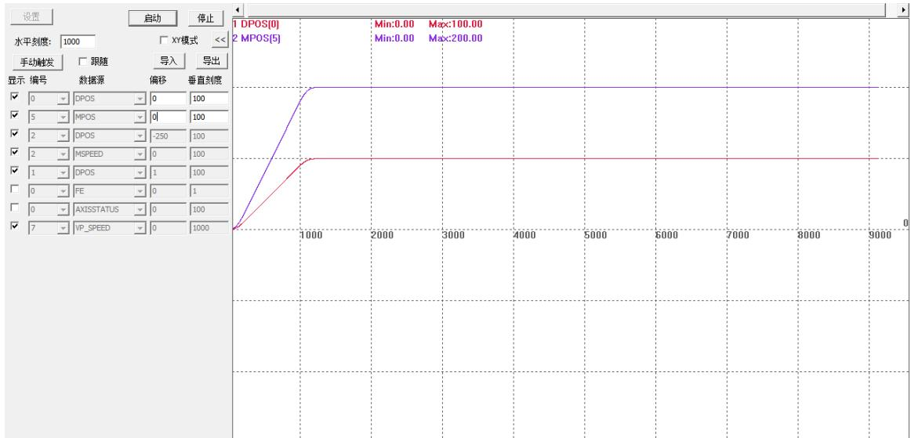

## 6.5 插补运动

## 指令列表

<table><tr><td colspan="2" rowspan="1">指令                                                   说明</td></tr><tr><td colspan="1" rowspan="1">ZAux Direct Move</td><td colspan="1" rowspan="1">多轴相对直线插补</td></tr><tr><td colspan="1" rowspan="1"> ZAux Direct MoveSp</td><td colspan="1" rowspan="1">相对多轴直线插补 SP 运动</td></tr><tr><td colspan="1" rowspan="1"> ZAux _Direct_ MoveAbs</td><td colspan="1" rowspan="1">绝对多轴直线插补</td></tr><tr><td colspan="1" rowspan="1"> ZAux Direct MoveAbsSp</td><td colspan="1" rowspan="1">绝对多轴直线插补 SP运动</td></tr><tr><td colspan="1" rowspan="1"> ZAux Direct_ MoveCirc</td><td colspan="1" rowspan="1">相对圆心定圆弧插补运动</td></tr><tr><td colspan="1" rowspan="1"> ZAux Direct MoveCircSp</td><td colspan="1" rowspan="1">相对圆心定圆弧插补运动 插补 SP 运动</td></tr><tr><td colspan="1" rowspan="1"> ZAux Direct MoveCircAbs</td><td colspan="1" rowspan="1">绝对圆心圆弧插补运动</td></tr><tr><td colspan="1" rowspan="1"> ZAux Direct MoveCircAbsSp</td><td colspan="1" rowspan="1">绝对圆心圆弧插补 SP运动</td></tr><tr><td colspan="1" rowspan="1"> ZAux Direct_ MoveCirc2</td><td colspan="1" rowspan="1">相对3点定圆弧插补运动</td></tr><tr><td colspan="1" rowspan="1"> ZAux_ Direct_MoveCirc2Abs</td><td colspan="1" rowspan="1">绝对3点定圆弧插补运动</td></tr><tr><td colspan="1" rowspan="1"> ZAux_ Direct MoveCirc2Sp</td><td colspan="1" rowspan="1">相对3点定圆弧插补 SP 运动</td></tr><tr><td colspan="1" rowspan="1"> ZAux Direct MoveCirc2AbsSp</td><td colspan="1" rowspan="1">绝对3点定圆弧插补 SP 运动</td></tr><tr><td colspan="1" rowspan="1"> ZAux_Direct_ MHelical</td><td colspan="1" rowspan="1">相对3轴 圆心画螺旋插补运动</td></tr><tr><td colspan="1" rowspan="1"> ZAux Direct MHelicalAbs</td><td colspan="1" rowspan="1">绝对3轴 圆心画螺旋插补运动</td></tr><tr><td colspan="1" rowspan="1"> ZAux_ Direct_ MHelicalSp</td><td colspan="1" rowspan="1">相对3轴 圆心画螺旋插补 SP 运动</td></tr><tr><td colspan="1" rowspan="1"> ZAux Direct MHelicalAbsSp</td><td colspan="1" rowspan="1">绝对3轴 圆心画螺旋插补 SP 运动</td></tr><tr><td colspan="1" rowspan="1"> ZAux Direct MHelical2</td><td colspan="1" rowspan="1">相对3轴3点画螺旋插补运动</td></tr><tr><td colspan="1" rowspan="1"> ZAux Direct MHelical2Abs</td><td colspan="1" rowspan="1">绝对3轴3点画螺旋插补运动</td></tr><tr><td colspan="1" rowspan="1"> ZAux Direct MHelical2Sp</td><td colspan="1" rowspan="1">相对3轴3点画螺旋插补 SP 运动</td></tr><tr><td colspan="1" rowspan="1"> ZAux Direct MHelical2AbsSp</td><td colspan="1" rowspan="1">绝对3轴3点画螺旋插补 SP 运动</td></tr><tr><td colspan="1" rowspan="1"> ZAux Direct_ MEclipse</td><td colspan="1" rowspan="1">相对椭圆插补运动</td></tr><tr><td colspan="1" rowspan="1"> ZAux Direct MEclipseAbs</td><td colspan="1" rowspan="1">绝对椭圆插补运动</td></tr><tr><td colspan="1" rowspan="1"> ZAux_ Direct_ MEclipseSp</td><td colspan="1" rowspan="1">相对椭圆插补 SP 运动</td></tr><tr><td colspan="1" rowspan="1"> ZAux Direct MEclipseAbsSp</td><td colspan="1" rowspan="1">绝对椭圆插补 SP 运动</td></tr><tr><td colspan="1" rowspan="1"> ZAux Direct MEclipseHelical</td><td colspan="1" rowspan="1">相对椭圆＋螺旋插补运动</td></tr><tr><td colspan="1" rowspan="1"> ZAux Direct MEclipseHelicalAbs</td><td colspan="1" rowspan="1">绝对椭圆＋螺旋插补运动</td></tr><tr><td colspan="1" rowspan="1"> ZAux_Direct_ MEclipseHelicalSp</td><td colspan="1" rowspan="1">相对椭圆＋螺旋插补 SP 运动</td></tr><tr><td colspan="1" rowspan="1"> ZAux_Direct_MEclipseHelicalAbsSp</td><td colspan="1" rowspan="1">绝对椭圆＋螺旋插补 SP 运动</td></tr><tr><td colspan="1" rowspan="1"> ZAux Direct MSpherical</td><td colspan="1" rowspan="1">空间圆弧 ＋螺旋插补运动</td></tr><tr><td colspan="1" rowspan="1"> ZAux _Direct_ MSphericalSp</td><td colspan="1" rowspan="1">空间圆弧＋螺旋 插补 SP运动</td></tr><tr><td colspan="1" rowspan="1">ZAux_Direct_MSphericalABSSp</td><td colspan="1" rowspan="1">空间圆弧 ＋ 螺旋 插补 ABSSP 运动</td></tr><tr><td colspan="1" rowspan="1">ZAux Direct MoveSpiral</td><td colspan="1" rowspan="1">渐开线圆弧插补运动，相对移动方式</td></tr><tr><td colspan="1" rowspan="1"> ZAux Direct MoveSpiralSp</td><td colspan="1" rowspan="1">渐开线圆弧插补 SP运动，相对移动方式</td></tr><tr><td colspan="1" rowspan="1">ZAux Direct MoveSmooth</td><td colspan="1" rowspan="1">空间直线运动</td></tr><tr><td colspan="1" rowspan="1"> ZAux Direct MoveSmoothSp</td><td colspan="1" rowspan="1">空间直线插补 SP 运动</td></tr><tr><td colspan="1" rowspan="1">ZAux Direct MoveTurnabs</td><td colspan="1" rowspan="1">旋转台直线插补运动</td></tr><tr><td colspan="1" rowspan="1">ZAux Direct McircTurnabs</td><td colspan="1" rowspan="1">旋转台圆弧 ＋螺旋插补运动</td></tr><tr><td colspan="1" rowspan="1"> ZAux Direct MultiMove</td><td colspan="1" rowspan="1">多条相对多轴直线插补</td></tr><tr><td colspan="1" rowspan="1">ZAux Direct MultiMoveAbs</td><td colspan="1" rowspan="1">多条绝对多轴直线插补</td></tr><tr><td colspan="1" rowspan="1">ZAux Direct MultiLineN</td><td colspan="1" rowspan="1">多轴多段线直线连续插补</td></tr></table>

<table><tr><td rowspan=1 colspan=2>指令                                                   说明</td></tr><tr><td rowspan=1 colspan=1> ZAux Direct_ SetFhspeed</td><td rowspan=1 colspan=1>设置轴保持速度</td></tr><tr><td rowspan=1 colspan=1>ZAux_ Direct GetFhspeed</td><td rowspan=1 colspan=1>读取轴保持速度</td></tr><tr><td rowspan=1 colspan=1>ZAux_Direct_ SetEndMoveSpeed</td><td rowspan=1 colspan=1>设置 SP运动的结束速度</td></tr><tr><td rowspan=1 colspan=1>ZAux_Direct_ GetEndMoveSpeed</td><td rowspan=1 colspan=1>读取 SP 运动结束速度</td></tr><tr><td rowspan=1 colspan=1>ZAux_Direct_SetForceSpeed</td><td rowspan=1 colspan=1>设置 SP运动的运行速度</td></tr><tr><td rowspan=1 colspan=1>ZAux_ Direct_ GetForceSpeed</td><td rowspan=1 colspan=1>读取 SP运动的运行速度</td></tr><tr><td rowspan=1 colspan=1> ZAux Direct SetStartMoveSpeed</td><td rowspan=1 colspan=1>设置自定义速度的 SP运动的起始速度</td></tr><tr><td rowspan=1 colspan=1>ZAux_Direct_GetStartMoveSpeed</td><td rowspan=1 colspan=1>读取自定义速度的 SP运动的起始速度</td></tr><tr><td rowspan=1 colspan=1>ZAux Direct SetFholdIn</td><td rowspan=1 colspan=1>设置保持输入对应的输入点编号，-1无效。</td></tr><tr><td rowspan=1 colspan=1>ZAux Direct GetFholdIn</td><td rowspan=1 colspan=1>读取保持输入对应的输入点编号，-1无效。</td></tr></table>

<table><tr><td colspan="2" rowspan="1">指令                                                   说明</td></tr><tr><td colspan="1" rowspan="1">ZAux Direct SetCornerMode</td><td colspan="1" rowspan="1">设置拐角减速模式</td></tr><tr><td colspan="1" rowspan="1">ZAux Direct GetCornerMode</td><td colspan="1" rowspan="1">读取拐角减速模式</td></tr><tr><td colspan="1" rowspan="1">ZAux Direct SetDecelAngle</td><td colspan="1" rowspan="1">设置拐角开始减速角度,单位为弧度</td></tr><tr><td colspan="1" rowspan="1">ZAux_Direct_GetDecelAngle</td><td colspan="1" rowspan="1">读取拐角开始减速角度,单位为弧度</td></tr><tr><td colspan="1" rowspan="1">ZAux Direct SetFullSpRadius</td><td colspan="1" rowspan="1">设置小圆限速最小半径</td></tr><tr><td colspan="1" rowspan="1">ZAux_Direct_ GetFullSpRadius</td><td colspan="1" rowspan="1">读取小圆限速最小半径</td></tr><tr><td colspan="1" rowspan="1">ZAux Direct SetInterpFactor</td><td colspan="1" rowspan="1">设置插补时轴是否参与速度计算</td></tr><tr><td colspan="1" rowspan="1">ZAux Direct_ GetInterpFactor</td><td colspan="1" rowspan="1">读取插补时轴是否参与速度计算</td></tr><tr><td colspan="1" rowspan="1">ZAux_Direct_ SetMerge</td><td colspan="1" rowspan="1">设置连续插补状态</td></tr><tr><td colspan="1" rowspan="1"> ZAux Direct GetMerge</td><td colspan="1" rowspan="1">读取连续插补状态</td></tr><tr><td colspan="1" rowspan="1"> ZAux_ Direct SetStopAngle</td><td colspan="1" rowspan="1">设置减速到最低的最小拐角 弧度制</td></tr><tr><td colspan="1" rowspan="1">ZAux Direct GetStopAngle</td><td colspan="1" rowspan="1">读取减速到最低的最小拐角 弧度制</td></tr><tr><td colspan="1" rowspan="1">ZAux Direct SetZsmooth</td><td colspan="1" rowspan="1">设置自动倒角半径</td></tr><tr><td colspan="1" rowspan="1">ZAux Direct GetZsmooth</td><td colspan="1" rowspan="1">读取自动倒角半径</td></tr></table>

## 重点说明

## 6.5.2-1 SP 速度

SP 和非 SP 运动的区别

通过 ZAux\_Direct\_SetSpeed 设置轴速度，速度立即改变，可以实现动态变速，而所有的 插 补 运 动 都 有 对 应 的 自 定 义 速 度 的 SP 运 动 ， 如 ZAux\_Direct\_MoveSp ，ZAux\_Direct\_MoveAbsSp 等等。SP 运动的速度不再受全局速度 ZAux\_Direct\_SetSpeed 的控制，而是通过专门的速度指令设置对应的起始、运行、结束速度，这些速度也是随着运动一起进入运动缓冲的。

## SP 速度详解

SP 速度,代表着可以进行速度控制的函数。正运动控制卡指令后缀带有 SP 的，即表述为该运动可以进行自定义的速度控制。

该章节函数参数设置主要应用于插补运动指令带 SP后缀之后的函数，此时运动速度采用设置的 ZAux\_Direct\_SetForceSpeed 参数速度，而不是设置的 ZAux\_Direct\_SetSpeed 速度参数。SP 速度应用于插补运动指令带 SP 后缀之后的指令（例如 ZAux\_Direct\_MoveSp、ZAux\_Direct\_MoveCircSp）。

ZAux\_Direct\_SetStartMoveSpeed 设置的起始速度：自定义速度的SP运动的开始速度。  
ZAux\_Direct\_SetEndMoveSpeed 设置的结束速度：自定义速度的 SP 运动的结束速度。  
ZAux\_Direct\_SetForceSpeed 设置的强制速度：自定义速度的 SP 运动的强制速度。

注意：以上三个参数只有使用了带 SP 的运动指令才生效，参数都被带入运动缓冲。不使用时请将设置起始速度的指令 ZAux\_Direct\_SetStartMoveSpeed 和设置结束速度的指令ZAux\_Direct\_SetEndMoveSpeed 设置较大值，否则下一段运动指令还会沿用此参数。

## 6.5.2-2 连续插补与轨迹前瞻

在实际加工过程中，为追求加工效率会开启连续插补，运动轨迹的拐角处若不减速，当拐角较大时，会对机台造成较大冲击，影响加工精度。若关闭连续插补，使拐角处减速为 0，虽然保护了机台，但是加工效率受到了较大影响，所以提供了前瞻指令，使在拐角处自动判断是否将拐角速度降到一个合理的值，既不会影响加工精度又能提高加工的速度，这就是轨迹前瞻功能的作用。

运动控制器的轨迹前瞻可以根据用户的运动路径自动计算出平滑的速度规划，减少机台的冲击，从而提高加工精度。自动分析在运动缓冲区的指令轨迹将会出现的拐点，并依据用户设置的拐角条件，自动计算拐角处的运动速度，也会依据用户设定的最大加速度值计算速度 规 划 ， 使 任 何 加 减 速 过 程 中 的 速 度 值 都 不 超 过 ZAux\_Direct\_SetAccel 和ZAux\_Direct\_SetDecel 的值，防止对机械部分产生破坏冲击力。

使用轨迹前瞻和不使用轨迹前瞻的速度规划情况：

假设运动轨迹如下左图，走一个长方形轨迹，分为四段直线插补运动。

模式一：开启了连续插补后，得出的主轴速度随时间变化的曲线如下右图，主轴的速度是连续的，轨迹拐角处仍不减速，高速运行时拐角处冲击较大。

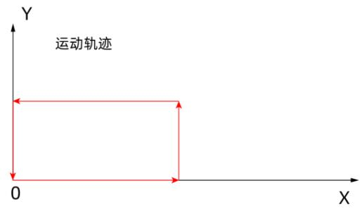

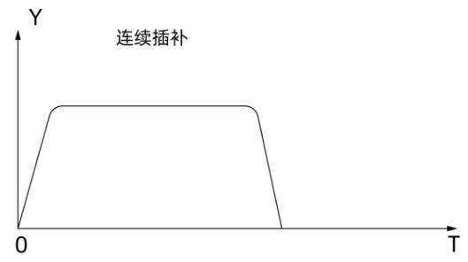

模式二：模式一条件下，关闭连续插补，得出的主轴速度随时间变化的曲线如下左图，每走完一段直线后便减速到 0再开始第二段直线运动，加工效率不高。

模式三：模式一条件下，开启连续插补，并设置了轨迹前瞻参数，得出的主轴速度随时间变化的曲线如下右图，拐角处按照一定的比例减速，加工效率比模式二高。

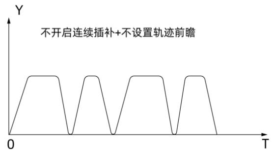

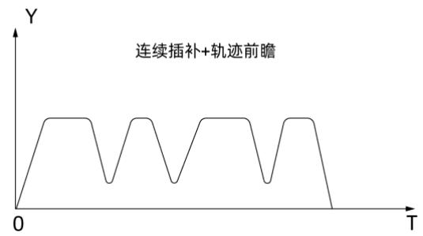

以上模式若希望速度曲线更柔和，只需通过 ZAux\_Direct\_SetSramp 指令设置速度为 S曲线。

轨迹前瞻的主要指令 ZAux\_Direct\_SetCornerMode，用于拐角处的速度规划，常用的三种模式，根据加工的轨迹的实际要求选择不同的模式。

此参数是在插补运动指令调用前生效，一般在参数初始化中设置拐角模式。因为前瞻运动参数会随着运动指令一并存入运动缓冲区，前瞻运动参数可以多次调用，不同模式也可以混合使用，例如 ZAux\_Direct\_SetCornerMode=2+8，表示同时使用自动拐角减速和小圆限速，根据轨迹段的要求设置合适的前瞻模式，在执行运动指令的时候自动优化轨迹。

注意：ZAux\_Direct\_SetCornerMode 模式一旦设置了参数就会存入控制器内，如果要取消设置的参数，就需要设置 Zaux\_Direct\_SetCornerMode =0 ,否则下次运行时，之前设置的 Zaux\_Direct\_SetCornerMode 仍会生效。

CORNER\_MODE 指令参数说明：
<table><tr><td rowspan=1 colspan=1>位</td><td rowspan=1 colspan=1>值</td><td rowspan=1 colspan=1>描述</td></tr><tr><td rowspan=1 colspan=1>0</td><td rowspan=1 colspan=1>1</td><td rowspan=1 colspan=1>预留</td></tr><tr><td rowspan=1 colspan=1>1</td><td rowspan=1 colspan=1>2</td><td rowspan=1 colspan=1>自动拐角减速。按 ZAux_Direct_SetAccel和 ZAux_Direct_SetDecel 生效加减速度。此参数是在运动函数调用前生效。减速角度根据ZAux_Direct_SetDecelAngle 和 ZAux_Direct_SetStopAngle 函数设定。减速拐角参考速度以 FORCE_SPEED 速度为参考，一定要设置合理的ZAux_Direct_SetForceSpeed。</td></tr><tr><td rowspan=1 colspan=1>2</td><td rowspan=1 colspan=1>4</td><td rowspan=1 colspan=1>预留</td></tr><tr><td rowspan=1 colspan=1>3</td><td rowspan=1 colspan=1>8</td><td rowspan=1 colspan=1>自动小圆限速，半径小于设置值时限速，大于限制值时不限速。此参数在运动函数调用前修改生效。限制速度与 ZAux_Direct_SetForceSpeed 有关。限制速 度 =ZAux_Direct_SetForceSpeed    *   实际半径/ZAux_Direct_SetFullSpRadius限速半径 ZAux_Direct_SetFulISpRadius 设置。</td></tr><tr><td rowspan=1 colspan=1>4</td><td rowspan=1 colspan=1>16</td><td rowspan=1 colspan=1>预留</td></tr><tr><td rowspan=1 colspan=1>5</td><td rowspan=1 colspan=1>32</td><td rowspan=1 colspan=1>自动倒角设置。此参数在直线运动函数调用前修改生效。倒角的半径设置值，并不为实际值，只有90度时才是。此直线运动自动和前面的直线运动做倒角处理，倒角半径参考ZAux_Direct_SetZsmooth。</td></tr></table>

ZAux\_Direct\_SetCornerMode=2 拐角减速应用场合：不改变运动轨迹，仅在拐角处自动判断是否减速，一般用于改善机台抖动的问题，对轨迹精度有要求，对速度要求没那么快的场合。

ZAux\_Direct\_SetCornerMode=8 小圆限速应用场合：不改变运动轨迹，一般应用在圆弧加工，根据圆弧半径计算当前圆弧的限制速度。

ZAux\_Direct\_SetCornerMode=32 自动倒角应用场合：改变运动轨迹，不会降低速度，针对轨迹拐角较大的场合，倒角处运动轨迹做自动平滑处理，所以一般应用在对速度要求快，对轨迹精度要求不高的场合。为了方便说明每个位的功能，例程都是单独位设置，实际应用时可以多位同时使用。比如 ZAux\_Direct\_SetCornerMode=2+8，打开自动拐角减速和小圆限速。

## 例程

## 6.5.3-1 拐角减速

开启拐角减速后，若设置自定义速度（SP）运动指令的 STARTMOVE\_SPEED(SP指令起 始 速 度 ZAux\_Direct\_SetStartMoveSpeed) 或 ENDMOVE\_SPEED(SP 指 令 结 束 速 度ZAux\_Direct\_SetEndMoveSpeed)参数，则拐角减速失效，拐角处的速度按以上两个 SP 速度指令设置的大小运动。本例子开启了拐角减速模式2 和连续插补，设置减速角度 15-45度之间，三段直线插补轨迹。

```c
// test1.cpp : 定义控制台应用程序的入口点。
//
#include "stdafx.h"
#include <windows.h>
#include "zmotion.h"
#include "zauxdll2.h"
#define PI 3.1415926
void commandCheckHandler(const char *command, int ret)
{
if (ret)//非 0 则失败
{
printf("%s fail!return code is %d\n", command, ret);
}
int _tmain(int argc, _TCHAR* argv[])
{
char *ip_addr = (char *)"192.168.0.181"; //控制器 IP 地址，使用仿真器查看时曲线可能
会有误差，最好连实物控制器查看
ZMC_HANDLE handle = NULL; //连接句柄
int ret = ZAux_OpenEth(ip_addr, &handle); //连接控制器
if (ERR_SUCCESS != ret)
{
printf("控制器连接失败!\n");
handle = NULL;
getchar();
```

return -1;   
}   
printf("控制器连接成功！\n");   
ret =ZAux\_Direct\_SetAtype(handle,0,1);//设置轴 0 轴类型为 1   
commandCheckHandler("ZAux\_Direct\_SetAtype", ret) ;//判断指令是否执行成功   
ret =ZAux\_Direct\_SetAtype(handle,1,1);//设置轴 1 轴类型为 1   
commandCheckHandler("ZAux\_Direct\_SetAtype", ret) ;//判断指令是否执行成功   
ret =ZAux\_Direct\_SetUnits(handle,0,100);//设置轴 0 脉冲当量为 100   
commandCheckHandler("ZAux\_Direct\_SetUnits", ret) ;//判断指令是否执行成功   
ret =ZAux\_Direct\_SetUnits(handle,1,100);//设置轴 1 脉冲当量为 100   
commandCheckHandler("ZAux\_Direct\_SetUnits", ret) ;//判断指令是否执行成功   
ret =ZAux\_Direct\_SetAccel(handle,0,500);//设置轴 0 加速度   
commandCheckHandler("ZAux\_Direct\_SetAccel", ret) ;//判断指令是否执行成功   
ret =ZAux\_Direct\_SetAccel(handle,1,500);//设置轴 1 加速度   
commandCheckHandler("ZAux\_Direct\_SetAccel", ret) ;//判断指令是否执行成功   
ret =ZAux\_Direct\_SetDecel(handle,0,500);//设置轴 0 减速度   
commandCheckHandler("ZAux\_Direct\_SetDecel", ret) ;//判断指令是否执行成功   
ret =ZAux\_Direct\_SetDecel(handle,1,500);//设置轴 1 减速度   
commandCheckHandler("ZAux\_Direct\_SetDecel", ret) ;//判断指令是否执行成功   
ret =ZAux\_Direct\_SetDpos(handle,0,0);//设置轴 0 DPOS 清 0   
commandCheckHandler("ZAux\_Direct\_SetDpos", ret) ;//判断指令是否执行成功   
ret =ZAux\_Direct\_SetDpos(handle,1,0);//设置轴 1 DPOS 清 0   
commandCheckHandler("ZAux\_Direct\_SetDpos", ret) ;//判断指令是否执行成功   
ret =ZAux\_Direct\_SetSpeed(handle,0,100);//设置轴 0 速度   
commandCheckHandler("ZAux\_Direct\_SetDecel", ret) ;//判断指令是否执行成功   
ret =ZAux\_Direct\_SetSpeed(handle,1,100);//设置轴 1 速度   
commandCheckHandler("ZAux\_Direct\_SetDecel", ret) ;//判断指令是否执行成功   
ret =ZAux\_Direct\_SetMerge(handle,0,1);//设置开启连续插补（开启主轴的即可，如轴 0，轴   
1 插补，轴 0 为主轴，主轴号取决于连续插补运动指令轴列表的第一个轴号）

commandCheckHandler("ZAux\_Direct\_SetMerge", ret) ;//判断指令是否执行成功   
ret =ZAux\_Direct\_SetCornerMode(handle,0,2);//设置开启拐角模式（开启主轴的即可，如轴   
0，轴 1 插补，轴 0 为主轴，主轴号取决于连续插补运动指令轴列表的第一个轴号）   
commandCheckHandler("ZAux\_Direct\_SetCornerMode", ret) ;//判断指令是否执行成功   
ret =ZAux\_Direct\_SetDecelAngle(handle,0,15 \* (PI/180));//设置开始减速角度（开启主轴   
的即可，如轴 0，轴 1 插补，轴 0 为主轴，主轴号取决于连续插补运动指令轴列表的第一个轴号）   
commandCheckHandler("ZAux\_Direct\_SetDecelAngle", ret) ;//判断指令是否执行成功   
ret =ZAux\_Direct\_SetStopAngle(handle,0,45 \* (PI/180));//设置结束减速角度（开启主轴的   
即可，如轴 0，轴 1 插补，轴 0 为主轴，主轴号取决于连续插补运动指令轴列表的第一个轴号）   
commandCheckHandler("ZAux\_Direct\_SetStopAngle", ret) ;//判断指令是否执行成功   
ret =ZAux\_Direct\_SetForceSpeed(handle,0,100);//设置等比减速时的速度（开启主轴的即可，   
如轴 0，轴 1 插补，轴 0 为主轴，主轴号取决于连续插补运动指令轴列表的第一个轴号）   
commandCheckHandler("ZAux\_Direct\_SetForceSpeed", ret) ;//判断指令是否执行成功   
float IDLE;   
float DposList[2]={0};   
int Axislist[2]={0,1};   
ZAux\_Trigger( handle);//触发示波器   
DposList[0]=100;   
DposList[1]=0;   
ret =ZAux\_Direct\_Move(handle,2,Axislist,DposList);//插补运动（100，0）   
commandCheckHandler("ZAux\_Direct\_SetForceSpeed", ret) ;//判断指令是否执行成功   
DposList[0]=0;   
DposList[1]=100;   
ret =ZAux\_Direct\_Move(handle,2,Axislist,DposList);//插补运动（0，100），运动角度大于   
45°，完全减速   
commandCheckHandler("ZAux\_Direct\_SetForceSpeed", ret) ;//判断指令是否执行成功   
DposList[0]=60;   
DposList[1]=100;   
ret =ZAux\_Direct\_Move(handle,2,Axislist,DposList);//插补运动（60，100），运动角度   
30.96°处于 15°\~45°，等比减速   
commandCheckHandler("ZAux\_Direct\_SetForceSpeed", ret) ;//判断指令是否执行成功

```c
DposList[0]=70;
DposList[1]=100;
ret =ZAux_Direct_Move(handle,2,Axislist,DposList);//插补运动（70，100），运动角度 4.03
小于 15°，不减速
commandCheckHandler("ZAux_Direct_SetForceSpeed", ret) ;//判断指令是否执行成功
while (1)//等待轴 0 运动完成
{
Sleep(100);
ZAux_Direct_GetParam(handle,"IDLE",0,&IDLE);
if (IDLE<0)break;
getchar();
ret = ZAux_Close(handle); //关闭连接
commandCheckHandler("ZAux_Close", ret); //判断指令是否执行成功
printf("connection closed!\n");
handle = NULL;
return 0;
```

轨迹曲线图：

启动 停止 1DPOS(0 Min:0.00 Max:230.00  
水平刻度：200 xY模式 |2DPOS[1] Min:0.00 Max:300.00  
厂   
第30运动（60100） 运动角度4.03°  
MPOS   
PPOS □ 第二段运动：  
  
□

角度分析：

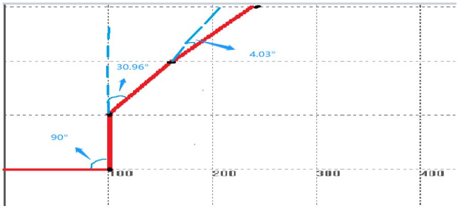

速度曲线图：

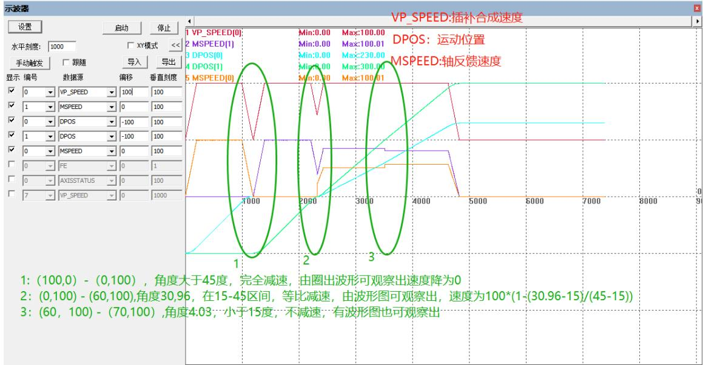

## 6.5.3-2 平面圆心画圆+小圆限速

小圆限制为 60，当半径大于或等于限制值时，不限制速度，按 SPEED 运行此时速度为

100。

```cpp
// test1.cpp : 定义控制台应用程序的入口点。
#include "stdafx.h"
#include <windows.h>
#include "zmotion.h"
#include "zauxdll2.h"
#define PI 3.1415926
void commandCheckHandler(const char *command, int ret)
{
if (ret)//非 0 则失败
```

```c
printf("%s fail!return code is %d\n", command, ret);
int _tmain(int argc, _TCHAR* argv[])
char *ip_addr = (char *)"192.168.0.181"; //控制器 IP 地址，使用仿真器查看时曲线可能
会有误差，最好连实物控制器查看
ZMC_HANDLE handle = NULL; //连接句柄
int ret = ZAux_OpenEth(ip_addr, &handle); //连接控制器
if (ERR_SUCCESS != ret)
{
printf("控制器连接失败!\n");
handle = NULL;
getchar();
return -1;
printf("控制器连接成功！\n");
ret =ZAux_Direct_SetAtype(handle,0,1);//设置轴 0 轴类型为 1
commandCheckHandler("ZAux_Direct_SetAtype", ret) ;//判断指令是否执行成功
ret =ZAux_Direct_SetAtype(handle,1,1);//设置轴 1 轴类型为 1
commandCheckHandler("ZAux_Direct_SetAtype", ret) ;//判断指令是否执行成功
ret =ZAux_Direct_SetUnits(handle,0,100);//设置轴 0 脉冲当量为 100
commandCheckHandler("ZAux_Direct_SetUnits", ret) ;//判断指令是否执行成功
ret =ZAux_Direct_SetUnits(handle,1,100);//设置轴 1 脉冲当量为 100
commandCheckHandler("ZAux_Direct_SetUnits", ret) ;//判断指令是否执行成功
ret =ZAux_Direct_SetAccel(handle,0,500);//设置轴 0 加速度
commandCheckHandler("ZAux_Direct_SetAccel", ret) ;//判断指令是否执行成功
ret =ZAux_Direct_SetAccel(handle,1,500);//设置轴 1 加速度
commandCheckHandler("ZAux_Direct_SetAccel", ret) ;//判断指令是否执行成功
ret =ZAux_Direct_SetDecel(handle,0,500);//设置轴 0 减速度
commandCheckHandler("ZAux_Direct_SetDecel", ret) ;//判断指令是否执行成功
```

ret =ZAux\_Direct\_SetDecel(handle,1,500);//设置轴 1 减速度   
commandCheckHandler("ZAux\_Direct\_SetDecel", ret) ;//判断指令是否执行成功   
ret =ZAux\_Direct\_SetDpos(handle,0,0);//设置轴 0 DPOS 清 0   
commandCheckHandler("ZAux\_Direct\_SetDpos", ret) ;//判断指令是否执行成功   
ret =ZAux\_Direct\_SetDpos(handle,1,0);//设置轴 1 DPOS 清 0   
commandCheckHandler("ZAux\_Direct\_SetDpos", ret) ;//判断指令是否执行成功   
ret =ZAux\_Direct\_SetSpeed(handle,0,100);//设置轴 0 速度   
commandCheckHandler("ZAux\_Direct\_SetDecel", ret) ;//判断指令是否执行成功   
ret =ZAux\_Direct\_SetSpeed(handle,1,100);//设置轴 1 速度   
commandCheckHandler("ZAux\_Direct\_SetDecel", ret) ;//判断指令是否执行成功   
ret =ZAux\_Direct\_SetMerge(handle,0,1);//设置开启连续插补（开启主轴的即可，如轴 0，轴   
1 插补，轴 0 为主轴，主轴号取决于连续插补运动指令轴列表的第一个轴号）   
commandCheckHandler("ZAux\_Direct\_SetMerge", ret) ;//判断指令是否执行成功   
ret =ZAux\_Direct\_SetCornerMode(handle,0,8);//设置开启小圆限速（开启主轴的即可，如轴   
0，轴 1 插补，轴 0 为主轴，主轴号取决于连续插补运动指令轴列表的第一个轴号）   
commandCheckHandler("ZAux\_Direct\_SetCornerMode", ret) ;//判断指令是否执行成功   
ret =ZAux\_Direct\_SetFullSpRadius(handle,0,60);//设置开始减速角度（设置主轴的即可，如   
轴 0，轴 1 插补，轴 0 为主轴，主轴号取决于连续插补运动指令轴列表的第一个轴号）   
commandCheckHandler("ZAux\_Direct\_SetFullSpRadius", ret) ;//判断指令是否执行成功   
ret =ZAux\_Direct\_SetForceSpeed(handle,0,100);//设置等比减速时的速度（设置主轴的即可，   
如轴 0，轴 1 插补，轴 0 为主轴，主轴号取决于连续插补运动指令轴列表的第一个轴号）   
commandCheckHandler("ZAux\_Direct\_SetForceSpeed", ret) ;//判断指令是否执行成功   
float IDLE;   
int Axislist[2]={0,1};   
ZAux\_Trigger( handle);//触发示波器   
//未运动前坐标为 0,0   
//插补轨迹终点坐标为 100,0   
//圆心坐标为 50,0，

```c
//由以上可知半径为 50
ret =ZAux_Direct_MoveCirc(handle,2,Axislist,100,0,50,0,1);//圆弧插补插补运动
commandCheckHandler("ZAux_Direct_MoveCirc", ret) ;//判断指令是否执行成功
while (1)//等待轴 0 运动完成
{
Sleep(100);
ZAux_Direct_GetParam(handle,"IDLE",0,&IDLE);
if (IDLE<0)break;
getchar();
ret = ZAux_Close(handle); //关闭连接
commandCheckHandler("ZAux_Close", ret) ;//判断指令是否执行成功
printf("connection closed!\n");
handle = NULL;
return 0;
```

半径为100，100>60，轨迹波形图：

自动 Min:0.00 Max:200.00  
水平刻度：500 Min:0.00 Max99.99  
手动发   
显示编号 数据原 垂直刻  
√  
√  
√

设置半径为100，100>60，速度波形图（完全不减速）：

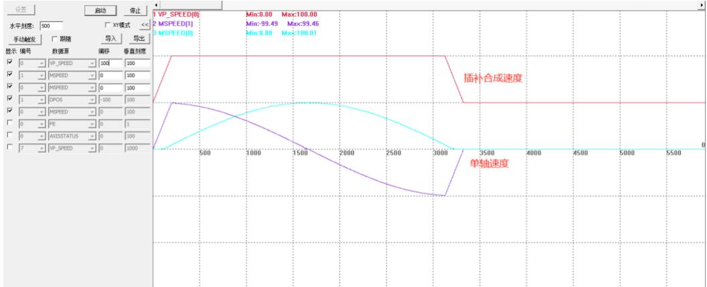

//半径小于等于限制值时，限速=FORCE\_SPEED \* 实际半径/FULL\_SP\_RADIUS

半径为50，50<60，轨迹波形图：
<table><tr><td colspan="2">设置</td><td colspan="2">启动</td><td colspan="2">停止</td><td colspan="3">Min:0.00 Max:100.00 Min:0.00 Max:50.00</td></tr><tr><td>水平刻度：</td><td>1000</td><td colspan="2">√xY模式</td><td colspan="6">1DPOS[0] # [2DPOS(1]</td></tr><tr><td>手动触发</td><td></td><td>跟随</td><td>导入</td><td>导出</td><td colspan="3"></td></tr><tr><td>显示编号</td><td></td><td>数据源</td><td></td><td></td><td colspan="6" rowspan="16"></td></tr><tr><td></td><td></td><td></td><td>偏移</td><td>垂直刻度</td></tr><tr><td>□ □</td><td>□</td><td>OPOS</td><td>日 D</td><td>50</td></tr><tr><td>□ 1</td><td>DPOS</td><td></td><td>□ 可</td><td>50</td></tr><tr><td>□</td><td></td><td>MSPEED</td><td>□ p</td><td>[100</td></tr><tr><td>□ □ √</td><td>√</td><td>DPOS</td><td></td><td>100</td></tr><tr><td>□</td><td>□</td><td>PPOs</td><td>□</td><td>国 100</td></tr><tr><td></td><td>□</td><td>FE</td><td></td><td>□</td></tr><tr><td>√ 7</td><td>T □</td><td>AXISSTATUS |vP_SPEED</td><td>□ 乖</td><td>100 1000</td></tr><tr><td></td><td></td><td></td><td></td><td></td></tr><tr><td></td><td></td><td></td><td></td><td></td></tr><tr><td></td><td></td><td></td><td></td><td></td></tr><tr><td></td><td></td><td></td><td></td><td></td></tr><tr><td></td><td></td><td></td><td></td><td></td></tr><tr><td></td><td></td><td></td><td></td><td></td></tr><tr><td></td><td></td><td></td><td></td><td></td></tr><tr><td></td><td></td><td></td><td></td><td></td></tr><tr><td></td><td></td><td></td><td></td><td></td></tr><tr><td></td><td></td><td></td><td></td><td></td></tr><tr><td></td><td></td><td></td><td></td><td></td></tr><tr><td></td><td></td><td></td><td></td><td></td></tr></table>

半径为50，50<60速度波形图（小圆减速）：

//速度=100\*50/60=83.33

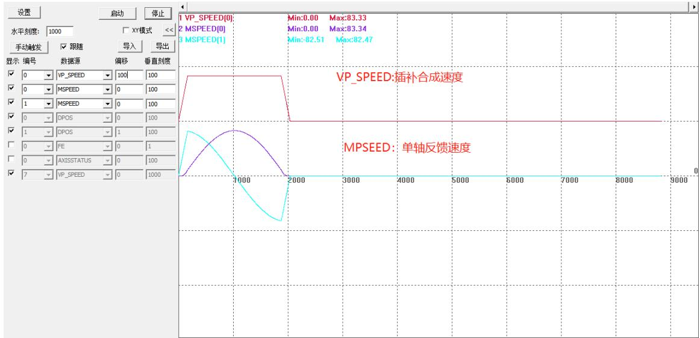

## 6.5.3-3 倒角

倒角是可以用于直线、圆弧、螺旋等运动的，例程为了直观显示，只做了直线拐角。根据拐角角度自动计算实际拐角半径大小。超过路径时限制为 50%。（例：走两段位移，（100,0），（0,100）则倒角半径最大值为 50）

```cpp
// test1.cpp : 定义控制台应用程序的入口点。
//
#include "stdafx.h"
#include <windows.h>
#include "zmotion.h"
```

```c
#include "zauxdll2.h"
#define PI 3.1415926
void commandCheckHandler(const char *command, int ret)
if (ret)//非 0 则失败
{
printf("%s fail!return code is %d\n", command, ret);
}
}
int _tmain(int argc, _TCHAR* argv[])
{
char *ip_addr = (char *)"192.168.0.181"; //控制器 IP 地址，使用仿真器查看时曲线可能
会有误差，最好连实物控制器查看
ZMC_HANDLE handle = NULL; //连接句柄
int ret = ZAux_OpenEth(ip_addr, &handle); //连接控制器
if (ERR_SUCCESS != ret)
printf("控制器连接失败!\n");
handle = NULL;
getchar();
return -1;
printf("控制器连接成功！\n");
ret =ZAux_Direct_SetAtype(handle,0,1);//设置轴 0 轴类型为 1
commandCheckHandler("ZAux_Direct_SetAtype", ret) ;//判断指令是否执行成功
ret =ZAux_Direct_SetAtype(handle,1,1);//设置轴 1 轴类型为 1
commandCheckHandler("ZAux_Direct_SetAtype", ret) ;//判断指令是否执行成功
ret =ZAux_Direct_SetUnits(handle,0,100);//设置轴 0 脉冲当量为 100
commandCheckHandler("ZAux_Direct_SetUnits", ret) ;//判断指令是否执行成功
ret =ZAux_Direct_SetUnits(handle,1,100);//设置轴 1 脉冲当量为 100
commandCheckHandler("ZAux_Direct_SetUnits", ret) ;//判断指令是否执行成功
```

ret =ZAux\_Direct\_SetAccel(handle,0,500);//设置轴 0 加速度   
commandCheckHandler("ZAux\_Direct\_SetAccel", ret) ;//判断指令是否执行成功   
ret =ZAux\_Direct\_SetAccel(handle,1,500);//设置轴 1 加速度   
commandCheckHandler("ZAux\_Direct\_SetAccel", ret) ;//判断指令是否执行成功   
ret =ZAux\_Direct\_SetDecel(handle,0,500);//设置轴 0 减速度   
commandCheckHandler("ZAux\_Direct\_SetDecel", ret) ;//判断指令是否执行成功   
ret =ZAux\_Direct\_SetDecel(handle,1,500);//设置轴 1 减速度   
commandCheckHandler("ZAux\_Direct\_SetDecel", ret) ;//判断指令是否执行成功   
ret =ZAux\_Direct\_SetDpos(handle,0,0);//设置轴 0 DPOS 清 0   
commandCheckHandler("ZAux\_Direct\_SetDpos", ret) ;//判断指令是否执行成功   
ret =ZAux\_Direct\_SetDpos(handle,1,0);//设置轴 1 DPOS 清 0   
commandCheckHandler("ZAux\_Direct\_SetDpos", ret) ;//判断指令是否执行成功   
ret =ZAux\_Direct\_SetSpeed(handle,0,100);//设置轴 0 速度   
commandCheckHandler("ZAux\_Direct\_SetDecel", ret) ;//判断指令是否执行成功   
ret =ZAux\_Direct\_SetSpeed(handle,1,100);//设置轴 1 速度   
commandCheckHandler("ZAux\_Direct\_SetDecel", ret) ;//判断指令是否执行成功   
ret =ZAux\_Direct\_SetMerge(handle,0,1);//设置开启连续插补（开启主轴的即可，如轴 0，轴   
1 插补，轴 0 为主轴，主轴号取决于连续插补运动指令轴列表的第一个轴号）   
commandCheckHandler("ZAux\_Direct\_SetMerge", ret) ;//判断指令是否执行成功   
ret =ZAux\_Direct\_SetCornerMode(handle,0,32);//设置自动倒角（开启主轴的即可，如轴 0，   
轴 1 插补，轴 0 为主轴，主轴号取决于连续插补运动指令轴列表的第一个轴号）   
commandCheckHandler("ZAux\_Direct\_SetCornerMode", ret) ;//判断指令是否执行成功   
ret =ZAux\_Direct\_SetZsmooth(handle,0,50);//设置倒角半径（设置主轴的即可，如轴 0，轴 1   
插补，轴 0 为主轴，主轴号取决于连续插补运动指令轴列表的第一个轴号）   
commandCheckHandler("ZAux\_Direct\_SetZsmooth", ret) ;//判断指令是否执行成功   
float IDLE;   
int Axislist[2]={0,1};   
float Dposlist[2]={0};   
ZAux\_Trigger( handle);//触发示波器

```c
Dposlist[0]=100;
Dposlist[1]=0;
ret =ZAux_Direct_Move(handle,2,Axislist,Dposlist);//直线插补运动
commandCheckHandler("ZAux_Direct_MoveCirc", ret) ;//判断指令是否执行成功
Dposlist[0]=0;
Dposlist[1]=100;
ret =ZAux_Direct_Move(handle,2,Axislist,Dposlist);//直线插补运动
commandCheckHandler("ZAux_Direct_MoveCirc", ret) ;//判断指令是否执行成功
while (1)//等待轴 0 运动完成
{
Sleep(100);
ZAux_Direct_GetParam(handle,"IDLE",0,&IDLE);
if (IDLE<0)break;
getchar();
ret = ZAux_Close(handle); //关闭连接
commandCheckHandler("ZAux_Close", ret) ;//判断指令是否执行成功
printf("connection closed!\n");
handle = NULL;
return 0;
```

插补轨迹，未使用倒角前，轨迹波形图：

启动 停止 1 DPS(0] Min:0.00 Max:100.00   
水平刻度：1000 xy模式 2DPOSI Min:0.00 Max:100.00  
手动角触发 跟随   
显示编号 数据源 偏移 垂直刻度  
50  
1 DPOS 50  
√ 1 MSPEED   
□   
√ 1  
□   
AXISSTATUS   
□  
插补轨迹，使用倒角后，倒角半径设置为该轨迹的最大值 50，轨迹波形图：

示波器  
启动 停止 1DPOS(0] Min:0.00 Max:100.00  
水平刻度：1000 x模式 <|2DPOS Min:0.00 Max:100.00  
手动触发 跟随 导入   
显示编号 数据源 偏移 垂直刻度  
50  
□ 50  
√  
√ ③  
√ 1  
D  
√

## 6.5.3-4 轴保持输入应用

在轴0运动1500 的一个SP 点位运动，期间碰到 IN（0）的信号时，速度自动切换成保持速度。

```c
// test1.cpp : 定义控制台应用程序的入口点。
//
#include "stdafx.h"
#include <windows.h>
#include "zmotion.h"
#include "zauxdll2.h"
void commandCheckHandler(const char *command, int ret)
{
if (ret)//非 0 则失败
{
printf("%s fail!return code is %d\n", command, ret);
}
int _tmain(int argc, _TCHAR* argv[])
{
char *ip_addr = (char *)"127.0.0.1"; //控制器 IP 地址
ZMC_HANDLE handle = NULL; //连接句柄
```

```c
int ret = ZAux_OpenEth(ip_addr, &handle); //连接控制器
if (ERR_SUCCESS != ret)
printf("控制器连接失败!\n");
handle = NULL;
getchar();
return -1;
printf("控制器连接成功！\n");
ret =ZAux_Direct_SetAtype(handle,0,1);//设置轴类型为 1
commandCheckHandler("ZAux_Direct_SetAtype", ret) ;//判断指令是否执行成功
ret =ZAux_Direct_SetAccel(handle,0,500);//设置轴加速度
commandCheckHandler("ZAux_Direct_SetAccel", ret) ;//判断指令是否执行成功
ret =ZAux_Direct_SetDecel(handle,0,500);//设置轴减速度
commandCheckHandler("ZAux_Direct_SetDecel", ret) ;//判断指令是否执行成功
ret =ZAux_Direct_SetDpos(handle,0,0);//设置轴 DPOS 清 0
commandCheckHandler("ZAux_Direct_SetDpos", ret) ;//判断指令是否执行成功
ret =ZAux_Direct_SetForceSpeed(handle,0,200);//设置轴 SP 运行速度
commandCheckHandler("ZAux_Direct_SetSpeed", ret) ;//判断指令是否执行成功
ret =ZAux_Direct_SetFhspeed(handle,0,100);//设置保持速度为 100
commandCheckHandler("ZAux_Direct_SetDpos", ret) ;//判断指令是否执行成功
ret =ZAux_Direct_SetFholdIn(handle,0,0);//设置保持速度映射 IN 为 0
commandCheckHandler("ZAux_Direct_SetDpos", ret) ;//判断指令是否执行成功
ret =ZAux_Direct_SetInvertIn(handle,0,1);//设置保持速度映射 IN 电平反转
commandCheckHandler("ZAux_Direct_SetDpos", ret) ;//判断指令是否执行成功
float IDLE;
int axislist=0;
float dposlist=1500;
ZAux_Trigger( handle);//触发示波器
ZAux_Direct_MoveSp(handle,1,&axislist,&dposlist);//轴 0 运动 1500
while (1)//等待轴 0 运动完成
```

```c
Sleep(100);
ZAux_Direct_GetParam(handle,"IDLE",0,&IDLE);
if (IDLE<0)break;
}
getchar();
ret = ZAux_Close(handle); //关闭连接
commandCheckHandler("ZAux_Close", ret) ;//判断指令是否执行成功
printf("connection closed!\n");
handle = NULL;
return 0;
}
```

速度曲线图：

MSPEED（编码器反馈实时速度）：垂直刻度 200

IN（0）：垂直刻度1

后动 停 1 MSPEED[0] Min:0.00 Max:200.00   
水平刻度： 500 □xy模式 <IN   
手动触发 □跟随 导入 导出   
显示编号 数据源 偏移 垂直刻度   
MSPEED 日 200   
□ 日N   
5 MPOS 400   
厂 MPOS   
√ 1 PPOs □   
FE   
AXISSTATUS   
□ 7 VP\_SPEED   
2000

## 6.5.3-5 连续插补 SP 速度运动控制

```cpp
// test1.cpp : 定义控制台应用程序的入口点。
//
#include "stdafx.h"
#include <windows.h>
#include "zmotion.h"
#include "zauxdll2.h"
```

```c
void commandCheckHandler(const char *command, int ret)
if (ret)//非 0 则失败
{
printf("%s fail!return code is %d\n", command, ret);
}
}
int _tmain(int argc, _TCHAR* argv[])
char *ip_addr = (char *)"127.0.0.1"; //控制器 IP 地址
ZMC_HANDLE handle = NULL; //连接句柄
int ret = ZAux_OpenEth(ip_addr, &handle); //连接控制器
if (ERR_SUCCESS != ret)
{
printf("控制器连接失败!\n");
handle = NULL;
getchar();
return -1;
}
printf("控制器连接成功！\n");
ret =ZAux_Direct_SetAtype(handle,0,1);//设置轴类型为 1
commandCheckHandler("ZAux_Direct_SetAtype", ret) ;//判断指令是否执行成功
ret =ZAux_Direct_SetAccel(handle,0,500);//设置轴加速度
commandCheckHandler("ZAux_Direct_SetAccel", ret) ;//判断指令是否执行成功
ret =ZAux_Direct_SetDecel(handle,0,500);//设置轴减速度
commandCheckHandler("ZAux_Direct_SetDecel", ret) ;//判断指令是否执行成功
ret =ZAux_Direct_SetDpos(handle,0,0);//设置轴 DPOS 清 0
commandCheckHandler("ZAux_Direct_SetDpos", ret) ;//判断指令是否执行成功
ret =ZAux_Direct_SetMerge(handle, 0,1);//设置连续插补
commandCheckHandler("ZAux_Direct_SetMerge", ret) ;//判断指令是否执行成功
float IDLE;
```

int axislist=0;   
float dposlist=40;   
ZAux\_Trigger( handle);//触发示波器   
//第一段   
ret =ZAux\_Direct\_SetForceSpeed(handle,0,30);//设置轴 SP 运行速度   
commandCheckHandler("ZAux\_Direct\_SetSpeed", ret) ;//判断指令是否执行成功   
ret =ZAux\_Direct\_SetStartMoveSpeed(handle,0,1000);//取消设置轴开始运行速度，设置值大   
于 ForceSpeed 即可   
commandCheckHandler("ZAux\_Direct\_SetStartMoveSpeed", ret) ;//判断指令是否执行成功   
ret =ZAux\_Direct\_SetEndMoveSpeed(handle,0,1000);//取消设置轴结束速度，设置值大于   
ForceSpeed 即可   
commandCheckHandler("ZAux\_Direct\_SetEndMoveSpeed", ret) ;//判断指令是否执行成功   
ZAux\_Direct\_MoveSp(handle,1,&axislist,&dposlist);//轴 0 运动 40   
//第二段   
ret =ZAux\_Direct\_SetForceSpeed(handle,0,50);//设置轴 SP 运行速度   
commandCheckHandler("ZAux\_Direct\_SetSpeed", ret) ;//判断指令是否执行成功   
ret =ZAux\_Direct\_SetStartMoveSpeed(handle,0,20);//设置轴开始运行速度 20   
commandCheckHandler("ZAux\_Direct\_SetStartMoveSpeed", ret) ;//判断指令是否执行成功   
ret =ZAux\_Direct\_SetEndMoveSpeed(handle,0,40);//设置轴结束运行速度 40   
commandCheckHandler("ZAux\_Direct\_SetEndMoveSpeed", ret) ;//判断指令是否执行成功   
dposlist=50;   
ZAux\_Direct\_MoveSp(handle,1,&axislist,&dposlist);//轴 0 运动 50   
//第三段   
ret =ZAux\_Direct\_SetForceSpeed(handle,0,60);//设置轴 SP 运行速度   
commandCheckHandler("ZAux\_Direct\_SetSpeed", ret) ;//判断指令是否执行成功   
ret =ZAux\_Direct\_SetStartMoveSpeed(handle,0,1000);//取消设置轴开始运行速度，设置值大

于 ForceSpeed 即可   
commandCheckHandler("ZAux\_Direct\_SetStartMoveSpeed", ret) ;//判断指令是否执行成功   
ret =ZAux\_Direct\_SetEndMoveSpeed(handle,0,1000);//取消设置轴开始运行速度，设置值大于   
ForceSpeed 即可   
commandCheckHandler("ZAux\_Direct\_SetEndMoveSpeed", ret) ;//判断指令是否执行成功   
dposlist=60;   
ZAux\_Direct\_MoveSp(handle,1,&axislist,&dposlist);//轴 0 运动 60   
getchar();   
ret = ZAux\_Close(handle); //关闭连接   
commandCheckHandler("ZAux\_Close", ret) ;//判断指令是否执行成功   
printf("connection closed!\n");   
handle = NULL;   
return 0;

不使用SP速度时：

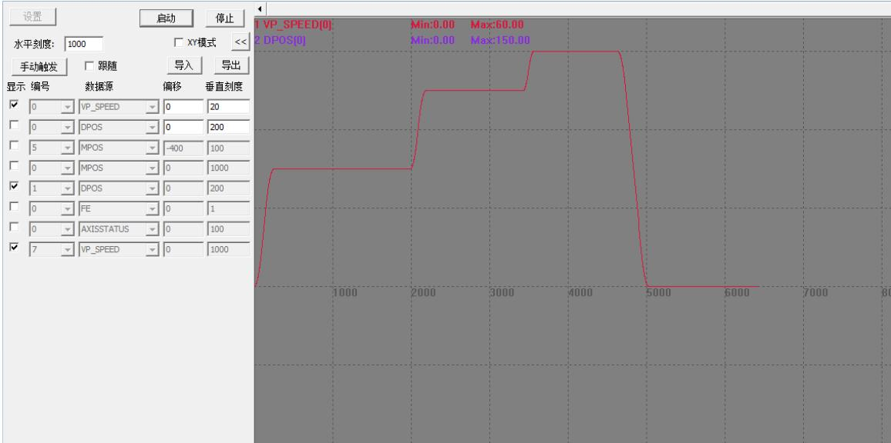  
使用 SP 速度后：

启动 停止 1VP\_SPEED[0] Min:0.00 Max:60.00  
水平刻度：1000 □xy模式 <<|2 DPOS[0]  
手动触发 □跟随 入 导出  
显示编号 数据源 偏移 垂直刻度  
□ 20  
□ PPOS 200  
5 MPOS □ -400  
MPOS  
DPOS  
□   
AXISSTATUS √  
VP\_SPEED

## 6.5.3-6 多轴直线插补

```cpp
// test1.cpp : 定义控制台应用程序的入口点。
#include "stdafx.h"
#include <windows.h>
#include "zmotion.h"
#include "zauxdll2.h"
void commandCheckHandler(const char *command, int ret)
if (ret)//非 0 则失败
{
printf("%s fail!return code is %d\n", command, ret);
}
int _tmain(int argc, _TCHAR* argv[])
char *ip_addr = (char *)"127.0.0.1"; //仿真器 IP 地址
ZMC_HANDLE handle = NULL; //连接句柄
int ret = ZAux_OpenEth(ip_addr, &handle); //连接控制器
if (ERR_SUCCESS != ret)
{
```

```c
printf("控制器连接失败!\n");
handle = NULL;
Sleep(2000);
return -1;
}
printf("控制器连接成功！\n");
ret =ZAux_Direct_SetAtype(handle,0,1);//设置轴 0 轴类型为 1
commandCheckHandler("ZAux_Direct_SetAtype", ret) ;//判断指令是否执行成功
ret =ZAux_Direct_SetAtype(handle,1,1);//设置轴 1 轴类型为 1
commandCheckHandler("ZAux_Direct_SetAtype", ret) ;//判断指令是否执行成功
ret =ZAux_Direct_SetAtype(handle,2,1);//设置轴 2 轴类型为 1
commandCheckHandler("ZAux_Direct_SetAtype", ret) ;//判断指令是否执行成功
ret = ZAux_Direct_Single_Cancel(handle, 0, 0); //轴 0 运动停止
commandCheckHandler("ZAux_Direct_Single_Cancel", ret);
ret = ZAux_Direct_Single_Cancel(handle, 1, 0); //轴 1 运动停止
commandCheckHandler("ZAux_Direct_Single_Cancel", ret);
ret = ZAux_Direct_Single_Cancel(handle, 2, 0); //轴 2 运动停止
commandCheckHandler("ZAux_Direct_Single_Cancel", ret);
ret = ZAux_Direct_SetDpos(handle, 0, 0); //设置轴 0 的 dpos
commandCheckHandler("ZAux_Direct_SetDpos", ret);
ret = ZAux_Direct_SetDpos(handle, 1, 0); //设置轴 1 的 dpos
commandCheckHandler("ZAux_Direct_SetDpos", ret);
ret = ZAux_Direct_SetDpos(handle, 2, 0); //设置轴 2 的 dpos
commandCheckHandler("ZAux_Direct_SetDpos", ret);
ret =ZAux_Direct_SetMerge(handle, 0,1);//设置连续插补
commandCheckHandler("ZAux_Direct_SetMerge", ret) ;//判断指令是否执行成功
int axislist[3] = { 1,0,2 }; //运动轴列表，其中轴 1 为主轴
float poslist[3] = { 100,200,300 }; //运动列表，轴 1-100，轴 0-200，轴 2-300
ZAux_Trigger( handle);//触发示波器
```

ret = ZAux\_Direct\_SetSpeed(handle, axislist[0], 100); //设置插补速度 100，设置在   
主轴上   
commandCheckHandler("ZAux\_Direct\_SetSpeed", ret);   
ret = ZAux\_Direct\_SetAccel(handle, axislist[0], 500); //设置插补加速度 500，设置   
在主轴上   
commandCheckHandler("ZAux\_Direct\_SetAccel", ret);   
ret = ZAux\_Direct\_SetDecel(handle, axislist[0], 500); //设置插补减速度 500，设置   
在主轴上   
commandCheckHandler("ZAux\_Direct\_SetDecel", ret);   
ret = ZAux\_Direct\_MoveAbs(handle, 3, axislist, poslist); //调用运动，轴 0,1,2 走到对   
应的绝对位置   
commandCheckHandler("ZAux\_Direct\_MoveAbs", ret);   
int state[3];   
do   
{   
ZAux\_Direct\_GetIfIdle(handle, axislist[0], state);   
ZAux\_Direct\_GetIfIdle(handle, axislist[1], state + 1);   
ZAux\_Direct\_GetIfIdle(handle, axislist[2], state + 2);   
if (!(state[0] || state[1] || state[2]))   
{   
Sleep(100);   
}   
else   
{   
break;   
}   
} while (true);//等待运动停止   
printf("Idle\n");   
Sleep(2000);

```c
ret = ZAux_Close(handle); //关闭连接
commandCheckHandler("ZAux_Close", ret) ;//判断指令是否执行成功
printf("connection closed!\n");
handle = NULL;
return 0;
```

图为轴0,1,2 的运动速度变化，线段表示意义如图所示。

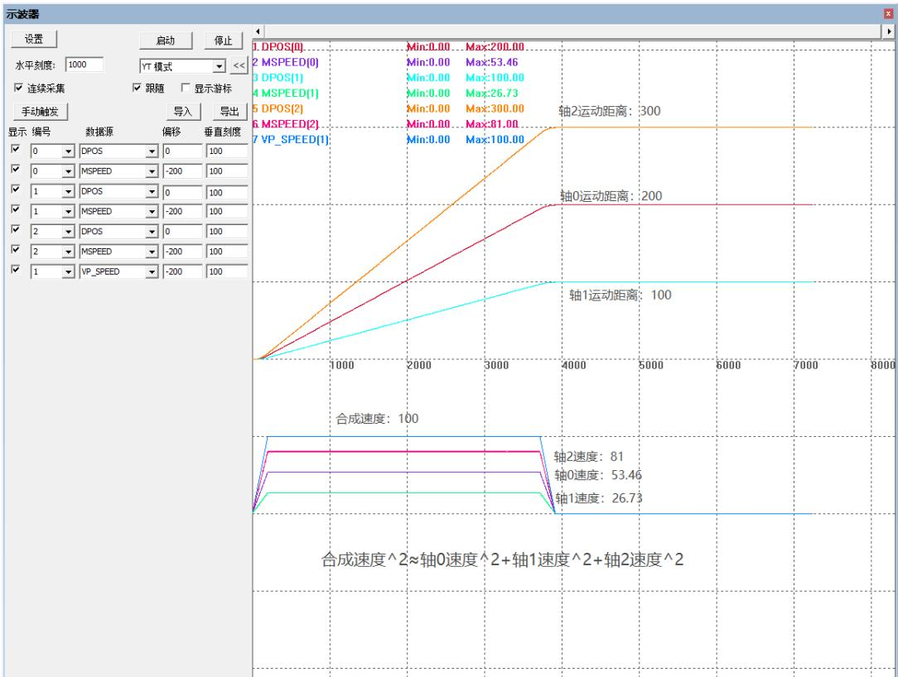

## 6.5.3-7 平面三点画弧

本例程使用 2 个轴做平面圆弧运动，起点（100，100），终点(300,100)，中间点(200,200)，三点画弧。

```cpp
（本例程把当前位置点清0，在运动轴1到100，100作为起点
100，100)
运动参数配置 设置起点 设置中间点，终点
// test1.cpp : 定义控制台应用程序的入口点。
//
#include "stdafx.h"
#include <windows.h>
#include "zmotion.h"
```