```c
#include "zauxdll2.h"
void commandCheckHandler(const char *command, int ret)
{
if (ret)//非 0 则失败
{
printf("%s fail!return code is %d\n", command, ret);
}
int _tmain(int argc, _TCHAR* argv[])
char *ip_addr = (char *)"127.0.0.1"; //仿真器 IP 地址
ZMC_HANDLE handle = NULL; //连接句柄
int ret = ZAux_OpenEth(ip_addr, &handle); //连接控制器
if (ERR_SUCCESS != ret)
{
printf("控制器连接失败!\n");
handle = NULL;
Sleep(2000);
return -1;
printf("控制器连接成功！\n");
float UnitsValue = 100;
float DposValue = 0;
float SpeedValue = 100;
float AccelValue = 10000;
float DecelValue = 10000;
int AxisList[2] = { 0,1 };
float DiatanceValue = 100;
ret =ZAux_Direct_SetAtype(handle,0,1);//设置轴 0 轴类型为 1
commandCheckHandler("ZAux_Direct_SetAtype", ret) ;//判断指令是否执行成功
ret =ZAux_Direct_SetAtype(handle,1,1);//设置轴 1 轴类型为 1
commandCheckHandler("ZAux_Direct_SetAtype", ret) ;//判断指令是否执行成功
```

ret = ZAux\_Direct\_SetUnits(handle, AxisList[0], UnitsValue);//设置轴 0 脉冲当量 commandCheckHandler("ZAux\_Direct\_SetUnits", ret);

ret = ZAux\_Direct\_SetUnits(handle, AxisList[1], UnitsValue);//设置轴 1 脉冲当量 commandCheckHandler("ZAux\_Direct\_SetUnits", ret);

ret = ZAux\_Direct\_SetSpeed(handle, AxisList[0], SpeedValue);//设置轴 0 速度 commandCheckHandler("ZAux\_Direct\_SetSpeed", ret);

ret = ZAux\_Direct\_SetSpeed(handle, AxisList[1], SpeedValue);//设置轴 1 速度

commandCheckHandler("ZAux\_Direct\_SetSpeed", ret);

ret = ZAux\_Direct\_SetAccel(handle, AxisList[0], AccelValue);//设置轴 0 加速度 commandCheckHandler("ZAux\_Direct\_SetAccel", ret);

ret = ZAux\_Direct\_SetAccel(handle, AxisList[1], AccelValue);//设置轴 1 加速度

commandCheckHandler("ZAux\_Direct\_SetAccel", ret);

ret = ZAux\_Direct\_SetDecel(handle, AxisList[0], DecelValue);//设置轴 0 减速度

ret = ZAux\_Direct\_SetDecel(handle, AxisList[1], DecelValue);//设置轴 1 减速度

commandCheckHandler("ZAux\_Direct\_SetDecel", ret);

ret = ZAux\_Direct\_SetDpos(handle, AxisList[0], 0);//设置轴 0 的 dpos 为 0 commandCheckHandler("ZAux\_Direct\_SetDpos", ret);

ret = ZAux\_Direct\_SetDpos(handle, AxisList[1], 0);//设置轴 1 的 dpos 为 0

commandCheckHandler("ZAux\_Direct\_SetDpos", ret);

ret = ZAux\_Direct\_Single\_Cancel(handle, 0, 0); //轴 0 运动停止

commandCheckHandler("ZAux\_Direct\_Single\_Cancel", ret);

ret = ZAux\_Direct\_Single\_Cancel(handle, 1, 0); //轴 1 运动停止

commandCheckHandler("ZAux\_Direct\_Single\_Cancel", ret);

ret = ZAux\_Direct\_Single\_Cancel(handle, 2, 0); //轴 2 运动停止

commandCheckHandler("ZAux\_Direct\_Single\_Cancel", ret);

```c
int run_state = 0; //轴运动状态
ZAux_Trigger( handle);//触发示波器
//运动到起点位置（100，100）
ret = ZAux_Direct_Single_Move(handle, AxisList[0], DiatanceValue);
commandCheckHandler("ZAux_Direct_Single_Move", ret);
ret = ZAux_Direct_Single_Move(handle, AxisList[1], DiatanceValue);
commandCheckHandler("ZAux_Direct_Single_Move", ret);
//运动到起点位置（100，100）
int state[2];
do
{
ret = ZAux_Direct_GetIfIdle(handle, AxisList[0], state);
commandCheckHandler("ZAux_Direct_GetIfIdle", ret);
ret = ZAux_Direct_GetIfIdle(handle, AxisList[1], state + 1);
commandCheckHandler("ZAux_Direct_GetIfIdle", ret);
if (!(state[0] || state[1] ))
{
Sleep(100);
}
else
{
break;
} while (true);//等待运动停止
//三点画弧运动，起点（100，100），中间点（200，200），终点（300，100）
ret = ZAux_Direct_MoveCirc2(handle, 2, AxisList, 200-100, 200-100, 300-100, 100-100);
commandCheckHandler("ZAux_Direct_MoveCirc2", ret);
Sleep(2000);
ret = ZAux_Close(handle); //关闭连接
```

commandCheckHandler("ZAux\_Close", ret) ;//判断指令是否执行成功   
printf("connection closed!\n");   
handle = NULL;   
return 0;

XY 的平面效果图

1 DPOS[0] Min:0.00 Max:300.00   
2 DPOS[1] Min:0.00 Max:199.99

## 6.5.3-8 空间 3 点圆弧

本例程使用 3 个轴做空间圆弧运动，当前位置点，作为起点（0，0，0），终点(120,160,400)，中间点(240,320,300)，模式 0，三点画弧。

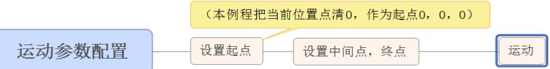

```cpp
// test1.cpp : 定义控制台应用程序的入口点。
#include "stdafx.h"
#include <windows.h>
#include "zmotion.h"
#include "zauxdll2.h"
void commandCheckHandler(const char *command, int ret)
{
if (ret)//非 0 则失败
{
```

```c
printf("%s fail!return code is %d\n", command, ret);
}
int _tmain(int argc, _TCHAR* argv[])
char *ip_addr = (char *)"127.0.0.1"; //仿真器 IP 地址
ZMC_HANDLE handle = NULL; //连接句柄
int ret = ZAux_OpenEth(ip_addr, &handle); //连接控制器
if (ERR_SUCCESS != ret)
{
printf("控制器连接失败!\n");
handle = NULL;
Sleep(2000);
return -1;
}
printf("控制器连接成功！\n");
ret =ZAux_Direct_SetAtype(handle,0,1);//设置轴 0 轴类型为 1
commandCheckHandler("ZAux_Direct_SetAtype", ret) ;//判断指令是否执行成功
ret =ZAux_Direct_SetAtype(handle,1,1);//设置轴 1 轴类型为 1
commandCheckHandler("ZAux_Direct_SetAtype", ret) ;//判断指令是否执行成功
ret =ZAux_Direct_SetAtype(handle,2,1);//设置轴 2 轴类型为 1
commandCheckHandler("ZAux_Direct_SetAtype", ret) ;//判断指令是否执行成功
ret = ZAux_Direct_SetSpeed(handle, 0, 200); //设置主轴 0 速度为 200units/s
commandCheckHandler("ZAux_Direct_SetSpeed", ret);
ret = ZAux_Direct_SetAccel(handle, 0, 2000); //设置主轴 0 加速度为 2000units/s/s
commandCheckHandler("ZAux_Direct_SetAccel", ret);
ret = ZAux_Direct_SetDecel(handle, 0, 2000); //设置主轴 0 减速度为 2000units/s/s
commandCheckHandler("ZAux_Direct_SetDecel", ret);
ret = ZAux_Direct_Single_Cancel(handle, 0, 0); //轴 0 运动停止
commandCheckHandler("ZAux_Direct_Single_Cancel", ret);
ret = ZAux_Direct_Single_Cancel(handle, 1, 0); //轴 1 运动停止
```

commandCheckHandler("ZAux\_Direct\_Single\_Cancel", ret);   
ret = ZAux\_Direct\_Single\_Cancel(handle, 2, 0); //轴 2 运动停止   
commandCheckHandler("ZAux\_Direct\_Single\_Cancel", ret);   
int run\_state = 0; //轴运动状态   
ret = ZAux\_Direct\_SetDpos(handle, 0, 0); //设置轴 0 的 dpos 为 0   
commandCheckHandler("ZAux\_Direct\_SetDpos", ret);   
ret = ZAux\_Direct\_SetDpos(handle, 1, 0); //设置轴 1 的 dpos 为 0   
commandCheckHandler("ZAux\_Direct\_SetDpos", ret);   
ret = ZAux\_Direct\_SetDpos(handle, 2, 0); //设置轴 2 的 dpos 为 0   
commandCheckHandler("ZAux\_Direct\_SetDpos", ret);   
ZAux\_Trigger( handle);//触发示波器   
//参与运动的轴列表   
int axisList[3] = { 0,1,2};   
//起点（0,0,0）终点(120,160,400)，中间点(240,320,300)，模式 0，三点画弧   
ret = ZAux\_Direct\_MSpherical(handle, 3, axisList, 120, 160, 400, 240, 320, 300, 0, 0,   
0);   
commandCheckHandler("ZAux\_Direct\_MSpherical", ret);   
int state[3];   
do   
{   
ret = ZAux\_Direct\_GetIfIdle(handle, axisList[0], state);   
commandCheckHandler("ZAux\_Direct\_GetIfIdle", ret);   
ret = ZAux\_Direct\_GetIfIdle(handle, axisList[1], state + 1);   
commandCheckHandler("ZAux\_Direct\_GetIfIdle", ret);   
ret = ZAux\_Direct\_GetIfIdle(handle, axisList[2], state + 2);   
commandCheckHandler("ZAux\_Direct\_GetIfIdle", ret);   
if (!(state[0] || state[1] || state[2]))

```c
Sleep(100);
}
else
{
break;
}
} while (true);//等待运动停止
printf("Idle\n");
Sleep(2000);
ret = ZAux_Close(handle); //关闭连接
commandCheckHandler("ZAux_Close", ret) ;//判断指令是否执行成功
printf("connection closed!\n");
handle = NULL;
return 0;
```

轨迹效果如下图所示：

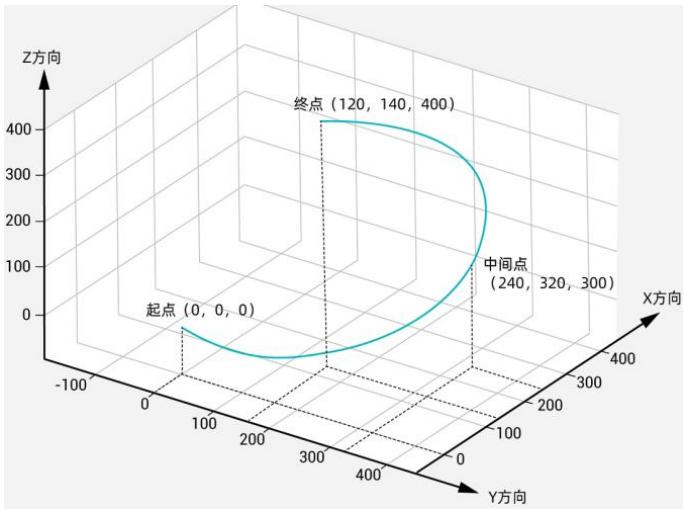

## 6.5.3-9 螺旋曲线

本例程使用 3 个轴做空间圆弧运动，当前位置点，原点作为起点（0，0），终点(200，-200)，中间点(200,0），Z 轴参与运动，运动 100，作顺时针圆心螺旋运动。

（本例程把当前位置点清0，以当前点作为起点0，0）  
运动参数配置 设置起点 设置中间点，终点 圆心螺旋运动

```c
// test1.cpp : 定义控制台应用程序的入口点。
//
#include "stdafx.h"
#include <windows.h>
#include "zmotion.h"
#include "zauxdll2.h"
void commandCheckHandler(const char *command, int ret)
{
if (ret)//非 0 则失败
{
printf("%s fail!return code is %d\n", command, ret);
int _tmain(int argc, _TCHAR* argv[])
char *ip_addr = (char *)"127.0.0.1"; //仿真器 IP 地址
ZMC_HANDLE handle = NULL; //连接句柄
int ret = ZAux_OpenEth(ip_addr, &handle); //连接控制器
if (ERR_SUCCESS != ret)
{
printf("控制器连接失败!\n");
handle = NULL;
Sleep(2000);
return -1;
}
printf("控制器连接成功！\n");
ret =ZAux_Direct_SetAtype(handle,0,1);//设置轴 0 轴类型为 1
commandCheckHandler("ZAux_Direct_SetAtype", ret) ;//判断指令是否执行成功
ret =ZAux_Direct_SetAtype(handle,1,1);//设置轴 1 轴类型为 1
```

commandCheckHandler("ZAux\_Direct\_SetAtype", ret) ;//判断指令是否执行成功   
ret =ZAux\_Direct\_SetAtype(handle,2,1);//设置轴 2 轴类型为 1   
commandCheckHandler("ZAux\_Direct\_SetAtype", ret) ;//判断指令是否执行成功   
ret = ZAux\_Direct\_Single\_Cancel(handle, 0, 0); //轴 0 运动停止   
commandCheckHandler("ZAux\_Direct\_Single\_Cancel", ret);   
ret = ZAux\_Direct\_Single\_Cancel(handle, 1, 0); //轴 1 运动停止   
commandCheckHandler("ZAux\_Direct\_Single\_Cancel", ret);   
ret = ZAux\_Direct\_Single\_Cancel(handle, 2, 0); //轴 2 运动停止   
commandCheckHandler("ZAux\_Direct\_Single\_Cancel", ret);   
int run\_state = 0; //轴运动状态   
ret = ZAux\_Direct\_SetDpos(handle, 0, 0); //设置轴 0 的 dpos 为 0   
commandCheckHandler("ZAux\_Direct\_SetDpos", ret);   
ret = ZAux\_Direct\_SetDpos(handle, 1, 0); //设置轴 1 的 dpos 为 0   
commandCheckHandler("ZAux\_Direct\_SetDpos", ret);   
ret = ZAux\_Direct\_SetDpos(handle, 2, 0); //设置轴 1 的 dpos 为 0   
commandCheckHandler("ZAux\_Direct\_SetDpos", ret);   
ret = ZAux\_Direct\_SetSpeed(handle, 0, 100); //设置主轴 轴 0 速度为 100units/s   
commandCheckHandler("ZAux\_Direct\_SetSpeed", ret);   
ret = ZAux\_Direct\_SetAccel(handle, 0, 10000); //设置主轴 轴 0 加速度为   
10000units/s/s   
commandCheckHandler("ZAux\_Direct\_SetAccel", ret);   
ret = ZAux\_Direct\_SetDecel(handle, 0, 10000); //设置主轴 轴 0 减速度为   
10000units/s/s   
commandCheckHandler("ZAux\_Direct\_SetDecel", ret);   
//参与运动的轴列表   
int axisList[3] = { 0,1,2 };   
ZAux\_Trigger( handle);//触发示波器   
//原点作为起点，中心(200,0)，终点(200,-200)，顺时针，Z 轴参与速度计算，运动 100，   
作圆心螺旋运动   
ret = ZAux\_Direct\_MHelical(handle, 3, axisList, 200,-200, 200, 0, 1, 100,0);

```c
commandCheckHandler("ZAux_Direct_MoveCirc", ret);
int state[3];
do
ret = ZAux_Direct_GetIfIdle(handle, axisList[0], state);
commandCheckHandler("ZAux_Direct_GetIfIdle", ret);
ret = ZAux_Direct_GetIfIdle(handle, axisList[1], state + 1);
commandCheckHandler("ZAux_Direct_GetIfIdle", ret);
ret = ZAux_Direct_GetIfIdle(handle, axisList[2], state + 2);
commandCheckHandler("ZAux_Direct_GetIfIdle", ret);
if (!(state[0] || state[1] || state[2]))
{
Sleep(100);
}
else
{
break;
}
} while (true);//等待运动停止
printf("Idle\n");
Sleep(2000);
ret = ZAux_Close(handle); //关闭连接
commandCheckHandler("ZAux_Close", ret) ;//判断指令是否执行成功
printf("connection closed!\n");
handle = NULL;
return 0;
}
```

插补轨迹

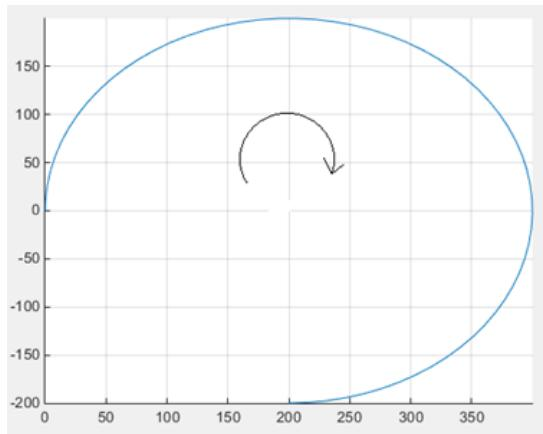

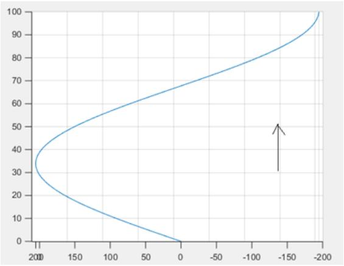

## 6.6 轴暂停/恢复/停止相关

## 指令列表

<table><tr><td rowspan=1 colspan=2>指令                                                   说明</td></tr><tr><td rowspan=1 colspan=1> ZAux_Direct_ MovePause</td><td rowspan=1 colspan=1>运动暂停，插补运动暂停主轴</td></tr><tr><td rowspan=1 colspan=1>ZAux_ Direct_MoveResume</td><td rowspan=1 colspan=1>取消运动暂停</td></tr><tr><td rowspan=1 colspan=1>ZAux_ Direct Rapidstop</td><td rowspan=1 colspan=1>所有轴立即停止</td></tr><tr><td rowspan=1 colspan=1>ZAux Direct CancelAxisList</td><td rowspan=1 colspan=1>多个轴运动停止</td></tr><tr><td rowspan=1 colspan=1>ZAux Direct Single_Cancel</td><td rowspan=1 colspan=1>单轴运动停止</td></tr></table>

## 重点说明

在单轴或多轴插补运动时，运动控制卡支持运动暂停，轴停止等功能。

注意：使用轴停止功能时，运动会以快减减速度（ZAux\_Direct\_SetFastDec）停止运动，若快减减速度未设置，则快减减速度会默认等于设置的减速度（ZAux\_Direct\_SetDecel），所以使用轴停止功能时必须设置减速度或者快减减速度。ZAux\_Direct\_Single\_Cancel, 用模式3 时，不能用于被叠加轴的停止, 否则可能导致叠加轴位置不一致。

## 例程

## 6.6.3-1 轴暂停与恢复

本例程使用轴 0 做单轴运动，正方向运动 2000 个 uintis，运动开始之后 1 秒后暂停，4秒之后恢复运动。

连接控制器 轴参数配置 轴0运动2000uints 1S之后暂停轴0 4S之后恢复轴0运动

```c
// test1.cpp : 定义控制台应用程序的入口点。
//
#include "stdafx.h"
#include <windows.h>
#include "zmotion.h"
#include "zauxdll2.h"
void commandCheckHandler(const char *command, int ret)
if (ret)//非 0 则失败
{
printf("%s return code is %d\n", command, ret);
}
int _tmain(int argc, _TCHAR* argv[])
char *ip_addr = (char *)"127.0.0.1"; //控制器 IP 地址
ZMC_HANDLE handle = NULL; //连接句柄
int ret = ZAux_OpenEth(ip_addr, &handle); //连接控制器
if (ERR_SUCCESS != ret)
{
printf("connect controller failed!\n");
handle = NULL;
getchar();
return -1;
}
printf("控制器连接成功！\n");
ZAux_Direct_SetAtype(handle, 0, 1); //设置轴 0 轴类型为 1
ZAux_Direct_SetUnits(handle, 0, 100); //设置轴 0 脉冲当量为 100
ZAux_Direct_SetSpeed(handle, 0, 200); //设置轴 0 速度为 200units/s
ZAux_Direct_SetAccel(handle, 0, 2000); //设置轴 0 加速度为 2000units/s/s
```

```c
ZAux_Direct_SetDecel(handle, 0, 2000); //设置轴 0 减速度为 2000units/s/s
ZAux_Direct_SetSramp(handle, 0, 200); //设置轴 0 S 曲线为 200ms
ret = ZAux_Direct_SetDpos( handle, 0, 0);//轴指令位置清 0
commandCheckHandler("ZAux_Direct_SetDpos", ret);//判断指令是否执行成功
ret = ZAux_Direct_SetMpos( handle, 0, 0);//编码器反馈位置清 0
commandCheckHandler("ZAux_Direct_SetMpos", ret);//判断指令是否执行成功
int GetVal;
ret =ZAux_Direct_Single_Move( handle, 0, 2000);
commandCheckHandler("ZAux_Direct_SetDpos", ret);//判断指令是否执行成功
Sleep(1000);//等待 1S
ZAux_Direct_MovePause(handle, 0,0);//暂停轴 0 当前运动
Sleep(2000);//等待 2S
ZAux_Direct_GetAxisStatus(handle, 0,&GetVal);//获取轴停止原因
printf("当前轴状态：%x h\n",GetVal);
Sleep(2000);//等待 2S
ZAux_Direct_MoveResume(handle, 0);//恢复轴 0 运动
float IDLE;
while (1)//等待轴 0 运动完成
{
Sleep(100);
ZAux_Direct_GetParam(handle,"IDLE",0,&IDLE);
if (IDLE<0)break;
}
Sleep(2000);
ret = ZAux_Close(handle); //关闭连接
commandCheckHandler("ZAux_Close", ret) ;//判断指令是否执行成功
printf("connection closed!\n");
handle = NULL;
return 0;
```

## 第七章 进阶运动控制

## 7.1 坐标循环

## 指令列表

<table><tr><td rowspan=1 colspan=2>指令                                                   说明</td></tr><tr><td rowspan=1 colspan=1> ZAux Direct SetRepDist</td><td rowspan=1 colspan=1>设置循环范围</td></tr><tr><td rowspan=1 colspan=1>ZAux_Direct GetRepDist</td><td rowspan=1 colspan=1>读取设置循环范围</td></tr><tr><td rowspan=1 colspan=1>ZAux Direct SetRepOption</td><td rowspan=1 colspan=1>设置坐标循环模式</td></tr><tr><td rowspan=1 colspan=1>ZAux Direct_GetRepOption</td><td rowspan=1 colspan=1>读取坐标循环模式</td></tr></table>

## 重点说明

本章节指令，可用于限制凸轮主轴的坐标循环范围，来实现多条凸轮曲线连续。

使用绝对运动模式时，如果目标位置处于坐标循环范围内，可以正确运动；如果处于坐标循环范围外，运动不正确。

相对运动不受影响。

ZAux\_Direct\_SetRepOption （坐标循环模式）：按位来表示不同的意义
<table><tr><td rowspan=1 colspan=1>位</td><td rowspan=1 colspan=1>值</td><td rowspan=1 colspan=1>描述</td></tr><tr><td rowspan=1 colspan=1>0</td><td rowspan=1 colspan=1>1</td><td rowspan=1 colspan=1>0-循环范围：-坐标循环位置（ZAux_Direct_SetRepDist）到 +坐标循环位置（ZAux_Direct_SetRepDist）1-循环范围：0 到 +坐标循环位置（ZAux_Direct_SetRepDist)</td></tr><tr><td rowspan=1 colspan=1>1</td><td rowspan=1 colspan=1>2</td><td rowspan=1 colspan=1>该位置1 跟随凸轮表运动(ZAux_Direct_Cambox)和自动凸轮（ZAux_Direct_Movelink）的重复运动，禁止生效后还原为0</td></tr><tr><td rowspan=1 colspan=1>2</td><td rowspan=1 colspan=1>4</td><td rowspan=1 colspan=1>预留</td></tr><tr><td rowspan=1 colspan=1>4</td><td rowspan=1 colspan=1>16</td><td rowspan=1 colspan=1>1-不使用 ZAux_Direct_SetRepDist，0-使用 ZAux_Direct_SetRepDist</td></tr></table>

## 例程

## 7.1.3-1 坐标循环

本例程使用轴0从原点位置开始，作-100至100之间循环运动以及0-100 直接的循环运

动。

```c
轴参数配置 设置循环位置0-100/-100-100 持续运动
// test1.cpp : 定义控制台应用程序的入口点。
//
#include "stdafx.h"
#include <windows.h>
#include "zmotion.h"
#include "zauxdll2.h"
void commandCheckHandler(const char *command, int ret)
if (ret)//非 0 则失败
{
printf("%s fail!return code is %d\n", command, ret);
}
int _tmain(int argc, _TCHAR* argv[])
char *ip_addr = (char *)"127.0.0.1"; //控制器 IP 地址
ZMC_HANDLE handle = NULL; //连接句柄
int ret = ZAux_OpenEth(ip_addr, &handle); //连接控制器
if (ERR_SUCCESS != ret)
{
printf("控制器连接失败!\n");
handle = NULL;
getchar();
return -1;
}
printf("控制器连接成功！\n");
ret =ZAux_Direct_SetAtype(handle,0,1);//设置轴类型为 1
```

commandCheckHandler("ZAux\_Direct\_SetAtype", ret) ;//判断指令是否执行成功   
ret =ZAux\_Direct\_SetAccel(handle,0,500);//设置轴加速度   
commandCheckHandler("ZAux\_Direct\_SetAccel", ret) ;//判断指令是否执行成功   
ret =ZAux\_Direct\_SetDecel(handle,0,500);//设置轴减速度   
commandCheckHandler("ZAux\_Direct\_SetDecel", ret) ;//判断指令是否执行成功   
ret =ZAux\_Direct\_SetDpos(handle,0,0);//设置轴 DPOS 清 0   
commandCheckHandler("ZAux\_Direct\_SetDpos", ret) ;//判断指令是否执行成功   
ret =ZAux\_Direct\_SetSpeed(handle,0,250);//设置轴速度   
commandCheckHandler("ZAux\_Direct\_SetDecel", ret) ;//判断指令是否执行成功   
ret =ZAux\_Direct\_SetRepDist(handle,0,100);//设置循环坐标为 100   
commandCheckHandler("ZAux\_Direct\_SetRepDist", ret) ;//判断指令是否执行成功   
ret =ZAux\_Direct\_SetRepOption(handle,0,1);//循环模式设置为 1   
commandCheckHandler("ZAux\_Direct\_SetDpos", ret) ;//判断指令是否执行成功   
float IDLE;   
int mode;   
int AxisStatus;   
ZAux\_Trigger( handle);//触发示波器   
ZAux\_Direct\_Single\_Vmove(handle,0,1);//轴 0 持续运动   
while (1)//等待轴 0 运动完成   
{   
Sleep(100);   
ZAux\_Direct\_GetParam(handle,"IDLE",0,&IDLE);   
if (IDLE<0)break;   
}   
getchar();   
ret = ZAux\_Close(handle); //关闭连接   
commandCheckHandler("ZAux\_Close", ret) ;//判断指令是否执行成功   
printf("connection closed!\n");   
handle = NULL;   
return 0;   
}

ZAux\_Direct\_SetRepOption（坐标循环模式）=0，-100 至+100 之间循环  
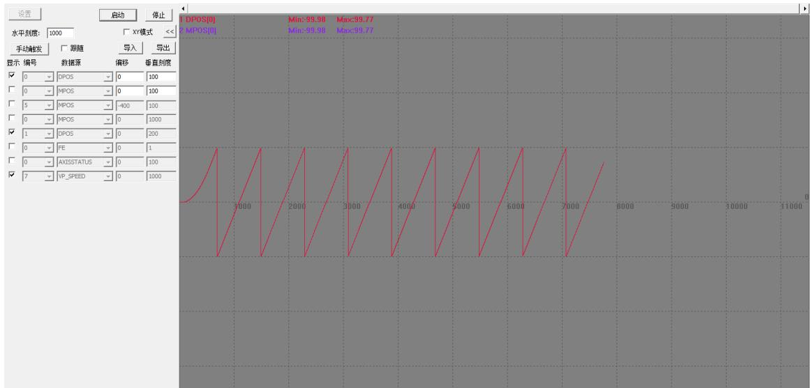

ZAux\_Direct\_SetRepOption（坐标循环模式）=1，0 至+100 之间循环  
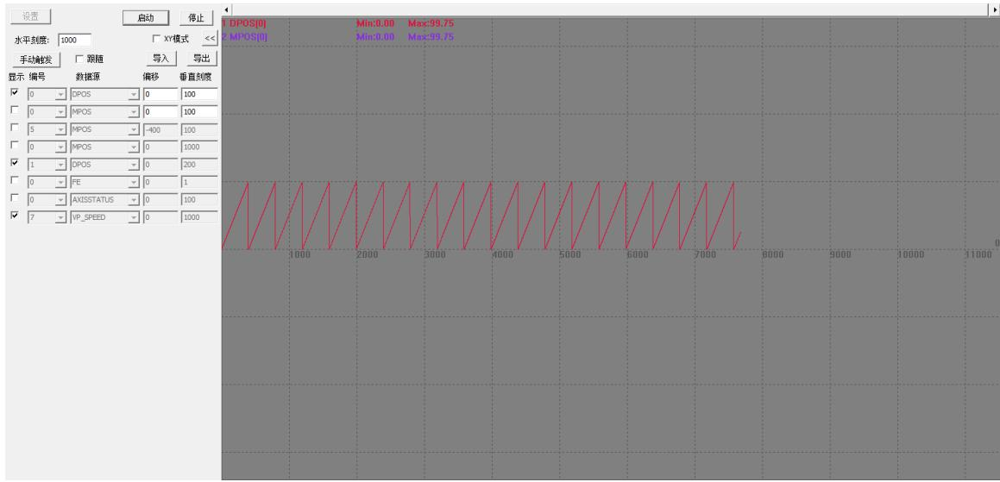

## 7.2 螺距补偿

## 指令列表

<table><tr><td rowspan=1 colspan=2>指令                                                   说明</td></tr><tr><td rowspan=1 colspan=1> ZAux Direct Pitchset</td><td rowspan=1 colspan=1>设置轴的螺距补偿，扩展轴无效</td></tr><tr><td rowspan=1 colspan=1>ZAux_ Direct_Pitchset2</td><td rowspan=1 colspan=1>设置轴的螺距双向补偿，扩展轴无效。</td></tr><tr><td rowspan=1 colspan=1>ZAux Direct_ GetPitchStatus</td><td rowspan=1 colspan=1>设置轴的螺距补偿状态读取，扩展轴无效。</td></tr></table>

## 重点说明

开环、半闭环系统，其定位精度很大程度上受滚珠丝杠精度的影响，尽管滚珠丝杠的精度很高，但总是存在制造误差。要得到超过滚珠丝杠精度的运动精度，在系统中则必须采用螺距误差补偿功能，利用系统对误差进行补偿和修正，来保证加工精度。

本章节指令主要为螺距补偿的函数，螺距补偿主要应用于，当设备机构有制造误差时，可以使用螺距补偿，保证精度。

## 例程

## 7.2.3-1 螺距补偿

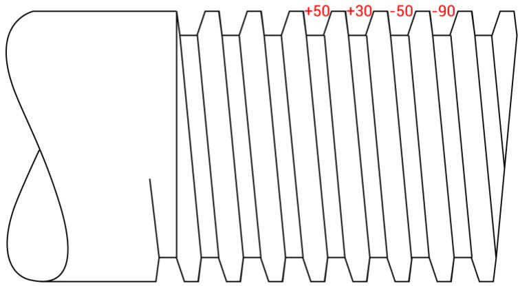

每一圈的螺距存在细微的误差，并不是严格均匀的，故精度高的场合需要螺距补偿来调整。  
本例程驱动轴0运动一段距离 700的往返运动，需要在如下列表点补偿相应的脉冲数。

<table><tr><td rowspan=1 colspan=1>开始补偿点位置（MPOS）</td><td rowspan=1 colspan=1>补偿值(距离100 时的脉冲个数)</td></tr><tr><td rowspan=1 colspan=1>100</td><td rowspan=1 colspan=1>0</td></tr><tr><td rowspan=1 colspan=1>200</td><td rowspan=1 colspan=1>50个脉冲</td></tr><tr><td rowspan=1 colspan=1>300</td><td rowspan=1 colspan=1>30个脉冲</td></tr><tr><td rowspan=1 colspan=1>400</td><td rowspan=1 colspan=1>-50个脉冲</td></tr><tr><td rowspan=1 colspan=1>500</td><td rowspan=1 colspan=1>-90个脉冲</td></tr><tr><td rowspan=1 colspan=1>600</td><td rowspan=1 colspan=1>0</td></tr></table>

```c
// test1.cpp : 定义控制台应用程序的入口点。
//
#include "stdafx.h"
#include <windows.h>
```

```c
#include "zmotion.h"
#include "zauxdll2.h"
void commandCheckHandler(const char *command, int ret)
if (ret)//非 0 则失败
{
printf("%s fail!return code is %d\n", command, ret);
}
int _tmain(int argc, _TCHAR* argv[])
char *ip_addr = (char *)"192.168.0.11"; //控制器IP 地址
ZMC_HANDLE handle = NULL; //连接句柄
int ret = ZAux_OpenEth(ip_addr, &handle); //连接控制器
if (ERR_SUCCESS != ret)
printf("控制器连接失败!\n");
handle = NULL;
getchar();
return -1;
}
printf("控制器连接成功！\n");
ret =ZAux_Direct_SetAtype(handle,0,1);//设置轴类型为 1
commandCheckHandler("ZAux_Direct_SetAtype", ret) ;//判断指令是否执行成功
ret =ZAux_Direct_SetAtype(handle,5,6);//设置轴类型为 6
commandCheckHandler("ZAux_Direct_SetAtype", ret) ;//判断指令是否执行成功
ret =ZAux_Direct_SetAccel(handle,0,500);//设置轴加速度
commandCheckHandler("ZAux_Direct_SetAccel", ret) ;//判断指令是否执行成功
ret =ZAux_Direct_SetDecel(handle,0,500);//设置轴减速度
commandCheckHandler("ZAux_Direct_SetDecel", ret) ;//判断指令是否执行成功
ret =ZAux_Direct_SetDpos(handle,0,0);//设置轴 DPOS 清 0
commandCheckHandler("ZAux_Direct_SetDpos", ret) ;//判断指令是否执行成功
ret =ZAux_Direct_SetMpos(handle,0,0);//设置轴 MPOS 清 0
```

commandCheckHandler("ZAux\_Direct\_SetMpos", ret) ;//判断指令是否执行成功   
ret =ZAux\_Direct\_SetDpos(handle,5,0);//设置轴 DPOS 清 0   
commandCheckHandler("ZAux\_Direct\_SetDpos", ret) ;//判断指令是否执行成功   
ret =ZAux\_Direct\_SetMpos(handle,5,0);//设置轴 MPOS 清 0   
commandCheckHandler("ZAux\_Direct\_SetMpos", ret) ;//判断指令是否执行成功   
ret =ZAux\_Direct\_SetSpeed(handle,0,250);//设置轴速度   
commandCheckHandler("ZAux\_Direct\_SetDecel", ret) ;//判断指令是否执行成功   
float numlist[4]={50,30,-50,-90};   
//开始补偿点位置（MPOS） 补偿值（距离 100 时的脉冲个数）   
// 100 0   
// 200 50 个脉冲   
// 300 30 个脉冲   
// 400 -50 个脉冲   
// 500 -90 个脉冲   
// 600 0   
ret =ZAux\_Direct\_Pitchset(handle,0,1,100,4,100,0,numlist);//设置螺距补偿   
commandCheckHandler("ZAux\_Direct\_Pitchset", ret) ;//判断指令是否执行成功   
float IDLE;   
int mode;   
int AxisStatus;   
ZAux\_Trigger( handle);//触发示波器   
ZAux\_Direct\_Single\_Move(handle,0,700);//轴 0 运动 700   
while (1)//等待轴 0 运动完成   
{   
Sleep(100);   
ZAux\_Direct\_GetParam(handle,"IDLE",0,&IDLE);   
if (IDLE<0)break;   
}   
ZAux\_Direct\_Single\_Move(handle,0,-700);//轴 0 运动-700

```c
while (1)//等待轴 0 运动完成
{
Sleep(100);
ZAux_Direct_GetParam(handle,"IDLE",0,&IDLE);
if (IDLE<0)break;
}
ret =ZAux_Direct_Pitchset(handle,0,0,100,4,100,0,numlist);//关闭螺距补偿
commandCheckHandler("ZAux_Direct_Pitchset", ret) ;//判断指令是否执行成功
getchar();
ret = ZAux_Close(handle); //关闭连接
commandCheckHandler("ZAux_Close", ret) ;//判断指令是否执行成功
printf("connection closed!\n");
handle = NULL;
return 0;
```

波形图：（该波形图，为了更好的显示补偿效果，把轴 0 的脉冲输出，接入到了轴 5的编码器输入上，方便观察规划位置以及实际位置的区别，以看出补偿效果）

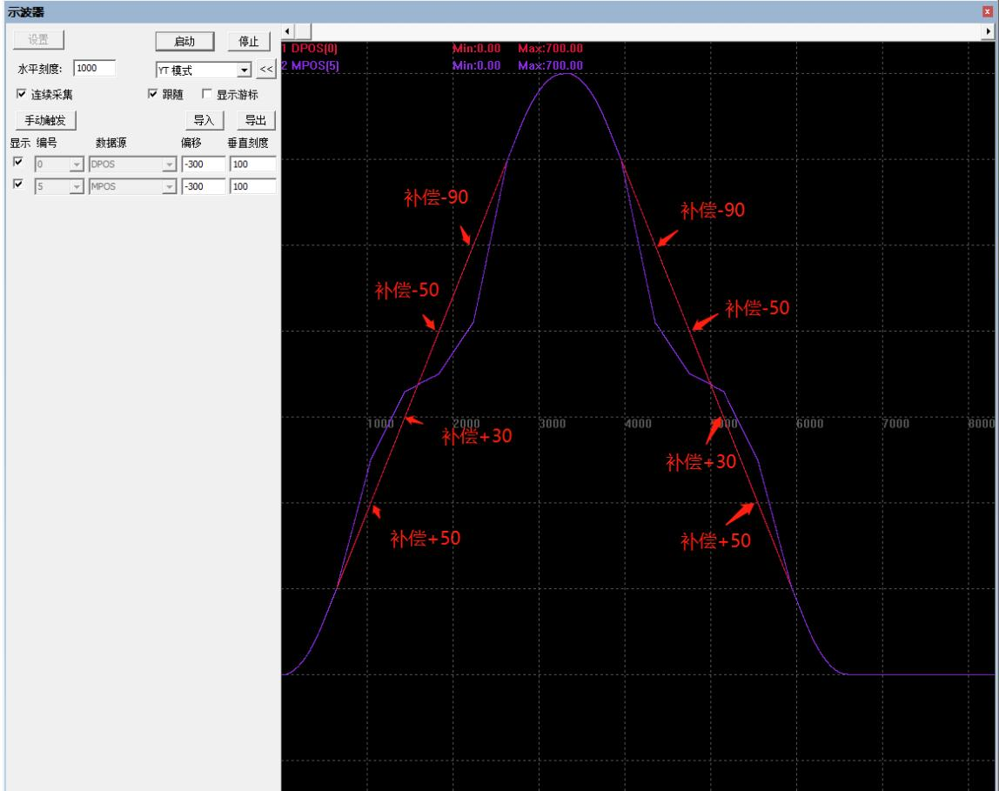

## 7.3 反向间隙补偿

## 指令列表

<table><tr><td>指令</td><td>说明</td></tr><tr><td>ZAux _Direct_ Backlash</td><td>设置轴的反向间隙补偿，扩展轴无效</td></tr></table>

## 重点说明

因为丝杠和螺母之间肯定存在一定的间隙，所以在正转后变换成反转的时候，在一定的角度内，尽管丝杠转动，但是螺母还要等间隙消除以后才能带动工作台运动，这个间隙就是反向间隙，但是要反映在丝杠的旋转角度上。

在设备上，给传动链的各环节中，比如齿轮传动、滚珠丝杠螺母副等都存在着反向间隙。反向间隙是影响机械加工精度的因素之一，当数控机床工作台在其运动方向上换向时，由于反向间隙的存在会导致伺服电动机空转而工作台无实际移动，称为失动。若反向间隙数值较小，对加工精度影响不大则不需要采取任何措施；若数值较大，则系统的稳定性明显下降，加工精度明显降低，尤其是曲线加工，会影响到尺寸公差和曲线的一致性，此时必须进行反向间隙的消除或是补偿，以提高加工精度。

## 例程

## 7.3.3-1 反向间隙补偿

例：假设某机构，存在 10 脉冲当量的反向间隙，如下例子，即演示了该机构正向运动走200后在反向走100，使用反向间隙补偿，把该间隙给自动补偿上去。

```c
// test1.cpp : 定义控制台应用程序的入口点。
//
#include "stdafx.h"
#include <windows.h>
#include "zmotion.h"
#include "zauxdll2.h"
void commandCheckHandler(const char *command, int ret)
```

```c
if (ret)//非 0 则失败
{
printf("%s fail!return code is %d\n", command, ret);
}
int _tmain(int argc, _TCHAR* argv[])
{
char *ip_addr = (char *)"192.168.0.11"; //控制器 IP 地址
ZMC_HANDLE handle = NULL; //连接句柄
int ret = ZAux_OpenEth(ip_addr, &handle); //连接控制器
if (ERR_SUCCESS != ret)
{
printf("控制器连接失败!\n");
handle = NULL;
Sleep(2000);
return -1;
printf("控制器连接成功！\n");
ret =ZAux_Direct_SetAtype(handle,0,4);//设置轴类型为 4
commandCheckHandler("ZAux_Direct_SetAtype", ret) ;//判断指令是否执行成功
ret =ZAux_Direct_SetUnits(handle,0,1);//设置脉冲当量为 1
commandCheckHandler("ZAux_Direct_SetAtype", ret) ;//判断指令是否执行成功
ret =ZAux_Direct_SetAccel(handle,0,500);//设置轴加速度
commandCheckHandler("ZAux_Direct_SetAccel", ret) ;//判断指令是否执行成功
ret =ZAux_Direct_SetDecel(handle,0,500);//设置轴减速度
commandCheckHandler("ZAux_Direct_SetDecel", ret) ;//判断指令是否执行成功
ret =ZAux_Direct_SetDpos(handle,0,0);//设置轴 DPOS 清 0
commandCheckHandler("ZAux_Direct_SetDpos", ret) ;//判断指令是否执行成功
ret =ZAux_Direct_SetMpos(handle,0,0);//设置轴 MPOS 清 0
commandCheckHandler("ZAux_Direct_SetMpos", ret) ;//判断指令是否执行成功
ret =ZAux_Direct_SetSpeed(handle,0,1000);//设置轴速度
commandCheckHandler("ZAux_Direct_SetDecel", ret) ;//判断指令是否执行成功
```

```c
ret =ZAux_Direct_SetMerge(handle,0,1);//设置轴速度
commandCheckHandler("ZAux_Direct_SetDecel", ret) ;//判断指令是否执行成功
ret =ZAux_Direct_Backlash(handle,0,1,10,100,100);//开启轴 0 反向间隙补偿，补偿 10
commandCheckHandler("ZAux_Direct_Backlash", ret) ;//判断指令是否执行成功
float IDLE;
int mode;
int AxisStatus;
ZAux_Trigger( handle);//触发示波器
ZAux_Direct_Single_Move(handle,0,200);//轴 0 运动 200
ZAux_Direct_Single_Move(handle,0,-100);//轴 0 运动-100
while (1)//等待轴 0 运动完成
{
Sleep(100);
ZAux_Direct_GetParam(handle,"IDLE",0,&IDLE);
if (IDLE<0)break;
}
ret =ZAux_Direct_Backlash(handle,0,0,0,100,100);//关闭轴 0 反向间隙补偿
commandCheckHandler("ZAux_Direct_Backlash", ret) ;//判断指令是否执行成功
Sleep(2000);
ret = ZAux_Close(handle); //关闭连接
commandCheckHandler("ZAux_Close", ret) ;//判断指令是否执行成功
printf("connection closed!\n");
handle = NULL;
return 0;
}
```

运动波形图：(由波形图可以看出来，在运动换向时，蓝色实际位置曲线，比红色运动规划曲线多走了一点)

<table><tr><td>示波器</td><td></td><td></td><td></td><td>1</td><td></td><td></td><td></td><td colspan="4"></td></tr><tr><td>设置</td><td colspan="2"></td><td colspan="2">启动 停止</td><td colspan="3">Min:0.00 Max:200.00</td><td colspan="5"></td></tr><tr><td colspan="2">水平刻度： 500</td><td colspan="2">□xy模式</td><td>1 DPOS[0] &lt; 2MSPEED[0]</td><td colspan="7">Min:-304.00 Max:204.00</td></tr><tr><td>手动触发</td><td>□跟隨</td><td></td><td colspan="2">导入 导出</td><td>3 MPOS(0)</td><td></td><td>Min:0.00</td><td>Max:210.00</td><td></td><td></td><td></td></tr><tr><td>显示编号</td><td></td><td>数据源</td><td colspan="2">偏移 垂直刻度</td><td></td><td></td><td></td><td></td><td></td><td></td><td></td></tr><tr><td>√ 回</td><td>□ DPOS</td><td></td><td>日 D</td><td>100</td><td></td><td></td><td></td><td></td><td></td><td></td><td></td></tr><tr><td>□ 0</td><td></td><td>MSPEED</td><td>□ 0</td><td>100</td><td rowspan="5"></td><td rowspan="5"></td><td rowspan="5"></td><td colspan="2"></td><td></td><td></td></tr><tr><td>√ □</td><td>□ MPOS</td><td>□</td><td>-100</td><td></td><td></td><td></td><td></td><td></td><td></td></tr><tr><td>√ 1</td><td></td><td>MSPEED</td><td>□ -2000</td><td>100 1000</td><td></td><td></td><td></td><td></td><td></td></tr><tr><td>√ 2</td><td>DPOS</td><td>日</td><td>-100</td><td>100</td><td></td><td rowspan="2"></td><td rowspan="2"></td><td rowspan="2"></td><td rowspan="2"></td></tr><tr><td>√ 2</td><td></td><td>MSPEED</td><td>□ -200</td><td>100</td><td></td></tr><tr><td>广 1</td><td></td><td>VP_SPEED □</td><td>-200</td><td>100</td><td rowspan="3"></td><td></td><td></td><td></td><td></td><td></td><td></td><td></td></tr><tr><td>√</td><td>√ [VP_SPEED</td><td>□ 回</td><td></td><td>1000</td><td></td><td></td><td></td><td></td><td></td><td></td><td></td></tr><tr><td></td><td></td><td></td><td></td><td></td><td>500</td><td>1000</td><td>1500</td><td>2000</td><td>2500</td><td></td><td></td></tr><tr><td></td><td></td><td></td><td></td><td></td><td></td><td></td><td></td><td></td><td></td><td></td><td>3000</td><td>3500</td></tr><tr><td></td><td></td><td></td><td></td><td></td><td></td><td></td><td></td><td></td><td></td><td></td><td></td><td></td></tr><tr><td></td><td></td><td></td><td></td><td></td><td></td><td></td><td></td><td></td><td></td><td></td><td></td><td></td></tr><tr><td></td><td></td><td></td><td></td><td></td><td></td><td></td><td></td><td></td><td></td><td></td><td></td><td></td></tr><tr><td></td><td></td><td></td><td></td><td></td><td></td><td></td><td></td><td></td><td></td><td></td><td></td><td></td></tr><tr><td></td><td></td><td></td><td></td><td></td><td></td><td></td><td></td><td></td><td></td><td></td><td></td><td></td></tr><tr><td></td><td></td><td></td><td></td><td></td><td></td><td></td><td></td><td></td><td></td><td></td><td></td><td></td></tr><tr><td></td><td></td><td></td><td></td><td></td><td></td><td></td><td></td><td></td><td></td><td></td><td></td><td></td></tr><tr><td></td><td></td><td></td><td></td><td></td><td></td><td></td><td></td><td></td><td></td><td></td><td></td><td></td></tr><tr><td></td><td></td><td></td><td></td><td></td><td></td><td></td><td></td><td></td><td></td><td></td><td></td><td></td></tr></table>

## 第八章 硬件接口访问与配置

## 8.1 数字输入输出

## 指令列表

<table><tr><td rowspan=1 colspan=2>指令                                                   说明</td></tr><tr><td rowspan=1 colspan=1> ZAux Direct GetIn</td><td rowspan=1 colspan=1>读取单个输入信号</td></tr><tr><td rowspan=1 colspan=1>ZAux_Direct_ SetOp</td><td rowspan=1 colspan=1>设置单个输出口信号</td></tr><tr><td rowspan=1 colspan=1>ZAux_Direct_GetOp</td><td rowspan=1 colspan=1>读取单个输出口状态</td></tr><tr><td rowspan=1 colspan=1>ZAux_GetModbusIn</td><td rowspan=1 colspan=1>快速读取多个输入(Modbus 方式)</td></tr><tr><td rowspan=1 colspan=1>ZAux GetModbusOut</td><td rowspan=1 colspan=1>快速读取多个当前的输出状态(Modbus 方式)</td></tr><tr><td rowspan=1 colspan=1>ZAux Direct GetInMulti</td><td rowspan=1 colspan=1>读取多个输入信号</td></tr><tr><td rowspan=1 colspan=1>ZAux Direct SetOutMulti</td><td rowspan=1 colspan=1>IO接口设置多路输出</td></tr><tr><td rowspan=1 colspan=1>ZAux_Direct_ GetOutMulti</td><td rowspan=1 colspan=1>IO 接口 获取多路输出状态</td></tr><tr><td rowspan=1 colspan=1>ZAux Direct SetInvertIn</td><td rowspan=1 colspan=1>设置输入口有效状态反转</td></tr><tr><td rowspan=1 colspan=1>ZAux Direct GetInvertIn</td><td rowspan=1 colspan=1>读取输入口反转状态的有无</td></tr></table>

## 重点说明

以ZMC406 控制器为例，控制器的输入输出口无需使用外部 IO 电源单独供电，连接扩展模块IO最多可扩展至512点。

控制器数字量输入口 IN允许接入的信号类型为 NPN，24V信号，内部电路图如下。IN口电压7V 以下为低电平。输入口分为高速输入口与普通输入口，高速输入口硬件允许的输入信号频率为500K，其他普通 IN 口硬件允许输入的频率在 10K左右。

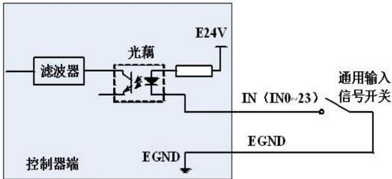  
控制器数字量输出口OUT信号类型为NPN，0V信号，输出电流300mA，内部电路图

如下。

高速输出口输出信号，硬件最大输出频率为1M，普通输出口硬件输出频率为10k左右。

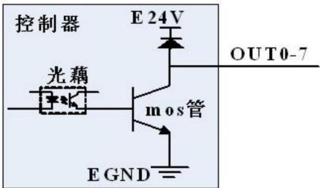  
输出电路  
具体硬件参数参考对应控制器/控制卡硬件手册

## 例程

## 8.1.3-1 IO 读取与设置

本例程获取仿真器 IN0的输入状态，再获取 OP0的状态，根据OP0 的输入状态重新设置OP0，后再读取OP0的状态。

```cpp
连接控制器 读取IN状态 读取OP状态 设置OP状态 读取OP状态
// test1.cpp : 定义控制台应用程序的入口点。
//
#include "stdafx.h"
#include <windows.h>
#include "zmotion.h"
#include "zauxdll2.h"
void commandCheckHandler(const char *command, int ret)
{
if (ret)//非 0 则失败
{
printf("%s fail!return code is %d\n", command, ret);
```

```c
int _tmain(int argc, _TCHAR* argv[])
{
char *ip_addr = (char *)"127.0.0.1"; //控制器 IP 地址
ZMC_HANDLE handle = NULL; //连接句柄
int ret = ZAux_OpenEth(ip_addr, &handle); //连接控制器
if (ERR_SUCCESS != ret)
{
printf("控制器连接失败!\n");
handle = NULL;
Sleep(2000);
return -1;
}
printf("控制器连接成功！\n");
unsigned int in_value;
unsigned int out_value;
ret = ZAux_Direct_GetIn(handle, 0, &in_value); //读取 IN0 状态
commandCheckHandler("ZAux_Direct_GetIn", ret);
printf("IN0 status: %d\n", in_value);
ret = ZAux_Direct_GetOp(handle, 0, &out_value); //读取 OP0 状态
commandCheckHandler("ZAux_Direct_GetOp", 0);
printf("OP0 status: %d\n", out_value);
if(out_value==0)
ret = ZAux_Direct_SetOp(handle, 0, 1); //设置 OP0 状态
commandCheckHandler("ZAux_Direct_SetOp", 0);
}else
{
ret = ZAux_Direct_SetOp(handle, 0, 0); //设置 OP0 状态
commandCheckHandler("ZAux_Direct_SetOp", 0);
ret = ZAux_Direct_GetOp(handle, 0, &out_value); //读取 OP0 状态
commandCheckHandler("ZAux_Direct_GetOp", 0);
printf("OP0 status: %d\n", out_value);
```

Sleep(2000);   
ret = ZAux\_Close(handle); //关闭连接   
commandCheckHandler("ZAux\_Close", ret) ;//判断指令是否执行成功   
printf("connection closed!\n");   
handle = NULL;   
return 0;   
}

## 8.1.3-2 多个 IO 读取(GetModbusOut/GetModbusIn)

本例程获取仿真器 IN0 –IN24的输入状态，再获取OP0-OP7 的状态。

```cpp
连接控制器 读取IN状态 读取OP状态
// test1.cpp : 定义控制台应用程序的入口点。
//
#include "stdafx.h"
#include <windows.h>
#include "zmotion.h"
#include "zauxdll2.h"
void commandCheckHandler(const char *command, int ret)
if (ret)//非0则失败
{
("%s fail!return code is %d\n", command, ret);
}
int (int argc, * argv[])
char *ip_addr = (char *)"127.0.0.1"; //控制器IP地址
ZMC_HANDLE handle = ; //连接句柄
int ret = ZAux_OpenEth(ip_addr, &handle); //连接控制器
if (ERR_SUCCESS != ret)
{
("控制器连接失败!\n");
handle = ;
```

```c
(2000);
return -1;
("控制器连接成功！\n");
uint8 GetValue[8]; //读取设置的值
ret = ZAux_GetModbusIn( handle, 0 , 24, GetValue);
commandCheckHandler("ZAux_GetModbusIn", ret);
for (int i = 0; i <= 24; i++)
{
if (i%8==0)
{
("\n");
}
//一次性取8位，每一位对应一个IO
//(GetValue[(int)(i/8)] & (0x1 <<(i%8)))：只保留对应位，其余全部置0
// >> (i%8)):取出对应位状态
("IN(%d) = %d ", i, (GetValue[(int)(i/8)] & (0x1 <<(i%8))) >> (i%8));
}
("\n*******************************************************************\n");
ret = ZAux_GetModbusOut(handle, 0 , 7 , GetValue);
commandCheckHandler("ZAux_GetModbusOut", ret);
for (int i = 0; i <= 7; i++)
{
("OP(%d) = %d ", i,(GetValue[(int)(i/8)] & (0x1 <<(i%8))) >> (i%8));
("\n");
(20000);
ret = ZAux_Close(handle); //关闭连接
commandCheckHandler("ZAux_Close", ret) ;//判断指令是否执行成功
("connection closed!\n");
handle = ;
return 0;
```

## 8.1.3-3 多个 IO 读取设置

本例程获取仿真器 IN 0-47的输入状态，再获取 OP 0-OP7 的状态


```c
// test1.cpp : 定义控制台应用程序的入口点。
//
#include "stdafx.h"
#include <windows.h>
#include "zmotion.h"
#include "zauxdll2.h"
void commandCheckHandler(const char *command, int ret)
if (ret)//非0则失败
{
("%s fail!return code is %d\n", command, ret);
}
int (int argc, * argv[])
char *ip_addr = (char *)"127.0.0.1"; //控制器IP地址
ZMC_HANDLE handle = ; //连接句柄
int ret = ZAux_OpenEth(ip_addr, &handle); //连接控制器
if (ERR_SUCCESS != ret)
{
("控制器连接失败!\n");
handle = ;
(2000);
return -1;
("控制器连接成功！\n");
int32 GetValue[2]; //读取设置的值
uint32 uValue;
ret = ZAux_Direct_GetInMulti( handle, 0 , 48, GetValue);
```

```c
commandCheckHandler("ZAux_GetModbusIn", ret);
for (int i = 0; i < 48; i++)
if (i%10==0)
{
("\n");
("IN(%d) = %d ", i, (GetValue[(int)(i/32)] & (0x1 << (i%32))) >> (i%32));
("\n**********************************************************************\n"
);
uValue=1;
ret = ZAux_Direct_SetOutMulti(handle, 0 , 7 , &uValue);
commandCheckHandler("ZAux_GetModbusOut", ret);
ret = ZAux_Direct_GetOutMulti(handle, 0 , 7 , &uValue);
commandCheckHandler("ZAux_GetModbusOut", ret);
for (int i = 0; i <= 7; i++)
{
("OP(%d) = %d ", i, (uValue & (0x1 << i)) >> i);
}
("\n");
(20000);
ret = ZAux_Close(handle); //关闭连接
commandCheckHandler("ZAux_Close", ret) ;//判断指令是否执行成功
("connection closed!\n");
handle = ;
return 0;
```

## 8.2 模拟量输入输出

## 指令列表

<table><tr><td rowspan=1 colspan=2>指令                                                  说明</td></tr><tr><td rowspan=1 colspan=1>ZAux_Direct GetAD</td><td rowspan=1 colspan=1>读取单个模拟量输入信号</td></tr><tr><td rowspan=1 colspan=1>ZAux Direct SetDA</td><td rowspan=1 colspan=1>打开单个模拟量输出信号</td></tr><tr><td rowspan=1 colspan=1>ZAux Direct GetDA</td><td rowspan=1 colspan=1>读取模拟输出口状态</td></tr></table>

## 重点说明

控制器 AD/DA 采用了内部电源，如 ZMC416BE 模拟量的分辨率为 12 位，0-10V 电压型，对应刻度为0-4095，控制器带2路AD 和2 路DA，可采用模拟量扩展模块扩展更多接口，最多支持扩展 256 路 AD 和 128 路 DA，可选 12 位分辨率和 16 位分辨率的扩展模块。控制器默认位12位分辨率。

<table><tr><td rowspan=1 colspan=1>针脚号</td><td rowspan=1 colspan=1>名称</td><td rowspan=1 colspan=1>说明</td></tr><tr><td rowspan=1 colspan=1>1</td><td rowspan=1 colspan=1>DA0</td><td rowspan=1 colspan=1>0-10V模拟输出口0</td></tr><tr><td rowspan=1 colspan=1>2</td><td rowspan=1 colspan=1>DA1</td><td rowspan=1 colspan=1>0-10V 模拟输出口1</td></tr><tr><td rowspan=1 colspan=1>3</td><td rowspan=1 colspan=1>AGND</td><td rowspan=1 colspan=1>模拟量口GND</td></tr><tr><td rowspan=1 colspan=1>4</td><td rowspan=1 colspan=1>AD0</td><td rowspan=1 colspan=1>0-10V模拟输入口0</td></tr><tr><td rowspan=1 colspan=1>5</td><td rowspan=1 colspan=1>AD1</td><td rowspan=1 colspan=1>0-10V模拟输入口1</td></tr></table>

## 例程

## 8.2.3-1 DA/AD 的设置与读取

本例程获取仿真器 AD0 的输入状态，再获取 DA0 的状态，再设置 DA0 后在重新读取DA0 的状态


<table><tr><td>/／ test1.cpp ：定义控制台应用程序的入口点。</td></tr><tr><td>//</td></tr></table>

```c
#include "stdafx.h"
#include <windows.h>
#include "zmotion.h"
#include "zauxdll2.h"
void commandCheckHandler(const char *command, int ret)
{
if (ret)//非 0 则失败
{
printf("%s fail!return code is %d\n", command, ret);
}
int _tmain(int argc, _TCHAR* argv[])
{
char *ip_addr = (char *)"127.0.0.1"; //控制器 IP 地址
ZMC_HANDLE handle = NULL; //连接句柄
int ret = ZAux_OpenEth(ip_addr, &handle); //连接控制器
if (ERR_SUCCESS != ret)
printf("控制器连接失败!\n");
handle = NULL;
Sleep(2000);
return -1;
printf("控制器连接成功！\n");
float AD_value;
float DA_value;
ret = ZAux_Direct_GetAD(handle,0,&AD_value);//获取 AD0 状态
commandCheckHandler("ZAux_Direct_GetAD", ret);
printf("read AD_value: %f\n",AD_value);
ret = ZAux_Direct_GetDA(handle,0,&DA_value);//获取 DA0 状态
commandCheckHandler("ZAux_Direct_GetDA", ret);
```

```c
printf("read DA_value: %f\n",DA_value);
Sleep(1000);
ret = ZAux_Direct_SetDA(handle,0,3000);//设置 DA0 状态
commandCheckHandler("ZAux_Direct_SetDA", ret);
Sleep(1000);
ret = ZAux_Direct_GetDA(handle,0,&DA_value);//获取 DA0 状态
commandCheckHandler("ZAux_Direct_GetDA", ret);
printf("read DA_value: %f\n",DA_value);
Sleep(2000);
ret = ZAux_Close(handle); //关闭连接
commandCheckHandler("ZAux_Close", ret) ;//判断指令是否执行成功
printf("connection closed!\n");
handle = NULL;
return 0;
```

## 8.3 PWM 控制

## 指令列表

<table><tr><td rowspan=1 colspan=2>指令                                                   说明</td></tr><tr><td rowspan=1 colspan=1> ZAux Direct SetPwmFreq</td><td rowspan=1 colspan=1>设置pwm频率</td></tr><tr><td rowspan=1 colspan=1> ZAux_Direct_GetPwmFreq</td><td rowspan=1 colspan=1>读取 pwm频率</td></tr><tr><td rowspan=1 colspan=1> ZAux_Direct SetPwmDuty</td><td rowspan=1 colspan=1>设置pwm占空比</td></tr><tr><td rowspan=1 colspan=1> ZAux Direct_ GetPwmDuty</td><td rowspan=1 colspan=1>读取pwm占空比</td></tr><tr><td rowspan=1 colspan=1> ZAux_ Direct MovePwm</td><td rowspan=1 colspan=1>运动中修改pwm</td></tr></table>

## 重点说明

PWM 是英文“Pulse Width Modulation”的缩写，中文译为“脉冲宽度调制”，简称“脉宽调制”或“调制”，是利用微处理器的数字输出来对模拟电路进行控制的一种非常有效的技术。

PWM（脉冲宽度调制）就是通过调节占空比，来调节脉冲宽度。只有支持 PWM 功能的控制器才能使用

脉冲时间T=1/f=1/4000=0.25ms

频率f：4000HZ占空比D：20%  
峰值功率Pp:6KW

在调节激光切割的工艺参数时，经常会用到脉冲频率、占空比这两个，很多对激光切割工艺不熟悉的人员可能不太理解这两个参数的作用，接下来就给大家详细的介绍一下。

1周期信号：从高电平到低电平再回到高电平为一个周期；

2脉冲频率：在1秒钟内PWM有多少个周期；

3脉冲占空比：一个周期内，高电平的时间与整个周期时间的比例；

4脉冲时间：一个周期所用的时间；

5 脉冲宽度：一个周期内，高电平所用的时间；

6激光峰值功率：在一个脉冲宽度内输出的瞬时能量；

7平均功率：激光在一个重复周期内输出的能量

接下来，我们用一个实例来说明如何计算 PWM 的各项参数。

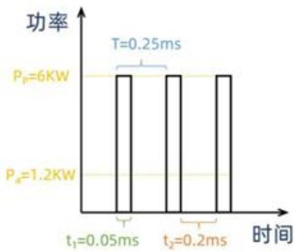

脉冲宽度 $t _ { 1 } = 7 \times 0 = 0 . 2 5 \times 2 0 \% = 0 . 0 5 m s$

平均功率 $P _ { \Delta } = P _ { \mathrm { p } } \times \mathsf { D } = 6 \times 2 0 \% = 1 . 2 \mathsf { K W }$

## 例程

## 8.3.3-1 PWM 使用

```cpp
连接控制器 设置PWM频率 设置PWM占空比 缓冲中操作PWM
// test1.cpp : 定义控制台应用程序的入口点。
//
#include "stdafx.h"
#include <windows.h>
#include "zmotion.h"
#include "zauxdll2.h"
void commandCheckHandler(const char *command, int ret)
```

```c
if (ret)//非 0 则失败
{
printf("%s fail!return code is %d\n", command, ret);
}
}
int _tmain(int argc, _TCHAR* argv[])
char *ip_addr = (char *)"192.168.0.11"; //控制器IP 地址
ZMC_HANDLE handle = NULL; //连接句柄
int ret = ZAux_OpenEth(ip_addr, &handle); //连接控制器
if (ERR_SUCCESS != ret)
{
printf("控制器连接失败!\n");
handle = NULL;
Sleep(2000);
return -1;
}
printf("控制器连接成功！\n");
float freq_value;
float duty_value;
ret = ZAux_Direct_SetPwmFreq(handle, 0,20); //设置 PWM 频率，必须在设置占空
比前设置频率，此处设置为 20，是为了能让 Zdevelop 示波器能抓取到波形
commandCheckHandler("ZAux_Direct_SetPwmFreq", ret);
ZAux_Trigger( handle);//触发示波器
ret = ZAux_Direct_SetPwmDuty(handle, 0, 0.2); //设置 PWM 占空比，大于 0 即输
出 PWM
commandCheckHandler("ZAux_Direct_SetPwmDuty", ret);
Sleep(1000);
ret = ZAux_Direct_SetPwmDuty(handle, 0, 0); //设置 PWM 占空比为 0，关闭 PWM
输出
commandCheckHandler("ZAux_Direct_SetPwmDuty", ret);
```

```c
Sleep(2000);
ret = ZAux_Close(handle); //关闭连接
commandCheckHandler("ZAux_Close", ret) ;//判断指令是否执行成功
printf("connection closed!\n");
handle = NULL;
return 0;
```

示波器图形：

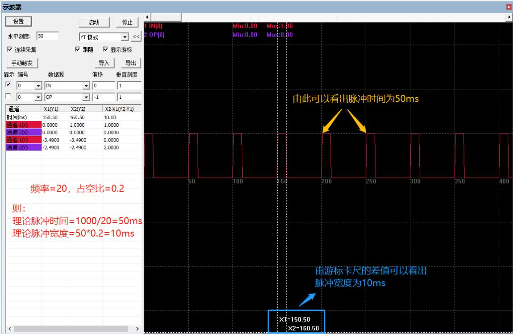

## 第九章 安全机制

## 9.1 轴软件限位函数

## 指令列表

<table><tr><td rowspan=1 colspan=2>指令                                                   说明</td></tr><tr><td rowspan=1 colspan=1> ZAux Direct SetFsLimit</td><td rowspan=1 colspan=1>设置正向软限位</td></tr><tr><td rowspan=1 colspan=1>ZAux_Direct_ GetFsLimit</td><td rowspan=1 colspan=1>读取正向软限位</td></tr><tr><td rowspan=1 colspan=1>ZAux Direct SetRsLimit</td><td rowspan=1 colspan=1>设置负向软限位位置</td></tr><tr><td rowspan=1 colspan=1>ZAux Direct_GetRsLimit</td><td rowspan=1 colspan=1>读取负向软限位位置</td></tr></table>

## 重点说明

正向软限位、负向软限位都为控制器的限位功能，为软件限位，与硬件无关，限制的是命令位置的范围。当 ZAux\_Direct\_SetFsLimit (正向软限位)或者 ZAux\_Direct\_SetRsLimit（负向软限位）大于 ZAux\_Direct\_SetRepDist（坐标循环位置，详情查阅 7.1 章节）时，参数不起作用，正负向软限位被禁止。取消软限位时，建议不要去修改 ZAux\_Direct\_SetRepDist（ 坐 标 循 环 位 置 ） 的 值 ， 将 ZAux\_Direct\_SetFsLimit ( 正 向 软 限 位 ) 或 者ZAux\_Direct\_SetRsLimit（负向软限位）设置一个较大值即可。ZAux\_Direct\_SetFsLimit (正向软限位)或者 ZAux\_Direct\_SetRsLimit（负向软限位）的值默认为 200000000/-200000000。

运动控制器能够通过安装限位开关或者设置软限位来限制各轴的运动范围。硬限位开关和软限位开关用于工艺对象轴的允许运动范围和工作范围。

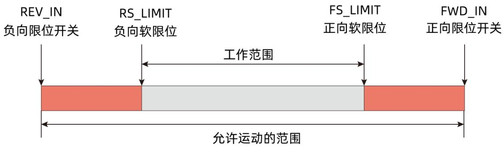  
与硬限位开关不同，软限位开关只通过软件程序设定来实现，而无需借助外部的开关元件。软限位开关将限制轴的“工作范围”，由指令直接设置限位位置，轴走到设置位置后立即采用快减减速度 STDEC（ZAux\_Direct\_SetFastDec）停止运动，且对应的轴状态位设置

为1，它们应位于机床限制行进范围的相关硬限位开关的内侧。由于软限位开关的位置较为灵活，因此可根据当前的运行轨迹和具体要求调整轴的工作范围。

工作台碰到限位开关或者规划位置超越软限位时，运动控制器紧急停止工作台的运动。限位触发以后，轴无法继续运动，此时需要调整轴的位置，使其远离限位位置才能重新开始运动。

轴在碰到限位的时候才会产生停止信号，此时由于减速需要一定的时间，实际轴的位置 会越过限位一定距离，假设停止时 SPEED（ZAux\_Direct\_SetSpeed）速度是 v0，快减速 STDEC （ZAux\_Direct\_SetFastDec）为 a，计算公式： $\mathrm { \mathbf { v _ { f } } } ^ { 2 } \mathrm { - } \mathrm { \mathbf { V } } \boldsymbol { 0 } ^ { 2 } \mathrm { = } 2 \mathrm { a s }$ ，带入下方数据： $0 { - } 1 0 0 ^ { 2 } { = } 2 ^ { * } ( - 1 0 0 0 ) ^ { * } \mathbf { s }$ ， 得出过冲的距离 s=5，由此可得，增大 STDEC（ZAux\_Direct\_SetFastDec）和减小 SPEED （ZAux\_Direct\_SetSpeed）都能达到减小过冲的目的。

## 例程

## 9.1.3-1 正负软限位设置

<table><tr><td rowspan=19 colspan=1>控制器连接成功！请输入运动模式，1为正向运动，-1为负向运动：AxisStatus轴状态：轴报警_512：请输入运动模式，i为正向运动，-1为负向运动：AxisStatus轴状态：轴报警_1024请输入运动模式，i为正向运动，-1为负向运动：</td><td rowspan=1 colspan=4></td></tr><tr><td rowspan=1 colspan=1>位</td><td rowspan=1 colspan=1>说明</td><td rowspan=1 colspan=2>打印值</td></tr><tr><td rowspan=1 colspan=1>1</td><td rowspan=1 colspan=1>随动误差超限告警</td><td rowspan=1 colspan=1>2</td><td rowspan=1 colspan=1>2h</td></tr><tr><td rowspan=1 colspan=1>2</td><td rowspan=1 colspan=1>与远程轴通讯出错</td><td rowspan=1 colspan=1>4</td><td rowspan=1 colspan=1>4h</td></tr><tr><td rowspan=1 colspan=1>3</td><td rowspan=1 colspan=1>远程驱动器报错</td><td rowspan=1 colspan=1>8</td><td rowspan=1 colspan=1>8h</td></tr><tr><td rowspan=1 colspan=1>4</td><td rowspan=1 colspan=1>正向硬限位</td><td rowspan=1 colspan=1>16</td><td rowspan=1 colspan=1>10h</td></tr><tr><td rowspan=1 colspan=1>5</td><td rowspan=1 colspan=1>反向硬限位</td><td rowspan=1 colspan=1>32</td><td rowspan=1 colspan=1>20h</td></tr><tr><td rowspan=1 colspan=1>6</td><td rowspan=1 colspan=1>找原点中</td><td rowspan=1 colspan=1>64</td><td rowspan=1 colspan=1>40h</td></tr><tr><td rowspan=1 colspan=1>7</td><td rowspan=1 colspan=1>HOLD速度保持信号输入</td><td rowspan=1 colspan=1>128</td><td rowspan=1 colspan=1>80h</td></tr><tr><td rowspan=1 colspan=1>8</td><td rowspan=1 colspan=1>随动误差超限出错</td><td rowspan=1 colspan=1>256</td><td rowspan=1 colspan=1>100h</td></tr><tr><td rowspan=1 colspan=1>9</td><td rowspan=1 colspan=1>超过正向软限位</td><td rowspan=1 colspan=1>512</td><td rowspan=1 colspan=1>200h</td></tr><tr><td rowspan=1 colspan=1>10</td><td rowspan=1 colspan=1>超过负向软限位</td><td rowspan=1 colspan=1>1024</td><td rowspan=1 colspan=1>400h</td></tr><tr><td rowspan=1 colspan=1>11</td><td rowspan=1 colspan=1>CANCEL执行中</td><td rowspan=1 colspan=1>2048</td><td rowspan=1 colspan=1>800h</td></tr><tr><td rowspan=1 colspan=1>12</td><td rowspan=1 colspan=1>脉冲频率超过MAX_SPEED限制.需要修改降速或修改MAX_SPEED</td><td rowspan=1 colspan=1>4096</td><td rowspan=1 colspan=1>1000h</td></tr><tr><td rowspan=1 colspan=1>14</td><td rowspan=1 colspan=1>机械手指令坐标错误</td><td rowspan=1 colspan=1>16384</td><td rowspan=1 colspan=1>4000h</td></tr><tr><td rowspan=1 colspan=1>18</td><td rowspan=1 colspan=1>电源异常</td><td rowspan=1 colspan=1>262144</td><td rowspan=1 colspan=1>40000h</td></tr><tr><td rowspan=1 colspan=1>21</td><td rowspan=1 colspan=1>运动中触发特殊运动指令失败</td><td rowspan=1 colspan=1>2097152</td><td rowspan=1 colspan=1>200000h</td></tr><tr><td rowspan=1 colspan=1>22</td><td rowspan=1 colspan=1>告警信号输入</td><td rowspan=1 colspan=1>4194304</td><td rowspan=1 colspan=1>400000h</td></tr><tr><td rowspan=1 colspan=1>23</td><td rowspan=1 colspan=1>轴进入了暂停状态</td><td rowspan=1 colspan=1>8388608</td><td rowspan=1 colspan=1>800000h</td></tr></table>

```cpp
// test1.cpp : 定义控制台应用程序的入口点。
//
#include "stdafx.h"
#include <windows.h>
#include "zmotion.h"
#include "zauxdll2.h"
void commandCheckHandler(const char *command, int ret)
{
```

```c
if (ret)//非 0 则失败
{
printf("%s fail!return code is %d\n", command, ret);
}
int _tmain(int argc, _TCHAR* argv[])
{
char *ip_addr = (char *)"127.0.0.1"; //控制器 IP 地址
ZMC_HANDLE handle = NULL; //连接句柄
int ret = ZAux_OpenEth(ip_addr, &handle); //连接控制器
if (ERR_SUCCESS != ret)
{
printf("控制器连接失败!\n");
handle = NULL;
getchar();
return -1;
printf("控制器连接成功！\n");
ret =ZAux_Direct_SetAtype(handle,0,1);//设置轴类型为 1
commandCheckHandler("ZAux_Direct_SetAtype", ret) ;//判断指令是否执行成功
ret =ZAux_Direct_SetAccel(handle,0,500);//设置轴加速度
commandCheckHandler("ZAux_Direct_SetAccel", ret) ;//判断指令是否执行成功
ret =ZAux_Direct_SetDecel(handle,0,500);//设置轴减速度
commandCheckHandler("ZAux_Direct_SetDecel", ret) ;//判断指令是否执行成功
ret =ZAux_Direct_SetDpos(handle,0,0);//设置轴 DPOS 清 0
commandCheckHandler("ZAux_Direct_SetDpos", ret) ;//判断指令是否执行成功
ret =ZAux_Direct_SetFsLimit(handle,0,500);//设置正向软限位为 500
commandCheckHandler("ZAux_Direct_SetDecel", ret) ;//判断指令是否执行成功
ret =ZAux_Direct_SetRsLimit(handle,0,-500);//设置负向软限位为-500
commandCheckHandler("ZAux_Direct_SetDpos", ret) ;//判断指令是否执行成功
```

```c
float IDLE;
int mode;
int AxisStatus;
ZAux_Trigger( handle);//触发示波器
while(1)
{
printf("请输入运动模式，1 为正向运动，-1 为负向运动：\n");
scanf("%d",&mode);
if (mode!=1 && mode!=-1 && mode!=0)
{
printf("输入运动模式错误,%d\n",mode);
Sleep(2000);
return 0;
}
if (mode==0)
{
printf("退出\n");
break;
}
ZAux_Direct_Single_Vmove(handle,0,mode);//轴 0 持续运动
while (1)//等待轴 0 运动完成
{
Sleep(100);
ZAux_Direct_GetParam(handle,"IDLE",0,&IDLE);
if (IDLE<0)break;
ZAux_Direct_GetAxisStatus(handle,0,&AxisStatus);
printf("AxisStatus 轴状态：%s %d：,\n",AxisStatus>0 ? "轴报警":"轴正常
",AxisStatus);
}
getchar();
ret = ZAux_Close(handle); //关闭连接
commandCheckHandler("ZAux_Close", ret) ;//判断指令是否执行成功
printf("connection closed!\n");
handle = NULL;
```

<table><tr><td>return 0;</td></tr><tr><td>1</td></tr></table>

输出波形图：

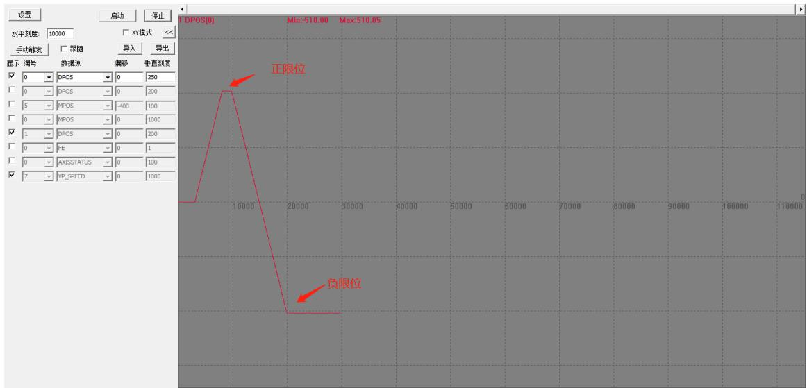

## 9.2 轴硬件限位函数

## 指令列表

<table><tr><td rowspan=1 colspan=2>指令                                                      说明</td></tr><tr><td rowspan=1 colspan=1> ZAux_ Direct_ SetFwdIn</td><td rowspan=1 colspan=1>设置正向硬限位开关对应的输入点编号</td></tr><tr><td rowspan=1 colspan=1>ZAux_Direct GetFwdIn</td><td rowspan=1 colspan=1>读取正向硬限位开关对应的输入点编号</td></tr><tr><td rowspan=1 colspan=1>ZAux Direct_SetRevIn</td><td rowspan=1 colspan=1>设置负向硬件限位开关对应的输入点编号</td></tr><tr><td rowspan=1 colspan=1>ZAux Direct GetRevIn</td><td rowspan=1 colspan=1>读取负向硬件限位开关对应的输入点编号</td></tr><tr><td rowspan=1 colspan=1> ZAux Direct SetDatumIn</td><td rowspan=1 colspan=1>设置回零原点信号对应输入点编号</td></tr><tr><td rowspan=1 colspan=1>ZAux Direct GetDatumIn</td><td rowspan=1 colspan=1>读取回零原点信号对应输入点编号</td></tr><tr><td rowspan=1 colspan=1> ZAux Direct SetInvertIn</td><td rowspan=1 colspan=1>设置输入口有效状态反转</td></tr><tr><td rowspan=1 colspan=1>ZAux Direct GetInvertIn</td><td rowspan=1 colspan=1>读取输入口反转状态</td></tr></table>

## 重点说明

控制器为每个轴提供两个输入作为行程控制开关，需要安装硬件传感器，轴运动中碰到限位开关，立即报警停止：

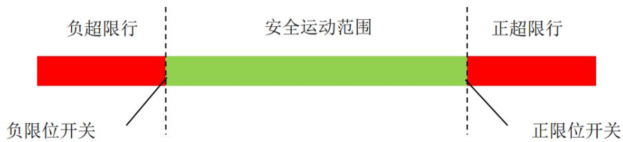

## 注意 1：

如限位发送报警并报错AXISSTATUS:10h（正限位报警），则继续操作轴时只能向负向运行。

如限位发送报警并报错AXISSTATUS:20h（负限位报警），则继续操作轴时只能向正向运行。

如限位发送报警并报错 AXISSTATUS:30h（正限位报警+负限位报警），则需要检查光电开关等外设的有效电平是否与控制器设置相反。

## 注意 2：

切记设置快减减速度 STDEC（ZAux\_Direct\_SetFastDec）

把轴配置成正负限位有效后，如果轴运动超越了限位开关所在位置，限位开关触发，运动控制器禁止发出限位方向上运动，轴会紧急停止。此时由于减速需要一定的时间，实际轴的位置会越过限位一定距离，假设停止时 SPEED（ZAux\_Direct\_SetSpeed）速度是 v0，快减速 STDEC（ZAux\_Direct\_SetFastDec）为 a，计算公式： $\mathrm { \mathbf { v _ { t } } } ^ { 2 } \mathrm { - } \mathrm { \mathbf { v _ { 0 } } } ^ { 2 } \mathrm { = } 2 \mathrm { a s }$ ，带入下方数据：0-1002=2\*(-1000)\*s，得出过冲的距离 s=5，由此可得，增大 STDEC（ZAux\_Direct\_SetFastDec）和减小 SPEED（ZAux\_Direct\_SetSpeed）都能达到减小过冲的目的。

若未设置减速度，或者快减减速度，轴碰到限位，不会停止。

## 注意 3：

切记正负限位不要设置反。

碰到正限位，轴可正常往负方向跑，碰到负限位，轴可正常往正方向跑，若正负限位设置相反，则碰到正负限位，轴不可正常运动。

## 例程

## 9.2.3-1 正负硬限位设置

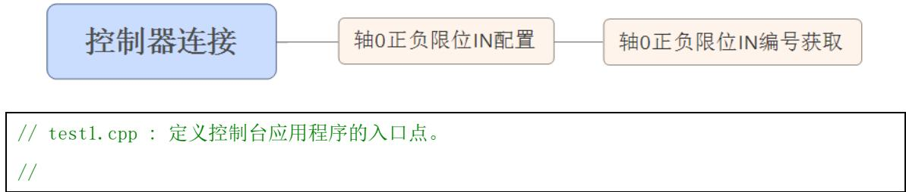

```c
#include "stdafx.h"
#include <windows.h>
#include "zmotion.h"
#include "zauxdll2.h"
void commandCheckHandler(const char *command, int ret)
{
if (ret)//非 0 则失败
{
printf("%s fail!return code is %d\n", command, ret);
}
int _tmain(int argc, _TCHAR* argv[])
{
char *ip_addr = (char *)"127.0.0.1"; //控制器 IP 地址
ZMC_HANDLE handle = NULL; //连接句柄
int ret = ZAux_OpenEth(ip_addr, &handle); //连接控制器
if (ERR_SUCCESS != ret)
{
printf("控制器连接失败!\n");
handle = NULL;
Sleep(2000);
return -1;
printf("控制器连接成功！\n");
int axislist[1] = { 0 };
/*设置参数*/
ret = ZAux_Direct_SetAtype(handle, axislist[0], 1); //设置轴 0 的类型
commandCheckHandler("ZAux_Direct_SetAtype", ret);
ZAux_Direct_SetAtype(handle, axislist[0], 1); //设置轴 0 轴类型为 1
ZAux_Direct_SetUnits(handle, axislist[0], 100); //设置轴 0 脉冲当量为 100
ZAux_Direct_SetSpeed(handle, axislist[0], 200); //设置轴 0 速度为 200units/s
ZAux_Direct_SetAccel(handle, axislist[0], 2000); //设置轴 0 加速度为 2000units/s/s
```

```c
ZAux_Direct_SetDecel(handle, axislist[0], 2000); //设置轴 0 减速度为 2000units/s/s
ZAux_Direct_SetFastDec(handle, axislist[0],3000); //设置轴 0 的快减减速度
float nvalue;
ZAux_Direct_GetFastDec(handle, axislist[0],&nvalue);//获取轴 0 的快减减速度
ret = ZAux_Direct_SetFwdIn(handle,axislist[0],1); //映射正限位输入对应到输
入口 1
commandCheckHandler("ZAux_Direct_SetFwdIn", ret);
ZAux_Direct_SetRevIn(handle,axislist[0],2); //映射负限位输入对应到输
入口 2
commandCheckHandler("ZAux_Direct_SetRevIn", ret);
ret = ZAux_Direct_SetInvertIn(handle,1, 0); //设置原点信号表示低电平
有效
commandCheckHandler("ZAux_Direct_SetInvertIn", ret);
ret = ZAux_Direct_SetInvertIn(handle,2, 0); //设置原点信号表示低电平
有效
commandCheckHandler("ZAux_Direct_SetInvertIn", ret);
/*获取参数*/
int GetValue;
ret = ZAux_Direct_GetAtype(handle, axislist[0], &GetValue); //获取轴 0 的类型
printf("ZAux_Direct_GetAtype = %d \n", GetValue);
ZAux_Direct_GetFwdIn(handle,axislist[0],&GetValue); //获取设置正向限位输入的
IN 编号
printf("ZAux_Direct_GetFwdIn = %d \n", GetValue);
ZAux_Direct_GetRevIn(handle,axislist[0],&GetValue); //获取设置负向限位输入的
IN 编号
printf("ZAux_Direct_GetRevIn = %d \n", GetValue);
Sleep(2000);
```

```c
ret = ZAux_Close(handle); //关闭连接
commandCheckHandler("ZAux_Close", ret) ;//判断指令是否执行成功
printf("connection closed!\n");
handle = NULL;
return 0;
}
```

## 9.3 轴报警函数

## 指令列表

<table><tr><td rowspan=1 colspan=2>指令                                                   说明</td></tr><tr><td rowspan=1 colspan=1> ZAux Direct SetAlmIn</td><td rowspan=1 colspan=1>设置轴告警开关对应的输入点编号</td></tr><tr><td rowspan=1 colspan=1>ZAux_Direct_GetAlmIn</td><td rowspan=1 colspan=1>读取告警开关对应的输入点编号</td></tr><tr><td rowspan=1 colspan=1>ZAux Direct SetInvertIn</td><td rowspan=1 colspan=1>设置输入口有效状态反转</td></tr><tr><td rowspan=1 colspan=1>ZAux Direct GetInvertIn</td><td rowspan=1 colspan=1>读取输入口反转状态</td></tr></table>

## 重点说明

控制器提供专用的驱动报警信号输入接口。该接口应该与驱动器的报警输出信号接口相接。当检测到驱动器报警信号以后，运动控制器将关闭该轴的伺服使能。

注意：

设 置 了 告 警 输 入 口 后 ， ZMC 控 制 器 缺 省 为 OFF 有 效 ， 常 开 信 号 用ZAux\_Direct\_SetInvertIn 反转电平;

ECI 控制器缺省为 ON 有效，常闭信号用 ZAux\_Direct\_SetInvertIn 反转电平。

## 例程

## 9.3.3-1 告警 IN 设置


```c
// test1.cpp : 定义控制台应用程序的入口点。
//
#include "stdafx.h"
#include <windows.h>
#include "zmotion.h"
#include "zauxdll2.h"
void commandCheckHandler(const char *command, int ret)
{
if (ret)//非 0 则失败
{
printf("%s fail!return code is %d\n", command, ret);
}
int _tmain(int argc, _TCHAR* argv[])
char *ip_addr = (char *)"127.0.0.1"; //控制器 IP 地址
ZMC_HANDLE handle = NULL; //连接句柄
int ret = ZAux_OpenEth(ip_addr, &handle); //连接控制器
if (ERR_SUCCESS != ret)
printf("控制器连接失败!\n");
handle = NULL;
Sleep(2000);
return -1;
printf("控制器连接成功！\n");
/*设置轴的相关参数*/
ZAux_Direct_SetAlmIn(handle,0,0);//将轴 0 的告警信号定义到输入口 0
commandCheckHandler("ZAux_Direct_SetAlmIn ",ret);
ZAux_Direct_SetInvertIn(handle,0 ,0);//设置输入 0 低电平有效
commandCheckHandler("ZAux_Direct_SetInvertIn ", ret);
```

```c
/*获取轴的相关参数*/
int GetValue;
ZAux_Direct_GetAlmIn(handle, 0, &GetValue);//获取轴 0 的告警信号输入口
printf("ZAux_Direct_GetAlmIn = %d\n ", GetValue);
Sleep(2000);
ret = ZAux_Close(handle); //关闭连接
commandCheckHandler("ZAux_Close", ret) ;//判断指令是否执行成功
printf("connection closed!\n");
handle = NULL;
return 0;
```

## 第十章 板卡数据交互

## 10.1 VR 寄存器

## 指令列表

<table><tr><td rowspan=1 colspan=2>指令                                                  说明</td></tr><tr><td rowspan=1 colspan=1> ZAux Direct SetVrf</td><td rowspan=1 colspan=1>设置VR 寄存器</td></tr><tr><td rowspan=1 colspan=1>ZAux_Direct_GetVrf</td><td rowspan=1 colspan=1>读取VR 寄存器</td></tr><tr><td rowspan=1 colspan=1> ZAux_Direct_ GetVrInt</td><td rowspan=1 colspan=1>整型方式读取VR 寄存器</td></tr></table>

## 重点说明

控制器具有电池保护寄存器或者铁电存储 VR，可以用于保存掉电的数据。ONPOWER掉电中断可以用于触发记录掉电时的位置到VR。

只有 ZMC，XPLC 系列有 VR 掉电存储，ECI 系列有这个寄存器，实际不具备掉电存储功能。

VR 寄存器以铁电的方式保存，最多可以保存10年左右。机器关键参数建议存储到Flash。

部分 ZMC，XPLC1/XPLC2 系列老产品是电池存储，正常使用几年没问题，可充电的，若长时间不开机会有影响。

## 例程

## 10.1.3-1 VR 寄存器的使用

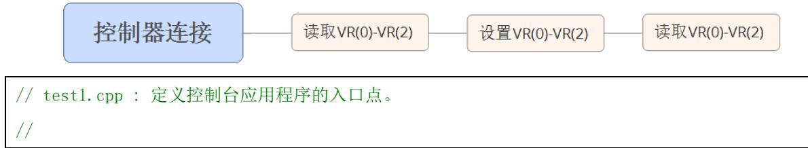

```c
#include "stdafx.h"
#include <windows.h>
#include "zmotion.h"
#include "zauxdll2.h"
void commandCheckHandler(const char *command, int ret)
{
if (ret)//非 0 则失败
{
printf("%s fail!return code is %d\n", command, ret);
}
}
int _tmain(int argc, _TCHAR* argv[])
{
char *ip_addr = (char *)"127.0.0.1"; //控制器 IP 地址
ZMC_HANDLE handle = NULL; //连接句柄
int ret = ZAux_OpenEth(ip_addr, &handle); //连接控制器
if (ERR_SUCCESS != ret)
printf("控制器连接失败!\n");
handle = NULL;
Sleep(2000);
return -1;
printf("控制器连接成功！\n");
float getVrfData[3] = {0.0};
ret = ZAux_Direct_GetVrf(handle, 0, 3, getVrfData);//读取 VR(0)-VR(2)
commandCheckHandler("ZAux_Direct_GetVrf", ret);
printf("getVrfData[0] = %f\n",getVrfData[0]);
printf("getVrfData[1] = %f\n", getVrfData[1]);
printf("getVrfData[2] = %f\n", getVrfData[2]);
float setVrfData[3] = {1.1,2.2,3.3};
```

```c
//将数组中的值写入 vr
ret = ZAux_Direct_SetVrf(handle, 0, 3, setVrfData);//设置 VR(0)-VR(2)
commandCheckHandler("ZAux_Direct_SetVrf", ret);
//取出刚才写入的值
ret = ZAux_Direct_GetVrf(handle, 0, 3, getVrfData);//读取 VR(0)-VR(2)
commandCheckHandler("ZAux_Direct_GetVrf", ret);
printf("getVrfData[0] = %f\n",getVrfData[0]);
printf("getVrfData[1] = %f\n", getVrfData[1]);
printf("getVrfData[2] = %f\n", getVrfData[2]);
Sleep(2000);
ret = ZAux_Close(handle); //关闭连接
commandCheckHandler("ZAux_Close", ret) ;//判断指令是否执行成功
printf("connection closed!\n");
handle = NULL;
return 0;
```

## 10.2 Table 寄存器

## 指令列表

<table><tr><td rowspan=1 colspan=2>指令                                                    说明</td></tr><tr><td rowspan=1 colspan=1> ZAux _Direct_ SetTable</td><td rowspan=1 colspan=1>设置系统 table 寄存器</td></tr><tr><td rowspan=1 colspan=1>ZAux_Direct_GetTable</td><td rowspan=1 colspan=1>读取系统 table寄存器</td></tr><tr><td rowspan=1 colspan=1> ZAux_Direct_ SetTableDouble</td><td rowspan=1 colspan=1>写入 Table</td></tr><tr><td rowspan=1 colspan=1>ZAux_Direct GetTableDouble</td><td rowspan=1 colspan=1>读取 Table，可以一次读取多个</td></tr></table>

## 重点说明

系统数组Table寄存器

TABLE 是控制器自带的一个超大数组，数据类型为 32 位浮点型（4 系列及以上为 64位浮点数），掉电不保存。编写程序时，TABLE 数组不需要再定义，可直接使用，索引下

标从0开始。系统缺省建立的全局数组，所有程序都可以访问。数据录波缓冲区，凸轮数据表，螺距补偿表，机械手参数，等等都是用table来存储。

ZBasic的某些指令可以直接读取TABLE内的值作为参数，比如凸轮运动，凸轮表运动，同步运动，正逆解，位置比较输出等指令。

示波器采样的参数也存储在 TABLE 里。因此在开发应用中要注意多个 TABLE 区域的分配与使用，不要与示波器采样的数据存储区域重合。

## 例程

## 10.2.3-1 Table 寄存器的使用

```cpp
控制器连接 读取Table(0)-Table(2) 设置Table(0)-Table(2) 读取Table(0)-Table(2)
// test1.cpp : 定义控制台应用程序的入口点。
//
#include "stdafx.h"
#include <windows.h>
#include "zmotion.h"
#include "zauxdll2.h"
void commandCheckHandler(const char *command, int ret)
if (ret)//非 0 则失败
{
printf("%s fail!return code is %d\n", command, ret);
int _tmain(int argc, _TCHAR* argv[])
char *ip_addr = (char *)"127.0.0.1"; //控制器 IP 地址
ZMC_HANDLE handle = NULL; //连接句柄
int ret = ZAux_OpenEth(ip_addr, &handle); //连接控制器
if (ERR_SUCCESS != ret)
{
```

```c
printf("控制器连接失败!\n");
handle = NULL;
Sleep(2000);
return -1;
}
printf("控制器连接成功！\n");
float getTableValue[3] = {0.0};
//获取 table 的值
ret = ZAux_Direct_GetTable(handle, 0, 3, getTableValue);
commandCheckHandler("ZAux_Direct_GetTable", ret);
//打印从 table 获取到的值
printf("getTableValue[0] = %f\n",getTableValue[0]);
printf("getTableValue[1] = %f\n", getTableValue[1]);
printf("getTableValue[2] = %f\n", getTableValue[2]);
float setTableValue[3] = {3.14,1.44,1.73};
//设置 table
ret = ZAux_Direct_SetTable(handle, 0, 3, setTableValue);
commandCheckHandler("ZAux_Direct_SetTable", ret);
//获取 table 的值
ret = ZAux_Direct_GetTable(handle, 0, 3, getTableValue);
commandCheckHandler("ZAux_Direct_GetTable", ret);
//打印从 table 获取到的值
printf("getTableValue[0] = %f\n",getTableValue[0]);
printf("getTableValue[1] = %f\n", getTableValue[1]);
printf("getTableValue[2] = %f\n", getTableValue[2]);
Sleep(2000);
ret = ZAux_Close(handle); //关闭连接
commandCheckHandler("ZAux_Close", ret) ;//判断指令是否执行成功
printf("connection closed!\n");
handle = NULL;
return 0;
```

## 10.3 Modbus 寄存器

## 指令列表

<table><tr><td rowspan=1 colspan=2>指令                                                   说明</td></tr><tr><td rowspan=1 colspan=1> ZAux_Modbus Set0x</td><td rowspan=1 colspan=1>设置 modbus 位寄存器</td></tr><tr><td rowspan=1 colspan=1>ZAux _Modbus_ Get0x</td><td rowspan=1 colspan=1>读取 modbus 位寄存器</td></tr><tr><td rowspan=1 colspan=1>ZAux_Modbus_Set4x</td><td rowspan=1 colspan=1>设置 modbus 寄存器（REG）</td></tr><tr><td rowspan=1 colspan=1>ZAux Modbus Get4x</td><td rowspan=1 colspan=1>读取 modbus 寄存器（REG）</td></tr><tr><td rowspan=1 colspan=1>ZAux_Modbus_Set4x_Long</td><td rowspan=1 colspan=1>Modbus4x 寄存器写操作(LONG)</td></tr><tr><td rowspan=1 colspan=1>ZAux_ Modbus_ Get4x Long</td><td rowspan=1 colspan=1>Modbus4x 寄存器读操作(LONG)</td></tr><tr><td rowspan=1 colspan=1>ZAux_Modbus_ Set4x String</td><td rowspan=1 colspan=1>Modbus 字寄存器操作（ASCII)</td></tr><tr><td rowspan=1 colspan=1>ZAux_Modbus_Get4x_String</td><td rowspan=1 colspan=1>Modbus 字寄存器操作（ASCII)</td></tr><tr><td rowspan=1 colspan=1>ZAux Modbus Set4x Float</td><td rowspan=1 colspan=1>设置 modbus 寄存器(float 类型)</td></tr><tr><td rowspan=1 colspan=1> ZAux_Modbus_Get4x_Float</td><td rowspan=1 colspan=1>读取 modbus 寄存器(float类型)</td></tr></table>

## 重点说明

MODBUS 寄存器符合 MODBUS 标准通讯协议，分为位寄存器和字寄存器两类。

位寄存器：MODBUS\_BIT，触摸屏一般称为 MODBUS\_0X，布尔型

字寄存器：MODBUS\_REG、MODBUS\_LONG、MODBUS\_IEEE、MODBUS\_STRING，触摸屏一般叫 MODBUS\_4X，类型如下图。

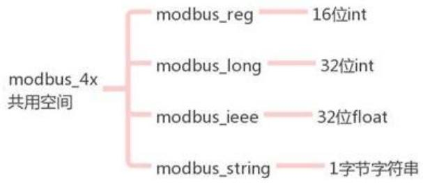

控制器中字寄存器占用同一个存储空间，其中一个 LONG 占用两个 REG，使用时注意错开字寄存器编号。

MODBUS\_LONG(0)占用 MODBUS\_REG(0)与 MODBUS\_REG(1)两个 REG 地址。  
MODBUS\_LONG(1)占用 MODBUS\_REG(1)与 MODBUS\_REG(2)两个 REG 地址。  
MODBUS\_IEEE(0)占用 MODBUS\_REG(0)与 MODBUS\_REG(1)两个 REG 地址。  
MODBUS\_IEEE(1)占用 MODBUS\_REG(1)与 MODBUS\_REG(2)两个 REG 地址。  
因此需注意 MODBUS\_REG，MODBUS\_LONG，MODBUS\_IEEE 地址不能重叠。

4X 空间示意图

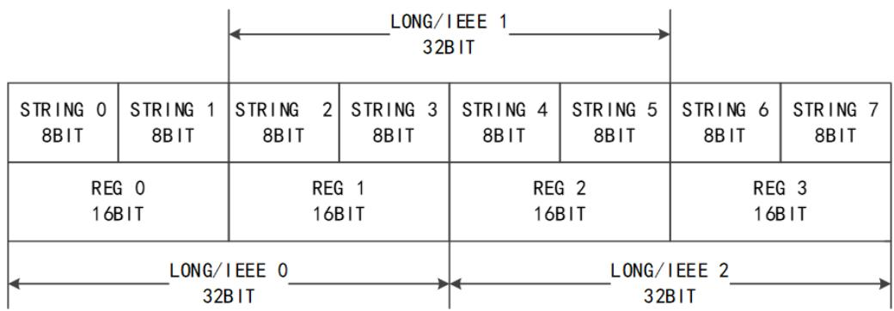

## 例程

## 10.3.3-1 Modbus 寄存器的使用

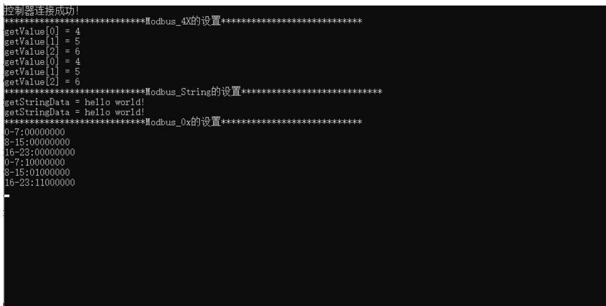

```cpp
// test1.cpp : 定义控制台应用程序的入口点。
//
#include "stdafx.h"
#include <windows.h>
#include "zmotion.h"
#include "zauxdll2.h"
void commandCheckHandler(const char *command, int ret)
{
if (ret)//非0则失败
```

```c
("%s fail!return code is %d\n", command, ret);
int (int argc, * argv[])
char *ip_addr = (char *)"127.0.0.1"; //控制器IP地址
ZMC_HANDLE handle = ; //连接句柄
int ret = ZAux_OpenEth(ip_addr, &handle); //连接控制器
if (ERR_SUCCESS != ret)
("控制器连接失败!\n");
handle = ;
(2000);
return -1;
("控制器连接成功！\n");
uint16 getValue[3];
ZAux_Modbus_Get4x(handle, 0, 3, getValue);
commandCheckHandler("ZAux_Modbus_Get4x", ret);
("*********** ******Modbus_4X的设置
****************************\n");
//打印获取到的值
("getValue[0] = %d\n",getValue[0]);
("getValue[1] = %d\n", getValue[1]);
("getValue[2] = %d\n", getValue[2]);
uint16 setValue[3] = {4,5,6};
//设置modbus_4x数据，这里设置的是从0开始，共3个值
//modbus_4x(0)设为4
//modbus_4x(1)设为5
//modbus_4x(2)设为6
ret = ZAux_Modbus_Set4x(handle, 0, 3, setValue);
commandCheckHandler("ZAux_Modbus_Set4x", ret);
//获取modbus_4x的值，这里取是上面设置的值
//getValue[0]的值是modbus_4x(0)中的值
//getValue[1]的值是modbus_4x(1)中的值
//getValue[2]的值是modbus_4x(2)中的值
ZAux_Modbus_Get4x(handle, 0, 3, getValue);
commandCheckHandler("ZAux_Modbus_Get4x", ret);
```

//打印获取到的值   
("getValue[0] = %d\n",getValue[0]);   
("getValue[1] = %d\n", getValue[1]);   
("getValue[2] = %d\n", getValue[2]);   
("\*\*\*\*\*\* \*\*\*\*\*Modbus\_String的设置   
\*\*\*\*\*\*\*\*\*\*\*\*\*\*\*\*\*\*\*\*\*\*\*\*\*\*\*\*\n");   
char getStringData[13] = {0};   
//这里在modbus中取出"100-113"内容   
ZAux\_Modbus\_Get4x\_String(handle,100,13,getStringData);   
commandCheckHandler("ZAux\_Modbus\_Get4x\_String", 0);   
//打印获取到的字符串   
("getStringData = %s\n",getStringData);   
char setStringData[13] = "hello world!";   
//这里在modbus中写入一句"hello world!",第二个参数是开始写入的地址   
//字符串长度为13，所以第3个参数的值为13   
ret = ZAux\_Modbus\_Set4x\_String(handle, 100, 13, setStringData);   
commandCheckHandler("ZAux\_Modbus\_Set4x\_String", ret);   
//这里在modbus中取出"hello world!"   
ZAux\_Modbus\_Get4x\_String(handle,100,13,getStringData);   
commandCheckHandler("ZAux\_Modbus\_Get4x\_String", 0);   
//打印获取到的字符串   
("getStringData = %s\n",getStringData);   
uint8 GetValue[3];   
ret = ZAux\_Modbus\_Get0x( handle, 0, 24, GetValue);   
commandCheckHandler("ZAux\_Modbus\_Get0x" ,ret);   
("\*\*\*\*\*\*\*\* \*\*\*\*Modbus\_0x的设置   
\*\*\*\*\*\*\*\*\*\*\*\*\*\*\*\*\*\*\*\*\*\*\*\*\*\*\*\*\n");   
for (int j=0;j<=2;j++)   
("%d-%d:",8\*j,8\*j+7 );   
for (int i=0;i<=7;i++)   
((GetValue[j]>>i & 1) ? '1' : '0');   
}   
("\n" );

```c
uint8 SetValue[3] = {1, 2, 3};
ret = ZAux_Modbus_Set0x( handle, 0, 24, SetValue);
commandCheckHandler("ZAux_Modbus_Set0x",ret);
ret = ZAux_Modbus_Get0x( handle, 0, 24, GetValue);
commandCheckHandler("ZAux_Modbus_Get0x" ,ret);
for (int j=0;j<=2;j++)
{
("%d-%d:",8*j,8*j+7 );
for (int i=0;i<=7;i++)
{
((GetValue[j]>>i & 1) ? '1' : '0');
}
("\n" );
}
(10000);
ret = ZAux_Close(handle); //关闭连接
commandCheckHandler("ZAux_Close", ret) ;//判断指令是否执行成功
("connection closed!\n");
handle = ;
return 0;
```

## 10.4 Flash/文件读写

## 指令列表

<table><tr><td colspan="2" rowspan="1">指令                                                   说明</td></tr><tr><td colspan="1" rowspan="1"> ZAux WriteUFile</td><td colspan="1" rowspan="1">向U盘中写文件</td></tr><tr><td colspan="1" rowspan="1">ZAux_ReadUFile</td><td colspan="1" rowspan="1">从U盘中读取文件</td></tr><tr><td colspan="1" rowspan="1">ZAux FlashWritef</td><td colspan="1" rowspan="1">写控制器 FLASH空间</td></tr><tr><td colspan="1" rowspan="1">ZAux FlashReadf</td><td colspan="1" rowspan="1">读控制器 FLASH空间</td></tr><tr><td colspan="1" rowspan="1"> ZAux_ DownMem3FileRam</td><td colspan="1" rowspan="1">打包字符串运动下发</td></tr><tr><td colspan="1" rowspan="1"> ZAux Run3FileRam</td><td colspan="1" rowspan="1">运行下发的3次文件</td></tr><tr><td colspan="1" rowspan="1">ZAux_Down3FileRam</td><td colspan="1" rowspan="1">下载3次文件到RAM</td></tr><tr><td colspan="1" rowspan="1"> ZAux 3FileRamGetRemainSpace</td><td colspan="1" rowspan="1">动态下载3次文件，读取可写的空间</td></tr><tr><td colspan="1" rowspan="1"> ZAux 3FileRamDownBegin</td><td colspan="1" rowspan="1">动态下载3次文件，启动下载</td></tr><tr><td colspan="1" rowspan="1"> ZAux_3FileRamDownPart</td><td colspan="1" rowspan="1">动态下载3次文件</td></tr><tr><td colspan="1" rowspan="1">ZAux_3FileRamDownEnd</td><td colspan="1" rowspan="1">动态下载3次文件，结束下载</td></tr><tr><td colspan="1" rowspan="1">ZAux_Up3File</td><td colspan="1" rowspan="1"></td></tr><tr><td colspan="1" rowspan="1"> ZAux_Up3FileToMem</td><td colspan="1" rowspan="1"></td></tr></table>

## 重点说明

控制器上面有U盘接口和flash。

用户可以通过 U 盘即可实现和控制器进行通讯，U 盘的文件格式和读写文件的格式/顺序必须保持一致。

存储 Flash 块(ZDevelop 在线命令?FLASH\_SECTES 参数可以查看)，可以用于保存掉电的数据。


Flash 是有读写寿命限制，不可以无限次的擦写，经常改写的数据建议写入 VR。

## U 盘接口

采用标准的 U 盘接口，用于插入 U 盘设备，支持与 U 盘数据交互。不同型号的控制器U 盘接口的使用方法都是相同的，将U盘插在控制器上的 UDISK端口即可，控制器上电后有U 盘插入时，U 盘指示灯亮。

<table><tr><td rowspan=1 colspan=1>针脚号</td><td rowspan=1 colspan=1>名称</td><td rowspan=1 colspan=1>说明</td></tr><tr><td rowspan=1 colspan=1>1</td><td rowspan=1 colspan=1>V</td><td rowspan=1 colspan=1>内部+5V电源</td></tr><tr><td rowspan=1 colspan=1>2</td><td rowspan=1 colspan=1>D-</td><td rowspan=1 colspan=1>差分数据D-</td></tr><tr><td rowspan=1 colspan=1>3</td><td rowspan=1 colspan=1>D+</td><td rowspan=1 colspan=1>差分数据D+</td></tr><tr><td rowspan=1 colspan=1>4</td><td rowspan=1 colspan=1>GND</td><td rowspan=1 colspan=1>内部电源地</td></tr></table>

在对 U 盘进行操作之前，先使用 U\_STATE 指令判断 U 盘的状态，确保 U 盘能成功通讯，再使用U 盘相关指令操作。（建议使用2.0的U 盘）

U 盘接口主要有以下三个方面的用途：

1．程序升级

通过U盘口，下载打包好的 zar加密程序包，方便客户更新系统程序。

2．加载三次文件

使用U盘指令加载U 盘里保存的三次文件执行。

3．U 盘与寄存器数据交互

U 盘支持读写变量和数组。


部分 U 盘格式不支持，U 盘读取文件系统支持 fat32 和 fat16，不支持 ntfs、exFAT 格式。

FLASH 数据拷贝：多个控制器中 FLASH 存储的数据可以通过U盘来相互传递。

VR 寄存器、TABLE 寄存器与U盘里的数据互相传递。

读写文件类型为 SD(filenum).BIN 或 SD(filenum).CSV，不同的指令可操作的文件类型有所区别。

## 例程

## 10.4.3-1 Flash 的读写

下面的例子展示了 flash读写的示例，先将数据写入控制器的第0块flash，然后再读取flash 中的数据。

控制器连接 读取第0块Flash4个变量 设置第0块Flash4个变量 读取第0块Flash4个变量

// test1.cpp : 定义控制台应用程序的入口点。   
//   
#include "stdafx.h"   
#include <windows.h>   
#include "zmotion.h"   
#include "zauxdll2.h"   
void commandCheckHandler(const char \*command, int ret)   
{   
if (ret)//非 0 则失败   
{   
printf("%s fail!return code is %d\n", command, ret);   
}   
int \_tmain(int argc, \_TCHAR\* argv[])   
char \*ip\_addr = (char \*)"127.0.0.1"; //控制器 IP 地址   
ZMC\_HANDLE handle = NULL; //连接句柄   
int ret = ZAux\_OpenEth(ip\_addr, &handle); //连接控制器   
if (ERR\_SUCCESS != ret)

```c
{
printf("控制器连接失败!\n");
handle = NULL;
Sleep(2000);
return -1;
}
printf("控制器连接成功！\n");
float readValues[4] = {0};
uint32 readValuesNum = 0;
//从 flash 的第 0 个块读取数据读取 flash 数据
ret = ZAux_FlashReadf(handle, 0,4,readValues,&readValuesNum);
commandCheckHandler("ZAux_FlashReadf", ret);
//打印获取到的数据
printf("readValues[0] = %f\n",readValues[0]);
printf("readValues[1] = %f\n", readValues[1]);
printf("readValues[2] = %f\n", readValues[2]);
printf("readValues[3] = %f\n", readValues[3]);
float writeValues[4] = { 1.0,2.0,3.0,4.0 };
//将数据写入 flash 的第 0 个块
ret = ZAux_FlashWritef(handle, 0, 4, writeValues);
commandCheckHandler("ZAux_FlashWritef", ret);
//从 flash 的第 0 个块读取数据读取 flash 数据
ret = ZAux_FlashReadf(handle, 0,4,readValues,&readValuesNum);
commandCheckHandler("ZAux_FlashReadf", ret);
//打印获取到的数据
printf("readValues[0] = %f\n",readValues[0]);
printf("readValues[1] = %f\n", readValues[1]);
printf("readValues[2] = %f\n", readValues[2]);
printf("readValues[3] = %f\n", readValues[3]);
Sleep(2000);
ret = ZAux_Close(handle); //关闭连接
```

commandCheckHandler("ZAux\_Close", ret) ;//判断指令是否执行成功   
printf("connection closed!\n");   
handle = NULL;   
return 0;   
}

## 10.4.3-2 U 盘文件的读写

将数据写入到文件，文件的格式须和 U 盘的文件格式保持一致，然后再读取写入的数据。

```c
控制器连接 文件内容写入 文件内容读取
// test1.cpp : 定义控制台应用程序的入口点。
//
#include "stdafx.h"
#include <windows.h>
#include "zmotion.h"
#include "zauxdll2.h"
void commandCheckHandler(const char *command, int ret)
if (ret)//非 0 则失败
{
printf("%s fail!return code is %d\n", command, ret);
}
int _tmain(int argc, _TCHAR* argv[])
char *ip_addr = (char *)"127.0.0.1"; //控制器 IP 地址
ZMC_HANDLE handle = NULL; //连接句柄
int ret = ZAux_OpenEth(ip_addr, &handle); //连接控制器
if (ERR_SUCCESS != ret)
{
printf("控制器连接失败!\n");
```

```proto
handle = NULL;
Sleep(2000);
return -1;
}
printf("控制器连接成功！\n");
//将数据存储到名为 test.txt 的文件，会在程序的相同路径下生成
float writepvarlist[10] = {1.1,2.2,3.3,4.4,5.5,6.6,7.7,8.8,9.9,10.2};
ret = ZAux_WriteUFile("test123.txt",writepvarlist,10);
commandCheckHandler("ZAux_WriteUFile", ret);
float readpvarlist[10] = {0};
int readnum = 0;
//读取刚才存入文件的数据到浮点型数组
ret = ZAux_ReadUFile("test123.txt", readpvarlist, &readnum);
commandCheckHandler("ZAux_ReadUFile", ret);
//打印读取到的结果
printf("readpvarlist[0] = %f\n",readpvarlist[0]);
printf("readpvarlist[1] = %f\n", readpvarlist[1]);
printf("readpvarlist[2] = %f\n", readpvarlist[2]);
printf("readpvarlist[3] = %f\n", readpvarlist[3]);
printf("readpvarlist[4] = %f\n", readpvarlist[4]);
printf("readpvarlist[5] = %f\n", readpvarlist[5]);
printf("readpvarlist[6] = %f\n", readpvarlist[6]);
printf("readpvarlist[7] = %f\n", readpvarlist[7]);
printf("readpvarlist[8] = %f\n", readpvarlist[8]);
printf("readpvarlist[9] = %f\n", readpvarlist[9]);
Sleep(2000);
ret = ZAux_Close(handle); //关闭连接
commandCheckHandler("ZAux_Close", ret) ;//判断指令是否执行成功
printf("connection closed!\n");
handle = NULL;
return 0;
```

## 10.4.3-3 三次文件使用

三次文件，可以在多段运动之中，小线段过多，导致网口通信发送数据一次性发不完，多段发送跟不上运动速度执行效率，从而新增的一个三次文件功能。本例子使用仿真器，动态加载三次文件，动态追加字符串控制轴 0的一个简易使用例子。

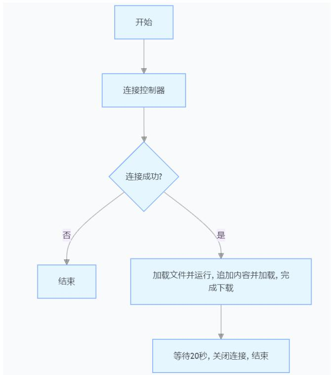

```cpp
// test1.cpp : 定义控制台应用程序的入口点。
//
#include "stdafx.h"
#include <windows.h>
#include "zmotion.h"
#include "zauxdll2.h"
void commandCheckHandler(const char *command, int ret)
{
if (ret)//非0则失败
{
("%s fail!return code is %d\n", command, ret);
int (int argc, * argv[])
```

```c
//步骤1：初始化连接控制器/仿真器
char *ip_addr = (char *)"127.0.0.1"; //控制器IP地址
ZMC_HANDLE handle = ; //连接句柄
int ret = ZAux_OpenEth(ip_addr, &handle); //连接控制器
if (ERR_SUCCESS != ret)
{
("控制器连接失败!\n");
handle = ;
(2000);
return -1;
}
("控制器连接成功！\n");
//步骤2：开启3次文件动态加载
uint32 iRemainSpace;
uint32 nRemain;
ret = ZAux_3FileRamDownBegin(handle, 0, &iRemainSpace, "Zmc.z3p");
commandCheckHandler("ZAux_3FileRamDownBegin",ret);
//步骤3：编写文件内容字符串
char cmdbuff[262144];
(cmdbuff, "SPEED(0)=100\n");
(cmdbuff, "ACCEL(0)=1000\n");
(cmdbuff, "DECEL(0)=1000\n");
(cmdbuff, "DPOS(0)=0\n");
(cmdbuff, "MERGE(0)=1\n");
(cmdbuff, "MOVE(100)axis(0)\n");
(cmdbuff, "MOVE(200)axis(0)\n");
(cmdbuff, "MOVE_RESUME\n");//首次结尾必须追加
//若缓冲不足，等待3次文件缓冲足够下发
ret = ZAux_3FileRamGetRemainSpace(handle, 0, &nRemain);
commandCheckHandler("ZAux_3FileRamGetRemainSpace",ret);
if (nRemain <= (cmdbuff))
{
("拼接文件过大！\n");
(5000);
return 0;
}
//加载3次文件字符
ret = ZAux_3FileRamDownPart(handle, 0, cmdbuff, (uint) (cmdbuff), &nRemain);
commandCheckHandler("ZAux_3FileRamDownPart",ret);
//运行3次文件
```

```c
ret = ZAux_Run3FileRam(handle, 0, 0);
commandCheckHandler("ZAux_Run3FileRam",ret);
//步骤3.5：动态追加加载
//{若（文件/轨迹数据）不是超大，在第一步直接打包数据到位，运行跑完即可，无需动态追加，
直接跳过步骤3.5，执行步骤4}
(cmdbuff, "MOVE(1)axis(0)\n");
for (int i=0;i<999;i++)
{
(cmdbuff, "MOVE(1)axis(0)\n");
ret = ZAux_3FileRamGetRemainSpace(handle, 0, &nRemain);
while (nRemain <= (cmdbuff))
ret = ZAux_3FileRamGetRemainSpace(handle, 0, &nRemain);
commandCheckHandler("ZAux_3FileRamGetRemainSpace",ret);
ret = ZAux_3FileRamDownPart(handle, 0, cmdbuff, (uint) (cmdbuff),
&nRemain);//追加
commandCheckHandler("ZAux_3FileRamDownPart",ret);
//步骤4：全部下载完成
ret = ZAux_3FileRamDownEnd(handle, 0);
(20000);
//步骤5：结束
ret = ZAux_Close(handle); //关闭连接
commandCheckHandler("ZAux_Close", ret) ;//判断指令是否执行成功
("connection closed!\n");
handle = ;
return 0;
```

## 第十一章 总线相关

## 11.1 总线初始化

## 指令列表

<table><tr><td rowspan=1 colspan=2>指令                                                   说明</td></tr><tr><td rowspan=1 colspan=1> ZAux_BusCmd_GetNodeNum</td><td rowspan=1 colspan=1>读取卡槽上节点数量</td></tr><tr><td rowspan=1 colspan=1>ZAux_BusCmd GetNodeInfo</td><td rowspan=1 colspan=1>读取节点上的信息</td></tr><tr><td rowspan=1 colspan=1>ZAux_BusCmd_GetNodeStatus</td><td rowspan=1 colspan=1>读取节点总线状态</td></tr><tr><td rowspan=1 colspan=1>ZAux_BusCmd_DriveClear</td><td rowspan=1 colspan=1>设置清除总线伺服报警</td></tr><tr><td rowspan=1 colspan=1>ZAux Direct SetErrormask</td><td rowspan=1 colspan=1>设置错误标记</td></tr><tr><td rowspan=1 colspan=1>ZAux_Direct_ GetErrormask</td><td rowspan=1 colspan=1>读取错误标记</td></tr><tr><td rowspan=1 colspan=1>ZAux Direct SetAxisEnable</td><td rowspan=1 colspan=1>设置轴使能，只针对总线控制器轴使用有效</td></tr><tr><td rowspan=1 colspan=1>ZAux_ Direct_ GetAxisEnable</td><td rowspan=1 colspan=1>读取轴使能状态，只针对总线控制器轴使用有效</td></tr><tr><td rowspan=1 colspan=1>ZAux BusCmd InitBus</td><td rowspan=1 colspan=1>总线初始化</td></tr><tr><td rowspan=1 colspan=1>ZAux BusCmd_ GetInitStatus</td><td rowspan=1 colspan=1>获取总线初始化状态</td></tr><tr><td rowspan=1 colspan=1>ZAux_Direct_GetBusAxisEnable</td><td rowspan=1 colspan=1>读取总线轴使能状态</td></tr></table>

## 重点说明

## 11.1.2-1 EtherCAT 协议描述

EtherCAT 是一项高性能、低成本、应用简易、拓扑灵活的工业以太网技术，可用于工业现场级的超高速 I/O 网络，使用标准的以太网物理层，传输媒体双绞线或光纤(100Base-TX 或 100Base-FX)。EtherCAT 系统由主站、从站组成。

总线卡 EtherCAT 通讯规格
<table><tr><td colspan="3" rowspan="1">项目                                                 规格</td></tr><tr><td colspan="2" rowspan="1">通讯协议</td><td colspan="1" rowspan="1">IEC61800-7 CiA 402 Drive Profile</td></tr><tr><td colspan="1" rowspan="3">应用层</td><td colspan="1" rowspan="1">SDO</td><td colspan="1" rowspan="1">SDO 请求，SDO 应答</td></tr><tr><td colspan="1" rowspan="1">PDO</td><td colspan="1" rowspan="1">可变 PDO 映射</td></tr><tr><td colspan="1" rowspan="1">CiA 402</td><td colspan="1" rowspan="1">同步周期位置模式（CSP）同步周期速度模式（CSV)同步周期转矩模式（CST)HM(回零)</td></tr><tr><td colspan="1" rowspan="1"></td><td colspan="1" rowspan="1"></td><td colspan="1" rowspan="1">TouchProbe(探针)</td></tr><tr><td colspan="1" rowspan="3">物理层</td><td colspan="1" rowspan="1">传输协议</td><td colspan="1" rowspan="1">100BASE-TX(IEEE802.3)</td></tr><tr><td colspan="1" rowspan="1">最大距离</td><td colspan="1" rowspan="1">100M</td></tr><tr><td colspan="1" rowspan="1">接口</td><td colspan="1" rowspan="1">RJ45(EtherCAT口)</td></tr></table>

## 11.1.2-2 EtherCAT 总线接口

EtherCAT 总线接口与 EtherNET 网口一样采用 RJ45 标准网线接口，用于连接 EtherCAT总线驱动器和扩展模块，部分控制器型号不支持EtherCAT 总线。

EtherCAT 总线驱动器连接驱动器之后，使用前需要进行总线初始化操作，并使用指令映射驱动器的轴号、打开驱动器使能等，详情参见总线初始化参考程序。

支持总线轴和脉冲轴混合使用。EtherCAT 总线接线参考图如下。

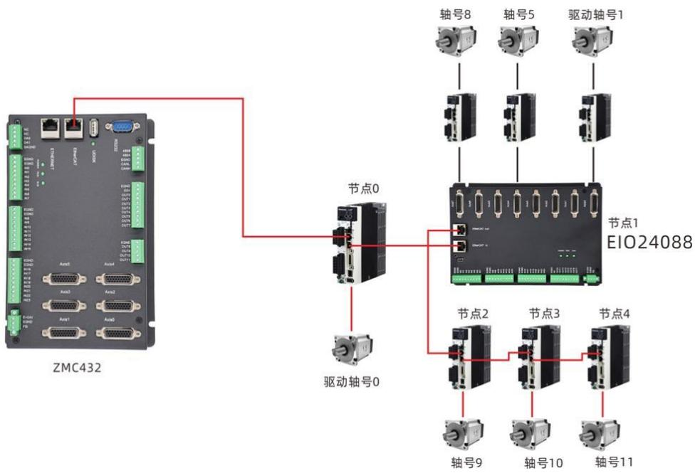

基本概念：

1.槽位号：槽位号即为控制器上的 EtherCAT 网口槽位号。默认只有一个EtherCAT 的槽位，默认槽位号为 0。

2.节点编号：根据 EtherCAT 设备接线顺序排列，编号从 0 开始到（设备个数-1）。通过判断节点电机数，IO数量来配置轴号与IO号等。

3.轴号：控制器对轴的编号，从0开始到（连接设备总轴数-1），通过AXIS\_ADDRESS指令可以将轴号映射到任何一个连接的驱动器设备。

4.总线周期时间：默认 1ms。4 系列以上控制器支持修改总线同步周期时间 500us-4ms。

## 11.1.2-3 EtherCAT 通讯结构

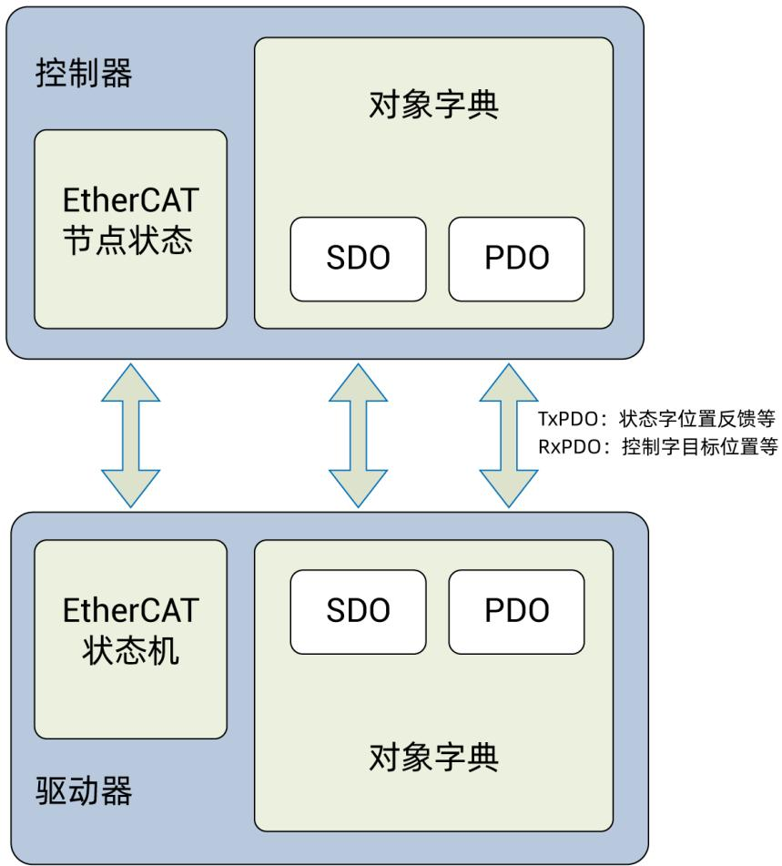

结构图中，PDO 过程数据对象，包含了伺服驱动器运行过程中的实时数据，且以周期性地进行读写访问。SDO 邮箱通信，则以非周期性的对一些通信参数对象、PDO 过程数据对象，进行访问修改。

## 11.1.2-4 总线初始化

## （1）脉冲控制器与总线控制器的区别

总线控制：总线控制是通过网线来进行发送命令规划位置值，总线控制器需要一段初始化程序才可以使能电机，进而再去控制电机。

脉冲控制：脉冲控制是直接打开对应的输出口使能电机，然后发送脉冲即可控制电机。

## （2）总线初始化

总线初始化的过程（该过程为 basic文件初始化过程）：

1. 节点扫描，扫描 EtherCAT 网络上所有的节点

2. 对 EtherCAT 节点，进行 PDO 预设置映射，如目标位置 607Ah 映射到轴的规划

位置，6064h反馈位置映射到轴的反馈位置等

3. 总线启动，切换驱动器状态机，“初始化—>预运行—>安全运行—>运行”

## （3）总线回零

部分EtherCAT驱动器支持驱动器自身回零，并提供了多种回零方式。驱动器回零需要将原点、限位传感器开关直接接到驱动器对应IO端口中，（控制器方式回零时需要接到控制器 IO 口）。通过控制主站发送对应的回零命令即可完成回零动作。

## 11.1.2-5 总线模式

EtherCAT总线常用的有三种控制模式，分别为CSP周期位置模式，CSV周期速度模式，CST 周期转矩模式。

CSP、CSV、CST 模式的设置需要预先设置驱动器的 PDO 列表，PDO 包含对应的数据字典时，才可切换成该模式。驱动器默认 PDO 列表内置的数据字典需要查看驱动器手册确定。

1. 当驱动器PDO列表包含数据字典607Ah时，轴类型可设置为 65，CSP周期位置控制模式，此时使用位置运动指令控制电机运动，并设置运动速度。

2. 当驱动器 PDO 列表包含数据字典 60FFh 时，轴类型可设置为 66，CSV 周期速度控制模式，此时使用专用的速度指令控制电机以设置值的转速运行，不可使用位置运动指令。

3. 当驱动器PDO列表包含数据字典6071h时，轴类型可设置为 67，CST周期转矩控制模式，此时使用专用的转矩指令控制电机以设置值的转矩运行，不可使用位置运动指令。

## CSP 模式：

周期同步位置模式下，上位控制器完成位置指令规划，然后将规划好的目标位置周期性地发送给伺服驱动器，位置、速度、转矩控制由伺服驱动器内部完成。

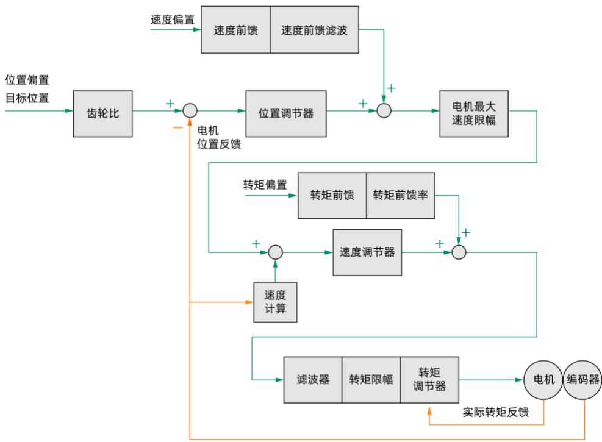  
CSP 模式图

## CSV 模式：

周期同步速度模式下，上位控制器将计算好的目标速度周期性同步地发送给伺服驱动器，速度、转矩调节由伺服内部执行。

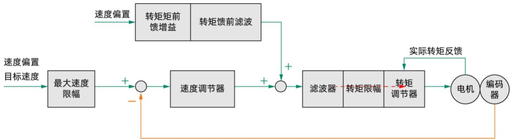  
速度控制时需要看驱动器具体单位。

修改对应的 ATYPE 类型，然后在修改对应的 profile(速度控制设置为 20)即可，然后再通过在线命令或者程序中修改 dac的值即可。

## CST 模式:

周期同步转矩模式下，上位控制器将计算好的目标转矩周期性同步的发送给伺服驱动器，转矩调节由伺服内部执行。

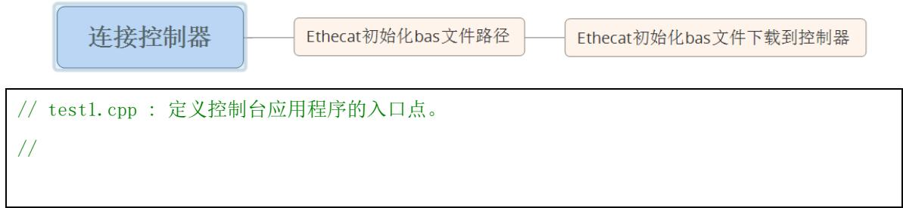

<table><tr><td>指令</td></tr></table>

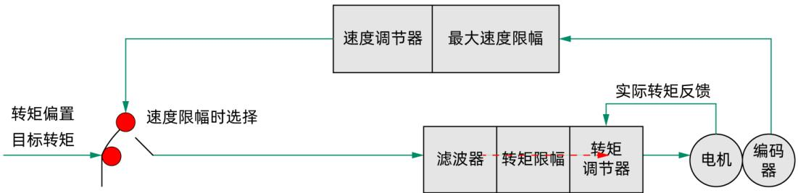

EtherCAT力矩控制需要设置对应的轴类型(67)，对应的将 profile 修改成 30 以上即可。

然后再通过在线命令或者程序中去修改 dac 的值去控制电机的转动(调整 dac 的值不易跨度过大)

## RTEX 力矩模式:

需要修改对应的轴类型去修改对应的模式，然后再去修改对应的 profile 即可，详细请看 ZBasic 手册。

通过在线命令发送 dac的值去控制电机的转动，也可以通过程序去控制电机的转动，力矩控制时dac的单位为千分之一的力矩，dac=1000时表示100%

指令转矩

[大小]：带符号32bit

[单位]：0.1%

[设定范围]：-电机最大转矩～电机最大转矩

\*最大转矩限制[%]=100×Pr9.07/(Pr9.06X√2)

如果 dac(力矩)过小时，电机无法克服摩擦力，不能转动。

## 例程

## 11.1.3-1 EtherCAT 总线初始化（bas 方式）

（若不熟悉本公司的 Zbasic语言，可以使用本公司免费提供的光盘资料里面的basic文件，“PC 函数库 V2.1\windows 平台\32 位库\C++\例程\例程 8-总线控制运动\总线初始化BASIC 程序\ECAT 初始化.bas”）

```c
#include "stdafx.h"
#include <windows.h>
#include "zmotion.h"
#include "zauxdll2.h"
void commandCheckHandler(const char *command, int ret)
{
if (ret)//非 0 则失败
{
printf("%s fail!return code is %d\n", command, ret);
int _tmain(int argc, _TCHAR* argv[])
{
char *ip_addr = (char *)"192.168.0.11"; //控制器 IP 地址
ZMC_HANDLE handle = NULL; //连接句柄
int ret = ZAux_OpenEth(ip_addr, &handle); //连接控制器
if (ERR_SUCCESS != ret)
{
printf("控制器连接失败!\n");
handle = NULL;
Sleep(2000);
return -1;
}
printf("控制器连接成功！\n");
const char * filename= ".\\ECAT 初始化.bas";
//下载程序到 ROM 中 0-RAM 1-ROM
ret = ZAux_BasDown(handle,filename,0);//把初始化 bas 文件下载到控制器里面进行初始化
commandCheckHandler("ZAux_BasDown",ret);
Sleep(2000);
ret = ZAux_Close(handle); //关闭连接
commandCheckHandler("ZAux_Close", ret) ;//判断指令是否执行成功
printf("connection closed!\n");
```

handle = NULL;   
return 0;

## 11.1.3-2 Rtex 总线初始化（bas 方式）

（若不熟悉本公司的 Zbasic语言，可以使用本公司免费提供的光盘资料里面的basic文件，“PC 函数库 V2.1\windows 平台\32 位库\C++\例程\例程 8-总线控制运动\总线初始化BASIC 程序\RTEX 初始.bas”）

连接控制器 Rtex初始化bas文件路径 Rtex初始化bas文件下载到控制器

// test1.cpp : 定义控制台应用程序的入口点。   
//   
#include "stdafx.h"   
#include <windows.h>   
#include "zmotion.h"   
#include "zauxdll2.h"   
void commandCheckHandler(const char \*command, int ret)   
if (ret)//非 0 则失败   
{   
printf("%s fail!return code is %d\n", command, ret);   
}   
int \_tmain(int argc, \_TCHAR\* argv[])   
{   
char \*ip\_addr = (char \*)"192.168.0.11"; //控制器 IP 地址   
ZMC\_HANDLE handle = NULL; //连接句柄   
int ret = ZAux\_OpenEth(ip\_addr, &handle); //连接控制器   
if (ERR\_SUCCESS != ret)   
{

```c
printf("控制器连接失败!\n");
handle = NULL;
Sleep(2000);
return -1;
}
printf("控制器连接成功！\n");
//程序路径下
const char * filename= ".\\RTEX 初始.bas";
//下载程序到 ROM 中 0-RAM 1-ROM
ret = ZAux_BasDown(handle,filename,0);//把初始化 bas 文件下载到控制器里面进行初始化
commandCheckHandler("ZAux_BasDown",ret);
Sleep(2000);
ret = ZAux_Close(handle); //关闭连接
commandCheckHandler("ZAux_Close", ret) ;//判断指令是否执行成功
printf("connection closed!\n");
handle = NULL;
return 0;
```

## 11.1.3-3 EtherCAT 总线轴的使能

在对 EtherCAT 总线轴进行使能前，需进行总线轴的初始化配置。该对 EtherCAT 总线进行初始化配置的方法有两种：方法 1.用本公司的Zbasic语言，编写一个对EtherCAT 总线进行初始化配置的 bas 文件，在通过 ZAux\_BasDown 函数把 Bas 文件下载到控制器中（若不熟悉本公司的 Zbasic 语言，可以使用本公司免费提供的光盘资料里面的 basic 文件，“PC函数库 V2.1\windows 平台\32 位库\例程\例程 8-总线控制运动\总线初始化BASIC 程序\ECAT初始化.bas”），进行总线进行初始化配置；方法2.通过使用本公司免费提供的 Zmotion Tools小工具，对总线初始化配置；

该例程使用方法 2，通过Zmotion Tools工具，对总线进行初始化配置。

场景：当前控制器连接了一个 EtherCAT 总线电机，需对电机进行使能。

Zmotion Tools 工具配置流程框图：

打开Zmotion Tools  
连接控制器  
点击软件左上角工具栏-->控制器-->选择对应方式连接控制器  
打开配置文件  
选中控制器IP地址..->文件操作-->打开文件-->选中ZmotionTools安装目录下的  
EcatInit.bas文件-->打开-->下载到ROM或下载到RAM  
配置参数  
点击总线配置..>自动分配  
点击总线配置.->根据需求，自己手动配置Profile,控制模式，轴号等->保存配置

```c
// test1.cpp : 定义控制台应用程序的入口点。
//
#include "stdafx.h"
#include <windows.h>
#include "zmotion.h"
#include "zauxdll2.h"
void commandCheckHandler(const char *command, int ret)
if (ret)//非 0 则失败
{
printf("%s fail!return code is %d\n", command, ret);
}
int _tmain(int argc, _TCHAR* argv[])
{
char *ip_addr = (char *)"192.168.0.11"; //控制器IP 地址
ZMC_HANDLE handle = NULL; //连接句柄
int ret = ZAux_OpenEth(ip_addr, &handle); //连接控制器
if (ERR_SUCCESS != ret)
```

```c
printf("控制器连接失败!\n");
handle = NULL;
(2000);
return -1;
}
printf("控制器连接成功！\n");
//ZAux_BusCmd_InitBus(handle);//总线初始化 （针对 Zmotion tools 工具软件配置过总线
参数控制器使用有效）
int GetValue;
ret = ZAux_BusCmd_GetInitStatus(handle, &GetValue); //获取总线初始化状态 0：失败 1：
成功（只针对 Zmotion tools 工具软件配置过总线参数控制器使用有效）
commandCheckHandler("ZAux_BusCmd_GetInitStatus", ret);
printf("总线初始化状态= %d \n", GetValue);
int AxisEnable;
ret = ZAux_Direct_GetAxisEnable(handle, 0, &AxisEnable);// 设置轴使能 0 表示关闭 1
表示打开
commandCheckHandler("ZAux_BusCmd_GetInitStatus", ret);
printf("轴 0 总线初始化使能状态为： %d \n", AxisEnable);
if (AxisEnable<1)
{
ret = ZAux_Direct_SetAxisEnable(handle, 0, 1);// 设置轴使能 0 表示关闭 1 表示
打开
commandCheckHandler("ZAux_Direct_SetAxisEnable", ret);
printf("打开使能\n");
}
else
{
ret = ZAux_Direct_SetAxisEnable(handle, 0, 0);// 设置轴使能 0 表示关闭 1 表示打
开
commandCheckHandler("ZAux_Direct_SetAxisEnable", ret);
printf("关闭使能使能\n");
```

```c
Sleep(2000);
ret = ZAux_Close(handle); //关闭连接
commandCheckHandler("ZAux_Close", ret) ;//判断指令是否执行成功
printf("connection closed!\n");
handle = NULL;
return 0;
```

## 11.2 SDO/PDO 读写

## 指令列表

<table><tr><td rowspan=1 colspan=2>指令                                                   说明</td></tr><tr><td rowspan=1 colspan=1>ZAux BusCmd SDOWrite</td><td rowspan=1 colspan=1>通过设备号和槽位号进行 SDO 写入</td></tr><tr><td rowspan=1 colspan=1>ZAux_BusCmd_ SDORead</td><td rowspan=1 colspan=1>通过设备号和槽位号进行 SDO 读取</td></tr><tr><td rowspan=1 colspan=1>ZAux_BusCmd_SDOWrite2</td><td rowspan=1 colspan=1>写入节点 SDO 参数信息</td></tr><tr><td rowspan=1 colspan=1>ZAux BusCmd SDORead2</td><td rowspan=1 colspan=1>读取节点 SDO 参数信息</td></tr><tr><td rowspan=1 colspan=1>ZAux BusCmd RtexRead</td><td rowspan=1 colspan=1>Rtex读取参数信息</td></tr><tr><td rowspan=1 colspan=1>ZAux BusCmd RtexWrite</td><td rowspan=1 colspan=1>Rtex 写参数信息</td></tr><tr><td rowspan=1 colspan=1>ZAux BusCmd_ SDOReadAxis</td><td rowspan=1 colspan=1>读轴 SDO 参数信息</td></tr><tr><td rowspan=1 colspan=1>ZAux_BusCmd SDOWriteAxis</td><td rowspan=1 colspan=1>写轴 SDO 参数信息</td></tr><tr><td rowspan=1 colspan=1>ZAux_BusCmd NodePdoWrite</td><td rowspan=1 colspan=1>Pdo 写操作</td></tr><tr><td rowspan=1 colspan=1>ZAux BusCmd NodePdoRead</td><td rowspan=1 colspan=1>Pdo 读操作</td></tr><tr><td rowspan=1 colspan=1>ZAux BusCmd NodePdoWriteFloat</td><td rowspan=1 colspan=1>Pdo 写操作</td></tr><tr><td rowspan=1 colspan=1>ZAux_BusCmd NodePdoReadFloat</td><td rowspan=1 colspan=1>Pdo 读操作</td></tr></table>

## 重点说明

SDO 的数据交换使用 Mailbox 通信。因而请注意 SDO 的数据刷新时间变得不稳定。

主站侧在对象字典内的记录中读写数据，可进行对象设定以及从站的各种状态的监测。

## 注意：

SDO的读写动作的响应需要花费时间。

ZAux\_BusCmd\_SDOWrite 和 ZAux\_BusCmd\_SDORead 总线指令，仅 EtherCAT 可以使用，通过设备号对槽位号进行 SDO 写入。

## 例程

## 11.2.3-1 EtherCAT 总线 SDO 读写

本例程是在总线初始化之后然后再新建工程之后再操作。

```c
可通过Zmotion tools/或者下载bas文件到控制器来实现
连接控制器 SDO读取最大扭矩 SDO读取最大扭矩
// test1.cpp : 定义控制台应用程序的入口点。
//
#include "stdafx.h"
#include <windows.h>
#include "zmotion.h"
#include "zauxdll2.h"
void commandCheckHandler(const char *command, int ret)
if (ret)//非 0 则失败
{
printf("%s fail!return code is %d\n", command, ret);
int _tmain(int argc, _TCHAR* argv[])
char *ip_addr = (char *)"192.168.0.11"; //控制器IP 地址
ZMC_HANDLE handle = NULL; //连接句柄
int ret = ZAux_OpenEth(ip_addr, &handle); //连接控制器
if (ERR_SUCCESS != ret)
{
printf("控制器连接失败!\n");
handle = NULL;
Sleep(2000);
return -1;
```

```c
}
printf("控制器连接成功！\n");
int slot = 0;
int node = 0;
int index = 0x6041;
int subindex=0;
int type = 6;
int value;
int setValue = 8;
/*读取槽位 0 上面的状态字*/
ret = ZAux_BusCmd_SDORead(handle,slot,node, index, subindex,type,&value);
commandCheckHandler("ZAux_BusCmd_SDORead",ret);
printf("Value=%d\n",value);
/*设置槽位 0 上面的控制模式*/
index = 0x6060;
ret = ZAux_BusCmd_SDOWrite(handle,slot,node, index,subindex,2, setValue);
commandCheckHandler("ZAux_BusCmd_SDOWrite", ret);
/*读取槽位 0 上面的控制模式*/
ret = ZAux_BusCmd_SDORead(handle,slot,node, index, subindex,type,&value);
commandCheckHandler("ZAux_BusCmd_SDORead",ret);
printf("Value=%d\n",value);
Sleep(2000);
ret = ZAux_Close(handle); //关闭连接
commandCheckHandler("ZAux_Close", ret) ;//判断指令是否执行成功
printf("connection closed!\n");
handle = NULL;
return 0;
```

## 11.2.3-2 Rtex 参数相关信息

本例程是在总线初始化之后然后再新建工程之后再操作。

```c
// test1.cpp : 定义控制台应用程序的入口点。
//
#include "stdafx.h"
#include <windows.h>
#include "zmotion.h"
#include "zauxdll2.h"
void commandCheckHandler(const char *command, int ret)
if (ret)//非 0 则失败
{
printf("%s fail!return code is %d\n", command, ret);
int _tmain(int argc, _TCHAR* argv[])
{
char *ip_addr = (char *)"192.168.0.11"; //控制器IP 地址
ZMC_HANDLE handle = NULL; //连接句柄
int ret = ZAux_OpenEth(ip_addr, &handle); //连接控制器
if (ERR_SUCCESS != ret)
printf("控制器连接失败!\n");
handle = NULL;
Sleep(2000);
return -1;
}
printf("控制器连接成功！\n");
float GetValue;
int ipara = 7 * 256 + 11;
/*设置 Pr7.11 的值*/
ret = ZAux_BusCmd_RtexWrite(handle,0,ipara,500);
/*读取 Pr7.11 的值*/
ret = ZAux_BusCmd_RtexRead(handle,0, ipara,&GetValue);
commandCheckHandler("ZAux_BusCmd_RtexRead", ret);
printf("GetValue=%f\n", GetValue);
```

```c
Sleep(2000);
ret = ZAux_Close(handle); //关闭连接
commandCheckHandler("ZAux_Close", ret) ;//判断指令是否执行成功
printf("connection closed!\n");
handle = NULL;
return 0;
```

## 11.3 总线转矩力矩

## 指令列表

<table><tr><td rowspan=1 colspan=2>指令                                                   说明</td></tr><tr><td rowspan=1 colspan=1>ZAux_BusCmd_GetDriveTorque</td><td rowspan=1 colspan=1>读取当前总线驱动当前力矩，需要设置对应的驱动器 PDO 类型</td></tr><tr><td rowspan=1 colspan=1> ZAux_BusCmd_SetMaxDriveTorque</td><td rowspan=1 colspan=1>设置当前总线驱动最大转矩，需要设置对应的驱动器 PDO 类型</td></tr><tr><td rowspan=1 colspan=1> ZAux_BusCmd_GetMaxDriveTorque</td><td rowspan=1 colspan=1>读取当前总线驱动最大转矩，需要设置对应的驱动器 PDO 类型</td></tr><tr><td rowspan=1 colspan=1>ZAux Direct SetDAC</td><td rowspan=1 colspan=1>模拟量控制。伺服轴 DA直接控制，总线驱动速度或力矩模式下支持。</td></tr><tr><td rowspan=1 colspan=1>ZAux Direct GetDAC</td><td rowspan=1 colspan=1>模拟量控制。伺服轴DA 直接控制，总线驱动速度或力矩模式下支持。</td></tr></table>

## 重点说明

电机转矩，简单的说，就是指转动的力量的大小。但电动机的转矩与旋转磁场的强弱和转子笼条中的电流成正比，和电源电压的平方成正比所以转矩是由电流和电压的因素所决定的。

电机扭矩和计算：T=9550 \* P / n 。

P 是电机的额定（输出）功率单位是千瓦（KW）

分母是额定转速 n 单位是转每分 (r/min)

P 和 n可从 电机铭牌中直接查到。因为 P 和 n都是电机的额定值，故T 就是电机的额定转矩。一般来讲电动机带动机械转动的劲头就是电动机的转矩，电动机的转矩=皮带轮拖

动皮带的力×皮带轮的半径。

注：必须设置正确的 ATYPE 与驱动器PDO以后才可以读取设置。

## 例程

## 11.3.3-1 获取当前总线驱动当前力矩

```c
连接控制器 PROFILE配置对应的模式 力矩读取 最大转矩读取
// test1.cpp : 定义控制台应用程序的入口点。
//
#include "stdafx.h"
#include <windows.h>
#include "zmotion.h"
#include "zauxdll2.h"
void commandCheckHandler(const char *command, int ret)
{
if (ret)//非 0 则失败
{
printf("%s fail!return code is %d\n", command, ret);
}
int _tmain(int argc, _TCHAR* argv[])
char *ip_addr = (char *)"192.168.0.11"; //控制器 IP 地址
ZMC_HANDLE handle = NULL; //连接句柄
int ret = ZAux_OpenEth(ip_addr, &handle); //连接控制器
if (ERR_SUCCESS != ret)
printf("控制器连接失败!\n");
handle = NULL;
Sleep(2000);
```

```c
return -1;
}
printf("控制器连接成功！\n");
int gValue;
ret=ZAux_BusCmd_GetDriveTorque(handle,0,&gValue);//获取当前力矩，PROFILE 需配置对应
的模式
commandCheckHandler("ZAux_BusCmd_GetDriveTorque", ret) ;//判断指令是否执行成功
printf("轴 0 当前力矩为：%d\n",gValue);
ret=ZAux_BusCmd_GetMaxDriveTorque(handle,0,&gValue);//获取当前最大转矩，PROFILE 需配
置对应的模式
commandCheckHandler("ZAux_BusCmd_GetDriveTorque", ret) ;//判断指令是否执行成功
printf("轴 0 当前最大转矩为：%d\n",gValue);
Sleep(2000);
ret = ZAux_Close(handle); //关闭连接
commandCheckHandler("ZAux_Close", ret) ;//判断指令是否执行成功
printf("connection closed!\n");
handle = NULL;
return 0;
```

## 第十二章 其他指令

## 12.1 在线命令

## 指令列表

<table><tr><td>指令</td><td>说明</td></tr><tr><td> ZAux Execute</td><td>发送字符串 (Zbasic）命令(缓冲方式)</td></tr><tr><td>ZAux _DirectCommand</td><td>发送字符串（Zbasic）命令(直接方式)</td></tr></table>

## 重点说明

ZAux\_Execute 或 ZAux\_DirectCommand 可对 basic 指令进行封装。如果使用到没有封装的命令或者想封装自己的函数，可以通过 ZAux\_Execute 发送或 ZAux\_DirectCommand，或是参照已有代码修改增加相应的函数。

发送字符串命令有两种方式，缓冲方式和直接方式。具体如图所示：

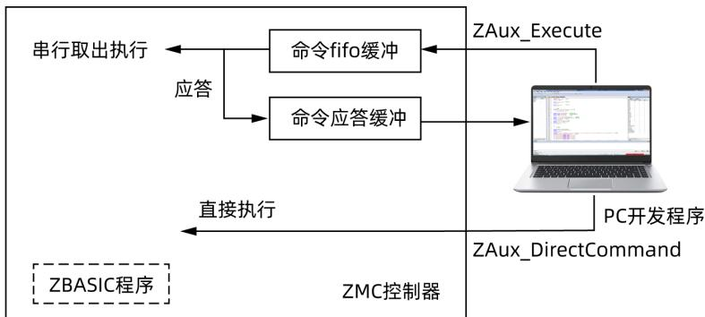

## 例程

## 12.1.3-1 在线命令函数的使用

本例程主要演示了如何使用 Execute 函数直接获取控制器的型号，如何使用DirectCommand 函数封装设置速度功能指令示例。

连接控制器 调用Execute函数直接获取控制器的型号 DirectCommand函数封装设置速度功能  
调用前，参考Basic语法，使用DirectCommand函数封装一个  
设置速度的功能

```c
// test1.cpp : 定义控制台应用程序的入口点。
//
#include "stdafx.h"
#include <windows.h>
#include "zmotion.h"
#include "zauxdll2.h"
void commandCheckHandler(const char *command, int ret)
if (ret)//非 0 则失败
{
printf("%s fail!return code is %d\n", command, ret);
}
int Test_Direct_SetSpeed(ZMC_HANDLE handle, int iaxis, float fValue)
char cmdbuff[2048];
char cmdbuffAck[2048];
if (iaxis> MAX_AXIS_AUX)
{
return ERR_AUX_PARAERR;
}
sprintf(cmdbuff,"SPEED(%d)=%f",iaxis,fValue);//生成对应命令的字符串
ZAux_DirectCommand(handle,cmdbuff,cmdbuffAck,2048);
/*参数： mode 25, 26 2D 的比较模式
Opnum 对应的输出口
Opstate 第一个比较点的输出状态.
maxerr 比较位置每个轴左右的脉冲偏差, 进入偏差范围后开始比较.
num TABLE 里面存储的比较点个数.
tablepos 第一个比较点坐标所在 TABLE 编号
与 hwtimer 并用时, 可以动态调整 hwtimer 参数.
ModePara1:脉冲时间
```

ModePara2:脉冲个数   
ModePara3:脉冲周期   
\*/   
int32 \_\_stdcall ZAux\_Direct\_HwPswitch2\_2D(ZMC\_HANDLE handle, int Axisnum,int Mode,int   
Opnum , int Opstate,int maxerr,int num, int tablepos, float ModePara1=0, float   
ModePara2=0,float ModePara3=0)   
if(0 > Axisnum || Axisnum > MAX\_AXIS\_AUX)   
{   
return ERR\_AUX\_PARAERR;   
}   
char cmdbuff[2048];   
char cmdbuffAck[2048];   
//生成命令   
switch(Mode)   
case 25:   
sprintf(cmdbuff, "HW\_PSWITCH2(%d,%d,%d,%d,%d,%d) AXIS(%d)", Mode, Opnum, Opstate,   
maxerr,num,tablepos,Axisnum);   
break;   
case 26:   
sprintf(cmdbuff, "HW\_PSWITCH2(%d,%d,%d,%d,%d,%d,%f,%f,%f) AXIS(%d)", Mode,   
Opnum, Opstate, maxerr,num,tablepos,ModePara1,ModePara2,ModePara3,Axisnum);   
break;   
//调用命令执行函数   
return ZAux\_Execute(handle, cmdbuff, cmdbuffAck,2048);   
int \_tmain(int argc, \_TCHAR\* argv[])   
char \*ip\_addr = (char \*)"127.0.0.1"; //控制器 IP 地址   
ZMC\_HANDLE handle = NULL; //连接句柄   
int ret = ZAux\_OpenEth(ip\_addr, &handle); //连接控制器   
if (ERR\_SUCCESS != ret)   
printf("控制器连接失败!\n");   
handle = NULL;   
Sleep(2000);   
return -1;

```c
printf("控制器连接成功！\n");
const char * command="?control"; //发送获取控制器型号的命令
char psRespons[20]; //用于接受控制器型号的数组
int length=20; //控制器型号的长度，一定要大于接受
的字符串长度
float GetValue1;
ret = ZAux_Execute(handle, command, psRespons, length); //直接通过 execute 直接获取
控制的型号
commandCheckHandler("ZAux_Execute",ret);
printf("psRespons = %s\n", psRespons); //打印返回的字符串
printf("length = %d\n",length);
ret=ZAux_Direct_GetSpeed(handle,0,&GetValue1);//获取设置速度前的速度值
commandCheckHandler("ZAux_Direct_GetSpeed",ret);
printf("设置速度前的速度值 = %f\n",GetValue1);
ret=Test_Direct_SetSpeed(handle,0,1231);//使用自己封装的设置速度指令设置轴 0 速度
commandCheckHandler("ZAux_Direct_GetSpeed",ret);
ret=ZAux_Direct_GetSpeed(handle,0,&GetValue1);//获取设置速度后的速度值
commandCheckHandler("ZAux_Direct_GetSpeed",ret);
printf("设置速度后的速度值 = %f\n",GetValue1);
Sleep(2000);
ret = ZAux_Close(handle); //关闭连接
commandCheckHandler("ZAux_Close", ret) ;//判断指令是否执行成功
printf("connection closed!\n");
handle = NULL;
return 0;
```

## 12.1.3-2 在线命令函数的使用 2

用户若想要获取多种数据，如轴的命令位置，轴的反馈位置，板卡上的 IO 点等等，往往都是通过多种单独独立的函数获取不同的数据，这样堆积，会导致读写次数的上位，导致程序的卡顿。为了提升一个上位程序的，往往可以通过自己定义一个自己的函数，通过一个函数，快速的把数据传输到上位程序上面来，而非是通过多次循环来获取到不同类型的数据。如下举例：

假设有一个简易的三轴平台，需要读取轴0，轴 1，轴 2 的命令位置，反馈位置，以及控制器板卡上的输入口 0-输入口23,输出口0-输出口，以及三个轴的状态。获取数据程序如下：

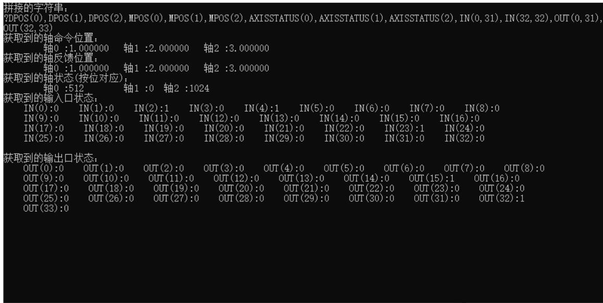

```c
// test1.cpp : 定义控制台应用程序的入口点。
//
#include "stdafx.h"
#include <windows.h>
#include "zmotion.h"
#include "zauxdll2.h"
void commandCheckHandler(const char *command, int ret)
{
if (ret)//非0则失败
{
printf("%s fail!return code is %d\n", command, ret);
}
/*************************************************************
Description: //我的自定义直接获取数据函数
Input: //handle 卡链接
iaxisNum 轴的总数量
```

```c
iaxislist 轴号列表
fDposlist 输出的命令位置值
fMposlist 输出的反馈位置值
iAxisstatuslist 输出的轴状态位置值，按位对应
startIn 要获取起始的IN编号
endIn 要获取结束的IN编号
iIn 输出的IN状态,按位对应
startOut 要获取起始的OUT编号
endOut 要获取结束的OUT编号
iOut 输出的OUT状态,按位对应
Output: //
Return: //错误码
********
int Demo_Direct_MyGetData(ZMC_HANDLE handle,int iaxisNum, int* iaxislist, float*
fDposlist,float* fMposlist,int32* iAxisstatuslist,int startIn , int endIn,int *iIn,int
startOut , int endOut,int *iOut)
{
char cmdbuff[2048];
char tempbuff[2048];
char cmdbuffAck[20480];
//若传进来的地址为空，则退出
if(NULL == iaxislist || NULL == fDposlist || NULL == fMposlist || NULL ==
iAxisstatuslist || NULL == iIn || NULL == iOut)
return ERR_AUX_PARAERR;
}
//若传进来的结束编号小于起始编码，则退出
if ((endIn<startIn) || (endOut<startOut))
{
return ERR_AUX_PARAERR;
}
int ret=0;
int i;
//生成命令
sprintf(cmdbuff, "?");
//拼接DPOS
for (i=0;i<iaxisNum;i++)
{
sprintf(tempbuff,"DPOS(%d),",iaxislist[i]);//生成对应命令的字符串
strcat(cmdbuff, tempbuff);//字符串拼接
```

```c
if (strlen(cmdbuff)>1000)
return ERR_AUX_PARAERR; //参数错误，字符串拼接过长
}
//拼接MPOS
for (i=0;i<iaxisNum;i++)
{
sprintf(tempbuff,"MPOS(%d),",iaxislist[i]);//生成对应命令的字符串
strcat(cmdbuff, tempbuff);//字符串拼接
if (strlen(cmdbuff)>1000)
{
return ERR_AUX_PARAERR; //参数错误，字符串拼接过长
}
//拼接AXISSTATUS
for (i=0;i<iaxisNum;i++)
sprintf(tempbuff,"AXISSTATUS(%d),",iaxislist[i]);//生成对应命令的字符串
strcat(cmdbuff, tempbuff);//字符串拼接
if (strlen(cmdbuff)>1000)
{
return ERR_AUX_PARAERR; //参数错误，字符串拼接过长
int32 ostart,istart,iend,oend; //一次最多32个
bool addflag;
addflag=false;
int32 temp; //一次最多32个
int32 temp2; //一次最多32个
temp=endIn-startIn+1;
if (temp%32 == 0)
{
temp=temp/32;
}
else
```

```c
temp=temp/32+1;
}
//拼接IN
for (i=0;i<temp;i++)
istart = startIn+32*i;
iend =istart+31;
if (iend>endIn)
iend=endIn;
}
//生成命令
sprintf(tempbuff, "IN(%d,%d),", istart,iend);
strcat(cmdbuff, tempbuff);//字符串拼接
if (strlen(cmdbuff)>1000)
{
return ERR_AUX_PARAERR ; //参数错误，字符串拼接过长
}
temp2=endOut-startOut+1;
if (temp2%32 == 0)
{
temp2=temp2/32;
}
else
{
temp2=temp2/32+1;
}
//拼接OUT
for (i=0;i<temp2;i++)
{
ostart = startOut+32*i;
oend =ostart+31;
if (oend>endOut)
{
oend=endOut;
}
//生成命令
```

```c
sprintf(tempbuff, "OUT(%d,%d)", ostart,oend);
strcat(cmdbuff, tempbuff);//字符串拼接
if (i<temp-1)
{
strcat(cmdbuff, ",");//字符串拼接
if (strlen(cmdbuff)>1000)
{
return ERR_AUX_PARAERR; //参数错误，字符串拼接过长
}
}
printf("拼接的字符串：\n",cmdbuff);
printf("%s\n",cmdbuff);
ret=ZAux_DirectCommand(handle,cmdbuff,cmdbuffAck,2048);
if(ERR_OK != ret)
{
return ret;
}
//printf("%s\n",cmdbuffAck);
//printf("%d\n",strlen(cmdbuffAck));
//
if(0 == strlen(cmdbuffAck))
{
return ERR_NOACK;
}
float ftempbuff[200];
int itempbuff[200];
ZAux_TransStringtoFloat(cmdbuffAck,iaxisNum*2,ftempbuff);//字符串转换为浮点数
//DPOS输出
for(i=0;i<iaxisNum;i++)
//printf("%f\n",ftempbuff[i]);
fDposlist[i]=ftempbuff[i];
}
//MPOS输出
for(i=0;i<iaxisNum;i++)
{
```

```c
//printf("%f\n",ftempbuff[i+iaxisNum]);
fMposlist[i]=ftempbuff[i+iaxisNum];
ZAux_TransStringtoInt(cmdbuffAck,iaxisNum*3+temp2+temp,itempbuff);//字符串转换为
整形
//AXISSTATUS输出
for(i=0;i<iaxisNum;i++)
//printf("%d\n",itempbuff[i+iaxisNum*2]);
iAxisstatuslist[i]=itempbuff[i+iaxisNum*2];
}
//IN输出
for(i=0;i<temp;i++)
{
//printf("%d\n",itempbuff[i+iaxisNum*3]);
iIn[i]=itempbuff[i+iaxisNum*3];
}
//OUT输出
for(i=0;i<temp2;i++)
{
//printf("%d\n",itempbuff[i+iaxisNum*3+temp]);
iOut[i]=itempbuff[i+iaxisNum*3+temp];
}
return ERR_OK;
}
int _tmain(int argc, _TCHAR* argv[])
{
char *ip_addr = (char *)"127.0.0.1"; //控制器IP地址
ZMC_HANDLE handle = NULL; //连接句柄
int ret = ZAux_OpenEth(ip_addr, &handle); //连接控制器
if (ERR_SUCCESS != ret)
printf("控制器连接失败!\n");
handle = NULL;
Sleep(2000);
return -1;
}
printf("控制器连接成功！\n");
int axis[4]={0,1,2,4};
float d_dpos[4];
float d_mpos[4];
int32 d_axis_status[4];
```

```c
int d_in[10];
int d_out[10];
ret =
Demo_Direct_MyGetData(handle,3,axis,d_dpos,d_mpos,d_axis_status,0,32,d_in,0,33,d_out);
int i;
printf("获取到的轴命令位置：\n");
for (i=0;i<3;i++)
{
printf("\t轴%d :%f",i,d_dpos[i]);
}
printf("\n");
printf("获取到的轴反馈位置：\n");
for (i=0;i<3;i++)
printf("\t轴%d :%f",i,d_mpos[i]);
}
printf("\n");
printf("获取到的轴状态(按位对应)：\n");
for (i=0;i<3;i++)
{
printf("\t轴%d :%d",i,d_axis_status[i]);
}
printf("\n");
printf("获取到的输入口状态：\n");
int j=0;
int tempval;
for (i=0;i<=32;i++)
if (((i%32)==0)&&(i>0) )
{
j++;
}
//转换成位
tempval=d_in[j]>>(i-32*j);
printf(" IN(%d):%d",i,tempval &(0x01));
if (((i%8)==0)&&(i>0) )
printf("\n");
}
}
printf("\n");
```

```c
printf("获取到的输出口状态：\n");
j=0;
for (i=0;i<=33;i++)
{
if (((i%32)==0)&&(i>0) )
{
j++;
}
//转换成位
tempval=d_out[j]>>(i-32*j);
printf(" OUT(%d):%d",i,tempval &(0x01));
if (((i%8)==0)&&(i>0) )
{
printf("\n");
}
}
printf("\n");
Sleep(20000);
ret = ZAux_Close(handle); //关闭连接
commandCheckHandler("ZAux_Close", ret) ;//判断指令是否执行成功
printf("connection closed!\n");
handle = NULL;
return 0;
```

## 12.1.3-3 在线命令函数的使用 3

一般点胶行业，木工行业用的居多，都是用连续轨迹，连续轨迹之间有插入缓冲输出，如果把运动跟连续轨迹的运动跟缓冲输出分开来发的话，难免会有局限性，可以通过自己单独封装运动函数，来达到一行命令执行多个函数的效果，如下举例：

假设控制一个 XY 两轴平台，从坐标点（0,0）—>（100,0）（输出口 0 输出 50ms）—>（100,100）（输出口 0 输出 50ms）—>（0,100）（输出口 0 输出 50ms）—>（0,0）（输出口 0 输出 50ms）的轨迹，则可以通过自己封装，用一条函数，快速发送下去：

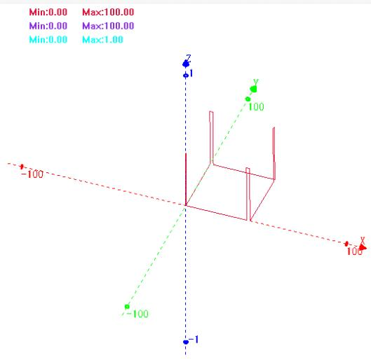

```cpp
示波器
水平刻度：100 xz模式 启动 停正 2MPOS1 1 MPOS[0) Min:0.00 Min:0.00Max:100.00 Max:100.00 D
连续采集 跟随
手动触发科视图
显示编号 数据源 偏移 垂直刻度
100
100
□
1
示波器
设置 启动 停止 1 MPOS(] Min:0.00 Max:100.00
水平刻度：1000 模式 |2MP0SI1 Min:0.00 Max:100.00
√连续来集 跟随 □显示游标
手动触发 入 出
显示编号 数据源 偏移 垂直刻度
MPOS 100
□ MPOS 100
□ □P
:1000 2000 3000 4000
// test1.cpp : 定义控制台应用程序的入口点。
//
#include "stdafx.h"
#include <windows.h>
#include "zmotion.h"
#include "zauxdll2.h"
void commandCheckHandler(const char *command, int ret)
{
if (ret)//非0则失败
{
printf("%s fail!return code is %d\n", command, ret);
}
```

\*\*\*\*\*\*\*\*\*\*\*\*\*\*\*\*\*\*\*\*\*\*  
Description: //我的自定义运动函数  
Input: //handle 卡链接  
iMoveLen 填写的运动长度  
iaxisNum 参与运动总轴数  
iaxislist 轴号列表  
fPoslist 距离列表  
iout 缓冲输出口  
outlist 缓冲输出列表(每条运动，决定是否输出，0为不输出，  
1为在运动后输出)  
outtime 缓冲输出时间  
Output: //  
Return: //错误码  
\*\*\*\*\*\*\*\*\*\*  
int Demo\_Direct\_MyMoveABS(ZMC\_HANDLE handle,int iMoveLen,int iaxisNum, int\* iaxislist,  
float\* fPoslist,int iout,int \*outlist,int outtime)  
char cmdbuff[2048];  
char tempbuff[2048];  
char cmdbuffAck[20480];  
//若传进来的地址为空，则退出  
int ret=0;  
int i;  
//先读取剩余直线缓冲  
int iBuffLen = 0;  
ret = ZAux\_Direct\_GetRemain\_LineBuffer(handle,iaxislist[0],&iBuffLen);  
if(iBuffLen <= iMoveLen\*2)  
{  
return 1002; //运动缓冲不够  
}  
//生成命令  
sprintf(cmdbuff, "BASE(");  
//拼接运动轴列表  
for (i=0;i<iaxisNum-1;i++)  
sprintf(tempbuff,"%d,",iaxislist[i]);//生成对应命令的字符串  
strcat(cmdbuff, tempbuff);//字符串拼接

```c
if (strlen(cmdbuff)>1000)
return ERR_AUX_PARAERR; //参数错误，字符串拼接过长
sprintf(tempbuff,"%d)\n",iaxislist[i]);//生成对应命令的字符串
strcat(cmdbuff,tempbuff);
//拼接运动
for (i=0;i<iMoveLen;i++)
//printf("%d,%d\n",i*iaxisNum,i*iaxisNum+1);
if (outlist[i]==0) //该段运动不输出
{
strcat(cmdbuff, "MoveAbs(");
sprintf(tempbuff,"%f,%f)\n",fPoslist[i*iaxisNum],fPoslist[i*iaxisNum+1]);//生成对应
命令的字符串
strcat(cmdbuff, tempbuff);//字符串拼接
}
else if (outlist[i]==1)
{
strcat(cmdbuff, "MoveAbs(");
sprintf(tempbuff,"%f,%f)\n",fPoslist[i*iaxisNum],fPoslist[i*iaxisNum+1]);//生成对应
命令的字符串
strcat(cmdbuff, tempbuff);//字符串拼接
strcat(cmdbuff, "Move_op2(");
sprintf(tempbuff,"%d,%d,%d)\n",iout,1,outtime);//生成对应命令的字符串
strcat(cmdbuff, tempbuff);//字符串拼接
}
else
{
return ERR_AUX_PARAERR;//参数错误
}
printf("拼接的字符串：\n");
printf("%s\n",cmdbuff);
```