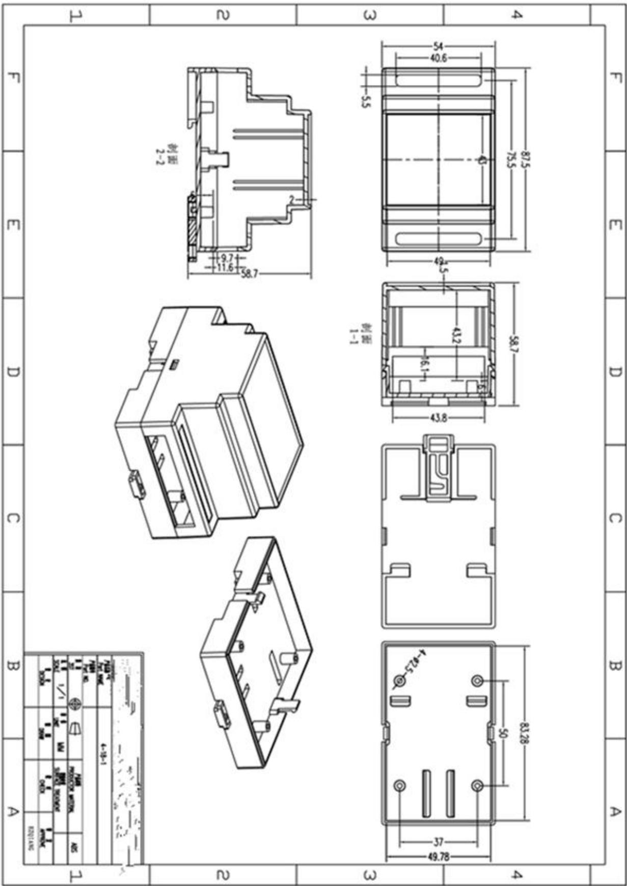
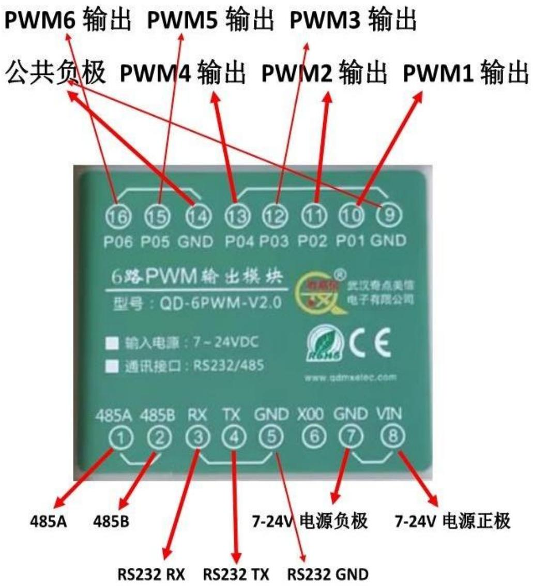

## PWM 规格书

## 一、产品特点：

1、本产品可以通过串口RS485或者RS232直接设置PWM的频率和占空比，P01-P04的频率范围1Hz-100KHz，4路频率可互不相同，P05-P06的频率和P01的频率相同，6路占空比可单独设定0-100%;  
2、本产品是1路光耦隔离数字开关量输入（备用功能），支持PNP或NPN输入；  
3、RS232、RS485通讯兼容MODBUS RTU协议，输入输出16进制，可与嵌入式设备通讯兼容。  
4、本产品具有完善的保护措施，如电源正负极防反接、输入采用工业级的光耦隔离、通讯放雷击等，这些保护措施使得模块在应用中更加安全、耐用和稳定。  
5、本产品具有良好的通用性，您只须按照标准的协议对模块进行访问，即可实现对模块的完全控制。  
6、模块结构设计合理，便于现场安装和调试，适用于开关信号采集、以及与上位机之间的通讯。

## 二、应用领域

1、可以和工业控制中的 PLC、变频器、风扇、电机、舵机等设备接口；  
2、可以用于 LED 电源 PWM 调光。

## 三、技术参数

1、型号：QD-6PWM-V2.0。  
2、电源供电电压：DC7V-DC24V，静态电流不超过 40ma;  
3、每路 PWM 驱动电流可达 50 毫安，瞬时脉冲电流可达 150 毫安，总功耗不超过 1 安；  
4、1 路输入方式可设置为高电平有效或低电平有效，1 路输入有发光二极管实时指示输入的状态，输入信号支持 7V-24V 输入，兼容 PNP 和 NPN;  
5、6 路 PWM 输出，PWM 的频率可调范围 1Hz--100KHz，PWM 的占空比可调范围 0--100%，PWM 的输出可设置 5V 高电平输出、供电电源电压输出（电路板上跳线选择），精度 0.5%，可通过 RS232 或 RS485 控制 PWM 的输出频率和 PWM 的占空比；（P01-P04 的频率范围 1Hz-100KHz，4 路频率可互不相同，P05-P06 的频率和 P01 的频率相同，6 路占空比可单独设定 0-100%）；  
6、通讯默认数据格式：波特率 9600、无校验、8 个数据位、1 个停止位（9600，N，8,1），也可以修改。  
7、工作环境：-20℃ \~ 60℃、16\~80%RH。

## 四、外壳机械尺寸

text_image

1
2
3
4
F
E
D
C
B
A
1
2
3
4
5
6
7
8
9
10
11
12
13
14
15
16
17
18
19
20
21
22
23
24
25
26
27
28
29
30
31
32
33
34
35
36
37
38
39
40.6
41.5
42.5
43.2
43.8
44.1
45.7
46.7
47.5
48.7
49.78
50.8
51.8
52.8
53.8
54.8
55.8

## 五、PWM 通讯协议

PC机、单片机、PLC（统称上位机）通过 232 或 485 发数据：

串口通讯参数默认设置：波特率 9600，8 位数据位，1 位停止位，无校验。每条指令的 CRC 校验码可以用 16 进制的 AA AA 代替。

1、输出一路PWM（单独输出每一路PWM的频率和占空比，PWM1，PWM2、PWM3、PWM4这4路是独立的频率和占空比；

PWM5、PWM6和PWM1这3路的频率是一样，更改任一个频率，其他2个的频率一起更改，占空比可以不一样）

上位机发送代码：(占空比是千分比)

21 10 22 51 00 03 06 00 27 10 00 32 00 4E BB

21：站号（RS485地址）  
10：功能码，写多个寄存器  
22 51: 第一路寄存器地址

22 52: 第二路寄存器地址  
22 53: 第三路寄存器地址  
22 54: 第四路寄存器地址  
22 55: 第五路寄存器地址  
22 56: 第六路寄存器地址

00 03: 寄存器个数  
06：数据个数（字节数）

00 27 10：第一路PWM的频率（16进制002710的10进制是10000即10K频率）  
➢ 00 32: 第一路PWM的高电平时间占PWM周期的比例（16进制0032的10进制是50即输出高电平的时间是PWM周期的5%）(此处是千分比，即千分之50)  
4E BB: 二个字节CRC码

此命令将输出“第一路PWM频率10K，高电平占空比5%；

设备返回：21 10 22 51 00 03 DC C1

## 2、输出6路PWM（千分比）

上位机发送代码:

21 10 02 46 00 0C 18 00 27 10 01F4 00 4E 20 0014 00 03
E8 0032 00 07 D0 0014 0030 0020 E6 2E

21：站号（RS485地址）  
10：功能码，写多个寄存器  
02 46: 寄存器地址  
00 0C: 寄存器个数  
18: 数据个数（字节数）

00 27 10：第一路PWM的频率（16进制002710的10进制是10000即10K频率）

01F4：第一路PWM的高电平时间占PWM周期的比例（16进制01F4的10进制是500即输出高电平的时间是PWM周期的一半 $50\%$ ，即千分之500）

➢ 00 4E 20：第二路PWM的频率（16进制004E20的10进制是20000即20K频率）

0014: 第二路PWM的高电平时间占PWM周期的比例（16进制14的10进制是20即输出高电平的时间是PWM周期的 $2\%$ ，即千分之20）

00 03 E8 : 第三路PWM的频率(16进制0003E8的10进制是1000即1K频率)

0032: 第三路PWM的高电平时间占PWM周期的比例（16进制0032的10进制是50即输出高电平的时间是PWM周期的 $5\%$ ，即千分

## 之50）

➢ 00 07 D0：第四路PWM的频率（16进制0007D0的10进制是2000即2K频率）  
0014: 第四路PWM的高电平时间占PWM周期的比例（16进制0014的10进制是20即输出高电平的时间是PWM周期的 $2\%$ ）  
➢ 0030：第五路PWM的高电平时间占PWM周期的比例（16进制0030的10进制是48即输出高电平的时间是PWM周期的4.8%）  
0020：第六路PWM的高电平时间占PWM周期的比例（16进制0020的10进制是32即输出高电平的时间是PWM周期的 $3.2\%$ ）

第五路和第六路的PWM频率和第一路的PWM频率是一样的，占空比不一样。

E6 2E: 二个字节CRC校验码

此命令将输出“第一路PWM频率10K，高电平占空比50%；第二路PWM频率20K，高电平占空比2%；第三路PWM频率1K，高电平占空比5%；第四路PWM频率2K，高电平占空比2%;第五路PWM频率10K，高电平占空比4.8%；第六路PWM频率10K，高电平占空比3.2%”

设备返回：21 10 02 46 00 0C 27 01

## 3、输出6路PWM（高电平以微秒为单位 us）

上位机发送代码:

21 10 14 64 00 0C 18 00 27 10 01F4 00 4E 20 0014 00 03
E8 0032 00 07 D0 0014 0030 0020 3C 36

21：站号（RS485地址）  
10：功能码，写多个寄存器  
14 64: 寄存器地址  
00 0C: 寄存器个数  
18: 数据个数（字节数）

00 27 10：第一路PWM的频率（16进制002710的10进制是10000即10K频率）

01F4：第一路PWM的高电平时间（16进制01F4的10进制是500即输出高电平的时间是500us）

➢ 00 4E 20：第二路PWM的频率（16进制004E20的10进制是20000即20K频率）

0014: 第二路PWM的高电平时间（16进制14的10进制是20即输出高电平的时间是20us）

➢ 00 03 E8 : 第三路PWM的频率（16进制0003E8的10进制是1000即1K频率）

0032: 第三路PWM的高电平时间（16进制0032的10进制是50即输出高电平的时间是50us）

➢ 00 07 D0：第四路PWM的频率（16进制0007D0的10进制是2000即2K频率）  
➢ 0014：第四路PWM的高电平时间（16进制0014的10进制是20即输出高电平的时间是20us）  
➢ 0030：第五路PWM的高电平时间（16进制0030的10进制是48即输出高电平的时间是48us）  
➢ 0020：第六路PWM的高电平时间（16进制0020的10进制是32即输出高电平的时间是32us）

第五路和第六路的PWM频率和第一路的PWM频率是一样的，占空比不一样。

3C 36: 二个字节CRC校验码

此命令将输出“第一路PWM频率10K，高电平500us；第二路PWM频率20K，高电平20us；第三路PWM频率1K，高电平50us；第四路PWM频率2K，高电平20us；第五路PWM频率10K，高电平48us；第六路PWM频率10K，高电平32us”

"

设备返回：21 10 14 64 00 0C 83 43

## 4、修改地址码

上位机发送代码：21 06 23 60 00 22 05 29

21: 站号（RS485地址）  
06: 功能码  
23 60：地址寄存器  
00 22：新地址码 (00 01 - 00 FF)  
05 29：二个字节CRC码

原数据返回：21 06 23 60 00 22 05 29

说明：此参数会永久保存，掉电不会丢失

## 5、设备上电PWM输出高电平还是低电平（接口设备是高有效还是低有效）默认输出低电平

上位机发送代码：21 06 17 33 00 00 7B 11

21: 站号（RS485地址）  
06：功能码  
17 33: 寄存器地址  
➢ 00 00: PWM1、PWM2上电输出低电平,

00 01: PWM1上电输出高电平,PWM2上电输出低电平

00 02: PWM1上电输出低电平,PWM2上电输出高电平

00 03: PWM1、PWM2上电输出高电平

PWM1、PWM3、PWM5、PWM6相同；PWM2、PWM4相同

7B 11: 二个字节CRC码

原数据返回：21 06 17 33 00 00 7B 11

默认设置是：00 00

说明：此参数会永久保存，掉电不会丢失

## 6、PLC协议

6-1 输出一路PWM（单独输出每一路PWM的频率和占空比，PWM1，

PWM2、PWM3、PWM4这4路是独立的频率和占空比；

PWM5、PWM6和PWM1这3路的频率是一样，更改任一个频率，其他2

个的频率一起更改，占空比可以不一样）

上位机发送代码：(占空比是千分比)

21 10 21 61 00 03 06 00 00 27 10 00 32 EE 03

21：站号（RS485地址）  
10：功能码，写多个寄存器  
21 61: 第一路寄存器地址

21 62: 第二路寄存器地址

21 63: 第三路寄存器地址

21 64: 第四路寄存器地址

21 65: 第五路寄存器地址

21 66: 第六路寄存器地址

00 03: 寄存器个数  
06：数据个数（字节数）  
00 00 27 10：第一路PWM的频率（16进制00002710的10进制是

10000即10K频率）

00 32：第一路PWM的高电平时间占PWM周期的比例（16进制0032

的10进制是50即输出高电平的时间是PWM周期的 $5\%$ ) (此处是千分比, 即

千分之50)

EE 03: 二个字节CRC码

此命令将输出“第一路PWM频率10K，高电平占空比5%；

设备返回：21 10 21 61 00 03 DC 8A

## 6-2、输出6路PWM（千分比）

上位机发送代码:

21 10 02 46 00 0E 1C 00 00 27 10 01F4 00 00 4E 20 0014 00
00 03 E8 0032 00 00 07 D0 0014 0030 0020 20 35

21：站号（RS485地址）

10：功能码，写多个寄存器

02 46: 寄存器地址

00 OE: 寄存器个数

1C: 数据个数（字节数）

0000 27 10：第一路PWM的频率（16进制00002710的10进制是10000即10K频率）

01F4: 第一路PWM的高电平时间占PWM周期的比例（16进制01F4的10进制是500即输出高电平的时间是PWM周期的一半 $50\%$ ，即千分之500）

➢ 0000 4E 20：第二路PWM的频率（16进制00004E20的10进制是20000即20K频率）

0014: 第二路PWM的高电平时间占PWM周期的比例（16进制14的10进制是20即输出高电平的时间是PWM周期的 $2\%$ ，即千分之20）  
➢ 0000 03 E8：第三路PWM的频率（16进制000003E8的10进制是1000即1K频率）  
0032: 第三路PWM的高电平时间占PWM周期的比例（16进制0032的10进制是50即输出高电平的时间是PWM周期的 $5\%$ ，即千分之50）  
➢ 0000 07 D0：第四路PWM的频率（16进制000007D0的10进制是2000即2K频率）  
0014: 第四路PWM的高电平时间占PWM周期的比例（16进制0014的10进制是20即输出高电平的时间是PWM周期的 $2 \%$ ）  
➢ 0030：第五路PWM的高电平时间占PWM周期的比例（16进制0030的10进制是48即输出高电平的时间是PWM周期的4.8%）  
0020: 第六路PWM的高电平时间占PWM周期的比例（16进制0020的10进制是32即输出高电平的时间是PWM周期的 $3.2\%$ ）

第五路和第六路的PWM频率和第一路的PWM频率是一样的，占空比不一样。

20 35: 二个字节CRC校验码

此命令将输出“第一路PWM频率10K，高电平占空比50%；第二路PWM频率20K，高电平占空比2%；第三路PWM频率1K，高电平占空比5%；第四路PWM频率2K，高电平占空比2%;第五路PWM频率10K，高电平占空比4.8%；第六路PWM频率10K，高电平占空比3.2%”

设备返回：21 10 02 46 00 0E A6 C0

## 7、修改波特率

上位机发送代码：21 06 13 73 00 04 7A 36

21：站号（RS485地址）  
06：功能码  
13 73: 寄存器地址  
00 04: 波特率代码  
00 01:1200  
00 02:2400  
00 03:4800  
00 04:9600【缺省值】  
00 05:19200  
00 06:38400  
00 07:57600  
00 08:115200  
7A 36：二个字节CRC码

原数据返回 : 21 06 13 73 00 04 7A 36

说明：此参数会永久保存，掉电不会丢失

## 8、恢复出厂设置

上位机发送代码：00 06 12 31 46 75 2F 2B

00：广播地址  
06：功能码  
12 31: 寄存器地址  
46 75: 寄存器的值  
2F 2B: 二个字节CRC码

原数据返回：00 06 12 31 46 75 2F 2B

恢复出厂设置：波特率为：9600,8位数据位，1位停止位，无校验设备地址：33（0x21）

也是本模块的默认设置！！！

## 9、复位（重启设备）

上位机发送代码：21 06 00 65 11 33 D2 F0

21: 站号（RS485地址）  
06: 功能码  
00 65: 寄存器地址  
11 33: 寄存器的值  
D2 F0: 二个字节CRC码

原数据返回：21 06 00 65 11 33 D2 F0

## 10、查询 485 地址命令：

上位机发送代码：000300330001

75 D4 (16 进制)

00: 广播地址  
03: 功能码  
➢ 00 33: 寄存器地址  
➢ 00 01: 寄存器个数  
75 D4：二个字节CRC码

返回数据：0003020021459C（16进制）

倒数第三个字节 21 就是本设备地址。

串口通讯参数默认设置: 波特率 9600, 8 位数据位, 1 位停止位,无校验。每条指令的 CRC 校验码可以用 16 进制的 AA AA 代替。

## 六、接线图

接线图  

text_image

PWM6 输出 PWM5 输出 PWM3 输出
公共负极 PWM4 输出 PWM2 输出 PWM1 输出
16 15 14 13 12 11 10 9
P06 P05 GND P04 P03 P02 P01 GND
6路PWM输出模块
型号：QD-6PWM-V2.0
武汉奇点美信
电子有限公司
输入电源：7-24VDC
通讯接口：RS232/485
www.qdmxelec.com
485A 485B RX TX GND X00 GND VIN
1 2 3 4 5 6 7 8
485A 485B
RS232 RX RS232 TX RS232 GND
7-24V 电源负极 7-24V 电源正极

武汉奇点美信技术部