# 正运动机械手指令说明书

V3.0.11

## 版 权 说 明

## Zmotion

本手册版权归深圳市正运动技术有限公司所有，未经本公司授权，任何人不得翻印、抄袭本手持中的任何内容。

本手册中的信息资料仅供参考。由于改进设计和功能等原因，正运动公司保留对本资料的最终解释权！内容如有更改，恕不另行通知！


调试机器要注意安全！请务必在机器中设计有效的安全保护装置，并在软件中加入出错处理程序，否则所造成的损失，正运动技术公司没有义务或责任对此负责。

## 前言

感谢选用正运动的运动控制器。在使用本产品之前，请务必仔细阅读本手册以及了解必要的安全信息，注意事项，以及了解硬件接口、使用方法及函数接口，充分理解正运动控制器使用功能。

## （一）安全警告


调试机器过程中，人员保持安全的距离。


请务必在机器中设计有效的安全保护装置。


请务必在软件中加入出错处理程序。


调试过程中，测试的速度在合理范围。

## （二）常规安全守则

请查看下列安全防范措施以避免受伤害并防止对本产品或任何与其相连接的产品造成损伤。为避免潜在的危险，请仅按详细说明来使用本产品。

使用正确的电源线:请使用满足国家标准的电源线。

不要在潮湿的环境下操作,不要在爆炸性的空气中操作,保持产品表面清洁和干燥。

防止静电损伤:静电释放（ESD）可能会对运动控制卡及其附件中的元件造成损伤。为了防止ESD，请小心处理控制卡元件，不要触摸控制卡上元器件。不要将控制卡放置在可能产生静电的表面。在防护静电的袋子或容器内运输和储存控制卡。

## （三）关于保证

保修时间:在指定的地点购买的产品的保修期为 1年。

保修范围:如果在上述质保期内由于本公司责任发生了故障，本公司提供无偿修理。以下范围不在保修范围内:

▲对于说明书及其它手册记录的不适当环境或不适当使用引起的故障。

▲用户的装置、控制软件等引起本产品意外故障。

▲由客户对本产品的改造引起的故障。

▲火灾、地震及其它自然灾害等外部主要原因引起的故障。

产品的应用范围:本产品设计制造用于普通工业应用，超出预料的用途并对人的生命或财产造成重大的影响不在产品服务范围。

## （四）技术支持和售后服务

您可以通过以下途径获得我们的技术支持和售后服务

地址: 深圳市宝安区西乡洲石路阳光工业园 A1 栋 5 楼

公司网站：http://www.zmotion.com.cn/

电话：0755-32976042

传真：0755-26066955

服务热线：4000-8989-66

邮箱：tech@zmotion.com.cn

技术支持值班 qq：3002647338

## 第一章 机械手相关基本知识

## 一、工业机械手定义

所谓工业机械手，根据 ISO（国际标准化机构）的技术报告定义为“自动控制、可以重复程序、多目的，具备多个有自由度的机械机能的机械”。换言之，现在的工业机械手是“与人的手腕和手掌的动作机能相类似，具备多样动作机能的自动机械”。

工业机械手拥有能够操作多种动作的动作特性，将从前困难的多品种少量生产的自动化变为可能。

## 二、空间中的自由度

一个物体，在空间上完全没有约束，那么它可以在 3个正交方向上平动(X，Y，Z)，还可以以三个正交方向为轴进行转动(RX，RY，RZ)，那么就有 6 个自由度。而当把物体限定在 XY 平面上时，自由度减少为 3 个-可以在 X，Y 方向平动，可绕Z轴转动。

以标准 scara 为例，末端的工作点可以在 xy 方向移动(2 轴)，可以绕 z 旋转(3轴)，可以 z 方向上下(4 轴)，最多有 4 个自由度。而 6 自由度机械手的末端工作点可在控件中任意运动，所以有 6个自由度。

## 三、坐标系

## 1．关节坐标系

包含机械手所有关节，各关节之间相互独立，坐标单位为角度，一般简写作 J。

操作其中一个关节时不影响其他关节坐标。

$$
\begin{array} { r l r l r l } { J 1 : 0 ^ { \circ } } & { { } \ J 2 : 0 ^ { \circ } } & { { } \ J 3 : 0 ^ { \circ } } & { { } \ J 4 : 0 ^ { \circ } } & { { } \ J 5 : 0 ^ { \circ } } & { { } \ J 6 : 0 ^ { \circ } } \end{array}
$$

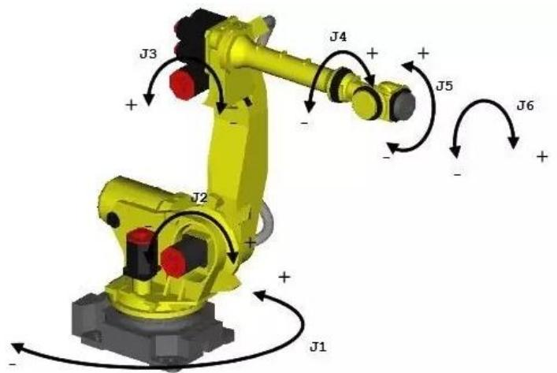

## 2．世界坐标系

世界坐标系是被固定在空间上的标准直角坐标系，其位置根据机械手类型确定。

虚拟轴操作时就是根据世界坐标系运动，此时各关节会自动解算需要旋转的角度。

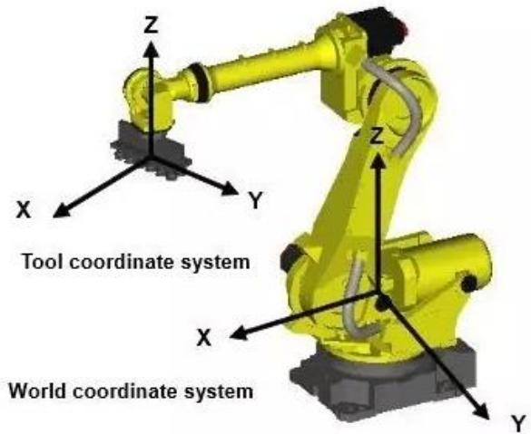

## 四、关节轴与虚拟轴

关节轴是指实际机械结构中的旋转关节，在程序中一般显示旋转角度（某些结构也是平移轴）。

由于电机与旋转关节会存在减速比，所以设置 units 时要按照实际关节旋转一圈来设置，同时 table 中填写结构参数时也要按照旋转关节中心计算，而不是按照电机轴中心计算。

虚拟轴不是实际存在的，抽象为世界坐标系的 6 个自由度，依次为 X、Y、Z、

RX、RY、RZ。可以理解为直角坐标系的三个直线轴和三个旋转轴，用来确定机械手末端工作点的加工轨迹与坐标。

## 五、正解运动与逆解运动

通过操作关节坐标，再根据机械结构参数可以计算出末端位置在直角坐标系的空间位置，这个过程称为正解运动，此时操作的是实际关节轴，虚拟轴自动计算坐标。

控制器使用 CONNREFRAME 指令建立正解模式，此指令作用在虚拟轴上。此时只能操作关节轴，关节轴也可以做各种运动，但实际运动的轨迹不是直线圆弧，这种模式一般用于手动调整关节位置或上电点位回零。

给定一个直角坐标系中的空间位置，反推出各关节轴坐标，这个过程称为逆解运动，此时操作的是虚拟轴，实际关节轴自动解算坐标并运动。

控制器使用 CONNFRAME 指令建立逆解模式，此指令作用在关节轴上。此时只能操作虚拟轴，虚拟轴可以在笛卡尔坐标系中做直线，圆弧，空间圆弧等运动，关节轴在 CONNFRAME 的作用下会自动运动到逆解后的位置。

## 六、机械手姿态

机械手姿态在数学上来说，是同一组虚拟轴数值有多组关节轴的解。即机械手在笛卡尔坐标系中运动到某一坐标点 A，可以有多种运动轨迹，这些运动轨迹就对应着不同姿态，如下图 scara的两种姿态，在 X方向运动，关节轴可以有两种运动方式。

姿态1，左手姿态

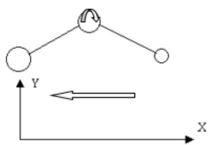

姿态2，右手姿态

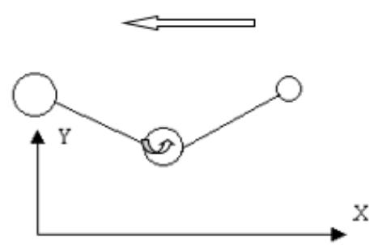

## 七、奇异点

机械手运动到某一特定位置时，会失去某个自由度，这个位置就叫做奇异点，实际使用时要避免。如 scara 机械手完全伸直时，此时无法在 X 方向平动，操作往x负向运动时，结构无法判断使用哪种姿态运动，此时结构会卡住。为避免出

现此种问题，需要正解时调整好姿态，逆解时规划好轨迹。

## 八、零点位置

机械手算法建立时，需要有个零点位置作为参考，同时需要确定好电机转向。各结构的零点位置与电机转向查看下文第6 章各类型具体说明确认。

## 九、正运动机械手模式

机械手有几个电机称为几关节机械手，控制实际机械关节运动的电机轴称为机械手的关节轴，所有的关节轴构成关节坐标系，关节轴在此坐标系中按角度旋转。

控制机械手末端工作点在世界坐标系下运动，世界坐标系的坐标轴假想为虚拟轴，按距离单位移动。

关节轴和虚拟轴通过 CONNREFRAME 或 CONNFRAME 指令来指明，只要轴数足够，控制器支持多机械手。

程序可以通过运动指令(所有的运动指令都可以使用)控制关节轴或虚拟轴运动，但同一时刻只能操作虚拟轴或者关节轴。

操作关节轴运动时，虚拟轴需要位于 CONNREFRAME 模式，从而自动指向当前的空间坐标；操作虚拟轴运动时，关节轴需要位于 CONNFRAME 模式，从而自动指向当前的关节轴坐标。

机械手建立是通过 CONNREFRAME（正解）和 CONNFRAME（逆解）指令，CONNREFRAME 时虚拟轴 MTYPE（运动类型）值为 34，CONNFRAME 时关节轴MTYPE 值为33，可以通过 MTYPE 来查看特定轴是否位于对应的模式。

通过 CANCEL 或 RAPIDSTOP 指令可以取消机械手模式。

## 第二章 硬件选配

## 一、支持的机械手类型

## 并联机械手类

<table><tr><td>类型</td><td></td></tr><tr><td></td><td></td></tr></table>

<table><tr><td colspan="1" rowspan="3">Frame2</td><td colspan="1" rowspan="1">图纸</td><td colspan="1" rowspan="1">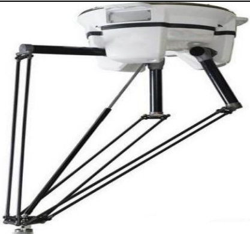</td></tr><tr><td colspan="1" rowspan="1">信息</td><td colspan="1" rowspan="1">Delta 基本类型。3个轴，末端点3个自由度。</td></tr><tr><td colspan="1" rowspan="1">区别</td><td colspan="1" rowspan="1"></td></tr><tr><td colspan="1" rowspan="3">Frame12</td><td colspan="1" rowspan="1">图纸</td><td colspan="1" rowspan="1">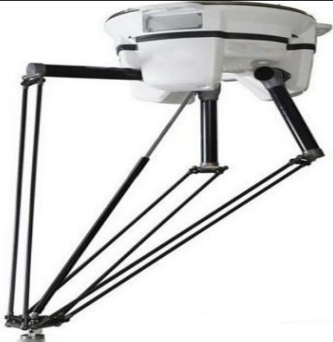</td></tr><tr><td colspan="1" rowspan="1">信息</td><td colspan="1" rowspan="1">4个轴，末端点4个自由度。</td></tr><tr><td colspan="1" rowspan="1">区别</td><td colspan="1" rowspan="1">与frame2比较，增加了末端的旋转轴。</td></tr><tr><td colspan="1" rowspan="3">Frame14</td><td colspan="1" rowspan="1">图纸</td><td colspan="1" rowspan="1">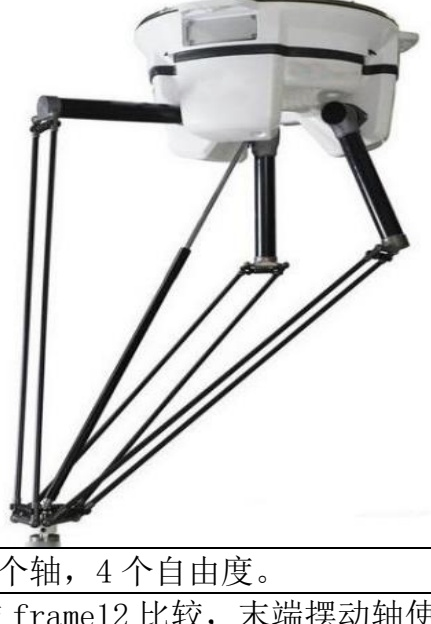</td></tr><tr><td colspan="1" rowspan="1">信息</td><td colspan="1" rowspan="1">4</td></tr><tr><td colspan="1" rowspan="1">区别</td><td colspan="1" rowspan="1">与                                         使用虚拟轴控制。</td></tr><tr><td colspan="1" rowspan="3">Frame102</td><td colspan="1" rowspan="1">图纸</td><td colspan="1" rowspan="1">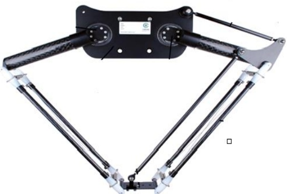</td></tr><tr><td colspan="1" rowspan="1">信息</td><td colspan="1" rowspan="1">2个轴，末端点2个自由度。</td></tr><tr><td colspan="1" rowspan="1">区别</td><td colspan="1" rowspan="1">与frame2比较，两轴的delta。</td></tr><tr><td colspan="1" rowspan="1">Frame13</td><td colspan="1" rowspan="1">图纸</td><td colspan="1" rowspan="1">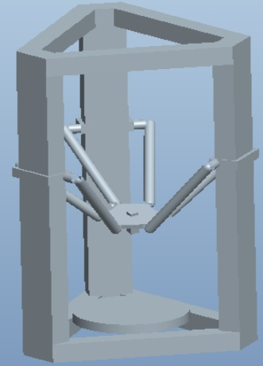</td></tr><tr><td colspan="1" rowspan="1"></td><td colspan="1" rowspan="1">信息</td><td colspan="1" rowspan="1">3个轴</td></tr><tr><td colspan="1" rowspan="1"></td><td colspan="1" rowspan="1">区别</td><td colspan="1" rowspan="1"></td></tr></table>

## 水平关节类

<table><tr><td>类型</td><td colspan="5"></td></tr><tr><td>Frame1</td><td>图纸</td><td colspan="4">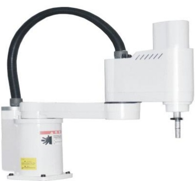</td></tr><tr><td></td><td>信息</td><td colspan="4">Scara 基本类型。 4个轴，末端点4个自由度。</td></tr><tr><td colspan="1" rowspan="1"></td><td colspan="1" rowspan="1">区别</td><td colspan="4"></td></tr><tr><td colspan="1" rowspan="3">Frame101</td><td></td><td colspan="4"></td></tr><tr><td colspan="1" rowspan="1">信息</td><td colspan="4"></td></tr><tr><td colspan="1" rowspan="1">区别</td><td colspan="4"></td></tr><tr><td colspan="1" rowspan="3">Frame105</td><td colspan="1" rowspan="1">图纸</td><td colspan="4"></td></tr><tr><td colspan="1" rowspan="1">信息</td><td colspan="4" rowspan="1">5个轴，5个自由度。</td></tr><tr><td colspan="1" rowspan="1">区别</td><td colspan="4" rowspan="1">与frame101比较，末端摆动轴使用虚拟轴控制。</td></tr><tr><td colspan="1" rowspan="3">Frame106</td><td colspan="1" rowspan="1">图纸</td><td colspan="4" rowspan="1">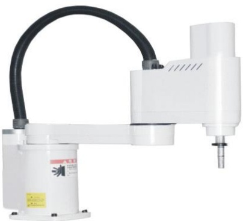</td></tr><tr><td colspan="1" rowspan="1">信息</td><td colspan="4" rowspan="1">4个轴，末端点4个自由度。</td></tr><tr><td colspan="1" rowspan="1">区别</td><td colspan="4" rowspan="1">与 frame1比较，大关节与小关节是关联的。</td></tr><tr><td rowspan="2"></td><td colspan="2">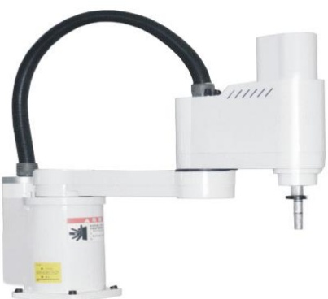</td><td rowspan="2"></td></tr><tr><td>信息</td><td colspan="2"></td></tr><tr><td>Frame108</td><td>区别 图纸</td><td colspan="4">4个轴，末端点4个自由度。 与frame1相比较，小关节与末端旋转轴是关联的。</td></tr><tr><td rowspan="2"></td><td></td><td>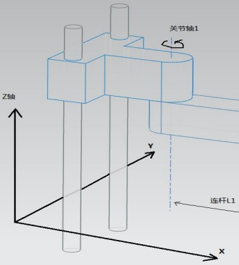</td><td colspan="2">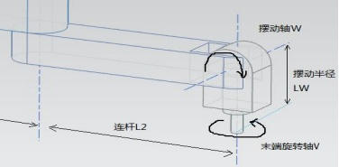</td></tr><tr><td>信息</td><td colspan="4">5个轴，5个自由度。</td></tr><tr><td></td><td>区别 构不同。</td><td colspan="4">与 frame105 相比较，末端摆动轴与末端旋转轴的链接机</td></tr></table>

## 6 自由度类

<table><tr><td colspan="1" rowspan="1">类型</td><td colspan="2" rowspan="1"></td></tr><tr><td colspan="1" rowspan="3">Frame6</td><td colspan="1" rowspan="1">图纸</td><td colspan="1" rowspan="1">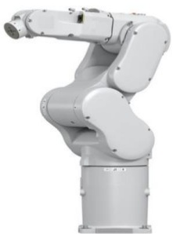</td></tr><tr><td colspan="1" rowspan="1">信息</td><td colspan="1" rowspan="1">6个轴，6个自由度。</td></tr><tr><td colspan="1" rowspan="1">区别</td><td colspan="1" rowspan="1"></td></tr><tr><td colspan="1" rowspan="3">Frame26</td><td colspan="1" rowspan="1">图纸</td><td colspan="1" rowspan="1">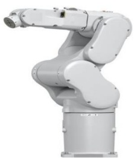</td></tr><tr><td colspan="1" rowspan="1">信息</td><td colspan="1" rowspan="1">6个轴，6个自由度。</td></tr><tr><td colspan="1" rowspan="1">区别</td><td colspan="1" rowspan="1">与frame6相比较，第2关节与第3关节关联。</td></tr><tr><td colspan="1" rowspan="3">Frame36</td><td colspan="1" rowspan="1">图纸</td><td colspan="1" rowspan="1">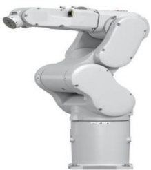</td></tr><tr><td colspan="1" rowspan="1">信息</td><td colspan="1" rowspan="1">6个轴，6个自由度。</td></tr><tr><td colspan="1" rowspan="1">区别</td><td colspan="1" rowspan="1">与frame6相比较，第4关节轴心Y方向的偏移参数。</td></tr><tr><td colspan="1" rowspan="3">Frame16</td><td colspan="1" rowspan="1">图纸</td><td colspan="1" rowspan="1">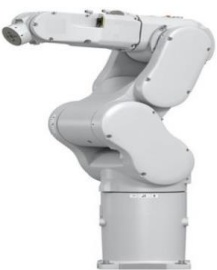</td></tr><tr><td colspan="1" rowspan="1">信息</td><td colspan="1" rowspan="1">6个轴，6个自由度。</td></tr><tr><td colspan="1" rowspan="1">区别</td><td colspan="1" rowspan="1">XYZ+3个旋转。</td></tr></table>

## 旋转台类

<table><tr><td>类型</td><td colspan="3"></td></tr><tr><td>Frame11</td><td>图纸</td><td>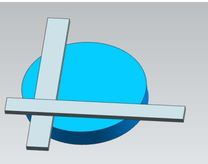</td><td></td></tr><tr><td></td><td>信息 3个轴</td><td></td><td></td></tr></table>

<table><tr><td rowspan=1 colspan=1></td><td rowspan=1 colspan=1>区别</td><td rowspan=2 colspan=1>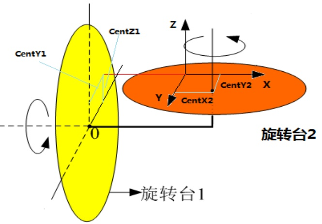</td></tr><tr><td rowspan=3 colspan=1>Frame17</td><td rowspan=1 colspan=1>图纸</td></tr><tr><td rowspan=1 colspan=1>信息</td><td rowspan=2 colspan=1>5个轴</td></tr><tr><td rowspan=1 colspan=1>区别</td></tr><tr><td rowspan=3 colspan=1>Frame18</td><td rowspan=1 colspan=1>图纸</td><td rowspan=1 colspan=1></td></tr><tr><td rowspan=1 colspan=1>信息</td><td rowspan=1 colspan=1>4个轴</td></tr><tr><td rowspan=1 colspan=1>区别</td><td rowspan=1 colspan=1>与 frame11区别，旋转台相对xy平面，支持旋转台任意角度偏转。</td></tr><tr><td rowspan=3 colspan=1>Frame19</td><td rowspan=1 colspan=1>图纸</td><td rowspan=1 colspan=1>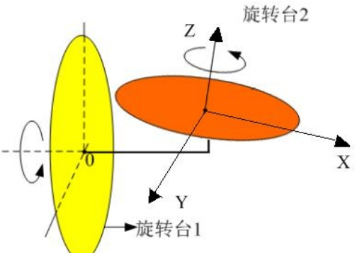?</td></tr><tr><td rowspan=1 colspan=1>信息</td><td rowspan=1 colspan=1>5个轴</td></tr><tr><td rowspan=1 colspan=1>区别</td><td rowspan=1 colspan=1>与frame17比较，旋转台2相对xy平面，支持旋转台任意角度偏转。</td></tr></table>

## 直角坐标系类

<table><tr><td rowspan=1 colspan=1>类型</td><td></td><td></td></tr><tr><td rowspan=3 colspan=1>Frame100</td><td rowspan=1 colspan=1>图纸</td><td></td></tr><tr><td rowspan=1 colspan=1>信息</td><td></td></tr><tr><td rowspan=1 colspan=1>区别</td><td></td></tr><tr><td rowspan=3 colspan=1>Frame104</td><td rowspan=1 colspan=1>图纸</td><td></td></tr><tr><td rowspan=1 colspan=1>信息</td><td rowspan=1 colspan=1>5个轴。</td></tr><tr><td rowspan=1 colspan=1>区别</td><td rowspan=1 colspan=1>与 frame100 比较，末端旋转轴与末端摆动轴使用虚拟轴进行控制。</td></tr></table>

<table><tr><td>类型 Frame3</td><td colspan="4"></td></tr><tr><td rowspan="5"></td><td rowspan="5">图纸</td><td colspan="3"></td></tr><tr><td></td><td></td><td></td></tr><tr><td>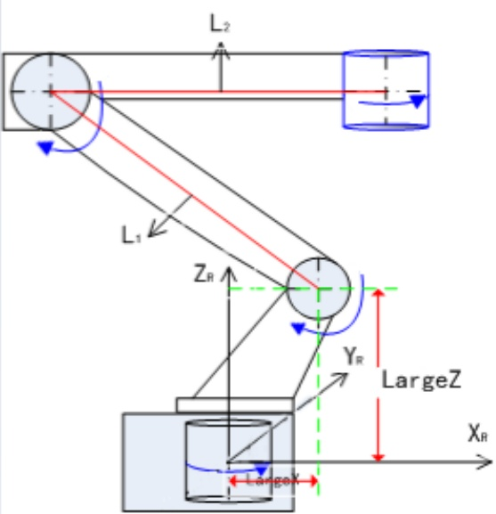</td><td></td><td></td></tr><tr><td>信息</td><td></td><td></td></tr><tr><td></td><td>码垛基本类型。 4个轴，末端点4个自由度。</td><td></td></tr><tr><td colspan="2">区别 Frame4 图纸</td><td>机械原因，末端旋转轴保持水平。 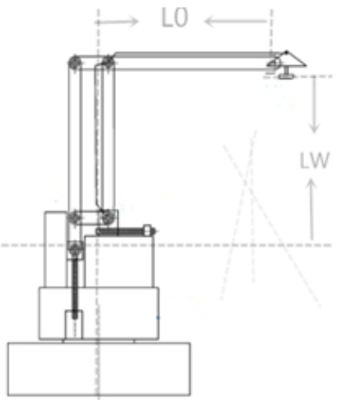</td><td></td></tr><tr><td colspan="2" rowspan="8">Frame103 Frame25</td><td>图纸</td><td></td></tr><tr><td>信息 4个轴 大旋转台+scara 区别</td><td colspan="3"></td></tr><tr><td>图纸 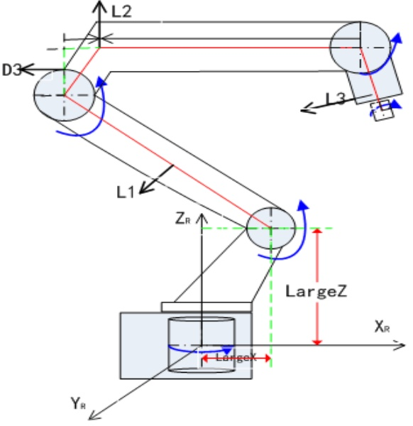</td><td colspan="3"></td></tr><tr><td>信息 5个轴。 区别 末端旋转轴。</td><td colspan="3">比6关节少一个中间转动轴,比 frame103 结构多一个</td></tr></table>

## 其余类

<table><tr><td rowspan=1 colspan=1>类型</td><td></td><td></td></tr><tr><td rowspan=1 colspan=1>Frame15</td><td></td><td></td></tr><tr><td rowspan=3 colspan=1>Frame5</td><td rowspan=1 colspan=1>图纸</td><td></td></tr><tr><td rowspan=1 colspan=1>信息</td><td rowspan=1 colspan=1>3个轴，3个自由度。</td></tr><tr><td rowspan=1 colspan=1>区别</td><td rowspan=1 colspan=1></td></tr><tr><td rowspan=2 colspan=1>Frame33</td><td rowspan=1 colspan=1>图纸</td><td rowspan=1 colspan=1>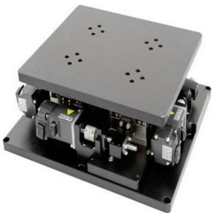</td></tr><tr><td rowspan=1 colspan=1>信息</td><td rowspan=1 colspan=1>UVW 对位平台</td></tr></table>

## 二、机械手控制器型号一览

<table><tr><td rowspan=1 colspan=1>控制器系列</td><td rowspan=1 colspan=1>支持机械手功能的控制器型号</td></tr><tr><td rowspan=1 colspan=1>ZMC0XX</td><td rowspan=1 colspan=1>无</td></tr><tr><td rowspan=1 colspan=1>ZMC1XX</td><td rowspan=1 colspan=1>ZMC104S/ZMC106S/</td></tr><tr><td rowspan=1 colspan=1>ZMC2XX</td><td rowspan=1 colspan=1>ZMC204  ZMC206/ZMC212/ZMC212-8</td></tr><tr><td rowspan=1 colspan=1>ZMC3XX</td><td rowspan=1 colspan=1>ZMC303/2ZMC304 /ZMC306M／ZMC306/ZMC306X／ZMC308／ZMC316</td></tr><tr><td rowspan=1 colspan=1>ZMC4XX</td><td rowspan=1 colspan=1>ZMC406／ZMC412／ZMC432／ZMC464/ZMC432N</td></tr><tr><td rowspan=1 colspan=1>ECI1000系列</td><td rowspan=1 colspan=1>无</td></tr><tr><td rowspan=1 colspan=1>ECI2000系列</td><td rowspan=1 colspan=1>ECI2608</td></tr><tr><td rowspan=1 colspan=1>ECI3000系列</td><td rowspan=1 colspan=1>ECI3608/ECI3808</td></tr></table>

<table><tr><td colspan="3">特殊的机械手类型</td></tr><tr><td>机械手类型</td><td colspan="2">支持的控制器型号</td></tr><tr><td>基本类型</td><td colspan="2">支持机械手功能的控制器</td></tr><tr><td rowspan="4">R特殊类型</td><td colspan="2">支持机械手功能的控制器，且带后缀一R</td></tr><tr><td>ZMC3XX</td><td>ZMC303-R/ZMC304-R/ZMC306M-R/ ZMC306-R/ZMC306X-R/ZMC308-R/ ZMC316-R</td></tr><tr><td>ZMC4XX（推荐）</td><td>ZMC406-R/ZMC412-R/ZMC432-R/</td></tr><tr><td></td><td>ZMC464-R／ ZMC432N-R</td></tr></table>

## 第三章 软件工具使用

## 一、Zdevelop 程序开发环境

编写和调试 ZBASIC 程序需要 ZDevelop 开发软件，ZMC 运动控制器（或仿真器）。Zdevelop 软件的路径“ZMC 光盘资料\5.编程软件\zdevelop2.70”，使用方法可以参看“ZMC 光盘资料\12.视频资料”中的网址获取。

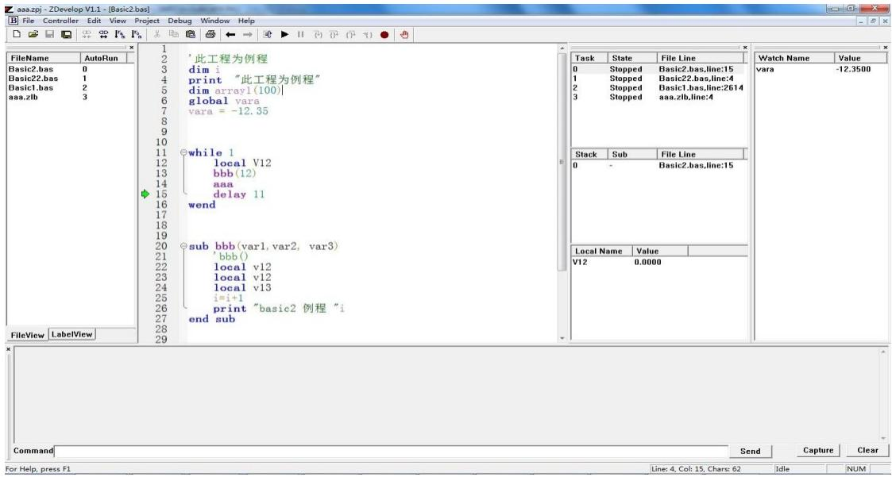

同时，在“ZMC 光盘资料\7.控制器例程\入门程序\机械手程序\机械手基本类型建立程序”中提供了所有机械手类型的基本测试程序，可直接打开 zpj 项目后选择对应bas 文件设置自动运行使用。

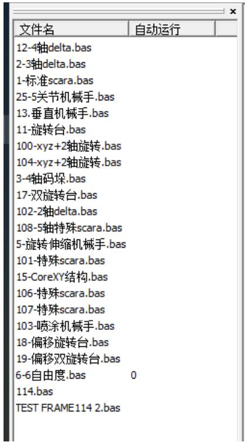

## 二、ZRobotView 机械手模型仿真工具

ZRobotView 主要是用来模拟机械手的实际运动轨迹，检查机械手程序及实际机械手在运行过程中的速度，轨迹，姿态位置等，防止事故的发生。

工具软件的路径“ZMC 光盘资料\6.工具软件\ ZRobotView 机械手仿真工具\ZRobotView.exe” 。

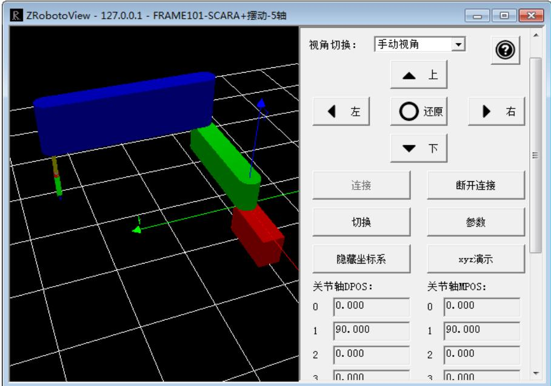

## 三、示波器参数抓取使用

示波器可用于抓取运动中轴的速度，坐标等参数曲线，用以判断运动过程的轨迹准确性，机台抖动大小等性能。在 zdevelop 软件-视图-示波器打开。

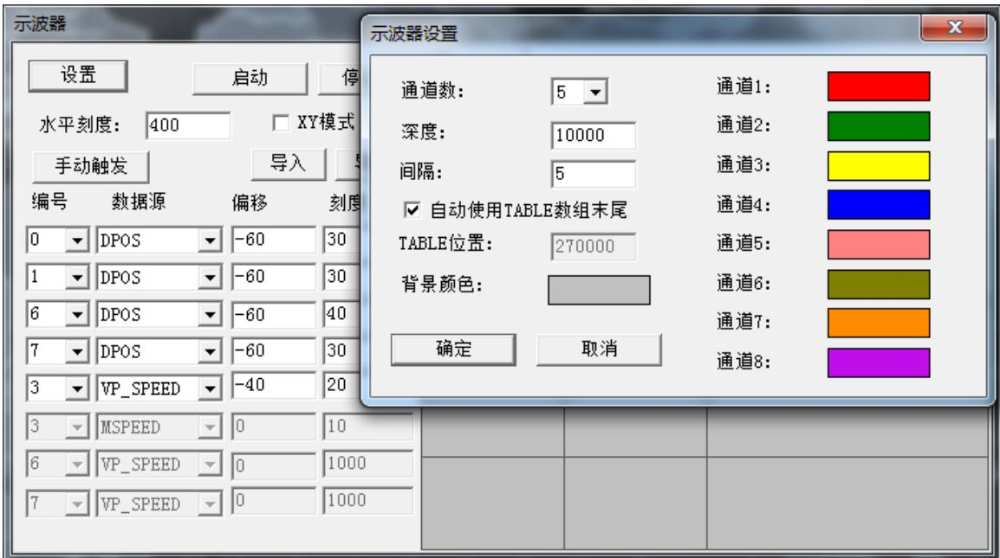

## 四、PC 上位机使用

PC 上位机使用时，根据不同的开发环境，在路径“ZMC 光盘资料\8.PC 编程相关”中选择对应的 dll 链接库及相关文件。然后使用 ZAux\_ Direct\_Connframe和 ZAux\_ Direct\_Connreframe 指令建立连接。

## 第四章 机械手相关指令使用

## CONFRAME--建立机械手逆解模式

<table><tr><td>类型 描述</td><td>同步运动指令，建立逆解连接</td></tr><tr><td rowspan="5"></td><td>将当前关节坐标系的目标位置与虚拟坐标系的位置关联。 CLUTCH_RATE=0 时关节坐标系的运动速度和加速度受关节轴 SPEED等参数的限制。</td></tr><tr><td>当关节轴告警等出错时，此运动会被CANCEL。 不要在虚拟轴高速运动中CANCEL此运动，会引起轴在高速运动</td></tr><tr><td>中停止。 此命令LOAD(加载)时会自动修改虚拟轴的坐标，使得与关节轴坐</td></tr><tr><td>标正确对应，因此调用后需要WAITLOADED后才开始运动。 连接过程中不要修改虚拟轴的坐标，或是调用 DATUM 等可能改 坐标的运动，这样会导致关节轴快速运动到新的虚拟位置。</td></tr><tr><td>CONNFRAME 生效后，关节轴的MTYPE为33，此时无法直接运 动关节轴，必须通过运行虚拟轴来间接运动关节轴，当要直接移 动关节轴时，先调用CANCEL 取消CONNFRAME，再运动关节 轴。</td></tr><tr><td>语法</td><td>当虚拟轴和实际轴都是旋转轴时，例如末端旋转轴，虚拟轴和实 际轴的脉冲当量注意要一致。 CONNFRAME（frame， tablenum, viraxis0, viraxis1,[...]) 参数: Frame：坐标系类型；1-scara。</td></tr><tr><td></td><td>Tablenum：机械手参数的TABLE 起始位置，具体填写哪些参 数根据类型确认。 viraxisO：虚拟坐标系第一个轴。 viraxis1：虚拟坐标系第二个轴。 []：虚拟坐标系第N个轴，可以是实际轴，具体由机械 手类型确定。</td></tr><tr><td>适用控制器 例程</td><td>2 系列以上控制器 L1=10‘第一个关节轴长度 L2=10‘第二个关节轴长度</td></tr><tr><td></td><td>BASE(0,1) '假设关节轴号是0/1 UNITS=10,10这里以度为单位 DPOS=0.0‘设置关节轴的位置，此处要根据实际情况来修改 BASE(6,7) ATYPE=0,0‘设置为虚拟轴 TABLE(0,L1,L2,3600,3600）‘参数存储在 TABLE0 开始的位置， 电 机一圈360个脉冲 UNITS=1000,1000‘此脉冲当量要提前设置，中途不能变化 BASE(0,1) '选择关节轴号 CONNFRAME(1,0,6,7) ： '第6/7轴作为虚拟的XY轴，启动逆解 连接 WAITLOADED '等待运动加载 '第三步：运动虚拟轴 BASE(6,7) MOVEABS(90.0）‘虚拟轴的坐标变为90,0</td></tr><tr><td>相关指令</td><td>CONNREFRAME</td></tr></table>

## CONNREFRAME--建立机械手正解模式

<table><tr><td>类型</td><td>同步运动指令，建立正解连接</td></tr><tr><td rowspan="3">描述</td><td>将虚拟轴的坐标与关节轴的坐标关联，关节轴运动后，虚拟轴自 动走到相应的位置。</td></tr><tr><td>此指令为CONNFRAME的反运动指令。</td></tr><tr><td>当虚拟轴 CONNREFRAME 运动 LOAD 时，关节轴的 CONNFRAME运动会自动被CANCEL。</td></tr><tr><td colspan="1" rowspan="1"></td><td colspan="1" rowspan="1">当关节 轴的 CONNFRAME 运动 LOAD 时，虚拟轴CONNREFRAME 运动会自动被CANCEL。</td></tr><tr><td colspan="1" rowspan="1">语法</td><td colspan="1" rowspan="1">CONNREFRAME（frame， tablenum,axis0,axis1,[...])参数：参见CONNFRAME_的参数，BASE 轴与参数里面的轴的位置相反，当有参考轴时，参考轴列表要加在参数后面(FRAME100等)。</td></tr><tr><td colspan="1" rowspan="1">适用控制器</td><td colspan="1" rowspan="1">2 系列以上控制器</td></tr><tr><td colspan="1" rowspan="1">例程</td><td colspan="1" rowspan="1">L1=10‘第一个关节轴长度L2=10‘第二个关节轴长度BASE(0,1)       '假设关节轴号是0/1UNITS=10,10这里以度为单位DPOS=0.0‘设置关节轴的位置，此处要根据实际情况来修改BASE(6,7)ATYPE=0.0 '设置为虚拟轴TABLE(0,L1,L2,3600,3600)   '参数存储在TABLEO开始的位置，'电机一圈360个脉冲UNITS=1000,1000 ‘此脉冲当量要提前设置，中途不能变化CONNREFRAME(1,0,0,1)   '6/7的坐标根据0/1来计算WAITLOADED                 '等待运动加载'第三步：运动关节轴BASE(0,1)MOVEABS(90,0)‘虚拟轴的坐标变为0,20</td></tr><tr><td colspan="1" rowspan="1">相关指令</td><td colspan="1" rowspan="1">CONFRAME</td></tr></table>

## CORNER\_MODE--运动参数设置

<table><tr><td colspan="1" rowspan="1">类型</td><td colspan="4" rowspan="1">轴参数</td></tr><tr><td colspan="1" rowspan="1">描述</td><td colspan="4" rowspan="1">拐角减速等模式设置。</td></tr><tr><td colspan="1" rowspan="6">语法</td><td></td><td></td><td></td><td></td></tr><tr><td></td><td colspan="1" rowspan="1">位</td><td colspan="1" rowspan="1">值</td><td colspan="1" rowspan="1">描述</td></tr><tr><td></td><td colspan="1" rowspan="1">0</td><td colspan="1" rowspan="1">1</td><td colspan="1" rowspan="1">预留</td></tr><tr><td></td><td colspan="1" rowspan="1">1</td><td colspan="1" rowspan="1">2</td><td colspan="1" rowspan="1">自动拐角减速。具体说明查看 Zbasic 帮助。</td></tr><tr><td></td><td colspan="1" rowspan="1">2</td><td colspan="1" rowspan="1">4</td><td colspan="1" rowspan="1">预留</td></tr><tr><td></td><td colspan="1" rowspan="1">3</td><td colspan="1" rowspan="1">8</td><td colspan="1" rowspan="1">自动小圆限速，半径小于设置值时限速，大于限制值时不限速。</td></tr><tr><td colspan="1" rowspan="7"></td><td></td><td colspan="1" rowspan="1"></td><td colspan="1" rowspan="1"></td><td colspan="1" rowspan="1">具体说明查看 Zbasic 帮助。</td></tr><tr><td></td><td colspan="1" rowspan="1">4</td><td colspan="1" rowspan="1">16</td><td colspan="1" rowspan="1">预留</td></tr><tr><td></td><td colspan="1" rowspan="1">5</td><td colspan="1" rowspan="1">32</td><td colspan="1" rowspan="1">自动倒角设置。具体说明查看 Zbasic 帮助。</td></tr><tr><td></td><td colspan="1" rowspan="1">6</td><td colspan="1" rowspan="1">64</td><td colspan="1" rowspan="1">插补使用每个轴的速度限。MOVER指令自动使用，其它指令预留。</td></tr><tr><td></td><td colspan="1" rowspan="1">7</td><td colspan="1" rowspan="1">128</td><td colspan="1" rowspan="1">预留</td></tr><tr><td></td><td colspan="1" rowspan="1">8</td><td colspan="1" rowspan="1">256M</td><td colspan="1" rowspan="1">OVER指令运动使用 SP功能。</td></tr><tr><td></td><td colspan="1" rowspan="1">9</td><td colspan="1" rowspan="1">512M</td><td colspan="1" rowspan="1">OVER指令运动使用虚拟轴的速度来限制。</td></tr><tr><td colspan="1" rowspan="1">适用控制器</td><td colspan="4" rowspan="1">通用</td></tr></table>

## CLUTCH\_RATE--连接速度设置

<table><tr><td>类型 轴参数 描述</td><td colspan="4">connect连接的速度，ratio/秒，默认值1000000。</td></tr><tr><td></td><td colspan="4">当设置为0时，根据轴的速度/加速度参数来跟踪连接，比较适合 于手轮运动。 当速度不够高时可能导致机械手要持续运动一段时间才能结束， 此时运动的最终位置是准确的，但轨迹是变形的。</td></tr><tr><td>语法</td><td colspan="4">clutch_rate= value</td></tr><tr><td>适用控制器</td><td colspan="4">通用</td></tr><tr><td rowspan="5">例程</td><td colspan="5">clutch_rate = 0 ‘根据轴的速度/加速度参数来跟踪连接 建立机械手连接后，相同的速度加速度参数下： 设为0（平滑模式），速度曲线如下 1MSPEED[1] Min:-139.60 Max:0.00</td></tr><tr><td></td><td></td><td></td><td></td><td></td></tr><tr><td></td><td></td><td></td><td></td><td></td></tr><tr><td>500</td><td>600</td><td>00</td><td>800</td><td>900</td></tr><tr><td colspan="7"></td></tr><tr><td rowspan="8"></td><td colspan="7">1 MSPEED(1)</td></tr><tr><td></td><td></td><td>Min:-142.70</td><td>Max:0.00</td><td></td><td colspan="2"></td></tr><tr><td>600</td><td>700</td><td>800</td><td>900</td><td>1000</td><td colspan="2">1100</td></tr><tr><td></td><td></td><td></td><td></td><td></td><td colspan="2"></td></tr><tr><td colspan="7">对关节轴有用，当配置为0时会使用关节轴的速度加速度做限制 （平滑模式），这样运行更平滑，步进电机也可以不丢步。 配置为非0时使用虚拟轴的速度加速度做限制（强制模式），运 动轨迹更精确，但易抖动。</td></tr></table>

## FRAME\_STATUS--查询机械手当前姿态

<table><tr><td rowspan=1 colspan=1>类型</td><td rowspan=1 colspan=1>轴状态</td></tr><tr><td rowspan=1 colspan=1>描述</td><td rowspan=1 colspan=1>指明当前的机械手姿态。不是机械手状态时返回-1,  FRAME_TRANS2_指令会用到这个姿态。只对SCARA、类SCARA结构和6自由度结构有多种姿态。SCARA左手姿态值为0，右手姿态值为1。</td></tr><tr><td rowspan=1 colspan=1>语法</td><td rowspan=1 colspan=1>VAR1=FRAME_STATUS（AXIS)</td></tr><tr><td rowspan=1 colspan=1>适用控制器</td><td rowspan=1 colspan=1>通用</td></tr><tr><td rowspan=1 colspan=1>例程</td><td rowspan=1 colspan=1>在线命令输入?frame_status，打印出当前姿态。&gt;&gt;?frame_status</td></tr></table>

## FRAME\_TRANS2--正逆解坐标转换

<table><tr><td>类型</td><td>机械手计算指令</td></tr><tr><td>描述</td><td>坐标转换函数。</td></tr><tr><td rowspan="3"></td><td>使用时必须base 正确的轴号。逆解时，base 虚拟轴；正解时，base</td></tr><tr><td>关节轴。</td></tr><tr><td>按照正确的顺序填入相应个数的数据。填入的个数与数据，与？</td></tr><tr><td></td><td>*frame一致。</td></tr><tr><td>语法</td><td>FRAME_TRANS2(tablein， tableout, dir) tablein：Table数组中的索引号，从这个索引开始连续存储数据， 正解时输入关节坐标，逆解时输入虚拟轴坐标列表，最 后附加姿态。 Tableout：Table这个索引开始存储数据，正解时输出虚拟坐标， 最后附加姿态，逆解时输出关节坐标列表。 Dir：0-逆解，虚拟轴到关节轴，无姿态，自动使用当前的姿态。 1-正解，关节轴到虚拟轴，无姿态输出。 2-逆解，输入虚拟轴坐标，最后加上姿态。 3-正解，输出虚拟轴坐标，输出最后一个位置填姿态。</td></tr><tr><td>适用控制器</td><td>通用</td></tr></table>

以scara结构为例。

第一关节轴 L1=10，第二关节轴 L2=10。Table(100)作为输入坐标的存放位置，table(200)作为输出坐标的存放位置。

建立连接后，关节轴原点坐标（0,0），此时虚拟轴坐标为（20,0），如下图。

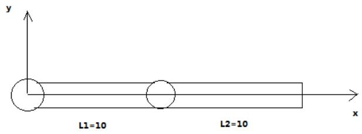

虚拟轴坐标 (10,10) 时，有两种姿态

关节轴 (0,90)

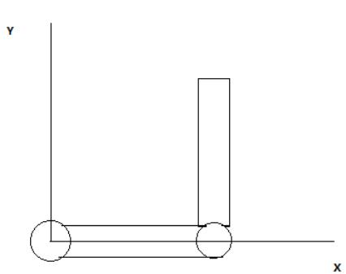

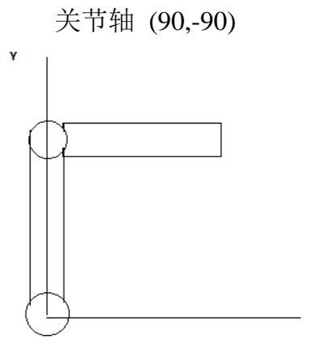

坐标转换表

<table><tr><td rowspan=1 colspan=1>状态</td><td rowspan=1 colspan=1>Base 轴</td><td rowspan=1 colspan=1>输入X、Y、姿态</td><td rowspan=1 colspan=1>使用指令模式</td><td rowspan=1 colspan=1>输出关节坐标</td></tr><tr><td rowspan=1 colspan=1>逆解</td><td rowspan=1 colspan=1>虚拟轴</td><td rowspan=1 colspan=1>Table(100,20,0,0)</td><td rowspan=1 colspan=1>FRAME_TRANS2(100,200</td><td rowspan=1 colspan=1>Table(200,0,0)</td></tr></table>

<table><tr><td rowspan=8 colspan=1></td><td rowspan=1 colspan=1>Table(100,10,10,1)</td><td rowspan=1 colspan=1>,0</td><td rowspan=1 colspan=1>Table(200,0,90)</td></tr><tr><td rowspan=1 colspan=1>Table(100,10,10,1)</td><td rowspan=1 colspan=1>FRAME_TRANS2(100,200,2)</td><td rowspan=1 colspan=1>Table(200,90,-90)</td></tr><tr><td rowspan=1 colspan=3></td></tr><tr><td rowspan=1 colspan=1>输入关节坐标</td><td rowspan=1 colspan=1>使用指令模式</td><td rowspan=1 colspan=1>输出X、Y、姿态</td></tr><tr><td rowspan=1 colspan=1>Table(100,0,0)</td><td rowspan=3 colspan=1>FRAME_TRANS2(100,200,1)</td><td rowspan=1 colspan=1>Table(200,20,0,0)</td></tr><tr><td rowspan=1 colspan=1>Table(100,0,90)</td><td rowspan=1 colspan=1>Table(200,10,10,0)</td></tr><tr><td rowspan=1 colspan=1>Table(100,90,-90)</td><td rowspan=1 colspan=1>Table(200,10,10,0)</td></tr><tr><td rowspan=1 colspan=1>Table(100,90,-90)</td><td rowspan=1 colspan=1>FRAME_TRANS2(100,200,3)</td><td rowspan=1 colspan=1>Table(200,10,10,1)</td></tr></table>

## FRAME\_ROTATE--工件坐标系变换

<table><tr><td>类型 描述</td><td>机械手计算指令</td></tr><tr><td rowspan="5"></td><td>用于对工件坐标系进行平移和旋转。 目前只对FRAME6 同时旋转姿态，其他具有XYZ 虚拟轴的可以</td></tr><tr><td>支持XYZ3个轴旋转，姿态轴不能旋转。 旋转后，虚拟轴 WORLD_DPOS 表示世界坐标不会改变，虚拟轴 DPOS 表示工件坐标会改变。</td></tr><tr><td>使用时需控制器当前存在机械链接。</td></tr><tr><td>base 轴，可以是虚拟轴与关节轴任意一个；base 轴无机械手链接， 会报1025的错误。</td></tr><tr><td>多种机械手叠加的情况，根据base 轴来识别是哪个机械手模式； 如果base（axis_1,axis_2）中的axis_1是模式1的机械手轴，axis_2 是模式2的机械手轴，那么结果是模式1的机械手进行坐标计算，</td></tr><tr><td>语法</td><td>即以base 轴的顺序来计算。 FRAME_ROTATE(X,Y,Z.RX,RY,RZ) 参数描述: X:坐标系B沿，X^的平移距离。 Y:坐标系B沿，Y^的平移距离。 Z:坐标系B沿，Z^的平移距离。 RX:坐标系B沿，X^的旋转的角度。</td></tr><tr><td>坐标系旋转： 旋转的方法是：x_y_z固定角坐标系。</td><td>首先将做坐标系{B}和一个已知参考坐标系{A}重合。先将{A}绕 X^a 旋转RX角，在绕Y^a 旋转RY角，最后绕 Z^a旋转RZ角。</td></tr><tr><td>适用控制器 例程</td><td>通用 以frame=2，detla为例；对其绕x轴旋转90度。 base(0,1,2) rapidstop</td></tr><tr><td>atype = 1,1,1 dpos=0,0,0 base(6,7,8) atype = 0,0,0 BASE(0,1,2) base(6,7,8) dpos(8)-world_dpos(8)= 58.1400</td><td>units=3600/360,3600/360,3600/360 TABLE(0,40,10,32,85,3600,3600,3600, 0, 0, 0) UNITS = 100,100,100 CONNFRAME(2,0,6,7,8) WAIT LOADED FRAME_ROTATE(0,0,0,pi/2,0,0) ?"dpos(7)-world_dpos(7)=",dpos(7)-world_dpos(7) ?"dpos(8)-world_dpos(8)=",dpos(8)-world_dpos(8) 输出行输出&gt;&gt; dpos(7)-world_dpos(7)= -58.1400</td></tr><tr><td></td><td>base(0,1,2,3) rapidstop atype = 1,1,1,1 units=3600/360,3600/360,3600/360,1000 dpos=0,0,0,0 base(6,7,8,9) atype = 0,0,0,0 TABLE(0,100,100,3600,3600,3600) UNITS = 100,100,3600/360,1000 BASE(0,1,2,3) CONNFRAME(1,0,6,7,8,9)</td></tr><tr><td></td><td>WAIT LOADED base(6,7,8,9) FRAME_ROTATE(0,0,0,0,0,pi/2)</td></tr><tr><td>相关指令 FRAME ROTATE2</td><td>?"dpos(7)-world_dpos(7)=",dpos(7)-world_dpos(7) ?"dpos(8)-world_dpos(8)=",dpos(8)-world_dpos(8) 输出行输出&gt;&gt; dpos(7)-world_dpos(7)= -200 dpos(8)-world_dpos(8)= 0</td></tr></table>

## FRAME\_TCP--末端 Flange 坐标叠加工具

<table><tr><td colspan="1" rowspan="1">类型</td><td colspan="1" rowspan="1">机械手计算指令</td></tr><tr><td colspan="1" rowspan="1">描述</td><td colspan="1" rowspan="1">用于 Scara 机械手叠加工具。目前只对FRAME1机械手起作用，其他机械手暂时不支持。使用前需要base 机械手关节轴，并处于 frame（正解或逆解）状态。参数：TCP，其坐标值可以通过Frame_Cal工具标定指令标定</td></tr><tr><td colspan="1" rowspan="1">语法</td><td colspan="1" rowspan="1">FRAME_TCP(X,Y,Z,RX,RY,RZ)参数描述:X:末端（Flange）坐标系 TCP 沿X^的平移距离。Y:末端（Flange）坐标系 TCP沿Y^的平移距离。Z:末端（Flange）坐标系TCP沿Z^的平移距离。</td></tr><tr><td>RX:末端 RY:末端</td><td>（Flange）坐标系TCP沿X^的旋转的角度。 （Flange）坐标系 TCP沿Y^的旋转的角度。 RZ:末端（Flange）坐标系TCP沿Z^的旋转的角度。 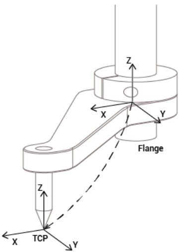</td></tr><tr><td>适用控制器</td><td>通用</td></tr><tr><td>例程 相关指令</td><td>BASE(0,1,2,3）‘选择关节轴号 CONNFRAME(1,0,6,7,8,9）‘第 6/7 轴作为虚拟的 XY 轴，启动逆 解</td></tr></table>

## FRAME\_ROTATE2--坐标系变换计算

<table><tr><td>类型</td><td>机械手计算指令</td></tr><tr><td>描述</td><td>手动计算坐标系旋转后的坐标值。 使用时需控制器当前存在机械链接。 base 轴，可以是虚拟轴与关节轴任意一个；base 轴无机械手链接， 会报1025 的错误。</td></tr><tr><td></td><td>多种机械手叠加的情况，根据base 轴来识别是哪个机械手模式。 如果base（axis_1,axis_2）中的axis_1是模式1的机械手轴，axis_2 是模式2的机械手轴，那么结果是模式1的机械手进行坐标计算， 即以base 轴的顺序来计算。</td></tr><tr><td colspan="1" rowspan="1">语法</td><td colspan="1" rowspan="1">FRAME_ROTATE2(tablein, tableout, dir[, x,y,z[, rx,ry,rz]l)Ret = FRAME_ROTATE2(tablein, tableout, dir[, x,y,z[, rx,ry,rz]])参数描述:Tablein:转换前，填写的坐标存储 TABLE 位置Tableout:转换后，输出的坐标存储 TABLE位置Dir: 0-DPOS 到 WORLD_DPOS1-WORLD_DPOS 到 DPOSX:坐标系B沿，X^的平移距离Y:坐标系B沿，Y^的平移距离Z:坐标系B沿，Z^的平移距离RX:坐标系B沿，X^的旋转的角度RY:坐标系B沿，Y^的旋转的角度RZ:坐标系B沿，Z^的旋转的角度[,x,y,z[,rx,ry,rz]]不填时使用当前的缺省 rotate 参数Ret:返回成功与否.-1：成功；0：未成功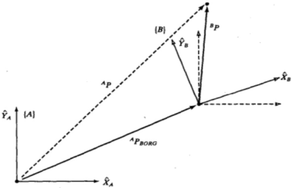</td></tr><tr><td colspan="1" rowspan="1">适用控制器</td><td colspan="1" rowspan="1">通用</td></tr><tr><td colspan="1" rowspan="1">例程</td><td colspan="1" rowspan="1">以f=2，detla为例；对其绕x轴旋转90度。base(0,1,2)rapidstopatype = 1,1,1units=3600/360,3600/360,3600/360dpos=0,0,0base(6,7,8)atype = 0,0,0TABLE(0,40,10,32,85,3600,3600,3600, 0, 0, 0)UNITS = 100,100,100BASE(0,1,2)CONNFRAME(2,0,6,7,8) WAIT LOADEDfori=0 to 2</td></tr></table>

```csv
table(100+i)=dpos(i+6)
next
base(6,7,8)
FRAME_ROTATE(0,0,0,pi/2,0,0)
base(6,7,8)
FRAME_ROTATE(0,0,0,pi/2,0,0)
wait loaded
ret=frame_rotate2(100,200,1,0,0,0,pi/2,0,0)
if ret=-1 then
?"计算值"
?"dpos(6)=",table(200)
?"dpos(7)=",table(201)
?"dpos(8)=",table(202)
?"比较值"
?"dpos(6)比较",table(200)-dpos(6)
?"dpos(7)比较",table(201)-dpos(7)
?"dpos(8)比较",table(202)-dpos(8)
Endif
输出行输出>>
计算值
dpos(6)= 0
dpos(7)= -58.1400
dpos(8)= 0.0000
比较值
dpos(6)比较 0
dpos(7)比较 0
dpos(8)比较 0.0000
以 f=1，scara 为例；对其相对于 z 轴旋转 90 度。
base(0,1,2,3)
rapidstop
atype = 1,1,1,1
units=3600/360,3600/360,3600/360,1000
dpos=0,0,0,0
base(6,7,8,9)
atype = 0,0,0,0
TABLE(0,100,100,3600,3600,3600)
UNITS = 100,100,3600/360,1000
BASE(0,1,2,3)
CONNFRAME(1,0,6,7,8,9)
WAIT LOADED
for i=0 to 3
```

```csv
table(100+i)=dpos(i+6)
next
base(6,7,8,9)
FRAME_ROTATE(0,0,0,0,0,pi/2)
wait loaded
ret=frame_rotate2(100,200,1,0,0,0,0,0,pi/2)
if ret=-1 then
?"计算值"
?"dpos(6)=",table(200)
?"dpos(7)=",table(201)
?"dpos(8)=",table(202)
?"dpos(9)=",table(203)
?"比较值"
?"dpos(6)比较",table(200)-dpos(6)
?"dpos(7)比较",table(201)-dpos(7)
?"dpos(8)比较",table(202)-dpos(8)
?"dpos(9)比较",table(203)-dpos(9)
Endif
输出行输出>>
计算值
dpos(6)= -0.0000
dpos(7)= -200
dpos(8)= 0
dpos(9)= 0
比较值
dpos(6)比较 -0.0000
dpos(7)比较 0
dpos(8)比较 0
相关指令 FRAME_ROTATE
```

## WORLD\_DPOS--世界坐标系

<table><tr><td colspan="1" rowspan="1">类型</td><td colspan="1" rowspan="1">轴状态</td></tr><tr><td colspan="1" rowspan="1">描述</td><td colspan="1" rowspan="1">虚拟轴参照世界坐标系的坐标值，没有旋转时与DPOS相同。</td></tr><tr><td colspan="1" rowspan="1">语法</td><td colspan="1" rowspan="1">varl=world_dpos(axis)</td></tr><tr><td colspan="1" rowspan="1">适用控制器</td><td colspan="1" rowspan="1">通用</td></tr><tr><td colspan="1" rowspan="1">例程</td><td colspan="1" rowspan="1">在线命令打印</td></tr><tr><td>&gt;&gt;?*world 1_dpos</td><td></td></tr></table>

## UNTIS--脉冲当量

<table><tr><td rowspan=1 colspan=1>类型</td><td rowspan=1 colspan=1>轴参数</td></tr><tr><td rowspan=1 colspan=1>描述</td><td rowspan=1 colspan=1>脉冲当量，指定每单位发送的脉冲数，支持5位小数精度。一个机械手的所有虚拟轴和关节轴的长度单位要求统一，一般都是 mm 单位，虚拟轴的一个mm 的脉冲数一般建议设置为1000。旋转轴单位一般以度为单位，此单位没有要求（特殊机械手可能要求虚拟旋转轴与对应的关节旋转轴的units一样）。</td></tr><tr><td rowspan=1 colspan=1>语法</td><td rowspan=1 colspan=1>可读：VAR1 = UNITS       或VR1=UNITS(轴号)可写：UNITS= expression 或 UNITS(轴号)= expression</td></tr><tr><td rowspan=1 colspan=1>适用控制器</td><td rowspan=1 colspan=1>通用</td></tr><tr><td rowspan=1 colspan=1>例程</td><td rowspan=1 colspan=1>查看Zbasic 帮助</td></tr></table>

## MOVER\_L/MOVER\_LABS--关节轴直线插补

<table><tr><td colspan="1" rowspan="1">类型</td><td colspan="1" rowspan="1">运动指令</td></tr><tr><td colspan="1" rowspan="1">描述</td><td colspan="1" rowspan="1">关节轴直线插补。机械手关节插补运动，机械手末端直线运动到指定坐标。此指令正解模式下使用，直接操作关节轴时会有改变姿态的可能，所以要确保起点结束点姿态要保持一致，否则会报错。</td></tr><tr><td colspan="1" rowspan="1">语法</td><td colspan="1" rowspan="1">MOVER_L(distance1 [,distance2 [,distance3 [,distance4.]])参数：distance1            第一个轴运动距离distance2            下一个轴运动距离</td></tr><tr><td colspan="1" rowspan="1">适用控制器</td><td colspan="1" rowspan="1">4 系列 20170511以上固件支持</td></tr><tr><td colspan="1" rowspan="1">例程</td><td colspan="1" rowspan="1">BASE(0,1)dpos=0,0base(6.7)</td></tr><tr><td>Wait idle Print *dpos 相关指令 MOVER C,</td><td>atype = 0.0 设置为虚拟轴 units=1000,1000 TABLE(0,L1,L2, 100*360, 100*360, 360 ) CONNREFRAME(1,0.0,1)'第6/7 轴作为虚拟的XY轴，启动连接 WAIT LOADED 关节运动 Base(0,1) speed=400 SRAMP=100 ACCEL=1000 DECEL=1000 MERGE=1 CORNER_MODE=32‘启动倒角 ZSMOOTH=2 moveabs(45,90）‘关节运动，此时运动关节角度 MOVER_LABS(90,0)‘末端直线运动 '等待运动停止</td></tr></table>

## MOVER\_C / MOVER\_CABS--关节轴平面圆弧

<table><tr><td>类型</td><td>运动指令</td></tr><tr><td>描述</td><td>关节轴直接走圆弧插补运动。 此指令正解模式下使用。 BASE 虚拟的 XYＺ 轴，否则无法确定 XYZ，此时的参数也是虚拟 轴的距离。</td></tr><tr><td>语法</td><td>参数： end1 第1个轴运动距离参数1</td></tr><tr><td></td><td>end2 第2个轴运动距离参数1</td></tr><tr><td></td><td>centre1 第1个轴运动距离参数2</td></tr><tr><td></td><td>centre2 第2个轴运动距离参数2</td></tr><tr><td></td><td>mode 值 描述</td></tr></table>

<table><tr><td rowspan="5"></td><td rowspan="5">0</td><td>当前点，中间点，终点三点定圆弧。 距离参数1为终点距离，距离参数2为中间点距离。</td></tr><tr><td>当前点，圆心，终点定圆弧。 走最短的圆弧。</td><td>距离参数1为终点距离，距离参数2为圆心的距离。</td></tr><tr><td>2</td><td>当前点，中间点，终点三点定圆。 距离参数1为终点距离，距离参数2为中间点距离。</td></tr><tr><td>3</td><td>当前点，圆心，终点定圆。 先走最短的圆弧，再继续走完整圆。</td></tr><tr><td colspan="2">距离参数1为终点距离，距离参数2为圆心的距离。 dis1-disn虫 螺旋轴的距离.</td></tr><tr><td>适用控制器</td><td colspan="2">4 系列 20170511以上固件支持 L1= 500</td></tr><tr><td></td><td colspan="2">L2 = 500 TABLE(0,L1,L2,100*360,100*360,360）&#x27;参数存储在 TABLE0 开 始的位置，电机一圈360个脉冲。 base(6,7) CONNREFRAME(1,0.0,1)&#x27;第6/7轴作为虚拟的XY轴，启动连接。 WAIT LOADED &#x27;等待运动加载 BASE(6,7）‘REFRAME 直接MOVER 运动虚拟轴，会自动转换 到关节轴上.</td></tr><tr><td>相关指令</td><td colspan="2">MOVER_C(500,0, 250,250, 0) MOVER_L，MOVER_C3</td></tr></table>

## MOVER\_C3 / MOVER\_C3ABS--关节轴空间圆弧

<table><tr><td>类型</td><td>运动指令</td></tr><tr><td>描述</td><td>关节轴直接走空间圆弧插补运动。 此指令正解模式下使用。 BASE 虚拟的 XYZ 轴，否则无法确定XYZ，此时的参数也是虚拟 轴的距离。</td></tr><tr><td>语法</td><td>MOVER_C3 (endx， endy， endz, midx， midy， midz, mode[,</td></tr></table>

<table><tr><td rowspan="7">2 3 适用控制器</td><td>dis1][,dis2][,dis3]) 参数： end1 end2 end3 centre1</td><td>第1个轴运动距离参数1 第2个轴运动距离参数1</td><td>第3个轴运动距离参数1 第1个轴运动距离参数2</td></tr><tr><td>centre2 centre3 mode 值</td><td>第2个轴运动距离参数2 第3个轴运动距离参数2</td><td></td></tr><tr><td>描述 0</td><td>当前点，中间点，终点三点定圆弧。</td><td></td></tr><tr><td></td><td>当前点，圆心，终点定圆弧。</td><td>距离参数1为终点距离，距离参数2为中间点距离。</td></tr><tr><td></td><td>走最短的圆弧。</td><td>距离参数1为终点距离，距离参数2为圆心的距离。</td></tr><tr><td></td><td>当前点，中间点，终点三点定圆。</td><td>距离参数1为终点距离，距离参数2为中间点距离。</td></tr><tr><td></td><td>当前点，圆心，终点定圆。 先走最短的圆弧，再继续走完整圆。</td><td>距离参数1为终点距离，距离参数2为圆心的距离。</td></tr><tr><td>dis1-disn螺旋轴的距离. 4 系列 20170511以上固件支持</td><td></td><td></td></tr><tr><td>例程</td><td>L1= 500 L2 = 500 TABLE(0,L1,L2,100*360,100*360,360）&#x27;参数存储在 TABLE0 开 始的位置，电机一圈360个脉冲。 base(6,7) CONNREFRAME(1,0,0,1)&#x27;第6/7轴作为虚拟的XY 轴，启动连接。 WAIT LOADED BASE(6,7,8）‘REFRAME 直接 MOVER 运动虚拟轴，会自动转</td><td>&#x27;等待运动加载 换到关节轴上. MOVER_LABS(400)</td></tr></table>

## FRAME\_CAL--参数矫正

<table><tr><td rowspan=1 colspan=1>类型</td><td rowspan=1 colspan=1>机械手计算指令</td></tr><tr><td rowspan=1 colspan=1>描述</td><td rowspan=1 colspan=1>根据机械手关节示教的坐标和特点自动校正当前的机械手参数。Tablein中存储的关节轴坐标获取，用当前的零点位置与机械手参数建立机械手链接前提下，控制机械手末端点运动到校正点，取校正点的关节轴坐标。校正当前零点位置与理论零点的偏差，计算出在理论零点的关节轴坐标。校正机械手参数的值（校正部分参数），计算出理论的机械参数的值。FRAME_CAL只做计算，指令返回值为-1计算成功，返回0计算失败。FRAME_CAL 的 BASE 轴必须是在FRAME 状态的轴。</td></tr><tr><td rowspan=1 colspan=1>语法</td><td rowspan=1 colspan=1>FRAME_CAL(tablein,space,groups,tableaux, zeroout, [tableout2])参数:tablein 关节坐标存储的 table 起始编号，每个点的关节坐标按顺序存储，多个点之间间隔 space。 space     每两个点之间间隔的 TABLE元素。Groups点数。Tableaux辅助参数的 table 编号，部分FRAME 需要。Zeroout计算出来理论零点时关节轴的绝对坐标的table编号。Tableout2计算出来的机械手参数存储的位置，不填时直接存储原参数的位置。</td></tr><tr><td rowspan=1 colspan=1>适用控制器</td><td rowspan=1 colspan=1>通用</td></tr><tr><td rowspan=1 colspan=1>例程</td><td rowspan=1 colspan=1>查看机械手参数校正章节</td></tr></table>

## 第五章 机械手相关功能操作

## 一、工件坐标系转换

工件坐标系是固定于工件上的笛卡尔坐标系，工件在坐标系相对与世界坐标系存在转换。机械手可以拥有诺干工件坐标系，或者表示不同的工件，或者表示同一工件在不同的位置。

虚拟轴满足 xyz 三轴的机械手类型支持此功能。

## 1．相关指令

Frame\_rotate 虚拟轴坐标系旋转。

Frame\_rotate2 坐标系旋转的计算指令。

World\_dpos 虚拟轴参照世界坐标系的坐标值。

## 2．确定工件坐标系

工件坐标系用世界坐标系进行描述，需原点的平移描述与坐标系姿态的描述。原点的平移描述用工件坐标系的原点在世界坐标系的坐标（X,Y,Z）表示。坐标系姿态描述，使用 X\_Y\_Z固定角坐标系。

## X\_Y\_Z固定角坐标系

首先将做坐标系{B}和一个已知参考坐标系{A}重合。先将{B}绕{A}的 X+旋转RX角，在绕{A}的Y+旋转 RY角，最后绕{A}的Z+旋转RZ 角。每个旋转都是绕着固定参考坐标系{A}的轴。

每个旋转都是绕着固定参考轴坐标系{A}的轴。我们规定这种坐标系的旋转方法为X-Y-Z固定角坐标系，也是控制器采用的旋转方法。

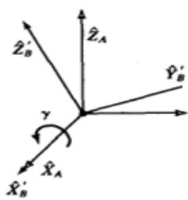

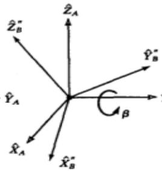

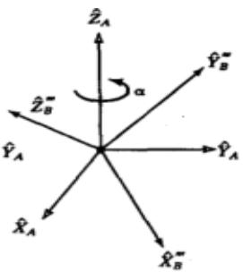  
图 3.1 X\_Y\_Z 固定角坐标系，按照 RX,RY,RZ 的顺序进行旋转

## 3．控制器坐标系旋转实现

```csv
Base(axisx,axisy,axisz)
frame_rotate(x,y,z,rx,ry,rz)
```

(axisx,axisy,axisz) ，填写虚拟轴 xyz 轴。

(x,y,z,rx,ry,rz)，按照计算方法填写正确的参数。

执行后，控制虚拟轴的 xyz 轴，对应的是工件坐标系的 xyz 轴。

需读取点在世界坐标系的位置，可读取 world\_dpos 的值。

## 4．坐标系转换完成

  
图3.2 经平移与旋转的坐标系 B

假设{A}世界坐标系，{B}是工件坐标系，{B}用{A}表示为（X1，Y1，Z1，RX1，RY1，RZ1）

## 进行坐标系转换前：

末端工作点向虚拟轴 X Y Z 方向移动 ,沿坐标系{A}的 X 方向，Y 方向，Z方向运动。虚拟轴的 dpos 表示的是在{A}的位置。WORLD\_DPOS 表示的是在{A}的位置。

## 进行坐标系转换后：

移动虚拟轴 X Y Z ,末端工作点是沿坐标系{B}的 X 方向，Y 方向，Z 方向运动。虚拟轴的dpos 表示的是在{B}的位置。WORLD\_DPOS 表示的是在{A}的位置。

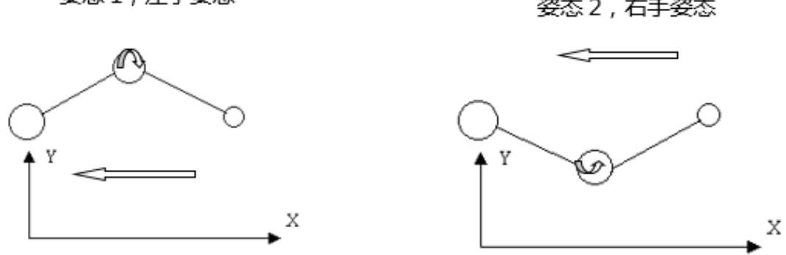

## 二、姿态调整

在逆解模式下运行时，由于机械结构的问题，会产生无法运动到某一位置或刚体干涉的问题，此时就需要进行姿态的调整。

机械手姿态只能在正解模式下操作关节轴进行调整，如 FRAME1 类型 scara机械手，可按下图操作关节轴调整。

姿态1，左手姿态

姿态2，右手姿态

## 三、奇异点规避

机械手结构建立时，需要将机械手先运动到给定的零点位置，某些结构类型的零点位置就是奇异点位置，如 scara 机械手。此时如果直接进行逆解操作的话会导致机台卡死，乱跑等问题产生。

解决方法为先建立正解模式连接，手动调整位置使其处于某个确定姿态，再切换为逆解模式进行操作。

## 四、机械手参数校正

由于机械手整体配件在设计和装配时都会有误差，所以如果按照理论值填写参数必然会产生坐标的偏差，此时就需要使用参数校正功能。

参数校正是机械手关节示教的坐标和特点自动校正零点位置与机械参数，部分机械手类型支持。

## 1．相关指令

FRAME\_CAL

## 2．操作步骤

1) 操作各关节轴运动到类型规定零点位置。

2) 按理论机械手参数建立机械手连接。

3) 控制机械手末端点运动到校正点。

4) 记录关节轴坐标并填入 Table数组。

5) 通过 FRAME\_CAL 指令实现参数校正。

6) 校正出实际零点时的关节轴绝对坐标与机械参数，输出到指令指定的 Table位置。

7) Rapidstop 指令取消机械手模式。

8) 手动运动各关节轴到纠偏输出对应的绝对位置。

9) 手动清 0 关节轴 dpos。

10) 最后使用纠偏输出的 Table 参数重新建立机械手。

## 3．各类型校正参数及过程

## FRAME1scara 及其他变种

## ①Frame\_Cal --小关节偏差

## 校正内容

零点时，小关节轴相对大关节轴的角度偏差。

## 校正要求

1) J1,J2 的长度是正确的。

2) 如果有末端旋转摆动，示教时必须保证末端在正下方，如下图。

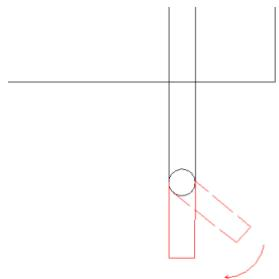

## 校正方法

根据 FRAME\_CAL 指令的 tableaux 参数填写值，有两种情况：

1) Tableaux 对应的 TABLE 填入 0，表示左右手法。左右两个关节姿态下运行到世界坐标系中同一个位置，分别记录左手姿态时的关节轴坐标和右手姿态时的关节轴坐标。

2) Tableaux 对应的 TABLE 填入不为 0，表示单手法，此时必须示教世界坐标系中的两个位置点，记录两点对应的关节坐标（同一姿态）和两点直线距离。此时Tableaux填写值为两点直线距离。必须两个关节坐标都有变动，建议沿X示教固定长度的两点。

## 校正前填写 table 数据

点 1 的关节轴坐标填入与 FRAME\_CAL 指令参数 tablein 一致的 table。

点 2 的关节轴坐标填入 tablein+space 的 table。

根据选择的校正方式，辅助点 Tableaux 填写0 或者非0，非0值为两点间的距离。

## 校正后输出 table 数据

校正后理论零点时关节轴的绝对坐标存储在指令参数 Zerooutz 指定的 table。

校正后实际的机械手参数存储在指令参数 Tableout2 指定的 table。

## 参考例程

使用单手法校正参数。

global const axis\_x = 0   
global const axis\_y = 1   
global const axis\_virx = 6   
global const axis\_viry = 7   
global L1   
global L2   
global RET   
base(axis\_x,axis\_y)   
atype = 1,1   
units = 100,100   
dpos=0,0   
L1 = 300   
L2 = 300   
base(axis\_virx,axis\_viry)

```csv
atype = 0,0,0 '设置为虚拟轴
TABLE(0,L1,L2,36000,36000,36000) '参数存储在 TABLE0 开始的位置，电机一圈 360 个脉冲。
UNITS(6)=1000 '此脉冲当量要提前设置，中途不能变化
UNITS(7)=1000 '此脉冲当量要提前设置，中途不能变化
units(8)=100 '虚拟旋转轴与关节轴 R 一致
base(axis_virx,axis_viry)
CONNREFRAME(1,0,axis_x,axis_y) '启动正解连接。
wait loaded
'假定已经按照校正操作前 3 步骤，记录到了关节坐标
table(300,30,-70) '左手姿态关节轴位置填入 table
table(305,-30,50) '右手姿态关节轴位置填入 table
table(200) = 0 '辅助点，选择左右手方式校正
RET = FRAME_CAL(300,5,2,200,100,150) '开始校正
'FRAME_CAL（tablein，space, groups，tableaux, zeroout, [tableout2]）
'校正的实际 0 点时关节轴绝对坐标存放在 table100，机械手参数存放在 table150
if not ret then
print "FRAMECAL failed"
Else
for i = 0 to 1
print "table",100+i,"= ",table(100 + i)
next
for i = 0 to 4
print "table",150+i,"= ",table(150 + i)
next
RAPIDSTOP(2) '取消机械手连接
wait IDLE
base(axis_X,axis_y)
moveabs(table(100),table(101)) '移动到校正后的 0 点位置
wait IDLE
dpos=0,0 '关节轴当前位置设为 0 点
base(axis_virx,axis_viry)
```

<table><tr><td>CONNREFRAME(1,150,axis_x,axis_y)</td><td>’用校正后的机械手参数重新建立连接。</td></tr><tr><td>wait loaded</td><td></td></tr><tr><td>end if</td><td></td></tr><tr><td>end</td><td></td></tr></table>

## ②FRAME\_CAL -- Scara 臂长参数矫正

<table><tr><td>类型 描述</td><td colspan="2">机械手计算指令 通过机械手按顺序示教四个孔，每示教一个孔需要读取记录一次</td></tr><tr><td rowspan="8">语法</td><td colspan="2">关节脉冲，直到记录完，然后使用该指令计算矫正SCARA臂长 L1和L2,以及小臂关节的零点位置与理论零点的偏差， 在机械手的工作平面上任意位置固定标定板，保证机械手执行末 端圆柱体在行程内可插入标定板任意孔位，其次依次将标定板执</td></tr><tr><td colspan="2">行端圆柱体插入标定板孔位中,示教顺序从A-B-C-D,记录关节 的度数，按间隔分别填到 table(groups) 如图标定板参数说明</td></tr><tr><td colspan="2">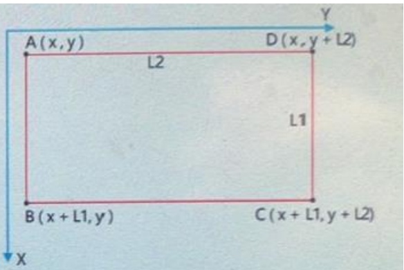</td></tr><tr><td colspan="2"></td></tr><tr><td colspan="2">L1和L2为标定板已知的参数 ABCD示教过程要求换姿态示教，确保每次小臂关节变化大 例如：ABCD-&gt;左右左右或者右左右左</td></tr><tr><td colspan="2">FRAME_CAL(tablein,space,groups,tableaux, zeroout, [tableout2]) tablein：关节坐标存储的 table起始编号，每个点的关节 坐标按顺序存储，多个点之间间隔 space space：每两个点之间间隔的 table 元素</td></tr><tr><td></td><td colspan="2">tableout2：计算出来的机械手参数存储的位置，不填时 直接存储原参数的位置 注： 要求 table(tableaux) = 2</td></tr><tr><td>适用控制器 例子</td><td colspan="2">table(tableaux + 1）= L1 table(tableaux + 2) =L2 LOCAL tablej,tablec,eyemode,tableout,tableout2,i,j tablej = 100</td></tr><tr><td>op(0,1)</td><td colspan="2">tablec = 200 tableout=300 tableout2=400 进入逆解</td></tr><tr><td></td><td colspan="2">TABLE(tablej,-56.08,130.35,0,0, -26.65,56.20,0,0, 21.30,15.08,0,0,3.53,104.67,0,0)</td></tr><tr><td>for i=0 to 3 1),table(tableout + i*4 + 2),table(tableout + i*4 + 3) NEXT ?"大臂长",table(tableout)</td><td colspan="2">table(tablec,2,180,200,0,0) base(0,1,2,3,4,5) ?FRAME_CAL(tablej,4,4,tablec,tableout,tableout2)</td></tr></table>

## ③FRAME\_CAL 坐标系标定

<table><tr><td colspan="1" rowspan="1">类型</td><td colspan="1" rowspan="1">机械手计算指令</td></tr><tr><td colspan="1" rowspan="1">描述</td><td colspan="1" rowspan="1">采用三点法，计算x、y平面下的用户坐标系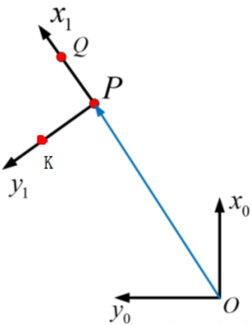第一个点：上图P点，用于原点标定第二个点：上图Q点，用于x+轴标定第三个点：上图K点，用于y+轴标定，此点不要求严格在y+轴上，大致即可。K 点必须在PQ的左侧，否则坐标系不成立，计算异常</td></tr><tr><td colspan="1" rowspan="1">语法</td><td colspan="1" rowspan="1">FRAME_Tool(tablein,space,groups,tableaux, zeroout, [tableout2])tablein：关节坐标存储的 table 起始编号，每个点的关节坐标按顺序存储，多个点之间间隔 spacespace：每两个点之间间隔的 table元素groups:点数tableaux：辅助参数的 table 编号，部分 frame 需要zeroout：计算用户坐标系原点位置和相对机械手基坐标系的角度tableout2：计算出来的机械手参数存储的位置，不填时直接存储原参数的位置注：要求 $\mathrm { t a b l e } ( \mathrm { t a b l e a u x } ) = 5$ </td></tr><tr><td colspan="1" rowspan="1">适用控制器例子</td><td colspan="1" rowspan="1">LOCAL tablej,tablec,eyemode,tableout,tableout2,i,j tablej = 100tablec = 201tableout=300tableout2=400</td></tr><tr><td></td><td>进入逆解 op(0,1) table(tablec,5) '设置3点关节数据 'TABLE(tablej,10.2075,120,-40.2050,2.2337,0,90,0,0) TABLE(tablej,10.2075,120,-40.2050,2.2337,17.6015,109.5725,- 127.17,7.0652,10.2075,120,-40.2050,2.2337) base(0,1,2,3,4,5) ?FRAME_CAL(tablej,4,3,tablec,tableout,tableout2) ?"用户坐标系原点在基座标系的x轴坐标",table(tableout2) ?"用户坐标系原点在基座标系的y轴坐标",table(tableout2 +1) ?"用户坐标系原点在基座标系的z轴坐标",table(tableout2+ 2) ?"用户坐标系在基座标系的Rx 轴坐标",table(tableout2 + 3) ?"用户坐标系在基座标系的Ry 轴坐标",table(tableout2+4) ?"用户坐标系在基座标系的Rz 轴坐标",table(tableout2 + 5)</td></tr></table>

## ④FRAME\_CAL 工具标定

<table><tr><td>类型</td><td>机械手计算指令</td></tr><tr><td>描述</td><td>标定机械手末端工具，返回工具在末端坐标系下的坐标</td></tr><tr><td rowspan="3"></td><td>采用两点法</td></tr><tr><td>用户选定一个在机械手工作空间范围内的点，把机械手示教工具 末端对准该点，记录小臂末端关节坐标，换个姿态或手系，继续</td></tr><tr><td>对准该点，记录小臂末端关节坐标</td></tr><tr><td colspan="1" rowspan="1"></td><td colspan="1" rowspan="1">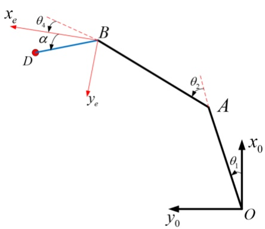最终计算出工具的长度，和工具相对旋转轴零点的角度</td></tr><tr><td colspan="1" rowspan="1">语法</td><td colspan="1" rowspan="1"> FRAME_CAL(tablein,space,groups,tableaux, zeroout, [tableout2])tablein：关节坐标存储的 table起始编号，每个点的关节坐标按顺序存储，多个点之间间隔 spacespace：每两个点之间间隔的 table元素groups：点数tableaux：辅助参数的 table编号，部分 frame 需要zeroout：工具位姿tableout2：计算出来的机械手参数存储的位置，不填时直接存储原参数的位置注：要求 table(tableaux) = 3</td></tr><tr><td colspan="1" rowspan="1">适用控制器例子</td><td colspan="1" rowspan="1">LOCAL tablej,tablec,eyemode,tableout,tableout2,i,jtablej = 100tablec = 201tableout=300tableout2=400进入逆解op(0,1)table(tablec,3)TABLE(tablej,10.2075,120,-40.2050,2.2337,17.6015,109.5725,-127.17,7.0652)base(0,1,2,3,4,5)?FRAME_CAL(tablej,4,2,tablec,tableout,tableout2)</td></tr><tr><td></td><td>?"工具长度",table(tableout) ?"工具相对零点的旋转角度",table(tableout +1) ?"工具末端在机械手末端的 x轴坐标",table(tableout2) ?"工具末端在机械手末端的y 轴坐标",table(tableout2 +1)</td></tr></table>

## ⑤FRAME\_CAL U 型旋转轴标定

<table><tr><td>类型 描述</td><td colspan="2">机械手计算指令</td></tr><tr><td rowspan="2"></td><td>标定机械手末端U型旋转的偏心位置和角度（机械手零点位置机 械手末端至圆心所成直线与X 轴所成夹角。） 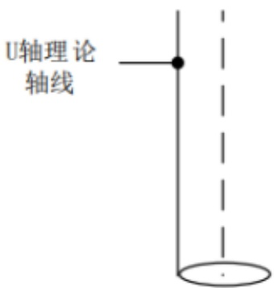</td><td></td></tr><tr><td>a)理论轴线与旋转轴线平行 最终计算出旋转轴旋转一圈的圆心位置和角度 FRAME_CAL(tablein,space,groups,tableaux, zeroout, [tableout2]) table 起始编号，每个点的关节坐标按顺序存储，多个点之间间隔</td><td>tablein：圆上相机采集的mark点的世界坐标坐标存储的</td></tr><tr><td></td><td>space space：每两个点之间间隔的 table元素 groups:点数 tableaux：辅助参数的 table 编号，部分 frame 需要 zeroout:旋转轴旋转一圈的圆心位置和角度的 table 编号 tableout2：计算出来的机械手参数存储的位置，不填时 直接存储原参数的位置 注： 要求 table(tableaux) = 6</td></tr><tr><td>适用控制器 例子</td><td>LOCAL tablej,tablec,eyemode,tableout,tableout2,i.j</td></tr></table>

```csv
tablej = 100
tablec = 201
tableout=300
tableout2=400
'进入逆解
op(0,1)
table(tablec,6)
'设置3点关节数据
TABLE(tablej,360.1170,0.7223,359.5905,5.1943,355.7279,9.246
6,350.9536,10.1093,346.1812,9.1534,342.3643,6.0690,340.6466,1.5
751,341.1974,-3.1836, 343.8594, -7.2663, 348.2902,
-9.7636, 353.3520, -9.0493, 357.7442 , -6.9600,360.5526,
-2.6476 )
base(0,1,2,3,4,5)
?FRAME_CAL(tablej,4,13,tablec,tableout,tableout2)
?"U 轴末端在机械手坐标系下 x 轴坐标",table(tableout)
?"U 轴末端在机械手坐标系下 y 轴坐标",table(tableout + 1)
?"U 轴末端在机械手末端的的角度",table(tableout + 2)
?"U 轴末端在机械手末端的距离",table(tableout + 3)
?"U 轴末端在机械手末端的 x 轴坐标",table(tableout2)
?"U 轴末端在机械手末端的 y 轴坐标",table(tableout2 + 1)
?"U 轴末端在机械手末端的 Rz 轴坐标",table(tableout2 + 5)
```

## FRAME11

## 校正内容

旋转中心实际偏移 CENTERX，CENTERY。

## 校正要求

1) 旋转轴 UNITS 设置为正确的一圈脉冲数。

2) 旋转正向与机械手连接设置方向一致。

## 校正方法

此时 Table（Tableaux）=0，在世界坐标系中同一个位置，对应旋转轴不同的角度, 角度范围大一些。至少记录 3个关节坐标位置，如下图所示。

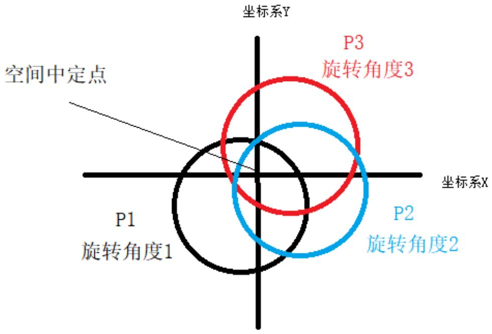

## 校正前填写 table 数据

点 1 关节轴坐标填入编号为 FRAME\_CAL 指令参数 tablein 一致的 table。

点 2 关节轴坐标填入编号为 tablein+space\*1 的 table。

点 3 关节轴坐标填入编号为 tablein+space\*2 的 table。

编号为 Tableaux 的 table，填 0。

## 校正后输出 table 数据

校正后理论零点时关节轴的绝对坐标存储在指令参数 Zerooutz 指定的 table。  
校正后实际的机械手参数存储在指令参数 Tableout2 指定的 table。

## 例程

dim axisx,axisy,axisR '实际关节轴定义  
dim axisx,axisy,axisR '实际关节轴定义  
dim viraxisx,viraxisy'虚拟轴定义  
axisx=0  
axisy=1 ' 实际关节轴编号  
axisR=2  
viraxisx=3 '虚拟轴编号  
viraxisy=4  
dim CENTERX 'x 方向偏移  
dim CENTERY 'y 方向偏移  
dim IfAntiClock '是否为逆时针旋转，逆时针旋转遵循右手法则  
CENTERX=10 '旋转中心偏移  
CENTERY=10  
IfAntiClock=1 '此时为逆时针关系  
dim u\_mx 'x 电机旋转一圈的脉冲  
dim u\_my 'y 电机旋转一圈的脉冲  
dim u\_mR '旋转电机旋转一圈的脉冲  
u\_mx=10000  
u\_my=10000  
u\_mR=10000 '脉冲量赋值  
dim i\_x 'x 电机传动比  
dim i\_y 'y 电机传动比  
dim i\_R '旋转电机传动比  
i\_x=1  
i\_y=1  
i\_R=1 '传动比赋值  
dim u\_jx 'x 关节实际一圈脉冲数  
dim u\_jy 'y 关节实际一圈脉冲数  
dim u\_jR '旋转关节实际一圈脉冲数  
u\_jx=u\_mx\*i\_x  
u\_jy=u\_my\*i\_y  
u\_jR=u\_mR\*i\_R

```csv
dim p_x 'x 螺距
dim p_y 'y 螺距
p_x=2
p_y=2
global RET
'定义关节轴
base(axisx,axisy,axisR)
rapidstop
wait idle '确保所有轴停止运动
units=u_jx/p_x,u_jy/p_y,u_jR/360 'xy 设为 1mm 脉冲数，旋转轴设为 1°脉冲数
atype = 1,1,1 ' 轴功能设置
dpos=0,0,0
creep=10,10,10 '轴回零速度
speed =300,300,300 '移动速度
accel = 1000,1000,1000 '加速度
decel = 500,500,500 '减速度
''''''''''''虚拟轴定义
base(viraxisx,viraxisy)
atype = 0,0 '定义虚拟轴
TABLE(0,CENTERX,CENTERY,u_jR,IfAntiClock ) 'table 表参数
speed=200,200 '虚拟轴运动速度
accel = 300,300 '虚拟轴运动加速度
units=10000,10000
base(viraxisx, viraxisy,axisR)
CONNREFRAME(11,0,axisx,axisy,axisR) '启动正解连接。
wait loaded
'假定已经按照校正操作前 3 步骤，记录到了关节坐标
table(300,0,0,0) '第一个点
table(303,-6,10,-45) '第二个点
table(306,5.2,10.8,45) '第三个点
table(200) = 0 '辅助点
RET = FRAME_CAL(300,3,3,200,100,150) '开始校正
'FRAME_CAL（tablein，space, groups，tableaux, zeroout, [tableout2]）
'校正的实际 0 点时关节轴绝对坐标存放在 table100，机械手参数存放在 table150
```

```matlab
if not ret then
print "FRAMECAL failed"
Else
for i = 0 to 2
print "table",100+i,"= ",table(100 + i)
next
for i = 0 to 3
print "table",150+i,"= ",table(150 + i)
next
RAPIDSTOP(2) '取消机械手连接
wait IDLE
base(axisx,axisy,axisR)
moveabs(table(100),table(101),table(102)) '移动到校正后的 0 点位置
wait IDLE
dpos=0,0 '关节轴当前位置设为 0 点
base(viraxisx, viraxisy,axisR)
CONNREFRAME(11,150,axisx,axisy,axisR) '用校正后的机械手参数重新建立连接。
wait loaded
end if
end
```

## FRAME17/27

## 校正内容

大旋转中心实际偏移CentY1，CentZ1, 小旋转中心实际偏移CentX2，CentY2，大旋转轴零点时的位置。

## 校正要求

1) 旋转轴 UNITS 设置为正确的一圈脉冲数。

2) 旋转正向与机械手连接设置方向一致。

3) 大旋转中心线与 x 水平,小旋转中心线与 z 水平。

## 校正方法

此时 Table（Tableaux）=0，在世界坐标系中同一个位置，对应旋转轴不同的角度, 角度范围大一些。

至少记录 6 个关节坐标, 其中大旋转轴相同角度，小旋转不一样角度下至少3点；小旋转轴相同角度，大旋转不一样角度下至少 3点。

## 校正前填写 table 数据

点 1 关节轴坐标填入编号为 FRAME\_CAL 指令参数 tablein 一致的 table。

点 2 关节轴坐标填入编号为 tablein+space\*1 的 table。

点 3 关节轴坐标填入编号为 tablein+space\*2 的 table。

点 4 关节轴坐标填入编号为 tablein+space\*3 的 table。

点 5 关节轴坐标填入编号为 tablein+space\*4 的 table。

点 6 关节轴坐标填入编号为 tablein+space\*5 的 table。

编号为 Tableaux 的 table，填 0。

## 校正后输出 table 数据

校正后理论零点时关节轴的绝对坐标存储在指令参数 Zerooutz 指定的 table。

校正后实际的机械手参数存储在指令参数 Tableout2 指定的 table。

## 例程

```csv
dim axisx,axisy,axisz,axisr1,axisr2 ''定义实际轴
dim viraxisx,viraxisy,viraxisz ''定义虚拟轴
axisx=0 '''实际轴编号
axisy=1
axisz=2
axisr1=6 ''''旋转轴编号
axisr2=7
viraxisx=3 '''虚拟轴编号
viraxisy=4
viraxisz=5
dim centy1,centz1,centx2,centy2 '旋转中心定义
dim ifanticlock1,ifanticlock2 '是否逆时针
centy1=10 '偏移
centz1=10
centx2=10
centy2=10
ifanticlock1=1 '旋转台 1 逆时针
ifanticlock2=1 '旋转台 2 逆时针
```

```csv
dim u_mx,u_my,u_mz '轴旋转一圈的脉冲
dim u_mr1,u_mr2
u_mx=10000 '旋转轴脉冲参数赋值
u_my=10000
u_mz=10000
u_mr1=10000
u_mr2=10000
dim i_x,i_y,i_z '电机传动比
dim i_r1,i_r2
i_x=2
i_y=2
i_z=2
i_r1=1
i_r2=1
dim u_jx 'x 关节实际一圈脉冲数
dim u_jy 'y 关节实际一圈脉冲数
dim u_jz 'z 关节实际一圈脉冲数
dim u_jr1 '旋转 1 实际一圈脉冲数
dim u_jr2 '旋转 2 实际一圈脉冲数
u_jx=u_mx*i_x
u_jy=u_my*i_y
u_jz=u_mz*i_z
u_jr1=u_mr1*i_r1
u_jr2=u_mr2*i_r2
dim p_x 'x 螺距
dim p_y 'y 螺距
dim p_z 'z 螺距
p_x=2
p_y=2
p_Z=10
dim RET
'''''''''''定义关节轴
BASE(axisx,axisy,axisz) '实际轴定义
ATYPE=1,1,1 '轴运动类型
rapidstop
wait idle '确保所有轴停止运动
UNITS=u_jx/p_x,u_jy/p_y,u_jz/p_z '设置为 1mm 的脉冲数
```

```csv
Dpos=0,0,0
speed=500,500,500
CREEP=20,20,20
ACCEL=1000,1000,1000
DECEL=500,500,500
base(axisr1,axisr2) '旋转轴设置
ATYPE=1,1 '轴运动类型
units =u_jr1/360,u_jr1/360 '设置为 1°的脉冲数
Dpos=0,0
speed=200,200 '末端旋转轴参数设置
accel=300,300
''''''虚拟轴定义
base(viraxisx,viraxisy,viraxisz) '虚拟轴定义
ATYPE=0,0,0
TABLE(0, CentY1, CentZ1,u_jr1, IfAntiClock1, CentX2, CentY2,u_jr2, IfAntiClock2) '''''table
表参数填写
UNITS=1000,1000,1000 '''虚拟轴运动参数赋值
SPEED=300,300,300
ACCEL=500,500,500
BASE(viraxisx,viraxisy,viraxisz,axisr1,axisr2) '选择虚拟轴号
CONNREFRAME(17,0,axisx,axisy,axisz,axisr1,axisr2) '启动正解连接。
WAIT LOADED '等待运动加载。
'BASE(axisx,axisy,axisz,axisr1,axisr2) '选择关节轴号
'CONNFRAME(17,0, viraxisx,viraxisy,viraxisz,axisr1,axisr2) '启动逆解连接。
'WAIT LOADED '等待运动加载，此时会自动调整虚拟轴的位置。
'假定已经按照校正操作前 3 步骤，记录到了关节坐标
table(300,22.929,-15.355,0,0,45)
table(305,50,-10,0,0,90)
table(310,60,40,0,0,180)
table(315,0,10,-4.142,45,0)
table(320,0,20,0,90,0)
table(325,0,0,0,0,0)
table(200) = 0 '辅助点
```

RET = FRAME\_CAL(300,5,6,200,100,150)  
'FRAME\_CAL（tablein，space, groups，tableaux, zeroout, [tableout2]）  
'校正的实际 0 点时关节轴绝对坐标存放在 table100，机械手参数存放在 table150 位置  
if not ret then  
print "FRAMECAL failed"  
Else  
for i = 0 to 4  
print "table",100+i,"= ",table(100 + i)  
next  
for i = 0 to 7  
print "table",150+i,"= ",table(150 + i)  
next  
RAPIDSTOP(2) '取消机械手连接  
wait IDLE  
BASE(axisx,axisy,axisz,axisr1,axisr2)  
moveabs(table(100),table(101),table(102),table(103),table(104)) '移动到校正后的 0 点位  
置  
wait IDLE  
dpos=0,0 '关节轴当前位置设为 0 点  
BASE(viraxisx,viraxisy,viraxisz,axisr1,axisr2) '选择虚拟轴号  
CONNREFRAME(17,150,axisx,axisy,axisz,axisr1,axisr2) '启动正解连接。  
WAIT LOADED  
end if  
end

## FRAME101,105

## 校正内容

LW 长度，LVWX, LVWY 偏移，零点时 vw 的偏差。

大小关节的零位偏移需要先设置为 FRAME1 校正。

## 校正要求

1) 大小关节的零位已校正。

2) J1,J2 的长度是正确的。

## 校正方法

此时 Table（Tableaux）=0，通过不同的关节坐标，运动到世界坐标系中同一个位置。至少记录 5个关节坐标位置，如下图所示。

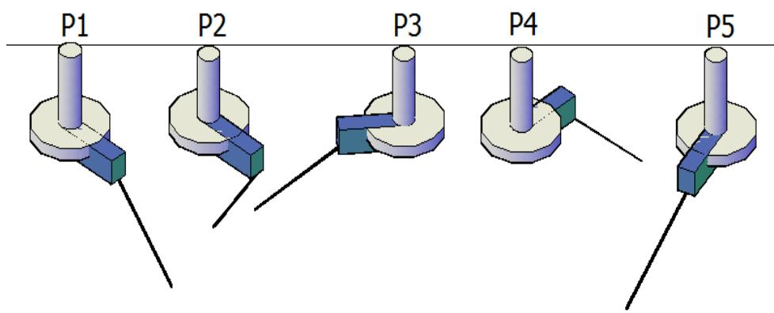

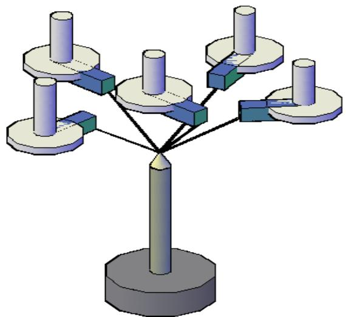

P1\~P3 :在世界坐标系中 x y z位置相同，末端旋转轴 v角度相同，摆动轴 w角度不相同的点，至少记录三个。

P4\~P5 :在世界坐标系中 x y z 位置相同，摆动轴 w角度相同（不能为 0），末端旋转轴角度不相同的点，至少记录两个。

## 校正前填写 table 数据

点 1 关节轴坐标填入编号为 FRAME\_CAL 指令参数 tablein 一致的 table。

点 2 关节轴坐标填入编号为 tablein+space\*1 的 table。

点 3 关节轴坐标填入编号为 tablein+space\*2 的 table。

点 4 关节轴坐标填入编号为 tablein+space\*3 的 table。

点 5 关节轴坐标填入编号为 tablein+space\*4 的 table。

编号为 Tableaux 的 table，填 0。

## 校正后输出 table 数据

校正后理论零点时关节轴的绝对坐标存储在指令参数 Zerooutz 指定的 table。  
校正后实际的机械手参数存储在指令参数 Tableout2 指定的 table。

## 例程

'''''电机、机械手参数定义  
dim L1 '大臂长度  
dim L2 '小臂长度  
dim LW '摆动半径  
dim Lvwx '末端 x 偏移  
dim Lvwy '末端 y 偏移  
L1=50  
L2=80  
LW=10  
Lvwx=5  
Lvwy=5  
dim u\_m1 '电机 1 一圈脉冲数  
dim u\_m2 '电机 2 一圈脉冲数  
dim u\_mz '电机 z 一圈脉冲数  
dim u\_mv '旋转电机 v 一圈脉冲数  
dim u\_mw '摆动电机 w 一圈脉冲数  
u\_m1=3600  
u\_m2=3600  
u\_mz=3600  
u\_mv=3600  
u\_mw=3600  
dim i\_1 '关节 1 传动比  
dim i\_2 '关节 2 传动比  
dim i\_z '关节 z 传动比  
dim i\_v '关节 v 传动比  
dim i\_w '关节 w 传动比  
i\_1=2  
i\_2=2  
i\_z=2  
i\_v=2  
i\_w=2  
dim u\_j1 '关节 1 实际一圈脉冲数

```csv
dim u_j2 '关节 2 实际一圈脉冲数
dim u_jz '关节 z 实际一圈脉冲数
dim u_jv '关节 v 实际一圈脉冲数
dim u_jw '关节 w 实际一圈脉冲数
u_j1=u_m1*i_1
u_j2=u_m2*i_2
u_jz=u_mz*i_z
u_jv=u_mv*i_v
u_jw=u_mw*i_w
dim p_z 'z 轴螺距
p_z=10
''''''''关节轴设置
base(0,1,2,3,4) '选择关节轴 0,1 实际轴
rapidstop '停止原来可能的运动
atype = 1,1,1,1,1 '轴类型为脉冲数
units=u_j1/360,u_j2/360,u_jz/p_z,u_jv/360,u_jw/360 'z 轴把 units 设为每 mm 的脉冲数，其他轴设
为每°脉冲数
speed =300,300,300,300,300 '速度参数设置
accel = 1000,1000,1000,1000,1000 '设置关节轴的加速度限制
decel = 500,500,500,500,500 '设置关节轴的减速度
clutch_rate =0,0,0,0,0 '使用关节轴的速度和加速度限制
DPOS=0,0,0,0,0 '先手动调整位置，再坐标清零
'''''''''虚拟轴设置
base(6,7,8,9)
atype = 0,0,0,0,0 '设置为虚拟轴
TABLE(0,L1,L2,u_j1,u_j2,u_jv,Lw,u_jw,Lvwx,Lvwy) '填写参数
UNITS = 1000,1000,1000,u_jv/360 '提前设置，中途不能变化,末端两个旋转轴保证 units 与
关节轴一致
merge = on '打开连续插补
CORNER_MODE =2 '启动拐角减速
DECEL_ANGLE = 15 * (PI/180) '开始减速的角度 15 度
STOP_ANGLE = 45 * (PI/180) '降到最低速度的角度 45 度
'''建立机械手连接
BASE(6,7,8,9,4)
CONNREFRAME(101,0,0,1,2,3,4) '启动正解连接
wait loaded
?"正解模式"
```

```csv
'假定已经按照校正操作前 3 步骤，记录到了关节坐标
table(300,-14.35, 89.25, 4.3958,-64.85 ,-20)
table(305,-13.6, 87.35, 3.6597, -63.8, -30)
table(310,-16.35, 94, 4.9611, -67.6, 5)
table(315,-14.45, 93.65 ,4.9611, -89.15, 5)
table(320,-17.45,96.7, 4.398, -69.25, 20)
table(200) = 0 '辅助点
RET = FRAME_CAL(300,5,5,200,100,150)
'FRAME_CAL（tablein，space, groups，tableaux, zeroout, [tableout2]）
'校正的实际 0 点时关节轴绝对坐标存放在 table100，机械手参数存放在 table150
if not ret then
print "FRAMECAL failed"
else
for i = 0 to 10
print "table",100+i,"= ",table(100 + i) '打印零点时关节轴绝对坐标
next
for i = 0 to 10
print "table",150+i,"= ",table(150 + i) '打印实际机械手参数
next
RAPIDSTOP(2) '取消机械手连接
wait idle
BASE(6,7,8,9,4)
moveabs(table(100),table(101),table(102),table(103),table(104)) '移动到校正后的 0
点位置
wait IDLE
dpos=0,0,0,0,0 '关节轴当前位置设为 0 点
base(6,7,8,9,4)
CONNREFRAME(101,150,0,1,2,3,4) '用校正后的机械手参数重新建立连接。
wait loaded
end if
end
```

## FRAME100,104

分为四轴模式与五轴模式两种情况。

## 四轴模式

## 校正内容

LVWX, LVWY 的偏移。

## 校正方法

此时 Table（Tableaux）=0，通过不同的关节坐标，运动到世界坐标系中同一个位置。至少记录 3个关节坐标位置，如下图所示。

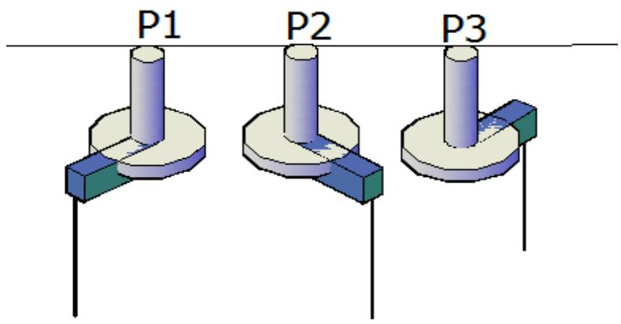

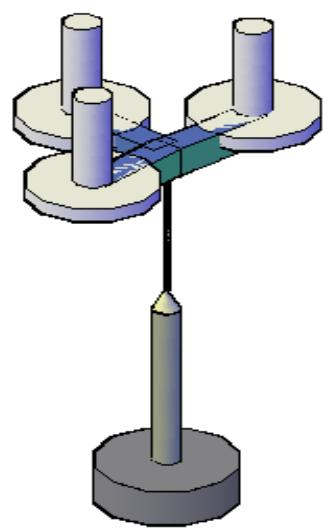

P1\~P3：在世界坐标系中 x y z 位置相同，末端旋转轴 v 角度不相同的点，至少记录三个。

## 校正前填写 table 数据

点 1 关节轴坐标填入编号为 FRAME\_CAL 指令参数 tablein 一致的 table。

点 2 关节轴坐标填入编号为 tablein+space\*1 的 table。

点 3 关节轴坐标填入编号为 tablein+space\*2 的 table。

编号为 Tableaux 的 table，填 0。

## 校正后输出 table 数据

校正后理论零点时关节轴的绝对坐标存储在指令参数 Zerooutz 指定的 table。  
校正后实际的机械手参数存储在指令参数 Tableout2 指定的table。

## 五轴模式

## 校正内容

LW 长度，LVWX, LVWY 偏移，零点时 vw 的偏差。

## 校正方法

此时 Table（Tableaux）=0，通过不同的关节坐标，运动到世界坐标系中同一个位置。至少记录 5个关节坐标位置，如下图所示。

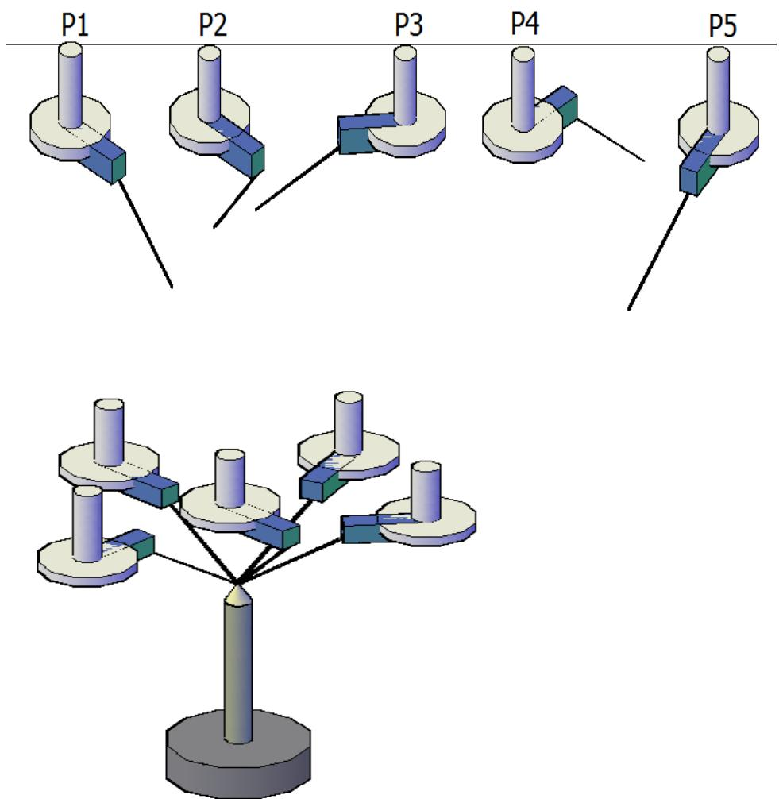  
P1\~P3 :在世界坐标系中 x y z 位置相同，末端旋转轴 v 角度相同，摆动轴 w

角度不相同的点，至少记录三个。

P4\~P5 :在世界坐标系中 x y z 位置相同，摆动轴 w角度相同（不能为 0），末端旋转轴角度不相同的点，至少记录两个。

## 校正前填写 table 数据

点 1 关节轴坐标填入编号为 FRAME\_CAL 指令参数 tablein 一致的 table。

点 2 关节轴坐标填入编号为 tablein+space\*1 的 table。

点 3 关节轴坐标填入编号为 tablein+space\*2 的 table。

点 4 关节轴坐标填入编号为 tablein+space\*3 的 table。

点 5 关节轴坐标填入编号为 tablein+space\*4 的 table。

编号为 Tableaux 的 table，填 0。

## 校正后输出 table数据

校正后理论零点时关节轴的绝对坐标存储在指令参数 Zerooutz 指定的 table。

校正后实际的机械手参数存储在指令参数 Tableout2 指定的 table。

## 例程

global const axis\_x = 0   
global const axis\_y = 1   
global const axis\_z = 2   
global const axis\_v = 3   
global const axis\_w = 4   
global const axis\_virx = 6   
global const axis\_viry = 7   
global const axis\_virz = 8   
global const axis\_virv = 9   
local lw   
local lwx   
local lwy   
lw = 20   
lwx = 10   
lwy = 10   
for i = 0 to 400   
table(i) = 0   
next   
base(axis\_x,axis\_y,axis\_z,axis\_v,axis\_w)

```csv
atype = 1,1,1,1,1
units = 100,100,100,100,100
base(axis_virx,axis_viry,axis_virz)
atype = 0,0,0 '设置为虚拟轴
TABLE(0,lw,3600,3600,lwx,lwy) '参数存储在 TABLE0 开始的位置，电机一圈 360 个脉冲。
UNITS(6)=1000 '此脉冲当量要提前设置，中途不能变化
UNITS(7)=1000 '此脉冲当量要提前设置，中途不能变化
units(8)=1000 '虚拟旋转轴与关节轴 R 一致
base(axis_virx,axis_viry,axis_virz,axis_v,axis_w)
CONNREFRAME(100,0,axis_x,axis_y,axis_z,axis_v,axis_w) '启动正解连接
wait loaded
'假定已经按照校正操作前 3 步骤，记录到了关节坐标
table(300,21.5800, 1.8800, 0.0000 ,10.0000 ,0.0000 )
table(305,0, 0, 0.0000, 0, 0.0000 )
table(310,13.6600, -3.6600, 0.0000, 6.0000, 0.0000)
table(315,-15.3200, 0.0000 ,-7.1400, 0.0000, 5.0000)
table(320,-19.6900,0.0000, -23.4700, 0.0000, 10.0000)
table(200) = 0 '辅助点
RET = FRAME_CAL(300,5,5,200,100,150)
'FRAME_CAL（tablein，space, groups，tableaux, zeroout, [tableout2]）
if not ret then
print "FRAMECAL failed"
else
for i = 0 to 10
print "table",100+i,"= ",table(100 + i)
next
for i = 0 to 10
print "table",150+i,"= ",table(150 + i)
next
RAPIDSTOP(2) '取消机械手连接
wait idle
```

```matlab
BASE(6,7,8,9,4)
moveabs(table(100),table(101),table(102),table(103),table(104)) '移动到校正后的 0
点位置
wait IDLE
dpos=0,0,0,0,0 '关节轴当前位置设为 0 点
base(axis_virx,axis_viry,axis_virz,axis_v,axis_w)
CONNREFRAME(100,150,axis_x,axis_y,axis_z,axis_v,axis_w) '用校正后的机械手参数
重新建立连接。
wait loaded
end if
end
```

## FRAME6

## 校正内容

根据校正点的不同，校正不同参数。

4 点法--P1\~P4，只计算末端的 SmallZ Small X, Small Y 偏移。

5 点法--P1\~P5，P5 的末端认为是垂直的，以此计算 InitRx, InitRy, InitRz。

6 点法--P1\~P6，P5 的末端认为是垂直的，P5\~P6 之间认为是 X 方向，以此计算 InitRx, InitRy, InitRz。

## 校正方法

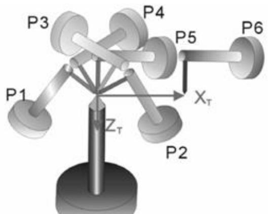  
校正前填写 table 数据

点 1 关节轴坐标填入编号为 FRAME\_CAL 指令参数 tablein 一致的 table。

点 2 关节轴坐标填入编号为 tablein+space\*1 的 table。

点 3 关节轴坐标填入编号为 tablein+space\*2 的 table。

点 4 关节轴坐标填入编号为 tablein+space\*3 的 table。

点 5 关节轴坐标填入编号为 tablein+space\*4 的 table。

点 6 关节轴坐标填入编号为 tablein+space\*5 的 table。

编号为 Tableaux 的 table，填 0。

## 校正后输出 table 数据

校正后理论零点时关节轴的绝对坐标存储在指令参数 Zerooutz 指定的 table。  
校正后实际的机械手参数存储在指令参数 Tableout2 指定的table。

## 例程

<table><tr><td>rapidstop(2)</td></tr><tr><td>dim p1(6) dim p2(6)</td></tr><tr><td>dim p3(6)</td></tr><tr><td>dim p4(6)</td></tr><tr><td>dim p5(6)</td></tr><tr><td>dim p6(6)</td></tr><tr><td>dim j dim i</td></tr><tr><td>.电机、机械手参数定义</td></tr><tr><td>dim L1 &#x27;大臂长度</td></tr><tr><td>dim L2 &#x27;小臂长度</td></tr><tr><td>dim L3 &#x27;X方向偏移</td></tr><tr><td>dim ZDis &#x27;旋转轴一圈，z轴移动距离</td></tr><tr><td>L1=100</td></tr><tr><td>L2=100 L3=0</td></tr><tr><td>ZDis=0</td></tr><tr><td>.电机、机械手参数定义</td></tr><tr><td>dim LargeZ &#x27;基座的垂直高度</td></tr><tr><td>dim L1 &#x27;1轴到2轴的X偏移；转盘中心到大摆臂中心的偏移。</td></tr><tr><td>dim L2 &#x27;大摆臂长度</td></tr><tr><td>dim L3 &#x27;3 轴中心到4轴中心距离</td></tr><tr><td>dim L4 &#x27;4轴到5轴的距离。</td></tr><tr><td>dim D5 &#x27;5 转一圈，6转动的圈数，0表示不关联。</td></tr><tr><td>dim PulesVROneCircle‘虚拟姿态轴一圈脉冲数</td></tr><tr><td>dim SmallZ &#x27;末端到5轴的垂直距离</td></tr><tr><td></td></tr><tr><td>dim SmallX, SmallY &#x27;末端到转盘中心的XY 偏移。0位置的时候</td></tr><tr><td>dim InitRx,InitRy, InitRz &#x27;初始的姿态，焊枪针头的方向。0，0，0指向z</td></tr></table>

正向  
LargeZ=50  
L1=0  
L2=100  
L3=0  
l4=60  
D5=0  
SmallZ=10  
SmallX=0  
SmallY=0  
InitRx=0  
InitRy=0  
InitRz=0  
PulesVROneCircle=360\*10000  
dim u\_m1 '电机 1 一圈脉冲数  
dim u\_m2 '电机 2 一圈脉冲数  
dim u\_m3 '电机 3 一圈脉冲数  
dim u\_m4 '电机 4 一圈脉冲数  
dim u\_m5 '电机 5 一圈脉冲数  
dim u\_m6 '电机 6 一圈脉冲数  
u\_m1=360000  
u\_m2=360000  
u\_m3=360000  
u\_m4=360000  
u\_m5=360000  
u\_m6=360000  
dim i\_1 '关节 1 传动比  
dim i\_2 '关节 2 传动比  
dim i\_3 '关节 3 传动比  
dim i\_4 '关节 4 传动比  
dim i\_5 '关节 5 传动比  
dim i\_6 '关节 6 传动比  
i\_1=1  
i\_2=1  
i\_3=1  
i\_4=1  
i\_5=1  
i\_6=1  
dim u\_j1 '关节 1 实际一圈脉冲数

```csv
dim u_j2 '关节2实际一圈脉冲数
dim u_j3 '关节 3 实际一圈脉冲数
dim u_j4 '关节 4 实际一圈脉冲数
dim u_j5 '关节 5 实际一圈脉冲数
dim u_j6 '关节6实际一圈脉冲数
u_j1=u_m1*i_1
u_j2=u_m2*i_2
u_j3=u_m3*i_3
u_j4=u_m4*i_4
u_j5=u_m5*i_5
u_j6=u_m6*i_6
'''''关节轴设置
BASE(0,1,2,3,4,5) '选择关节轴号 0、1、2、3、4、5
atype=1,1,1,1,1,1 '轴类型设为脉冲轴
UNITS = u_j1/360,u_j2/360,u_j3/360,u_j4/360,u_j5/360 ,u_j6/360 '把 units
设成每°脉冲数
DPOS=0,0,0,0,0,0 '设置关节轴的位置，此处要根据实际
情况来修改。
speed=100,100,100,100,100,100 '速度参数设置
accel=1000,1000,1000,1000,1000,1000
decel=1000,1000,1000,1000,1000,1000
CLUTCH_RATE=0,0,0,0,0,0 '使用关节轴的速度和加速度限制
merge=on '开启连续插补
corner_mode = 2 '启动拐角减速
decel_angle = 15 * (PI/180) '开始减速的角度 15 度
stop_angle = 45 * (PI/180) '降到最低速度的角度 45度
'''''''''''''''''''''虚拟轴设置'''''''''''''''''''''
BASE(6,7,8,9,10,11)
ATYPE=0,0,0,0,0,0 '设置为虚拟轴
TABLE(0,LargeZ,L1,L2,L3,L4,D5,u_j1,u_j2,u_j3,u_j4,u_j5,u_j6,PulesVROneCi
rcle,SmallX,SmallY,SmallZ,InitRx,InitRy,InitRz) '根据手册说明填写参数
UNITS=10000,10000,10000,10000,10000,10000 '运动精度，要提前设置，中
途不能变化
'''''''''''''''''''''建立机械手连接'''''''''''''''''''''
funtorobt
'''''''''''''''''''''正确遇到并取点信息''''''''''''''''
```

```vba
'p1 点
base(6,7,8,9,10,11)
moveabs(50,20,100,0,-60,-30)
wait idle
savejdpos
'p2 点
moveabs(50,20,100,0,60,0)
wait idle
savejdpos
'p3 点
moveabs(50,20,100,0,-60,0)
wait idle
savejdpos
'p4 点
moveabs(50,20,100,0,60,30)
wait idle
savejdpos
'p5 点
moveabs(50,20,100,0,180,0)
wait idle
savejdpos
'p6 点
moveabs(60,20,100,0,180,0)
wait idle
savejdpos
for i=0 to 5
print "table(",350+i,")="table(350+i)
print "table(",360+i,")="table(360+i)
print "table(",370+i,")="table(370+i)
print "table(",380+i,")="table(380+i)
print "table(",390+i,")="table(390+i)
print "table(",400+i,")="table(400+i)
next
table(300)=0
base(0)
```

Frame\_cal(350,10,6,300,420,450)   
for k=0 to 19   
print "table(",450+k,")="table(450+k)   
next k   
for k=0 to 19   
print "table(",420+k,")="table(420+k)   
next k   
end   
global sub funtorobt()   
BASE(0,1,2,3,4,5) '选择关节轴号   
CONNFRAME(6,0,6,7,8,9,10,11) '启动逆解连接。   
WAIT LOADED '等待运动加载，此时会自动调整虚拟轴的位   
置。   
?"逆解模式"   
end sub   
global sub savejdpos()   
for i=0 to 5   
table(350+i+10\*j)=dpos(i)   
next   
j=j+1   
delay(10)   
end sub

## 五、关节轴插补

关节插补运动是机械手在正解模式下，控制末端点走直线、圆弧等插补运动。

相关指令：

MOVER\_L 直线插补  
MOVER\_C 平面圆弧插补  
MOVER\_C3 空间圆弧插补

正解模式下直接用 MOVE 指令操作关节轴，即使角度计算正确，末端工作点走出的轨迹也不能保证为直线。而 MOVER\_L 指令操作关节轴，可以保证运动的轨迹为准确的直线。

使用 MOVER\_L 等指令不支持运动中脉冲叠加。

## 六、逆解模式速度参考设置

逆解运动模式是指机械手逆解运动时，参考关节轴速度参数，还是参考虚拟轴的速度参数。

逆解运动模式通过设置关节轴指令 clutch\_rate 实现，控制器默认 clutch\_rate为 1000000。

<table><tr><td rowspan=1 colspan=1>关节轴的clutch_rate</td><td rowspan=1 colspan=1>运动模式描述：</td></tr><tr><td rowspan=1 colspan=1>0</td><td rowspan=1 colspan=1>平滑模式：此模式下关节轴使用自己的速度加速度做速度规划，速度平滑，但只能保证运动终点位置正确，中间运动轨迹会有变形。</td></tr><tr><td rowspan=1 colspan=1>非0</td><td rowspan=1 colspan=1>强制模式：此模式下关节轴完全按照虚拟轴的速度加速度进行规划，保证运动轨迹准确，但高速时可能会产生抖动。</td></tr></table>

机械手保证结束点的位置准确的前提下，根据实际应用对运动过程的轨迹准确与速度平滑之间做取舍。

举例说明

'''''电机、机械手参数定义  
dim L1 '大臂长度  
dim L2 '小臂长度  
dim L3 'X方向偏移  
dim ZDis '旋转轴一圈，z 轴移动距离  
L1=100  
L2=100  
L3=0  
ZDis=0  
dim u\_m1 '电机1 一圈脉冲数  
dim u\_m2 '电机2 一圈脉冲数  
dim u\_mz '电机z一圈脉冲数  
dim u\_mv '电机v 一圈脉冲数  
u\_m1=3600  
u\_m2=3600  
u\_mz=3600  
u\_mv=3600  
dim i\_1 '关节 1 传动比  
dim i\_2 '关节2 传动比

dim i\_z '关节 z 传动比  
dim i\_v '关节 v 传动比  
i\_1=2  
i\_2=2  
i\_z=2  
i\_v=2  
dim u\_j1 '关节 1 实际一圈脉冲数  
dim u\_j2 '关节 2 实际一圈脉冲数  
dim u\_jz '关节 z 实际一圈脉冲数  
dim u\_jv '关节 v 实际一圈脉冲数  
u\_j1=u\_m1\*i\_1  
u\_j2=u\_m2\*i\_2  
u\_jz=u\_mz\*i\_z  
u\_jv=u\_mv\*i\_v  
dim p\_z 'z 轴螺距  
p\_z=1.5  
'''''关节轴设置  
BASE(0,1,2,3) '选择关节轴号  
atype=1,1,1,1 '轴类型设为脉冲轴  
UNITS=u\_j1/360,u\_j2/360,u\_jv/360,u\_jz/p\_z '把 z 轴 units 设成 1mm 的脉冲数  
DPOS=0,0,0,0 '设置关节轴的位置，此处要根据实际情况来修改。  
speed=100,100,500,1000 '速度参数设置  
accel=2000,2000,5000,5000  
decel=2000,2000,5000,5000  
CLUTCH\_RATE=0'使用关节轴的速度和加速度限制  
merge=on  
corner\_mode=2  
DECEL\_ANGLE = 15 \* (PI/180) '设置开始减速角度  
STOP\_ANGLE = 45 \* (PI/180) '设置结束减速角度  
FORCE\_SPEED=10  
'''''虚拟轴设置  
BASE(6,7,8,9)  
ATYPE=0,0,0,0 '设置为虚拟轴  
TABLE(0,L1,L2,u\_j1,u\_j2,u\_jv, L3,ZDis) '根据手册说明填写参数  
UNITS=1000,1000 ,u\_jv/360,1000 '运动精度，要提前设置，中途不  
能变化  
speed=1000,1000,500,1000 '速度参数设置

<table><tr><td>accel=5000,5000,5000,5000 decel=5000,5000,500,5000</td><td></td></tr><tr><td>merge=on</td><td></td></tr><tr><td>corner_mode=2</td><td></td></tr><tr><td>DECEL_ANGLE = 15 * (PI/180)</td><td>&#x27;设置开始减速角度</td></tr><tr><td>STOP_ANGLE = 45 * (PI/180)</td><td>&#x27;设置结束减速角度</td></tr><tr><td>FORCE_SPEED=50</td><td></td></tr><tr><td>BASE(0,1,2,3)</td><td>&#x27;选择关节轴号</td></tr><tr><td>CONNFRAME(1,0,6,7,8,9)</td><td>&#x27;第 6/7轴作为虚拟的XY轴，启动逆解连接。</td></tr><tr><td>WAITLOADED</td><td>&#x27;等待运动加载，此时会自动调整虚拟轴的位置。</td></tr><tr><td></td><td></td></tr><tr><td>TRIGGER</td><td></td></tr><tr><td>delay(10)</td><td></td></tr><tr><td>base(6,7)</td><td></td></tr><tr><td>moveabs(50,150)</td><td></td></tr><tr><td>wait loaded</td><td></td></tr><tr><td></td><td></td></tr><tr><td></td><td></td></tr><tr><td>end</td><td></td></tr></table>

## CLUTCH\_RATE=0 情况：

关节轴以自己的加速度做规划。

<table><tr><td rowspan=1 colspan=1>1MSPEED[0)</td><td rowspan=1 colspan=1></td><td rowspan=1 colspan=1>Min:-135.15</td><td rowspan=1 colspan=1>Max:103.80</td><td rowspan=1 colspan=1></td></tr><tr><td rowspan=1 colspan=1>2 MSPEED[1]3 MSPEED[6]4 MSPEED[7]</td><td rowspan=1 colspan=1></td><td rowspan=1 colspan=1>Min:0.00Min:-707.11Min:0.00</td><td rowspan=1 colspan=1>Max:121.90Max:0.00Max:707.11</td><td rowspan=1 colspan=1></td></tr><tr><td rowspan=1 colspan=1></td><td rowspan=1 colspan=1></td><td rowspan=1 colspan=1></td><td rowspan=1 colspan=1></td><td rowspan=1 colspan=1></td></tr><tr><td rowspan=1 colspan=1></td><td rowspan=1 colspan=1>2</td><td rowspan=1 colspan=1></td><td rowspan=1 colspan=1>600</td><td rowspan=1 colspan=1>800</td></tr><tr><td rowspan=1 colspan=1></td><td rowspan=1 colspan=1></td><td rowspan=1 colspan=1></td><td rowspan=1 colspan=1></td><td rowspan=1 colspan=1></td></tr></table>

CLUTCH\_RATE=1000000 情况：  
关节轴完全按照虚拟轴的速度自动进行规划。


比较两种情况 mspeed(0)、mspeed(1)的变化曲线：

CLUTCH\_RATE=0，其关节轴的最大加减速，不超过设置的加减速度；CLUTCH\_RATE<>0，关节轴的加减速超过设置的加减速度，当前的情况关节轴的最大加减速度默认为是无穷大。

## 七、拐角处理

如果运动轨迹中间有拐角，在高速运动时，其拐角处会有速度的突变，机械会有抖动。所以需要进行拐角处理（在对轨迹要求不高的情况下）。

拐角处理：

使用 CORNER\_MODE 指令设置拐角减速+自动小圆限速+自动倒角。

Base(axis)   
CORNER\_MODE=2+8+32 '启动拐角减速   
DECEL\_ANGLE = 15 \* (PI/180) '设置开始减速角度   
STOP\_ANGLE = 45 \* (PI/180) '设置结束减速角度   
FORCE\_SPEED=20 '小圆限速   
FULL\_SP\_RADIUS=5 '限速半径 60   
CORNER\_MODE=32 '启动倒角   
ZSMOOTH = 5 '倒角参考半径

拐角处理前轨迹


拐角处理后轨迹


## 第六章 各类型机械手使用具体说明

## 控制器使用步骤说明

各类型机械手使用操作的步骤都是相同的，参考以下步骤。每个步骤对应查看各类型中的对应小节。

1) 确认电机转向是否正确。>>查看电机方向说明

2) 确认机械手各关节轴对应到控制器指令参数的轴次序。>>查看轴顺序

3) Table 中设置好机械结构相关参数。>>查看结构参数

4) 设置关节轴参数及虚拟轴参数。>>查看电机参数

5) 移动各关节轴到规定的零点位置。>>查看零点位置

6) 使用 CONNREFARME 指令建立正解模式。>>查看建立连接

7) 操作关节轴调整机械手姿态，确认在运动中不会发生干涉(某些结构只有一个姿态)。>>查看姿态说明

8) 使用 CONNFARME 指令切换为逆解模式。

9) 选择虚拟轴，发送运动指令使用。

机械手建立完整程序查看使用例程，仿真时可用 ZRobotView 机械手模型仿真工具查看实时运动轨迹。

# Scara 水平关节类

## FRAME1--标准 SCARA

## 结构示意图

Scara 是水平多关节机械手臂（Selective Compliance Assembly Robot Arm），是一种特殊组态的机械手臂，如下图所示。

  
支持 2-4 轴，大关节轴+小关节轴 [+Z 轴] [+末端旋转轴]。

## 电机方向及角度范围

定义各关节电机正向如下图蓝色箭头所示。


<table><tr><td rowspan=1 colspan=1>小关节轴</td><td rowspan=1 colspan=1>（-2π，2π）</td></tr><tr><td rowspan=1 colspan=1>末端旋转轴</td><td rowspan=1 colspan=1>无限制</td></tr><tr><td rowspan=1 colspan=1>上下伸缩轴</td><td rowspan=1 colspan=1>机械结构限制</td></tr></table>

## 轴顺序

<table><tr><td rowspan=1 colspan=1>实际机械手关节轴：</td><td rowspan=1 colspan=1>定义简写：</td></tr><tr><td rowspan=1 colspan=1>大关节轴电机</td><td rowspan=1 colspan=1>Axis_a</td></tr><tr><td rowspan=1 colspan=1>小关节轴电机</td><td rowspan=1 colspan=1>Axis_b</td></tr><tr><td rowspan=1 colspan=1>末端旋转轴电机</td><td rowspan=1 colspan=1>Axis_c</td></tr><tr><td rowspan=1 colspan=1>上下伸缩轴电机</td><td rowspan=1 colspan=1>Axis_d</td></tr></table>

<table><tr><td rowspan=1 colspan=1>直角坐标系虚拟轴：</td><td rowspan=1 colspan=1>定义简写：</td></tr><tr><td rowspan=1 colspan=1>平移轴X</td><td rowspan=1 colspan=1>Viraxis_x</td></tr><tr><td rowspan=1 colspan=1>平移轴Y</td><td rowspan=1 colspan=1>Viraxis_y</td></tr><tr><td rowspan=1 colspan=1>旋转轴RZ</td><td rowspan=1 colspan=1>Viraxis_V</td></tr><tr><td rowspan=1 colspan=1>平移轴Z</td><td rowspan=1 colspan=1>Viraxis_z</td></tr></table>

## 指令规定轴号填写次序如下：

逆解时：

<table><tr><td>BASE(Axis_a,Axis_b[,Axis_c][,Axis_d])</td></tr><tr><td>CONNFRAME(1,tablenum, Viraxis_x, Viraxis_y, [Viraxis_v] [,Viraxis_z])</td></tr></table>

正解时：

<table><tr><td>BASE(Viraxis_x, Viraxis_y,[Viraxis_v] [,Viraxis_z])</td></tr><tr><td>CONNREFRAME(1,tablenum,Axis_a,Axis_b[, Axis_c][,Axis_d])</td></tr><tr><td></td></tr></table>

## 结构参数设置

建立机械手连接时，需要将机械结构参数依次填写到 table 数组中，参数说明如下。

<table><tr><td colspan="2" rowspan="1">TABLE(tablenum, L1,L2, Pules1OneCircle, Pules2OneCircle,[Pules3OneCircle,L3][,ZDis])</td></tr><tr><td colspan="1" rowspan="1">Tablenum</td><td colspan="1" rowspan="1">存储转换参数的TABLE地址</td></tr><tr><td colspan="1" rowspan="1">L1</td><td colspan="1" rowspan="1">大关节轴旋转中心到小关节轴旋转中心的距离</td></tr><tr><td colspan="1" rowspan="1">L2</td><td colspan="1" rowspan="1">小关节轴旋转中心到末端旋转轴的旋转中心距离</td></tr><tr><td colspan="1" rowspan="1">Pules 1OneCircle</td><td colspan="1" rowspan="1">大关节旋转一圈的脉冲数</td></tr><tr><td colspan="1" rowspan="1">Pules2OneCircle</td><td colspan="1" rowspan="1">小关节旋转一圈的脉冲数</td></tr><tr><td colspan="1" rowspan="1">Pules3OneCircle</td><td colspan="1" rowspan="1">末端旋转轴旋转一圈的脉冲数</td></tr><tr><td colspan="1" rowspan="1">L3</td><td colspan="1" rowspan="1">末端旋转轴旋转中心到末端工作点的距离</td></tr><tr><td colspan="1" rowspan="1">ZDis</td><td colspan="1" rowspan="1">末端旋转轴旋转一圈，伸缩轴移动的距离</td></tr></table>


## 电机参数设置

各轴的轴类型和脉冲当量要设置正确。

一个机械手的所有虚拟轴和关节轴的长度单位要求统一，一般都是mm单位，虚拟轴的一个mm 的脉冲数一般建议设置为 1000，表示精度为小数点后 3位。

<table><tr><td rowspan=1 colspan=1></td><td rowspan=1 colspan=1>Atype</td><td rowspan=1 colspan=1>Units</td></tr><tr><td rowspan=1 colspan=1>Axis_a</td><td rowspan=1 colspan=1>1或4或7或65或50</td><td rowspan=1 colspan=1>Pules1OneCircle/360</td></tr><tr><td rowspan=1 colspan=1>Axis_b</td><td rowspan=2 colspan=1></td><td rowspan=1 colspan=1>Pules2OneCircle/360</td></tr><tr><td rowspan=1 colspan=1>Axis_c</td><td rowspan=1 colspan=1>Pules3OneCircle/360</td></tr><tr><td rowspan=1 colspan=1>Axis_d</td><td rowspan=1 colspan=1></td><td rowspan=1 colspan=1>伸缩轴移动1MM的脉冲数</td></tr><tr><td rowspan=1 colspan=1>Viraxis_x</td><td rowspan=1 colspan=1>0</td><td rowspan=1 colspan=1>1000</td></tr><tr><td rowspan=1 colspan=1>Viraxis_y</td><td rowspan=1 colspan=1></td><td rowspan=1 colspan=1>1000</td></tr><tr><td rowspan=1 colspan=1>Viraxis_V</td><td rowspan=1 colspan=1></td><td rowspan=1 colspan=1>Pules3OneCircle/360</td></tr><tr><td rowspan=1 colspan=1>Viraxis_z</td><td rowspan=1 colspan=1></td><td rowspan=1 colspan=1>1000</td></tr></table>

## 零点位置

两个关节轴的零点时成一条直线，此时指向虚拟 X 轴的正向。  
当关节轴为零点的位置时，虚拟轴零点的坐标为（L1+L2,0）。  
上下伸缩轴零点位置无特殊要求。


## 建立连接

## 正解模式

```sql
BASE(Viraxis_x, Viraxis_y, [Viraxis_v] [,Viraxis_z])
CONNREFRAME(1,tablenum, Axis_a,Axis_b[, Axis_c][,Axis_d])
WAIT LOADED
```

建立成功后，虚拟轴 MTYPE 将显示为 34，IDLE 显示为 0。

此时只能操作关节轴在关节坐标系中运动，虚拟轴会自动计算末端工作点位于直角坐标系中的位置。

## 逆解模式

```erlang
BASE(Axis_a,Axis_b[, Axis_c][,Axis_d])
CONNFRAME(1,tablenum, Viraxis_x, Viraxis_y, [Viraxis_v] [,Viraxis_z])
WAIT LOADED
```

建立成功后，关节轴 MTYPE 将显示为 33，IDLE显示为0。

此时只能操作虚拟轴在直角坐标系中运动，关节轴会自动计算在关节坐标系中如何联合运动。

## 姿态说明

Scara机械手有两个姿态，只可在正解模式下移动关节轴选择。

当前姿态通过指令 FRAME\_STATUS 查询。

<table><tr><td rowspan=1 colspan=1>姿态</td><td rowspan=1 colspan=1>左手姿态</td><td rowspan=1 colspan=1>右手姿态</td></tr><tr><td rowspan=1 colspan=1>Frame_status</td><td rowspan=1 colspan=1>0</td><td rowspan=1 colspan=1>1</td></tr><tr><td rowspan=1 colspan=1>图形的表述</td><td></td><td></td></tr></table>

## 使用例程

''''电机、机械手参数定义  
dim L1 '大臂长度  
dim L2 '小臂长度  
dim L3 'X 方向偏移  
dim ZDis '旋转轴一圈，z轴移动距离  
L1=10  
L2=10  
L3=0  
ZDis=0  
dim u\_m1 '电机 1 一圈脉冲数  
dim u\_m2 '电机2 一圈脉冲数  
dim u\_mz '电机z一圈脉冲数  
dim u\_mv '电机v 一圈脉冲数  
u\_m1=10000  
u\_m2=10000  
u\_mz=10000  
u\_mv=10000

<table><tr><td>dim i_1 dim i_2 dimi_z dim i_v i_1=2 i_2=2 i_z=2 i_v=2</td><td>关节1传动比 '关节2传动比 '关节z传动比 '关节v传动比</td></tr><tr><td></td><td>'关节1实际一圈脉冲数</td></tr><tr><td>dim u_j1 dim u_j2 dim u_jz</td><td>'关节2实际一圈脉冲数</td></tr><tr><td> dim u_jv</td><td>'关节z实际一圈脉冲数 '关节v实际一圈脉冲数</td></tr><tr><td>u_j1=u_m1*i_1</td><td></td></tr><tr><td>u_j2=u_m2*i_2 u_jz=u_mz*i_z u_jv=u_mv*i_v</td><td></td></tr><tr><td>dim p_z 'z轴螺距</td><td></td></tr><tr><td>p_z=1.5</td><td></td></tr><tr><td>.关节轴设置</td><td></td></tr><tr><td>BASE(0,1,2,3)</td><td>'选择关节轴号</td></tr><tr><td>atype=1,1,1,1</td><td>'轴类型设为脉冲轴</td></tr><tr><td></td><td>UNITS=u_j1/360,u_j2/360,u_jv/360,u_jz/p_z‘把z轴units 设成1mm 的脉冲数</td></tr><tr><td>DPOS=0,0,0,0</td><td>'其余轴设成1的脉冲数 '设置关节轴位置，确认移动到零点位置再清0</td></tr><tr><td>speed=100,100,100,100</td><td>'速度参数设置</td></tr><tr><td>accel=1000,1000,1000,1000</td><td></td></tr><tr><td>decel=1000,1000,1000,1000</td><td></td></tr><tr><td>CLUTCH_RATE=0,0,0,0</td><td>'使用关节轴的速度和加速度限制</td></tr><tr><td></td><td></td></tr><tr><td>.*虚拟轴设置</td><td></td></tr><tr><td></td><td></td></tr><tr><td>BASE(6,7,8,9)</td><td></td></tr><tr><td>ATYPE=0,0,0,0</td><td>'设置为虚拟轴</td></tr><tr><td></td><td></td></tr><tr><td></td><td></td></tr><tr><td></td><td>TABLE(0,L1,L2,u_j1,u_j2,u_jv,L3,ZDis）‘根据手册说明填写参数</td></tr><tr><td></td><td></td></tr><tr><td></td><td></td></tr><tr><td>UNITS=1000,1000,u_jv/360,1000</td><td>'运动精度，要提前设置，中途不能变化</td></tr><tr><td></td><td>'速度参数设置</td></tr><tr><td></td><td></td></tr><tr><td>speed=200,200,200,200</td><td></td></tr><tr><td></td><td></td></tr><tr><td></td><td></td></tr><tr><td></td><td></td></tr><tr><td></td><td></td></tr><tr><td>accel=1000,1000,1000,1000</td><td></td></tr><tr><td></td><td></td></tr><tr><td></td><td></td></tr><tr><td></td><td></td></tr><tr><td>decel=1000,1000,1000,1000</td><td></td></tr><tr><td></td><td></td></tr><tr><td></td><td></td></tr><tr><td></td><td></td></tr><tr><td></td><td></td></tr><tr><td></td><td></td></tr><tr><td></td><td></td></tr><tr><td></td><td></td></tr><tr><td></td><td></td></tr><tr><td></td><td></td></tr><tr><td colspan="2"></td></tr><tr><td>while 1</td><td></td></tr><tr><td>if scan_event(in(O))&gt;O then</td><td>输入0上升沿触发</td></tr><tr><td>BASE(0,1,2,3)</td><td>'选择关节轴号</td></tr><tr><td></td><td>CONNFRAME(1,0,6,7,8,9)'第6/7 轴作为虚拟的XY轴，启动逆解连接</td></tr><tr><td>WAITLOADED</td><td>'等待运动加载，此时会自动调整虚拟轴的位置</td></tr><tr><td>?"逆解模式：此时可以发送运动指令操作虚拟轴"</td><td></td></tr><tr><td>elseif scan_event(in(O))&lt;O then'输入0 下降沿触发</td><td></td></tr><tr><td>BASE(6,7,8,9)</td><td>'选择虚拟轴号</td></tr><tr><td></td><td>CONNREFRAME(1,0,0,1,2,3）‘第0/1轴作为关节轴，启动正解连接。</td></tr><tr><td>WAITLOADED</td><td>等待运动加载</td></tr><tr><td>?"正解模式：此时可发送运动指令操作关节轴"</td><td></td></tr><tr><td>endif</td><td></td></tr><tr><td></td><td></td></tr><tr><td>wend</td><td></td></tr></table>

# FRAME101/105--标准 SCARA+末端摆动轴

## 结构示意图


## 电机方向及角度范围

定义各关节电机正向如下图蓝色箭头所示。


<table><tr><td rowspan=1 colspan=1></td><td rowspan=1 colspan=1>角度或移动范围</td></tr><tr><td rowspan=1 colspan=1>大关节轴</td><td rowspan=1 colspan=1>（-2π，2π）</td></tr><tr><td rowspan=1 colspan=1>小关节轴</td><td rowspan=1 colspan=1>（-2π，2π）</td></tr><tr><td rowspan=1 colspan=1>末端旋转轴</td><td rowspan=1 colspan=1>无限制</td></tr><tr><td rowspan=1 colspan=1>上下伸缩轴</td><td rowspan=1 colspan=1>无限制</td></tr><tr><td rowspan=1 colspan=1>末端摆动轴</td><td rowspan=1 colspan=1>无限制</td></tr></table>

## 轴顺序

<table><tr><td>实际机械手关节轴：</td><td>定义简写：</td></tr><tr><td colspan="1" rowspan="1">大关节轴电机</td><td colspan="1" rowspan="1">Axis_a</td></tr><tr><td colspan="1" rowspan="1">小关节轴电机</td><td colspan="1" rowspan="1">Axis_b</td></tr><tr><td colspan="1" rowspan="1">末端旋转轴电机</td><td colspan="1" rowspan="1">Axis_c</td></tr><tr><td colspan="1" rowspan="1">上下伸缩轴电机</td><td colspan="1" rowspan="1">Axis_d</td></tr><tr><td colspan="1" rowspan="1">末端摆动轴电机</td><td colspan="1" rowspan="1">Axis_e</td></tr></table>

<table><tr><td rowspan=1 colspan=1>直角坐标系虚拟轴：</td><td rowspan=1 colspan=1>定义简写：</td></tr><tr><td rowspan=1 colspan=1>平移轴X</td><td rowspan=1 colspan=1>Viraxis_x</td></tr><tr><td rowspan=1 colspan=1>平移轴Y</td><td rowspan=1 colspan=1>Viraxis_y</td></tr><tr><td rowspan=1 colspan=1>旋转轴RZ</td><td rowspan=1 colspan=1>Viraxis_V</td></tr><tr><td rowspan=1 colspan=1>平移轴Z</td><td rowspan=1 colspan=1>Viraxis_z</td></tr><tr><td rowspan=2 colspan=1>摆动轴w</td><td rowspan=1 colspan=1>Axis_e(FRAME101)</td></tr><tr><td rowspan=1 colspan=1>Viraxis_W(FRAME105)</td></tr></table>

注意末端摆动轴的操作，FRAME101 类型无论处于正解还是逆解，始终用关节轴号控制；FRAME105 类型正解时关节轴号控制，逆解时虚拟轴号控制。

指令规定轴号填写次序如下：

逆解时：

FRAME101 类型

BASE(Axis\_a,Axis\_b, Axis\_c, Axis\_d, Axis\_e)

CONNFRAME(101,tablenum,Viraxis\_x,Viraxis\_y,Viraxis\_v,Viraxis\_z, Axis\_e)

FRAME105 类型

BASE(Axis\_a,Axis\_b, Axis\_c, Axis\_d, Axis\_e)

CONNFRAME(105,tablenum,Viraxis\_x,Viraxis\_y,Viraxis\_v,Viraxis\_z, Viraxis\_w)

正解时：

FRAME101 类型

BASE(Viraxis\_x, Viraxis\_y, Viraxis\_v,Viraxis\_z,Axis\_e)

CONNREFRAME(101,tablenum, Axis\_a,Axis\_b, Axis\_c,Axis\_d,Axis\_e)

FRAME105 类型

BASE(Viraxis\_x, Viraxis\_y, Viraxis\_v,Viraxis\_z,Viraxis\_w)

CONNREFRAME(105,tablenum, Axis\_a,Axis\_b, Axis\_c,Axis\_d,Axis\_e)

## 结构参数设置

建立机械手连接时，需要将机械结构参数依次填写到 table 数组中，参数说明如下。

<table><tr><td rowspan=1 colspan=2>TABLE(tablenum,L1,L2,Pules1OneCircle,Pules2OneCircle,PulesvOneCircle,Lw,Pules WOneCircle, Lvwx,Lvwy)</td></tr><tr><td rowspan=1 colspan=1>Tablenum</td><td rowspan=1 colspan=1>存储转换参数的 TABLE 位置</td></tr><tr><td rowspan=1 colspan=1>L1</td><td rowspan=1 colspan=1>Xy 平面内，第一个关节轴的旋转中心到第二个关节轴的旋转中心的距离</td></tr><tr><td rowspan=1 colspan=1>L2</td><td rowspan=1 colspan=1>Xy 平面内，第二个关节轴的旋转中心到末端旋转轴的旋转中心的距离</td></tr><tr><td rowspan=1 colspan=1>Pules1OneCircle</td><td rowspan=1 colspan=1>第一个关节轴旋转一圈的脉冲数</td></tr><tr><td rowspan=1 colspan=1>Pules2OneCircle</td><td rowspan=1 colspan=1>第二个关节轴旋转一圈的脉冲数</td></tr><tr><td rowspan=1 colspan=1>PulesvOneCircle</td><td rowspan=1 colspan=1>末端旋转轴旋转一圈的脉冲数</td></tr><tr><td rowspan=1 colspan=1>Lw</td><td rowspan=1 colspan=1>摆动半径</td></tr><tr><td rowspan=1 colspan=1>PuleswOneCircle</td><td rowspan=1 colspan=1>末端摆动轴旋转一圈的脉冲数</td></tr><tr><td rowspan=1 colspan=1>Lvwx</td><td rowspan=1 colspan=1>Xy 平面内，末端工作点与末端旋转轴旋转中心的x方向距离</td></tr><tr><td rowspan=1 colspan=1>Lvwy</td><td rowspan=1 colspan=1>Xy 平面内，末端工作点与末端旋转轴旋转中心的y方向距离</td></tr></table>


## 电机参数设置

各轴的轴类型和脉冲当量要设置正确。

一个机械手的所有虚拟轴和关节轴的长度单位要求统一，一般都是mm单位，虚拟轴的一个 mm 的脉冲数一般建议设置为 1000，表示精度为小数点后 3 位。

<table><tr><td rowspan=1 colspan=1></td><td rowspan=1 colspan=1>Atype</td><td rowspan=1 colspan=1>Units</td></tr><tr><td rowspan=1 colspan=1>Axis_a</td><td rowspan=1 colspan=1>1或4或7或65或50</td><td rowspan=1 colspan=1>Pules1OneCircle/360</td></tr><tr><td rowspan=1 colspan=1>Axis_b</td><td rowspan=1 colspan=1></td><td rowspan=1 colspan=1>Pules2OneCircle/360</td></tr><tr><td rowspan=1 colspan=1>Axis_c</td><td rowspan=1 colspan=1></td><td rowspan=1 colspan=1>PulesvOneCircle/360</td></tr><tr><td rowspan=1 colspan=1>Axis_d</td><td rowspan=1 colspan=1></td><td rowspan=1 colspan=1>伸缩轴移动1MM的脉冲数</td></tr><tr><td rowspan=1 colspan=1>Axis_e</td><td rowspan=1 colspan=1></td><td rowspan=1 colspan=1>PuleswOneCircle</td></tr><tr><td rowspan=1 colspan=1>Viraxis_x</td><td rowspan=1 colspan=1>0</td><td rowspan=1 colspan=1>1000</td></tr><tr><td rowspan=1 colspan=1>Viraxis_y</td><td rowspan=1 colspan=1></td><td rowspan=1 colspan=1>1000</td></tr><tr><td rowspan=1 colspan=1>Viraxis_V</td><td rowspan=1 colspan=1></td><td rowspan=1 colspan=1>PulesvOneCircle/360</td></tr><tr><td rowspan=1 colspan=1>Viraxis_z</td><td rowspan=1 colspan=1></td><td rowspan=1 colspan=1>1000</td></tr><tr><td rowspan=1 colspan=1>Viraxis_w</td><td rowspan=1 colspan=1></td><td rowspan=1 colspan=1>PuleswOneCircle   (FRAME105)</td></tr></table>

## 零点位置

两个关节轴的零点时成一条直线，此时指向虚拟 X轴的正向。

当关节轴为零点的位置时，虚拟轴零点的坐标为（L1+L2,0）。

末端摆动轴竖直指向下方。


## 建立连接

正解模式

FRAME101 类型   
BASE(Viraxis\_x, Viraxis\_y, Viraxis\_v,Viraxis\_z,Axis\_e)   
CONNREFRAME(101,tablenum, Axis\_a,Axis\_b, Axis\_c,Axis\_d,Axis\_e)   
WAIT LOADED

## FRAME105 类型

BASE(Viraxis\_x, Viraxis\_y, Viraxis\_v,Viraxis\_z,Viraxis\_w)   
CONNREFRAME(105,tablenum, Axis\_a,Axis\_b, Axis\_c,Axis\_d,Axis\_e)   
WAIT LOADED

建立成功后，虚拟轴 MTYPE 将显示为 34，IDLE 显示为 0。

此时只能操作关节轴在关节坐标系中运动，虚拟轴会自动计算末端工作点位于直角坐标系中的位置。

## 逆解模式

FRAME101 类型   
BASE(Axis\_a,Axis\_b, Axis\_c, Axis\_d, Axis\_e)   
CONNFRAME(101,tablenum,Viraxis\_x,Viraxis\_y,Viraxis\_v,Viraxis\_z, Axis\_e)   
WAIT LOADED   
FRAME105 类型   
BASE(Axis\_a,Axis\_b, Axis\_c, Axis\_d, Axis\_e)   
CONNFRAME(105,tablenum,Viraxis\_x,Viraxis\_y,Viraxis\_v,Viraxis\_z, Viraxis\_w )   
WAIT LOADED

建立成功后，关节轴 MTYPE 将显示为 33，IDLE 显示为 0。

此时只能操作虚拟轴在直角坐标系中运动，关节轴会自动计算在关节坐标系

中如何联合运动。

## 姿态说明

Scara机械手有两个姿态，只可在正解模式下移动关节轴选择。

当前姿态通过指令 FRAME\_STATUS 查询。

<table><tr><td rowspan=1 colspan=1>姿态</td><td rowspan=1 colspan=1>左手姿态</td><td rowspan=1 colspan=1>右手姿态</td></tr><tr><td rowspan=1 colspan=1>Frame_status</td><td rowspan=1 colspan=1>0</td><td rowspan=1 colspan=1>1</td></tr><tr><td rowspan=1 colspan=1>图形的表述</td><td></td><td></td></tr></table>

## 使用例程

以下例程为 FRAME101 类型，若使用 FRAME105，则逆解时注意用虚拟轴操作末端摆动轴。

```csv
'''''电机、机械手参数定义
dim L1 '大臂长度
dim L2 '小臂长度
dim Lw '摆动半径
dim Lvwx '末端 x 偏移
dim Lvwy '末端 y 偏移
L1=20
L2=30
Lw=10
Lvwx=0
Lvwy=0
dim u_m1 '电机 1 一圈脉冲数
dim u_m2 '电机 2 一圈脉冲数
```

```csv
dim u_mz '电机 z 一圈脉冲数
dim u_mv '旋转电机 v一圈脉冲数
dim u_mw '摆动电机 w 一圈脉冲数
u_m1=10000
u_m2=10000
u_mz=10000
u_mv=10000
u_mw=10000
dim i_1 '关节 1 传动比
dim i_2 '关节 2 传动比
dim i_z '关节 z 传动比
dim i_v '关节 v 传动比
dim i_w '关节 w 传动比
i_1=2
i_2=2
i_z=2
i_v=2
i_w=2
dim u_j1 '关节 1 实际一圈脉冲数
dim u_j2 '关节 2 实际一圈脉冲数
dim u_jz '关节 z 实际一圈脉冲数
dim u_jv '关节 v 实际一圈脉冲数
dim u_jw '关节 w 实际一圈脉冲数
u_j1=u_m1*i_1
u_j2=u_m2*i_2
u_jz=u_mz*i_z
u_jv=u_mv*i_v
u_jw=u_mw*i_w
dim p_z 'z 轴螺距
p_z=10
''''''''关节轴设置
base(0,1,2,3,4) '选择关节轴 0,1 实际轴
rapidstop '停止原来可能的运动
atype = 1,1,1,1,1 '轴类型为脉冲数
units=u_j1/360,u_j2/360,u_jz/p_z,u_jv/360,u_jw/360 'z 轴把 units 设为每 mm 的
脉冲数，其他轴设为每°脉冲数
speed =300,300,300,300,300 '速度参数设置
```

accel = 1000,1000,1000,1000,1000 '设置关节轴的加速度限制  
decel = 500,500,500,500,500 '设置关节轴的减速度  
clutch\_rate =0,0,0,0,0 '使用关节轴的速度和加速度限制  
DPOS=0,0,0,0,0 '先手动调整位置，再坐标清零  
'''''''''虚拟轴设置  
base(6,7,8,9)  
atype = 0,0,0,0,0 '设置为虚拟轴  
TABLE(0,L1,L2,u\_j1,u\_j2,u\_jv,Lw,u\_jw,Lvwx,Lvwy) '填写参数  
UNITS = 1000,1000,1000,u\_jv/360 '提前设置，中途不能变化,末端两  
个旋转轴保证units 与关节轴一致  
merge = on '打开连续插补  
CORNER\_MODE =2 '启动拐角减速  
DECEL\_ANGLE = 15 \* (PI/180) '开始减速的角度 15 度  
STOP\_ANGLE = 45 \* (PI/180) '降到最低速度的角度 45 度  
'''''''建立机械手连接  
while 1  
if scan\_event(in(0))>0 then '输入0 上升沿触发  
BASE(0,1,2,3,4) '配置关节轴  
CONNFRAME(101,0,6,7,8,9,4) '启动逆解连接。  
wait loaded '等待运动加载，此时会自动调整虚拟轴的  
位置'运动控制  
?"逆解模式"  
elseif scan\_event(in(0))<0 then '输入 0 下降沿触发  
base(6,7,8,9,4) '选择虚拟轴号  
CONNREFRAME(101,0,0,1,2,3,4) '启动正解连接  
wait loaded  
?"正解模式"  
endif  
wend

## FRAME106--特殊 SCARA


此类型结构与 FRAME1 一致，区别只是大关节轴和小关节轴是关联的，大关节旋转会带动小关节转动，结构参数如下，其他参考 FRAME1。

## 结构参数设置

<table><tr><td rowspan=1 colspan=2>TABLE(tablenum,L1,L2,L1toL2,Pules1OneCircle,Pules2OneCircle,[Pules3OneCircle,L3] [,ZDis])</td></tr><tr><td rowspan=1 colspan=1>Tablenum</td><td rowspan=1 colspan=1>存储转换参数的TABLE位置</td></tr><tr><td rowspan=1 colspan=1>L1</td><td rowspan=1 colspan=1>Xy 平面内，第一个关节轴的旋转中心到第二个关节轴的旋转中心的距离</td></tr><tr><td rowspan=1 colspan=1>L2</td><td rowspan=1 colspan=1>Xy 平面内，第二个关节轴的旋转中心到末端旋转轴的旋转中心的距离</td></tr><tr><td rowspan=1 colspan=1>L1toL2</td><td rowspan=1 colspan=1>大关节转动一圈，小关节变动的圈数</td></tr><tr><td rowspan=1 colspan=1>Pules1OneCircle</td><td rowspan=1 colspan=1>第一个关节轴旋转一圈的脉冲数</td></tr><tr><td rowspan=1 colspan=1>Pules2OneCircle</td><td rowspan=1 colspan=1>第二个关节轴旋转一圈的脉冲数</td></tr><tr><td rowspan=1 colspan=1>Pules3OneCircle</td><td rowspan=1 colspan=1>末端旋转轴旋转一圈的脉冲数</td></tr><tr><td rowspan=1 colspan=1>L3</td><td rowspan=1 colspan=1>Xy 平面内，末端旋转轴旋转中心到末端工作点的距离</td></tr><tr><td rowspan=1 colspan=1>ZDis</td><td rowspan=1 colspan=1>末端旋转轴旋转一圈，伸缩轴移动的距离</td></tr></table>

## 使用例程

<table><tr><td>.电机、机械手参数定义</td></tr><tr><td>dim L1 &#x27;大臂长度</td></tr><tr><td>dim L2 &#x27;小臂长度</td></tr><tr><td>dim L3 X方向偏移</td></tr><tr><td>dim L1to2 &#x27;大关节转动一圈，小关节变动的圈数</td></tr></table>

dim ZDis '旋转轴一圈，z 轴移动距离  
L1=10  
L2=10  
L3=0  
L1to2=0.5  
ZDis=0  
dim u\_m1 '电机 1 一圈脉冲数  
dim u\_m2 '电机 2 一圈脉冲数  
dim u\_mz '电机 z 一圈脉冲数  
dim u\_mv '电机 v 一圈脉冲数  
u\_m1=100  
u\_m2=10000  
u\_mz=10000  
u\_mv=10000  
dim i\_1 '关节 1 传动比  
dim i\_2 '关节 2 传动比  
dim i\_z '关节 z 传动比  
dim i\_v '关节 v 传动比  
i\_1=2  
i\_2=2  
i\_z=2  
i\_v=2  
dim u\_j1 '关节 1 实际一圈脉冲数  
dim u\_j2 '关节 2 实际一圈脉冲数  
dim u\_jz '关节 z 实际一圈脉冲数  
dim u\_jv '关节 v 实际一圈脉冲数  
u\_j1=u\_m1\*i\_1  
u\_j2=u\_m2\*i\_2  
u\_jz=u\_mz\*i\_z  
u\_jv=u\_mv\*i\_v  
dim p\_z 'z 轴螺距  
p\_z=1.5  
'''''关节轴设置

BASE(0,1,2,3) '选择关节轴号  
atype=1,1,1,1 '轴类型设为脉冲轴  
UNITS=u\_j1/360,u\_j2/360,u\_jv/360,u\_jz/p\_z '把 z 轴 units 设成 1mm 的脉冲  
数  
'其余轴设成 1°的脉冲数  
DPOS=0,0,0,0 '设置关节轴的位置，此处要根据实际情况来  
修改。  
speed=100,100,100,100 '速度参数设置  
accel=1000,1000,1000,1000  
decel=1000,1000,1000,1000  
CLUTCH\_RATE=0,0,0,0 '使用关节轴的速度和加速度限制  
'''''虚拟轴设置  
BASE(6,7,8,9)  
ATYPE=0,0,0,0 '设置为虚拟轴  
TABLE(0,L1,L2,L1to2,u\_j1,u\_j2,u\_jv, L3,ZDis) '根据手册说明填写参数  
UNITS=1000,1000 ,u\_jv/360,1000 '运动精度，要提前设置，中  
途不能变化  
speed=200,200,200,200 '速度参数设置  
accel=1000,1000,1000,1000  
decel=1000,1000,1000,1000  
'''''建立机械手连接  
while 1  
if scan\_event(in(0))>0 then '输入0 上升沿触发  
BASE(0,1,2,3) '选择关节轴号  
CONNFRAME(106,0,6,7,8,9) '第 6/7 轴作为虚拟的 XY 轴，  
启动逆解连接。  
WAIT LOADED '等待运动加载，此时会自动调整虚拟  
轴的位置。  
?"逆解模式"  
elseif scan\_event(in(0))<0 then '输入 0 下降沿触发  
BASE(6,7,8,9) '选择虚拟轴号  
CONNREFRAME(106,0,0,1,2,3) '第 0/1 轴作为关节轴，启动正  
解连接。  
WAIT LOADED '等待运动加载。  
?"正解模式"  
endif  
Wend

## FRAME107--特殊 SCARA


此类型结构与 FRAME1 一致，区别只是小关节轴和末端旋转轴是关联的，小关节旋转会带动末端旋转轴转动，结构参数如下，其他参考 FRAME1。

## 结构参数设置

<table><tr><td rowspan=1 colspan=2>TABLE(tablenum,L1,L2,L2toLV,Pules1OneCircle,Pules2OneCircle,[Pules3OneCircle,L3] [,ZDis])</td></tr><tr><td rowspan=1 colspan=1>Tablenum</td><td rowspan=1 colspan=1>存储转换参数的 TABLE位置</td></tr><tr><td rowspan=1 colspan=1>L1</td><td rowspan=1 colspan=1>Xy 平面内，第一个关节轴的旋转中心到第二个关节轴的旋转中心的距离</td></tr><tr><td rowspan=1 colspan=1>L2</td><td rowspan=1 colspan=1>Xy 平面内，第二个关节轴的旋转中心到末端旋转轴的旋转中心的距离</td></tr><tr><td rowspan=1 colspan=1>L2toLV</td><td rowspan=1 colspan=1>小关节转动一圈，旋转关节变动的圈数</td></tr><tr><td rowspan=1 colspan=1>Pules1OneCircle</td><td rowspan=1 colspan=1>第一个关节轴旋转一圈的脉冲数</td></tr><tr><td rowspan=1 colspan=1>Pules2OneCircle</td><td rowspan=1 colspan=1>第二个关节轴旋转一圈的脉冲数</td></tr><tr><td rowspan=1 colspan=1>Pules3OneCircle</td><td rowspan=1 colspan=1>末端旋转轴旋转一圈的脉冲数</td></tr><tr><td rowspan=1 colspan=1>L3</td><td rowspan=1 colspan=1>Xy 平面内，末端旋转轴旋转中心到末端工作点的距离</td></tr><tr><td rowspan=1 colspan=1>ZDis</td><td rowspan=1 colspan=1>末端旋转轴旋转一圈，伸缩轴移动的距离</td></tr></table>

## 使用例程

<table><tr><td>电机、机械手参数定义</td></tr><tr><td>dim L1 &#x27;大臂长度</td></tr><tr><td></td></tr><tr><td>dim L2 &#x27;小臂长度</td></tr><tr><td>dim L3 X方向偏移 dim L2toV &#x27;小关节转动一圈，旋转关节变动的圈数</td></tr></table>

```csv
dim ZDis '旋转轴一圈，z 轴移动距离
L1=10
L2=10
L3=0
L2toV=1
ZDis=0
dim u_m1 '电机 1 一圈脉冲数
dim u_m2 '电机 2 一圈脉冲数
dim u_mz '电机 z 一圈脉冲数
dim u_mv '电机 v 一圈脉冲数
u_m1=10000
u_m2=10000
u_mz=10000
u_mv=10000
dim i_1 '关节 1 传动比
dim i_2 '关节 2 传动比
dim i_z '关节 z 传动比
dim i_v '关节 v 传动比
i_1=2
i_2=2
i_z=2
i_v=2
dim u_j1 '关节 1 实际一圈脉冲数
dim u_j2 '关节 2 实际一圈脉冲数
dim u_jz '关节 z 实际一圈脉冲数
dim u_jv '关节 v 实际一圈脉冲数
u_j1=u_m1*i_1
u_j2=u_m2*i_2
u_jz=u_mz*i_z
u_jv=u_mv*i_v
dim p_z 'z 轴螺距
p_z=1.5
'''''关节轴设置
BASE(0,1,2,3) '选择关节轴号
atype=1,1,1,1 '轴类型设为脉冲轴
UNITS=u_j1/360,u_j2/360,u_jv/360,u_jz/p_z '把 z 轴 units 设成 1mm 的脉冲
```