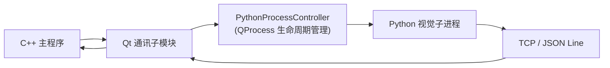

# Qt 子模块接入说明

本文档说明：当前 Qt 程序不是最终业务主程序，而是一个可复用的“Python 拉起 + 通讯桥接”子模块。  
后续移植到正式主程序时，Qt 代码应作为独立模块运行，由主程序统一管理窗口、业务逻辑和电机控制。

## 1. 当前定位

当前 Qt 工程只保留两类职责：

1. 通过 `QProcess` 拉起 Python 视觉子进程。
2. 通过本机 `TCP + JSON Line` 与 Python 进程建立通讯。

当前 Qt 程序**不直接负责**：

- 相机识别
- 姿态推理
- 机械臂控制
- RS485 / Modbus / ZMC 驱动

也就是说，这一层只做“启动器 + 通讯通道 + 状态展示”，不做最终业务决策。

---

## 2. 子模块化后的目标形态

将来正式主程序接入时，建议把当前 Qt 工程看作一个“通讯子模块”：

- 主程序负责总窗口、业务调度、硬件控制
- 当前 Qt 子模块负责 Python 生命周期管理和数据接收
- Python 侧负责视觉识别和姿态输出

### 推荐调用链

---

## 3. 当前代码中应当保留的核心能力

### 3.1 PythonProcessController

建议继续保留，作为 Python 进程生命周期管理器。

核心能力：

- 启动 Python
- 停止 Python
- 重启 Python
- 捕获 stdout / stderr
- 监听崩溃与退出状态

设计价值：

- Python 崩溃不会拖垮 Qt 主程序
- 主程序与 Python 可以独立开发、独立调试
- 适合后续嵌入正式 Qt 主工程

### 3.2 LocalCommBridge

建议继续保留，作为本地 TCP 通讯桥。

核心能力：

- 监听本机端口
- 接收 Python 发送的 JSON 消息
- 发送 `cmd / shutdown / ping` 等控制消息
- 向上层抛出标准化消息事件

### 3.3 JsonProtocol

建议继续保留，作为双方通讯协议定义。

当前协议建议保持“行协议”：

- 每条消息是一个完整 JSON 对象
- 以换行符 `\n` 作为帧边界
- 便于 Qt 和 Python 分别解析

---

## 4. 当前建议的职责边界

### Qt 子模块负责

- 读取启动配置
- 启动 / 停止 / 重启 Python
- 建立本地 TCP 通讯
- 接收 Python 的姿态数据
- 输出简洁日志与状态

### 主程序负责

- 总体界面框架
- 业务流程编排
- 姿态数据的进一步映射
- 电机控制策略
- RS485 / Modbus / ZMC 通讯

### Python 侧负责

- 摄像头采集
- MediaPipe 关键点识别
- 角度计算
- 姿态数据上报

---

## 5. 对外接口建议

为了后续能作为子模块嵌入正式主程序，Qt 这层建议对外只暴露少量稳定接口。

### 5.1 生命周期接口

- `startPython()`
- `stopPython()`
- `restartPython()`
- `isRunning()`

### 5.2 配置接口

建议保留以下配置项，并允许主程序覆盖：

- `pythonExecutable`：Python 可执行文件
- `projectRoot`：Python 项目根目录
- `module`：Python 入口模块
- `host`：监听地址，默认 `127.0.0.1`
- `port`：监听端口，默认 `5001`
- `clientName`：客户端名称

### 5.3 事件 / 信号接口

建议保留以下信号，供主程序接收：

- `started`
- `finished`
- `crashed`
- `stdoutLine`
- `stderrLine`
- `statusChanged`
- `errorOccurred`
- `messageReceived`

其中 `messageReceived` 应只承载已经解析好的 JSON 消息，避免上层重复做低层解析。

---

## 6. 数据交接边界

当前验证阶段，Qt 不直接做电机控制决策，只负责把 Python 的识别结果转成标准消息。

建议数据交接遵循如下原则：

1. Python 输出结构化姿态数据。
2. Qt 子模块只负责接收和透传。
3. 主程序根据自己的控制逻辑决定是否下发电机动作。

### 典型交接内容

当前测试阶段，Qt 侧重点可放在以下数据：

- `motor_6`
- `motor_commands`
- `pose_valid`
- `motion_allowed`
- `filter_reason`

主程序拿到这些字段后，再映射到实际电机控制层。

---

## 7. 推荐的模块拆分方式

如果后续要将当前 Qt 代码真正并入正式主程序，建议拆成两层：

### 7.1 核心通讯层

只保留以下能力：

- `PythonProcessController`
- `LocalCommBridge`
- `JsonProtocol`

这一层可以作为独立库或子模块复用。

### 7.2 演示 UI 层

当前的 `MainWindow` 更适合继续作为测试壳：

- 展示日志
- 展示连接状态
- 提供启动 / 停止按钮
- 提供路径选择

正式主程序中，如果已有自己的界面，可以不直接复用这套 UI，只复用核心通讯层。

---

## 8. 后续接入正式主程序的步骤

### 第一步：把 Qt 通讯层独立出来

将当前工程中的核心类抽成独立模块，主程序仅链接该模块。

### 第二步：由主程序创建和管理模块对象

主程序负责：

- 创建 Qt 通讯模块实例
- 配置 Python 路径和工作目录
- 连接信号 / 槽
- 控制启动和停止

### 第三步：接收 Python 姿态消息

主程序从 `messageReceived` 中拿到标准化 JSON，再交给运动控制层。

### 第四步：将姿态结果映射到电机

这一步不属于当前 Qt 子模块职责，应由正式主程序或独立电机控制模块完成。

---

## 9. 当前工程已经具备的子模块化前提

当前 Qt 工程已经具备较好的子模块化基础：

- Python 路径可配置，不再强依赖固定电脑路径
- Python 进程由 `QProcess` 管理
- 通讯协议已经标准化为 JSON Line
- 识别数据与电机控制已按职责分层
- Python 崩溃不会直接影响 Qt 主程序

因此，当前工程更适合继续演进为“正式主程序中的通讯子模块”，而不是把它当作独立业务主程序长期维护。

---

## 10. 最终建议

正式主程序接入时，推荐采用下面的原则：

1. Qt 子模块只管拉起 Python 和通讯。
2. Python 只管识别与回传结构化数据。
3. 主程序只管业务编排与电机控制。
4. 三者之间只通过稳定的 JSON 协议交互。

这样做的好处是：

- 接口清晰
- 便于单独调试
- 便于后续替换识别算法
- 便于移植到正式项目
- 便于电机控制和视觉识别解耦

